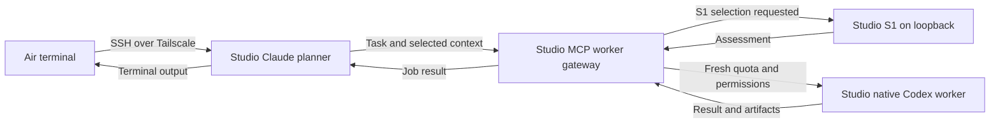

<!-- PURPOSE: Use the existing Studio planner and worker service from the MacBook Air.
     CONTRACT: Existing RT-MCP-001 installation; Forest selected SSH terminal operation.
     DEPENDS: Studio user-scoped Claude MCP registration, Tailscale and macOS SSH. -->
# Use the Studio from the MacBook Air

Forest selected this arrangement on 2026-10-17: Claude Code, the MCP worker service, S1 and native
workers run on the Mac Studio. The Air is the terminal. Forest already connects with
`ssh velox@forests-mac-studio` over Tailscale. The existing Studio user-scoped MCP registration is
available to Claude in that SSH session; a separate MCP installation on the Air is unnecessary.

## Connect and open a project

Run this in Terminal on the Air:

```sh
ssh velox@forests-mac-studio
```

Inside that Studio shell, check the existing setup:

```sh
/opt/homebrew/bin/claude auth status --text
/opt/homebrew/bin/claude mcp get cortados-workers
```

The first command should identify your Claude subscription login. The second should report
`cortados-workers` as Connected. Authentication from the actual SSH session remains an operator
check: a Codex-launched child on the Studio has a different authentication environment and is not
proof that the SSH session is signed in. Do not paste credentials or full authentication files into
a chat. If the SSH session is signed out, use the normal `claude auth login` flow in that session.

Choose a **Studio** project directory, then start Claude. For the standalone router checkout:

```sh
cd /Users/velox/.cortados-builds/cortados-router-repo
/opt/homebrew/bin/claude
```

In Claude, `/mcp` should list `cortados-workers`. A useful initial instruction is:

> Keep planning and review in this Claude session. Use cortados-workers context_requirements to
> identify the evidence needed, then delegate suitable tasks with S1 selection. Provide the Studio
> project path, relevant context and explicit permissions. Retrieve the worker result, review it,
> and report verified outcomes through job_feedback.

All paths supplied to the workers refer to files on the Studio. A project stored only on the Air
must first be made available on the Studio through your normal project workflow.

To open Claude directly in the Studio home directory from the Air:

```sh
ssh -t velox@forests-mac-studio /opt/homebrew/bin/claude
```

To return to a saved conversation, reconnect, enter its Studio project directory, and run
`/opt/homebrew/bin/claude --resume`. An SSH disconnect may end an interactive planner process;
resume is not a promise of uninterrupted execution. Accepted MCP jobs have their own durable broker
and can be inspected after reconnection.

## Where the work runs



S1 assesses a delegated assignment and helps select a worker. The gateway carries the assignment
and result; S1 does not process every worker output token. Claude's own planner calls still use
Claude's native subscription session. The installed worker backend is Codex; the wider fleet's
Claude, Cursor and Antigravity lanes are separate integrations. This setup does not turn those
lanes into new MCP worker backends.

S1 stays at `http://127.0.0.1:8431` on the Studio. SSH provides the remote terminal, so this arrangement
needs no public S1 port or HTTP MCP endpoint. Credentials, worker state and project files remain on
the Studio. Workers receive only configured, explicitly granted connectors; Claude's connectors
and in-memory sessions are not automatically inherited.

## Verified boundary

On 2026-10-17 the Studio's Tailscale connection was online, its SSH server answered on port 22, S1
reported healthy, and the absolute Claude binary reported the MCP service Connected even with a
minimal shell environment. Forest supplied the working Air SSH command. The Air's actual Claude
authentication and interactive `/mcp` view have not yet been observed by this task.

The Studio ED25519 SSH host-key fingerprint observed locally was
`SHA256:uDETlgUpV2iK3whoYKeINlTWf1GOW7xD25116jI4LAI`. Preserve normal SSH host verification.
If a previously saved host key changes, investigate it rather than disabling the check.

The active release and quota limitations are recorded in [INSTALLATION.md](INSTALLATION.md) and
[QUOTA-OPERATIONS.md](QUOTA-OPERATIONS.md). The quota-source repair is still under independent
contract/QA review; the connectivity checks above do not claim that repair has been installed.
