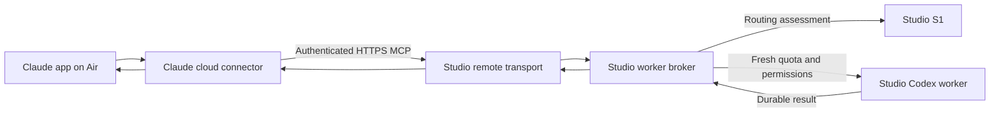

<!-- PURPOSE: Define the requested Air Claude app connection and remaining prerequisites.
     STATUS: Authorized build in preimplementation QA; no installed remote service.
     DEPENDS: Existing RT-MCP-001 broker, explicit access scope and Claude authentication UI. -->
# Claude app on Air → Studio workers

Forest requested this arrangement on 2026-10-17, replacing the SSH terminal as the preferred planner
interface. Forest then clarified that **Cowork is the general-purpose orchestrator**: tasks may involve
documents, analysis, research or other work, and need not belong to a repository. The earlier proposal
to restrict the interface to two repositories was not accepted and is superseded.

Cowork holds the planner conversation and its own file/connector access. S1, the MCP broker, native
worker sessions and subscription login remain on the Studio. Files local to the Air stay there unless
explicitly transferred. Workers receive task context and inputs through the gateway; they do not
automatically see Cowork's filesystem, connectors, permissions, chat history or skills.

## Verified prerequisites

Claude custom URL connectors originate from Anthropic's cloud and need a publicly reachable server.
A private tailnet address alone is insufficient. Local Desktop connectors use a separate mechanism.
See [Claude network requirements](https://support.claude.com/en/articles/11175166-get-started-with-custom-connectors-using-remote-mcp).

The Studio currently exposes only local stdio MCP. Its low-level official SDK registration is in
`integrations/mcp/server.py`; broker setup is in `integrations/mcp/__main__.py`. There is no authenticated
HTTP listener. Existing tool descriptions already explain evidence collection, delegation and review.

On October 17 at 20:35 Toronto, the host's Tailscale status showed private HTTPS port 443 forwarding
to `127.0.0.1:8432`. There was no public Funnel configuration. Preserve that unrelated private route.
A proposed independent public endpoint is
`https://forests-mac-studio.tailb38028.ts.net:8443/mcp`; this is **not active**. Tailscale supports public
HTTPS on port 8443, but Claude's actual connection to it still needs verification.
See [Funnel ports and proxy behavior](https://tailscale.com/docs/reference/tailscale-cli/funnel).

Forest confirmed that the Air's connector dialog has only URL and OAuth settings. Use an OAuth
connection design; fixed request headers are unavailable in this account's observed UI. The OAuth
identity provider and provisioning remain unresolved. See
[Claude authentication controls](https://claude.com/docs/connectors/custom/add-unlisted).

## General-task workflow

1. Cowork reads or retrieves the inputs through its own authorized tools and breaks the user's work
   into bounded assignments. It calls `context_requirements` to identify missing task evidence.
2. Cowork supplies the objective, relevant context, required capabilities and verification criteria.
   The proposed gateway creates a private Studio working folder for the assignment automatically;
   users do not have to select a repository or invent a Studio path.
3. S1 assesses the assignment and the gateway applies current quota and permission checks before
   starting an eligible worker. The initial implemented backend remains native Codex.
4. The worker produces a result for Cowork to inspect. A document or spreadsheet workflow additionally
   needs explicit artifact import/export; the existing service does not yet offer generic file transfer.
5. Cowork reviews the result, records feedback and performs follow-on operations using its own tools.
   A worker can use a connector directly only when that connector is separately configured and granted
   on the Studio. The MCP connection is not automatic access to every tool available in Cowork.

For example, Cowork can read a spreadsheet on the Air, delegate analysis of selected rows, and apply
the reviewed result to the original spreadsheet. It need not send the whole filesystem or expose a
repository. Opaque binary-file transport, downloadable artifacts, retention and deletion need their
own explicit contract and real Cowork verification; text context alone does not establish those paths.

## Proposed ownership and boundaries

- Compose the maintained SDK remote transport with the reviewed remote task/file schemas. Ordinary
  stdio schemas remain unchanged. Keep execution, routing, quota and feedback in their existing owners.
- Authenticate before handling any MCP request. Use a dedicated connector identity and isolated broker
  state; enforce that identity on job reads, cancellation and feedback as well as delegation.
- Replace the remote repository-selection proposal with gateway-owned task workspaces. This is a
  proposal for the new remote interface, not permission to broaden access to arbitrary Studio paths.
  Keep existing local callers compatible. The contract must bind workspace creation, input provenance,
  output retrieval and native sandbox permissions to the authenticated task owner.
- Keep strict fresh subscription quota checks, explicit/S1 selection, existing timeouts and durable jobs.
  Shell network remains off and connector grants remain empty unless separately configured and granted.
- Keep S1 on loopback. The remote transport carries tasks and results; S1 only assesses assignments.
  Claude app connectors and chat context do not automatically transfer into the worker harness.
- Teach the app planner through MCP instructions/tool descriptions and a short project instruction:
  call `context_requirements`, provide task evidence and explicit inputs, delegate, inspect the result,
  and record reviewed feedback. The app does not automatically load Studio `~/.claude/CLAUDE.md`.

## Build and activation gates

The [current RT008 core contract](COWORK-MCP-008.md) defines parameterized task folders, file transfer,
identity isolation and durable execution. The designated independent MCP QA owner reviews D, authors
and commits protected exams, then reviews A before a core builder starts through `cortados-workers`.
OAuth composition has a separate qualification gate. Live identity, limits and retention remain pending
operator choices; these do not block testing local parameterized enforcement.

Acceptance must cover unauthenticated and wrong-identity rejection, path/symlink containment, existing
tool schemas and limits, durable jobs across HTTP disconnects, quota refusal, connector grants and
credential-safe diagnostics. Run the full accumulated scoped suite and a real authenticated MCP
initialize/list-tools/context/delegate/result/feedback check before claiming the app is connected.
Record baseline/candidate transport latency without mixing it with S1 or model-generation latency.

Public activation follows local authentication/authorization verification. Confirm existing private
Tailscale routing is unchanged, verify public requests without credentials are rejected, then verify
the Air app connection. No endpoint, authentication secret, launchd service or public sharing was
created by this planning step.

The core contract is frozen for independent review at commit65e2dbb. No implementation or deployment is
claimed by this planning record. Full Cowork tool inheritance is not supported by the current service.

Source review confirmed that `integrations/mcp/codex.py` already uses `--skip-git-repo-check`: a
repository is unnecessary. `schemas.py` currently requires an existing absolute working directory;
the new task-folder lifecycle is missing. Results currently deliver text plus local evidence paths,
not arbitrary generated files. The existing `workspace-write` profile limits writes, but this review
does not establish that reads are confined to the task folder. Read-only MCP investigation job
`c6a63857-22d3-47d6-816b-d0a794ce5603` was independently checked by the planner and accepted; it is
source evidence, not an end-to-end Cowork test.

## How Cowork will use the connector after activation

The connector will advertise its tools and delegation instructions through MCP initialization and
tool descriptions. A task in the Air app does not load Studio shell instruction files automatically.
The following planner instruction can also be added to a Claude project after the connector is verified:

> Use CortadOS Studio Workers for bounded delegated work. Keep planning and final review in this
> conversation. Call context_requirements before route or delegate and answer its questions with
> relevant evidence. Reuse one task_group_id across revisions. Create a task folder through task_create;
> do not supply Studio paths. Upload only the selected input files using the returned transfer ticket,
> then include their sealed artifact IDs in the assignment. Use S1 when available or an explicit
> configured model; respect every fresh-quota refusal. Save the returned job_id and inspect that job
> after reconnecting instead of starting another attempt. Retrieve and inspect the result and output
> files, verify their hashes, and record honest job_feedback. Ask for missing context instead of
> assuming Studio workers inherit this conversation or its connectors. Delete task payloads only when
> requested.

Expected file journey: Cowork reads the selected local/cloud input through its authorized tools,
computes its byte count and SHA256, requests an upload ticket, and sends the raw bytes with the ticket
in the Authorization header. After the worker finishes, Cowork requests download tickets for the
published artifact IDs, downloads the bytes, verifies length/hash and materializes the files for review.
Ticket credentials are scoped temporary transfer authority; they are not Codex login credentials or
Claude's OAuth connector token. Keep them out of command traces and saved documents.

Actual upload/download from this account remains a release test. Official
[custom-connector guidance](https://support.claude.com/en/articles/11175166-get-started-with-custom-connectors-using-remote-mcp)
confirms that MCP calls originate in Anthropic's cloud. The separate
[Cowork architecture guide](https://support.claude.com/en/articles/14479288-claude-cowork-architecture-overview)
states that code execution egress follows network policy and that connector OAuth tokens do not enter
the execution sandbox. Therefore successful MCP login alone does not prove raw file transfer works.
Verify destination access, ticket-header egress and exact binary materialization in Cowork before
claiming the connection complete. No SSH, copied subscription credentials, or hidden companion is
part of this intended user flow.
