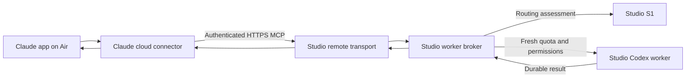

<!-- PURPOSE: Define the requested Air Claude app connection and remaining prerequisites.
     STATUS: Proposal only; not a signed contract or an installed remote service.
     DEPENDS: Existing RT-MCP-001 broker, explicit access scope and Claude authentication UI. -->
# Claude app on Air → Studio workers

Forest requested this arrangement on 2026-10-17, replacing the SSH terminal as the preferred planner
interface. The Air's Claude app holds the planner conversation. S1, the MCP broker, native Codex
worker sessions, project files and subscription login remain on the Studio. Claude app conversations
are not Studio Claude Code sessions; workers receive the context explicitly included in each task.

## Verified prerequisites

Claude custom URL connectors originate from Anthropic's cloud and need a publicly reachable server.
A private tailnet address alone is insufficient. Local Desktop connectors use a separate mechanism.
See [Claude network requirements](https://support.claude.com/en/articles/11175166-get-started-with-custom-connectors-using-remote-mcp).

The Studio currently exposes only local stdio MCP. Its low-level official SDK registration is in
`integrations/mcp/server.py`; broker setup is in `integrations/mcp/__main__.py`. There is no authenticated
HTTP listener. Existing tool descriptions already explain evidence collection, delegation and review.

On October 17 at 20:35 Toronto, the host's Tailscale status showed private HTTPS port 443 forwarding
to `127.0.0.1:8432`. There was no public Funnel configuration. Preserve that unrelated private route.
A proposed independent public endpoint is
`https://forests-mac-studio.tailb38028.ts.net:8443/mcp`; this is **not active**. Tailscale supports public
HTTPS on port 8443, but Claude's actual connection to it still needs verification.
See [Funnel ports and proxy behavior](https://tailscale.com/docs/reference/tailscale-cli/funnel).

Claude supports OAuth. Fixed request-header credentials are another option, but that UI is in limited
beta. Forest has been asked which controls the Air app exposes. Do not assume fixed-header availability
or put a credential in a URL. See [Claude authentication controls](https://claude.com/docs/connectors/custom/add-unlisted#authenticate-with-request-headers).

## Proposed ownership and boundaries

- Extend the existing MCP registration so stdio and HTTP share the same validated tool definitions.
  Use the maintained SDK transport; keep execution, idempotency, quota and feedback in existing owners.
- Authenticate before handling any MCP request. Use a dedicated connector identity and isolated broker
  state; enforce that identity on job reads, cancellation and feedback as well as delegation.
- Forest's proposed initial launch roots are `/Users/velox/.cortados-builds/cortados-router-repo` and
  `/Users/velox/cortados`. Approval is pending. Resolve and validate paths on the Studio before admission.
  A launch-root allowlist alone is not a complete read-access sandbox; the contract must accurately
  specify the existing native execution permissions and any additional confinement.
- Keep strict fresh subscription quota checks, explicit/S1 selection, existing timeouts and durable jobs.
  Shell network remains off and connector grants remain empty unless separately configured and granted.
- Keep S1 on loopback. The remote transport carries tasks and results; S1 only assesses assignments.
  Claude app connectors and chat context do not automatically transfer into the worker harness.
- Teach the app planner through MCP instructions/tool descriptions and a short project instruction:
  call `context_requirements`, provide evidence and a Studio project path, delegate, inspect the result,
  and record reviewed feedback. The app does not automatically load Studio `~/.claude/CLAUDE.md`.

## Build and activation gates

Authentication choice and launch-root scope must be resolved before freezing the observable contract.
The designated independent MCP QA owner then reviews the contract and owns committed acceptance tests
before a builder starts. The builder must use `cortados-workers` with that contract and bounded evidence.

Acceptance must cover unauthenticated and wrong-identity rejection, path/symlink containment, existing
tool schemas and limits, durable jobs across HTTP disconnects, quota refusal, connector grants and
credential-safe diagnostics. Run the full accumulated scoped suite and a real authenticated MCP
initialize/list-tools/context/delegate/result/feedback check before claiming the app is connected.
Record baseline/candidate transport latency without mixing it with S1 or model-generation latency.

Public activation follows local authentication/authorization verification. Confirm existing private
Tailscale routing is unchanged, verify public requests without credentials are rejected, then verify
the Air app connection. No endpoint, authentication secret, launchd service or public sharing was
created by this planning step.

If the app lacks request headers, OAuth needs a concrete approved identity-provider design. A local
Claude Desktop connector that invokes the existing SSH transport automatically is an alternative
without a visible terminal or public endpoint; it is not the requested custom URL connector.
