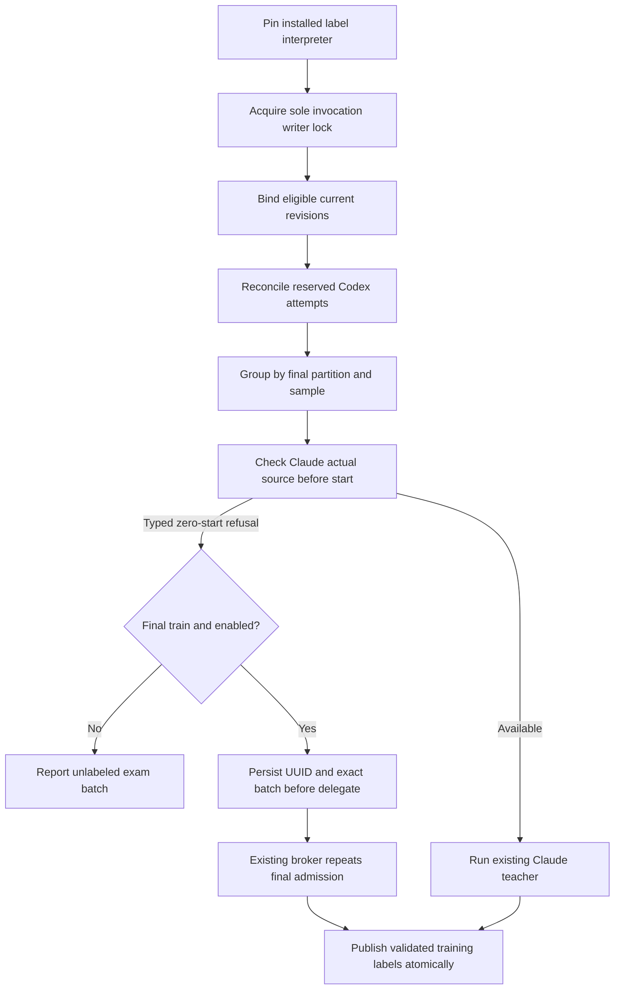
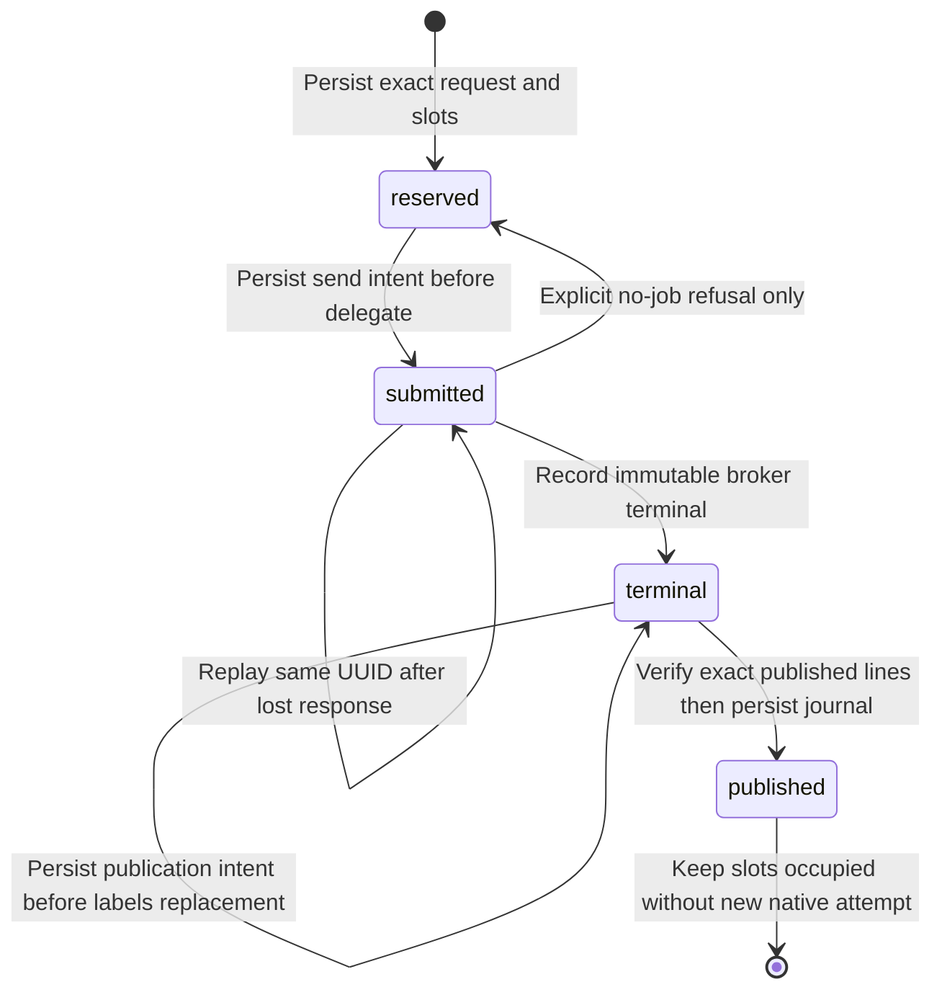

<!-- PURPOSE: Add a subscription fallback only for new final-training labels.
     CEILING: Preserve validation/holdout labels, gates, quota, permissions and budgets. -->
---
contract_id: RT-TRAINING-TEACHER-007
contract_version: 1
owner: Forest
author: /root/quota_repair_contract
status: design_error
implements: [RT-MCP-LEARNING-003, RT-FRESH-QUOTA-005, RT-QUOTA-SOURCES-006]
exam_owner: /root/quota_evaluation_qa
depends_on: [RT-MCP-001, RT-MCP-LEARNING-003, RT-FRESH-QUOTA-005, RT-QUOTA-SOURCES-006]
blocks: []
attempt_ledger: [{attempt: 1, result: failed, review: acceptance/training_teacher/B1-REVIEW.json}, {attempt: 2, result: design_error, review: acceptance/training_teacher/B2-REVIEW.json}]
D: 0
A: 0
B: 1
---

# Codex fallback for new training labels

Forest explicitly authorized a Codex subscription fallback for NEW TRAINING labels, preserving
existing held-out evaluation labels and promotion gates. Claude remains primary when verifiably
available. This draft proposes the already captured/allowlisted `gpt-6.1-sol` backup. It grants no
model calls, label writes, builder dispatch or activation until independent D0/A0 and frozen exams.
It does not amend the global decisions log. The parent must convey this user authorization to the
contract-owner session as the narrow extension of D-0016's Claude-only labeling description.

## 1. Inspected baseline and actual gaps

Production baseline is `bd01f179`; latest parent-reported standalone HEAD is `3ef7169` (documentation afterward).
Read the shared `docs/DECISIONS.md`, `contracts/CONVENTIONS.md` and pinned ab1b521 standards. Prior
scoped Router/MCP inventory is 695 passing tests, not a whole-CortadOS pass. Installed 006 release
broker, worker, native_metadata, codex, job_store and learning_data bytes match standalone sources.
No model, HTTP quota or native process was launched during authoring.

* Shared `train/label.py` has strict actual-source Claude checks; standalone `s1/label.py` still has
  the older direct Claude call. Neither is a reusable Codex execution owner.
* Resume is `(id,teacher,sample)`. Simply changing `teacher` creates extra samples for already
  labeled requests. In-process `_write` does not exclude another label process, duplicate answer
  indices are accepted, and an append interrupted mid-line is not transactionally recoverable.
* `learning_data.bind_snapshot` owns immutable revision eligibility and final train/valid/holdout
  partitions, including historical split-conflict quarantine. A request with `split="train"` may
  actually be validation/calibration. Fallback MUST require final partition `train`.
* `build_sft` groups every label by request, irrespective of teacher. `evaluate` groups by request
  and uses the same final partitions. Therefore a falsely labeled fallback row in valid/holdout
  directly changes the exam. No evaluator change is needed or authorized to permit it.
* The existing broker has durable UUIDv4 request replay before routing, a sole JobStore writer,
  prelaunch admission, bounded watchdog, termination receipts and exact terminal artifact checks.
  Reuse these. Never instantiate JobStore in the label process or launch another Codex CLI harness.
* Default MCP Codex execution has workspace-write tools. The Claude teacher has `--tools ""`.
  This is an explicit difference from the old Claude invocation, not a binding tool-free requirement
  in RT-MCP-LEARNING-003 or D-0016. Independent QA confirms the authorized fallback may adopt the
  existing approved MCP permissions/profile/lifecycle unchanged; do not claim tool-free execution.
* Ordinary worker jobs become MCP learning observations. Teacher execution must not recursively
  enter the dataset as a new user task. Use the same broker implementation with a separate teacher
  state/client; do not tag arbitrary tasks heuristically or weaken the source collector.

## 2. Owner dispositions and exact proposed scope

| Responsibility | Disposition |
|---|---|
| `cortados_router/learning_data.py` | Adopt `bind_snapshot`, `teacher_payload`, `label_provenance`; no model calls or new split rules here. |
| `integrations/mcp/{broker,job_store,worker,native_metadata}.py` | Adopt unchanged lifecycle and transport; no direct DB writes or parallel watchdog. |
| `integrations/mcp/codex.py::native_arguments` | Adopt unchanged approved invocation, environment and event parsing; exact argv parity for identical arguments. |
| `integrations/mcp/config.py` | Extend closed config with optional teacher admission policy and scarcity ceiling; no native execution-profile change. |
| `cortados_router/worker_admission.py::admit` | Extend teacher-only scarcity gate using its existing admitted resource snapshot; retain all account/model/quota checks. |
| `cortados_router/teacher.py` (new) | Provider selection and broker client adapter; no process supervision, split arithmetic or durable label writing. |
| `cortados_router/teacher_attempts.py` (new) | Label batch/slot identity and publication owner, extracted from current label writer; no provider transport. |
| `s1/label.py` and staged `train/label.py` | Thin adapters to the same teacher/attempt owners; retain CLI defaults, prompts, questions and legacy override branch. |
| staged `train/nightly.sh` | Enable new owner only for the next invocation, before supervised re-exec. No cadence or promotion changes. |

Builder-writable standalone paths, once gaps are resolved and exams frozen:
`cortados_router/teacher.py`, `cortados_router/teacher_attempts.py`,
`cortados_router/worker_admission.py`, `integrations/mcp/config.py`, `s1/label.py`.
Activation-stage writable paths under `~/.cortados-builds/training-teacher-activation`:
`train/label.py`, `train/nightly.sh`. Parent prepared exact guarded source copies; `source-baseline.json` pins all nine inputs.
Only these two stage files are writable; the other seven copied dependencies remain read-only.
A new immutable release is proposed at
`~/.local/share/cortados-workers/releases/training-teacher-v1-20261017`.
No existing release is modified. Only the labeling invocation migrates its installed learning import to the new release; learning
owner bytes remain identical. Other consumers retain their pinned 006 release (§5).

Contract/index updates belong to the author/root: this document and `docs/mcp-worker/INDEX.md`.
Independent protected exams belong to `acceptance/training_teacher/` (new, initially missing).
Builder unit tests, if needed: `tests/test_training_teacher.py`, `tests/test_teacher_attempts.py`.
No wildcard grants. Each new source stays below 500 physical lines; oversized existing owners
receive only delegating call-site edits unless a split is independently agreed.

Explicit exclusions: shared direct production edits by this author; all evaluation/calibration,
SFT/weighting/temperature, split/hash/cleaner, feature anchors, promotion/current.json, checkpoints,
requests/observations/labels/overrides, learned costs, daemon schedules, credentials, subscription
selection, Claude/Agy source enablement, existing protected tests and global DECISIONS edits.
The operator may later publish authorized new labels only through the reviewed owner, not fixtures.

## 3. Selection, budgets and the preserved exam

1. Bind one `learning_data.bind_snapshot(DATA)` per invocation. Select only eligible current revisions.
   Preserve its exclusion reasons. Never independently re-hash a partition or move a row.
2. Fallback is enabled only by `CORTADOS_TRAINING_TEACHER_V1=1`, with the exact new installed owner
   origin verified. It is unavailable when learning eligibility is disabled/unavailable. `--only`
   never invokes fallback or replaces a historical label. Invalid modes fail before any call.
3. Claude remains `claude-sonnet-5` for training and `claude-opus-5` for holdout. Validation remains
   Claude-only. Attempt Claude admission first for a new unreserved batch. A typed pre-start quota
   unknown/spent, source unavailable, or existing scarcity-stop refusal may select Codex only for
   a homogeneous final-training batch. No string-regex fallback after arbitrary exceptions.
4. Other integrity, malformed-input, permission, origin and storage failures stop that work. A
   started Claude call is never followed by Codex on timeout, parse failure or uncertain outcome.
   A refused validation/holdout batch cannot stop already authorized training fallback selection;
   it remains explicitly unlabeled. No Codex row can be written for validation or holdout.
5. Preserve defaults k=3 independent samples, batch=12, workers=3, limit=0 and timeout=600 seconds.
   Do not turn a batch into per-row calls. Exact pending/planned budget semantics are below.
6. Codex uses explicit model `gpt-6.1-sol`, allowed_models containing only it, native-default ChatGPT
   subscription, network=false and no MCP grants. No S1 call selects the teacher. Unknown/reported
   model remains null; requested model is not relabeled as observed model. No API billing fallback.
7. Keep the existing scarcity ceiling 0.7. The teacher-specific `worker_admission.admit` checks
   `admission.resources.health()['codex']['scarcity']` from that same validated snapshot; missing,
   nonfinite or >= ceiling refuses before worker start. Recheck through existing broker launch
   admission. Ordinary workers retain their existing policy. This ceiling is inherited label
   conservation, not a new permission to spend. A higher --max-scarcity does not broaden the Codex
   ceiling; a lower requested ceiling must be captured in the reviewed teacher policy/config.
8. Both quota clocks must remain <=30 seconds and all existing source/account/inventory/profile/
   containment checks survive. A prior route, journal, label or quota receipt is never authorization.
   `capacity_exhausted`/`workspace_busy` create no new request ID or retry loop: report deferred.
9. Existing labels and all override files remain byte-for-byte unchanged as a prefix. Existing
   completed sample slots block new work independent of teacher. Historical duplicate slots are
   reported and left intact, never resolved by deleting evidence. New labels do not rewrite history.

### Exact planning and orchestration seams

`teacher.run_labels(*, data_dir, snapshot, options, system_prompt, claude_environment,
claude_cwd, worker_config_path, validate_answers, questions) -> RunSummary` is the single new
orchestration entrypoint called by both label adapters when enabled and --only is empty. Nonempty --only retains the existing override branch under
the same LabelAttempts process lock, never calls this fallback orchestrator, and never rewrites
full-label history. `options` has exactly
`{split,k,batch,workers,limit,max_scarcity,only}` with existing CLI types/defaults; validate all
before calls. `RunSummary` is `{planned_batches,reconciled_batches,deferred_batches,
published_labels,diagnostics}`; diagnostics contain only `{code,attempt_id|null}`, never prompts.
Existing adapter CLI output may render this summary without inventing success for deferred work.

Enabled007 with empty --only defines `--split train` as final `snapshot.partitions[id]=="train"`
ONLY. This deliberately narrows the old logical train selection that also contained calibration
rows; it changes selection, never partition assignment. `--split holdout` selects final holdout;
`--split all` retains primary handling for all three final partitions. --only and flagoff retain
legacy scope and never invoke fallback. Thus the bounded operator --splittrain check cannot write
validation/holdout labels, even when Claude becomes available.

Group the selected eligible requests by final snapshot partition before batching: train, valid, holdout.
For each group/sample, order by id, shuffle using `random.Random(f"{partition}-{sample}")`, then
chunk by --batch; shuffle the completed new-batch list with Random(7). Train and valid both use
Claude Sonnet primary; holdout uses Opus. Only train may fall back. Empty batches do not count.

All fallback threads share ONE `CodexTeacher` instance and one ordinary in-process admission lock.
Hold it from prior-pending reconciliation through delegate acceptance and terminal reconciliation;
release it after terminal/deferred result or when bounded waiting exits retaining pending state.
Other existing label executor threads wait on this lock, rather than submitting parallel requests
that predictably hit the single-slot/same-cwd broker. Waiting threads do not reserve an extra native
job; the existing --workers bound limits them, and there is no new queue, daemon or retry loop.
If a known pending job cannot be reconciled before its existing timeout/termination bounds, release
with a pending marker: later waiting threads defer without first submission or new request IDs.
A finite --limit counts an actually attempted planned batch as below, not waiting on this lock.

Reconcile every reserved/submitted/terminal Codex attempt first. Status/result reads are read-only.
Reconciliation of an already persisted submitted identity does not consume a new --limit planned
identity slot. Exact delegate replay may first accept that previously planned attempt if the crash
preceded broker receipt; it cannot create a second accepted job for the same UUID/arguments. A
submitted journal state does not prove a prior native start. A reserved-but-never-submitted batch
does consume one planned slot when first sent;
process those by journal insertion order before new batches. A finite --limit bounds the combined
number of these first submissions plus new Claude/planned batches in this invocation. A primary
zero-start refusal plus its Codex fallback is ONE planned slot, even if fallback is also refused.
A preacceptance refusal is deferred with its SAME request ID; it consumes its attempted slot for
this invocation and cannot spin/retry until a later invocation. Limit=0 retains existing unbounded
batch count, not unbounded concurrency. An accepted pending Codex job occupies a worker slot until
terminal reconciliation; its dedicated broker allows only one. At most --workers slots exist for
all current Claude/native work combined. Replayed pending work is never duplicated to fill a slot.

`teacher.call_claude(model, batch, *, system_prompt, environment, cwd, config,
max_scarcity) -> (answers, meta)` adopts the existing Claude argv/payload/subprocess behavior.
It reuses 006 prepare_actual/check_actual directly from the new installed owner, using the retained
actual argv/env/cwd and final check immediately before subprocess.run. It raises the private
`teacher.PreStartRefusal(reason)` ONLY before entering subprocess.run, with closed reasons
`quota_unknown`, `quota_spent`, `scarcity_stop`. Actual-source preparation's documented unproven
source result maps to quota_unknown; check status unknown/spent maps directly. The existing
Claude scarcity-stop gate maps to scarcity_stop. Filesystem/config/import/permission errors do not.
The owner must not wrap subprocess execution or output decoding in this conversion. All errors
at/after subprocess.run propagate as started-or-unknown failures; no regex or message comparison
can turn them into fallback permission. Tests inject the subprocess boundary and count starts.

`teacher.CodexTeacher.submit(arguments)`, `.status(job_id)`, `.result(job_id)` return existing
broker delegate/job_status/job_result payloads unchanged or raise existing WorkerError. They use
validate + broker.rpc; `submit` never rewrites request_id. Owner loading is specified in §5.

## 4. Durable slots and attempts

config_digest is supplied explicitly by CodexTeacher from SHA256 of its retained raw config bytes;
it is never smuggled into closed broker arguments or read from an implicit global.

Canonical label slot is `(request_revision_id, sample)` for full final-training labels. Any existing
full label occupying that slot, regardless of teacher, closes it for this extension. `sample` is a
nonboolean nonnegative integer below requested k. Revision and observation digest retain existing
meaning; a superseded revision's label cannot satisfy the latest revision. Existing override
matching `(id,teacher,sample)` is retained and is not a fallback input.

`teacher_attempts.LabelAttempts(data_dir, *, validate_answers, questions)` is a context manager
(`__enter__` acquires, `__exit__` releases without cancelling accepted jobs). It owns an exclusive process flock on
`DATA/.teacher-attempts/lock` for the labeling invocation. All candidate label paths participate;
thread tasks use its internal serialization. Busy lock refuses without calls. Activation requires
no old label process, because the old executable does not honor this new lock.

The journal subdirectory is created mode0700; manifest and lock are mode0600, owned by the
current user and never symlinks. Existing incompatible ownership/mode/symlink or DATA identity
refuses without chmod, repair or deletion. Do not chmod DATA (currently0755) or existing labels
(currently0644). Atomic label replacement preserves the original regular-file mode and exact
existing bytes; no secret material is added to public logs. A symlink/nonregular labels target
refuses. LabelAttempts validates its recorded DATA identity before every reconciliation/publication.

`reserve(batch, *, sample, system_prompt, arguments, config_digest, snapshot)` returns an immutable
Codex fallback attempt record after Claude has refused before start. This journal does not replace
Claude execution or introduce durable Claude attempt state. Before native send, atomically persist a private `DATA/.teacher-attempts/manifest.json`
manifest (0600, private subdirectory) with schema `cortados.teacher-attempts.v1`, monotonically increasing
revision and attempts. Each attempt contains random UUIDv4 `attempt_id` and Codex `request_id`,
ordered row IDs + immutable teacher payload, sample, prompt digest/content, provider=codex-cli/model=gpt-6.1-sol,
exact normalized broker arguments/config digest, state, nullable job_id/result digest and diagnostics.
Secrets/auth tokens are never included. Broker arguments necessarily contain private request text;
this file is local evidence, never committed/exported. This is execution mapping, not a second
canonical answer store or writer. New attempts cannot reserve occupied or already reserved slots.

Closed manifest schema (unknown/missing fields refuse; no implicit migrations):
`{schema,data_identity,revision,attempts}`. data_identity is exactly
`{path,device,inode}` for the resolved DATA directory; moving/replacing it refuses automatic replay. Revision is a nonnegative nonboolean integer. Attempts is an ordered
list of closed records with exactly:
`{attempt_id,request_id,row_ids,payload,sample,system_prompt,system_prompt_digest,provider,model,
arguments,config_digest,state,job_id,result_digest,terminal_state,publication_ts,publication_rows,
last_refusal}`. IDs are UUIDv4; row_ids are unique nonempty strings, payload is the existing
teacher_payload array in that order, sample is the slot integer, provider/model are fixed Codex
values, arguments are existing normalized closed delegate arguments, digests are SHA256 hex.
`system_prompt_digest` covers UTF-8 system_prompt. `last_refusal` is null or an existing WorkerError
code. `publication_rows` is null or ordered `{index,line_digest}` entries; publication_ts is null
or an integer epoch second fixed before first label publication. Terminal state is null or an
existing JobStore TERMINAL value. Result digest binds existing canonical terminal result bytes.
Journal/terminal object canonicalization uses existing `task_evidence.canonical(value)` UTF-8
bytes and SHA256 (it preserves every field). Config digest is SHA256 of exact raw config bytes,
as required by broker.rpc; system_prompt_digest is SHA256 of exact UTF-8 prompt bytes.
line_digest is SHA256 of the exact new UTF-8 JSONL line INCLUDING its final newline; new lines use
`task_evidence.canonical(row) + "\n"`. `schemas.canonical` is used ONLY for existing normalized
broker argument identity where excluding request_id is intentional. Persist request_id separately
and inside arguments and require equality. Never use schemas.canonical for arbitrary objects.

Reserved: job_id/result_digest/terminal_state/publication fields null. Submitted: job_id nullable
until exact delegate replay resolves it; terminal/publication fields null. Terminal: job_id,
result_digest and terminal_state required, publication fields either both null or both prepared.
Published: those terminal fields and publication fields required; published rows may be empty
for rejected/failed/missing answers. The terminal state never changes. Persist the publication
intent (timestamp and exact expected new-line digests) BEFORE atomic labels replacement so restart
can rebuild the same bytes from the immutable broker result. Canonical labels remain sole answer
authority; journal records identity and publication intent, not independently accepted answers.

`Attempt` is a plain JSON-compatible dict with exactly the fields above, returned as a deep copy;
caller mutation never updates canonical state. No serializable dataclass or hidden executable fields.
The constructor retains the existing `valid_answers` callable and ordered `QUESTIONS` tuple supplied
by the label adapter. They are not stored in the journal; installed-source pins and prompt identity
bind their version. Snapshot is the existing learning_data result, not caller-reclassified rows.

Exact LabelAttempts methods besides constructor: `pending() -> tuple[Attempt,...]`,
`reserve(...) -> Attempt` as above, `submitted(attempt_id) -> Attempt` (persist BEFORE delegate),
`bind_job(attempt_id, job_id) -> Attempt`, `defer(attempt_id, code) -> Attempt`,
`terminal(attempt_id, terminal_payload) -> Attempt`, and `publish(...) -> int` as below.
`defer` leaves a never-accepted attempt reserved only after an explicit broker refusal; a lost RPC
response remains submitted/unknown. Unexpected state/identity changes raise
WorkerError('storage_error','Teacher attempt state is invalid'). Writes use temp+fsync+replace+
parent fsync under the same invocation lock; corruption never resets IDs or deletes reservations.

Random UUIDv4 is generated once and persisted before send. A deterministic masked hash is not a
UUIDv4 substitute. Per-slot UUIDs would also multiply calls or lose batch identity. New invocation
planning first reconciles reserved batches, then shuffles only unreserved slots using existing seeds.
Changing batch size, limit, order, model preference or available quota cannot regroup a reserved batch.

State chain: `reserved -> submitted -> terminal -> published`; explicit pre-admission refusal stays
reserved/deferred with no job, while ambiguous RPC response remains submitted with unknown job_id.
The exact original delegate request is replayed to resolve that ambiguity: broker replay occurs
before admission and returns the same accepted job. Never invent a new UUID. Returned arguments,
config identity and job identity must agree. A changed config digest refuses reconciliation until
its original broker configuration is restored; no silent migration of an accepted attempt.

Poll existing `job_status`/`job_result` using the configured process_poll_ms cadence, bounded by the
existing 600-second attempt timeout plus existing termination grace. A frontend disconnect never
means cancellation or failure. Pending/containment-unknown work remains reserved. Codex native terminal
failure or invalid answer is recorded and never automatically re-executed under another teacher.
Claude exceptions retain their existing behavior, with no same-invocation fallback after start;
this package does not rewrite general Claude persistence/retry behavior. A future explicit retry policy is outside this package.

`publish(attempt_id, *, terminal, answers, snapshot)` is the sole full-label publisher. It revalidates
original row/revision/partition membership and result identity. Require successful contained native
terminal evidence and valid twelve-answer rows. Reject duplicate indices, bool indices, out-of-range
indices and conflicting results; do not manufacture missing answers. Independently valid unique
answers may be published once; missing/invalid slots remain terminal-unlabeled, not silently retried.
Any malformed top-level response, duplicate/bool/out-of-range index or non-object member rejects
the WHOLE response with zero labels. For a structurally valid array with unique indices, an
individual answer that fails the existing twelve-answer validator is omitted; other valid answers
may publish. Omitted indices are terminal-unlabeled. A failed native result always publishes zero.

Write existing exact labels bytes plus validated new lines to a private temp file, fsync, atomic
replace, fsync parent; then mark published. Crash after label replace but before manifest update is
reconciled from labels' attempt_id and exact payload, without a call or duplicate. Malformed/truncated
existing labels or conflicting attempt rows fail closed; do not truncate or repair history silently.
The new publisher handles fallback rows; migrated adapters delegate existing full-label writes
through the same owner so there is one writer and training-slot occupancy is checked under the
same lock. Claude execution, answer representation and non-fallback retry behavior stay otherwise
unchanged. Override branch retains its existing representation and also acquires the same lock.

Additional single-writer methods for existing Claude paths:
`publish_claude(batch, *, model, sample, answers, meta, snapshot) -> int` emits existing full-label
shape and learning_data.label_provenance, preserving Claude accounting in the adapter. It checks
full-training slot occupancy against all teachers and reserved fallback slots under the same lock.
Its non-training `(id,teacher,sample)` resume rule remains unchanged. snapshot may be None ONLY
for the retained learning-disabled Claude branch; that branch has no fallback and uses existing
legacy row/split selection. None is forbidden for reserve and Codex publication. All branches
consult occupied/reserved fallback slots before writing a full training label. It does not create Codex
attempt records or teacher_execution fields. Existing Claude row validation is retained; a duplicate
training index cannot publish the same slot twice.
`publish_override(batch, *, model, sample, answers, only, defaults, snapshot) -> int` retains the
existing partial-answer validation (`valid_answers({**defaults,**selected_answers})`), override=true,
existing provenance and filename `labels-override-<joined only>.jsonl`. Unknown question names refuse;
only QUESTIONS are allowed. It never calls Codex or modifies full labels. Both methods own writing;
adapters must not append independently. `defaults` and `only` are the existing adapter constants/CLI
values, not a new answer-generation policy. Existing output file modes/prefix bytes are preserved.

## 5. Truthful provenance and one transport

Every new fallback label retains existing `{id,teacher,sample,ts,answers}` plus existing MCP
`label_provenance(row)`. `teacher` is exactly `gpt-6.1-sol`. Add
`teacher_execution={schema:'cortados.teacher-execution.v1',provider:'codex-cli',
requested_model:'gpt-6.1-sol',reported_model:null,job_id,request_id,attempt_id,cli_version,
result_digest}`. attempt_id lives ONLY inside teacher_execution, not at the label top level.
Reconciliation reads that exact nested field together with id/sample and exact line digest.
The result digest binds exact canonical successful terminal evidence, not quota
permission. Actual native usage fields stay nullable; no fabricated tokens, account identity,
cost, Claude session ID, or claim that native completion proves labeling quality.

`teacher.codex_arguments(batch, *, sample, system_prompt, request_id, cwd)` builds the existing
closed delegate shape: task contains unchanged teacher system instructions, context contains
`json.dumps(learning_data.teacher_payload(batch),ensure_ascii=False)`, explicit selection and
constraints as §3, permissions false/empty, timeout_s=600, account_ref=native-default. Native
`task_evidence.handoff` remains the sole wire assembly owner. Prompt fixtures pin exact bytes and
instruction/data attribution. No output extraction from arbitrary log lines: consume successful
`job_result.result.summary`, whose native final artifact equality is already verified by the worker.
The existing label answer validator remains canonical, with stricter index uniqueness at publication.

`teacher.CodexTeacher(config_path)` loads exact config bytes/digest and uses the installed
`broker.ensure_broker`/`broker.rpc` protocol. Every migrated label invocation, flag on OR off,
runs under `<new-release>/venv/bin/python` before any project or cortados_router import. Nightly
names exactly that interpreter with `-B <shared-repo>/train/label.py --workers 3`. Manual calls under
another interpreter re-exec once via stdlib `os.execve`: fixed absolute new interpreter,
`[interpreter,"-B",resolved_label_script,*original_argv[1:]]`, copied environment plus
`CORTADOS_TEACHER_REEXEC_V1="1"`. Never resolve the interpreter symlink away from its venv.
If normalized sys.executable or sys.prefix still differs from the fixed venv after the marker,
raise RuntimeError('teacher_release_mismatch') before imports/writes/calls. Missing expected
interpreter also refuses; no alternate Python/PATH fallback. A preexisting marker on a wrong
interpreter refuses instead of looping. No new helper CLI or request-response subprocess protocol.

Both adapters load the pinned newrelease teacher_attempts owner and acquire its one invocation
lock BEFORE branching on fallback/learning/override flags. Flagoff preserves primary selection,
answer representation and no Codex fallback, but cannot bypass this lock or reserved-slot checks.
After idle-boundary activation there is no writable current label path unaware of the lock;
predeployment processes must have exited before replacement. This replaces only the former
flagoff-origin guarantee, not its primary-only behavior. Re-exec changes only the child environment.

The shared label adapter's learning-enabled branch accepts the existing exact
CORTADOS_MCP_LEARNING_SITE_PACKAGES=006 literal as the other phases' inherited binding, but imports
its own byte-identical learning_data from the fixed newrelease literal. It checks the exact origins
of teacher, teacher_attempts and learning_data there, plus exact sys.executable/prefix, before work.
It never imports old006 learning_data first, edits sys.modules, or changes the parent's environment.
Teacher flag1 requires learning flag1 and that inherited006 literal; mismatches refuse fallback.
If learning is off, its existing legacy selection remains, under the same new writer lock; no
Codex fallback can run. The new release learning_data/learning_source/task_evidence and quota owner
bytes match accepted006 bytes. Dataset/build/evaluate and their existing global environment stay006.
Broker creation consequently inherits the verified new interpreter. No schema bypass, private
JobStore write, direct Codex Popen, separate quota cache or usage ledger.
Broker terminal result is the usage evidence; do not record these calls as runtime=claude.

Proposed separate deployment config: `~/.config/cortados-workers/teacher.json`, client_id
`s1-teacher`, state_dir `~/.local/state/cortados-teacher-workers`, same existing codex_bin/codex_home,
allowlist only `gpt-6.1-sol`, allow_network=false, connector_registry={}, max_concurrent_jobs=1.
All other bounds inherit the existing pinned operator limits; max_timeout_s=600. The existing
--workers=3 limit counts all Claude plus Codex label work together, including pending accepted jobs
reconciled after restart. The dedicated broker permits one Codex label attempt at a time within
that existing labeling budget; it never creates a fourth label worker. Deferral uses the existing
next-invocation work selection, not a new background queue or retry loop. Dedicated private empty
cwd is `state_dir/teacher-cwd`, not training data or a repository.
No collector is pointed at this state. The inherited native worker may expose shell, file reads and apply_patch; sandbox reads may extend
beyond cwd. An empty cwd, disabled network and empty MCP grants do not make this tool-free or
a filesystem read-isolation boundary. No additional native capability or permission is enabled.
No public MCP entry, launchd schedule or listening network port. The broker starts on demand through its existing owner and remains the only job-store writer.

Closed admission-policy configuration fields (never task text):

* `teacher_policy`: optional exact string `"training_labels_v1"`. Absent preserves existing
  normalized configuration bytes and behavior; no implicit `worker` field is inserted. This
  marks only the teacher admission policy, never native invocation settings or a public tool.
* `teacher_max_scarcity`: required iff teacher_policy is present; finite JSON number excluding
  bool in [0,0.7], forbidden otherwise. The normal teacher config freezes 0.7. Label CLI requires
  its requested --max-scarcity to equal this value for fallback; mismatch emits
  `WorkerError("invalid_request", "Teacher scarcity policy differs from requested ceiling")`
  and refuses fallback, never rewrites a running broker's config. An
  explicitly approved lower config is valid; values above 0.7 are not enabled by this package.

Config validation requires teacher-policy allowlist exactly [`gpt-6.1-sol`], network false,
empty connector registry, max_concurrent_jobs=1 and max_timeout_s=600; other existing limits remain
unchanged, including metadata_max_age_s=30. `worker_admission.admit` is the only interpreter of this
policy/ceiling, including final broker launch admission. Known scarcity >= ceiling raises existing
`WorkerError("permission_refused", "Teacher scarcity ceiling reached")`; unknown/invalid scarcity
raises `WorkerError("quota_unknown", "Teacher scarcity is unavailable")`. No new public error code. Native argv/environment and lifecycle owners
remain unchanged. Existing closed public tool/delegate schemas remain unchanged. Missing/unknown
teacher policy or ceiling refuses fallback; an ordinary worker config cannot opt into teacher work
merely by placing instructions in its task text.

## 6. Independent acceptance and fixtures

QA authors privacy-preserving fixtures; builders never edit protected acceptance. Minimum cases:

* AC-T01: Claude available selects Claude; typed zero-start refusal selects Codex only for final
  train; validation/holdout/--only and excluded/superseded revisions cause zero fallback starts.
  Enabled --splittrain never calls either teacher or writes labels for final validation/holdout;
  --splitall retains their existing Claude primary behavior, and partition assignments never change.
* AC-T02: immutable existing labels/overrides and holdout+validation identity before/after; exact
  partitions unchanged; duplicate fingerprint/group revisions quarantine through existing owner.
* AC-T03: all-teacher slot occupancy, mixed existing samples, k/batch/limit changes, reordered rows,
  duplicate output indices, partial response, malformed tail and two concurrent label invocations.
* AC-T04: crash before/after manifest fsync, after delegate acceptance before response, during polling,
  after terminal, before/after atomic label replacement; same UUID/args replay and exactly one native
  execution, no duplicate labels. Storage/config conflicts fail loudly without new attempt.
* AC-T05: spent/unknown/stale/both-clock regression, API-key account, allowlist/inventory mismatch,
  native version mismatch, final-launch expiry, scarcity threshold, capacity and containment refusal.
  Existing quota fixtures remain unchanged; unknown Claude is not a manufactured available result.
* AC-T06: teacher and ordinary approved native invocations/environment byte-match for identical
  arguments; network=false/no MCP grants remain enforced. Native shell/read/apply_patch capability
  is not misreported as absent. Policy config affects admission only, never native flags or tools.
* AC-T07: actual provider/requested-vs-reported model/CLI/job/usage provenance, strict native terminal
  plus final-file equality, no fake Claude accounting, private manifest excluded from logs/exports.
* AC-T08: full synthetic installed nightly path, owner origins, inactive flag primary behavior under the same lock,
  unchanged evaluation/gates/current pointer, no teacher jobs re-collected as training requests.
* AC-T09: all 695 previous scoped tests plus new exams and staged adapter suites, zero missing/skips
  claimed as pass. Exact candidate hashes and installed wheel origin required for B0.
* AC-T10: no-inference baseline/candidate measurements for 12-row batch planning, 4,554-row snapshot,
  4,071 historical labeled IDs, concurrent lock and crash replay. Report call counts, memory/I/O and
  raw timing; no additional quota/model calls for a benchmark. No quality improvement is claimed.

Before dispatch, freeze synthetic requests/labels containing train, validation, holdout, revision
changes and historical duplicate slots; broker START/replay/terminal fixtures; approved native invocation
parity fixture; prompt/answer fixtures; frozen guarded shared adapter inputs and run commands.
No real request text, labels, credentials or private manifests enter the repository.

## 7. Reversible activation

Build/test an unregistered non-editable release first. D0/A0/exam freeze precede implementation;
B0 and full accumulated verification precede activation. Root records every source/wheel/config
hash and exact installed origins. Install teacher config/cwd/state only after its constraints and
budgets are approved; do not copy auth files or change CODEX_HOME contents.

Idle-boundary activation changes only guarded shared label.py and nightly.sh (nightly last), adding
new flag and exact release adapter interpreter/path. Existing running nightly/script environment
remains unchanged. Forest's existing instruction to use Codex backup for new training labels and keep nightly running
already authorizes one bounded operator end-to-end validation after B0 and guarded activation.
Use the reviewed newrelease label entrypoint with `--split train --limit 1 --k 1 --batch 12
--workers 1`: at most one new normal batch, one sample and twelve final-training rows. This is
operator validation, not builder/QA fixture execution. It must use the reviewed writer, normal
strict fresh quota and actual provider selection; no validation/holdout labels or promotion gates
are changed. Record actual provider, attempt/job identity, row count and refusal/completion
truthfully. A quota refusal remains a refusal, never permission for another credential or retry.
No additional permission question is required. Builder and independent synthetic exams make zero
provider/model calls and use private fixtures; they cannot invoke this live operator allowance.
Rollback disables the new flag/restores only unchanged guarded adapter bytes. Never delete accepted
jobs, private attempt mapping or already published labels; finish/reconcile accepted jobs with their
original release before retirement. Existing held-out labels, promotion gates and schedule remain.

## 8. Review and dispatch readiness

Independent QA resolved the proposed tool-free requirement: it is not binding in
RT-MCP-LEARNING-003 or D-0016. This contract adopts the approved native worker unchanged, under
LEARNING-CONTEXT §87; it does not add guessed tool flags or a new native profile. Parent accepted
`gpt-6.1-sol` and existing workers=3 total, batch=12, timeout=600 seconds and call-budget semantics.

Accepted failed/interrupted/cancelled/timed-out Codex attempts are not automatically re-executed,
matching inherited MCP attempt policy. Unknown outcome is reconciled using the same request UUID.
Claude transport and non-fallback retry behavior remain unchanged. No separate retry decision is
requested and no new attempt may be invented merely to evade an existing terminal result.

Before A0, independent QA must freeze exact synthetic fixtures and commands, copied shared adapter
inputs, installed launcher/import-origin checks, and every source/config manifest. D review may
refine the proposed teacher-policy field names without creating a native execution-profile change.
Any necessary contract amendment precedes exam freeze/build dispatch. The draft alone grants none.

The new label provenance is truthful evidence, not an assertion that Codex matches Claude quality.
Existing independent validation/holdout and promotion gates remain the authority for a candidate.

## 9. Independent normative bindings and execution evidence

**[FIXED; AC-T01–AC-T08]** The builder MUST implement the exact selection, state, schema,
publication, permission and launcher declarations in §§2–5. Their interface declarations are
normative MUST requirements. The builder MUST NOT infer fallback permission from arbitrary
error text. The builder MUST NOT alter partition assignment, existing exam rows or promotion gates.
These boundaries prevent a quota-recovery mechanism from changing the authority that evaluates
its own generated labels. The near misses are raw `split=train` calibration rows, accepted jobs
with uncertain frontend outcomes, and an old flag-off writer racing atomic publication.

**[FIXED; AC-T01/AC-T04/AC-T07]** RunSummary count fields MUST be nonnegative integers excluding
bool. Diagnostics MUST be a list of closed `{code,attempt_id}` objects. attempt_id MUST be null
or UUIDv4. code MUST belong to existing `schemas.ERROR_CODES` union
`{historical_duplicate_slot,split_conflict,superseded,scoring_digest_mismatch}`.
Explicit preacceptance deferral MUST use the existing WorkerError code. Accepted pending work
MUST use job_not_terminal. A Claude scarcity_stop diagnostic MUST map to permission_refused.
Source-integrity failures MUST map to storage_error. PreStartRefusal MUST subclass Exception.
Its read-only reason MUST be exactly quota_unknown, quota_spent or scarcity_stop.
Fallback selection MUST inspect that type/property; message text MUST NOT grant fallback.

**[FIXED; AC-T01–AC-T08]** The builder MUST treat `acceptance/training_teacher/` and all earlier
protected exams as read-only. `METHOD-MAP.json` MUST enumerate every runnable independent method.
Worked positive and negative examples live in `support.py`, `test_attempts.py`, `test_admission.py`
and `test_selection.py`: typed pre-start refusal plus a final-training batch may reserve one UUID;
an identical unknown-outcome replay retains it; duplicate/bool/out-of-range answer indices publish
zero labels; post-start errors cannot select another provider. Broker fixture payloads use the
actual `JobStore.response` and `codex.terminal_result` shapes. Existing redacted native metadata
fixtures remain unchanged. All teacher text and rows in this package are invented.

**[FIXED; AC-T09]** Root MUST retain all 695 prior scoped tests and every new method in the
full inventory. Missing, empty, skipped or failing lanes MUST NOT count as passing. Historical
006 activation fixtures MUST remain on their historical stage; the new installed teacher lane
MUST execute exact staged main under the new interpreter. This is the maintained Router/MCP
package inventory, not a claim that unrelated whole-CortadOS suites ran.

**[FIXED; AC-T10]** Root MUST measure synthetic 12-row and 4,554-row planning, 4,071 historical
labeled IDs, lock contention and crash replay without provider/model calls. Raw timing, memory,
I/O and call counts MUST accompany exact source identities. The new durable owner has no successful
baseline counterpart; comparisons MUST distinguish unchanged owner overhead from newly measured
behavior. The candidate MUST preserve the existing learning/source bytes in the installed release.

**[FIXED; AC-T08–AC-T10]** An unregistered candidate release MAY be installed for verification.
Live adapters and operator config MUST remain unchanged until independent B0. Root MUST pin the
full runner, installed parity and performance commands in METHOD-MAP before dispatch. Handback
MUST include confined diff, per-AC ground truth, source/wheel hashes, bounded choices and residual
risks. A valid failed B attempt MUST increment this contract's attempt ledger; a second valid
failure MUST stop for redesign. Exam corrections MUST retain prior evidence and owner attribution.

### Store and failure aspect map

| Entity | Owner / mutability | Budget / failure truth |
|---|---|---|
| Label slots and journal | LabelAttempts, canonical, atomic monotonic transitions | Exact batch12/samplek/limit budget; corruption refuses, never resets IDs |
| Published labels | LabelAttempts, canonical append-by-replace preserving prefix | Existing12-answer validator; intent-before-replace and exact-line crash reconciliation |
| Bound partitions | learning_data, immutable per-invocation projection | Existing snapshot owner; rebuild from requests/observations without relabeling |
| Native jobs | Existing broker/JobStore, canonical immutable terminal |600s + existing grace; quota/source/containment refusal remains binding |
| Summary and diagnostics | teacher, derived view | Exact closed schema; no request text or credentials |
| Source/installed identity | Guarded fixed release and origins | Label-only migration; retained006 consumers; wrong interpreter refuses before imports |

### Baseline source references

`cortados_router/learning_data.py:60` owns final partition calculation and historical conflict
quarantine; `:105` binds the current snapshot; `:188` owns teacher payloads. `s1/common.py:38`
owns existing answer validation. Shared `train/label.py:90` owns actual-source teacher checks;
its legacy writer and regex stopping behavior are the brownfield gaps replaced by this contract.
`integrations/mcp/broker.py:148` replays an accepted UUID before admission. `job_store.py:100`
owns request replay; `:258` owns public job responses. `codex.py:42` owns native arguments;
`:133` owns terminal result fields. `worker_admission.py:43` owns shared launch policy.
`task_evidence.py:17` owns arbitrary canonical objects; `schemas.py:178` canonicalizes only
broker argument identity. Exact bytes are pinned by evidence/authoring-inputs.json.

### Selection flow

### Durable attempt state

Both diagrams are rendered in the protected evidence directory. The admission/resource rules
remain in their existing owners; these diagrams do not introduce another execution authority.
