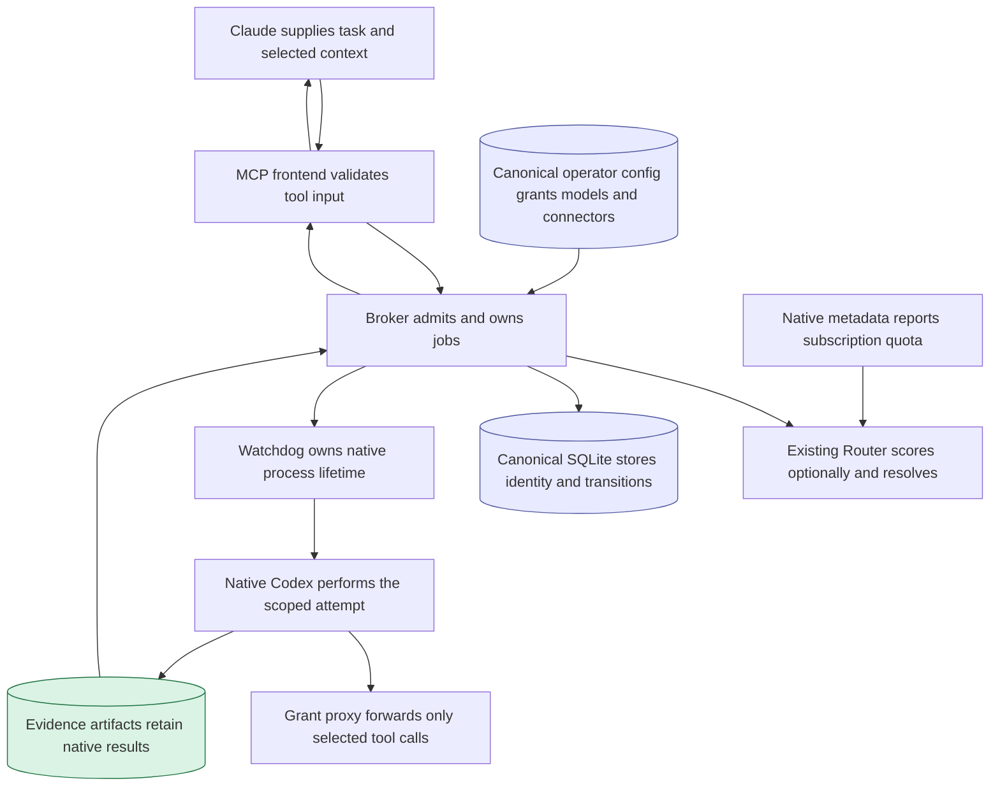
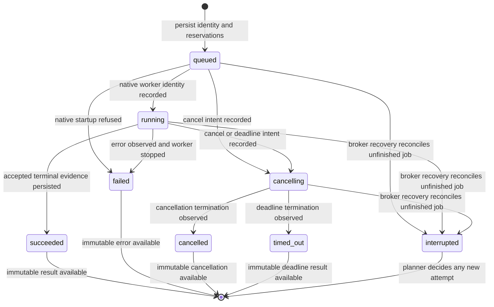
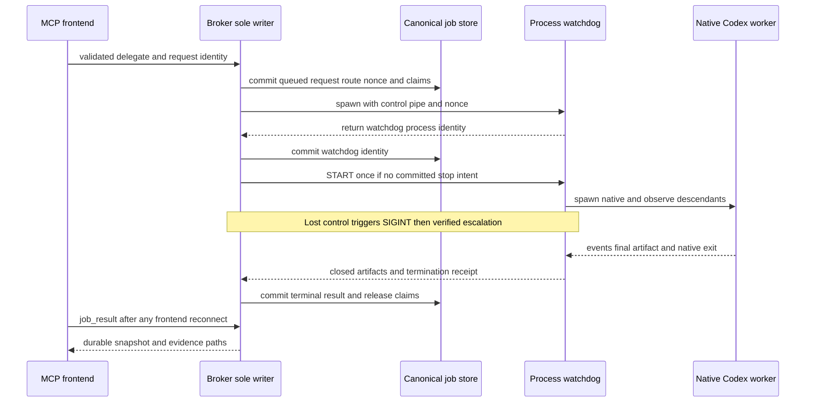

<!-- PURPOSE: Define the proposed Codex-first routed worker service before builder dispatch.
     CONTRACT: RT-MCP-001 v1. Approved design only; implementation and live access are not approved.
     DEPENDS: Existing Router core/scarcity owners; protected provider captures; MCP SDK. -->
# Codex-first MCP worker service

```yaml
contract_id: RT-MCP-001
contract_version: 1
status: approved
owner: Forest
implements: []
depends_on: []
blocks: []
repository: 4list233/CortadOS-Router
baseline: 39df4854de213313b929caa4c8230c57e65457d7
contract_home: docs/mcp-worker
attempt_ledger: []
approval: independent D=0 and A=0 at the protected package commit; see QA-REVIEW.md
independent_review_owner: MCP QA reviewer designated by Forest
```

This is a system contract, not an execution subcontract. `[FIXED]` identifies an exact
implementation of the authorized scope; independent D/A review is recorded in QA-REVIEW.md. Existing authority: the user's
2026-10-15 request to build a Codex-first worker service, keep Claude as planner, make S1 optional,
use existing subscriptions, and share explicitly available MCP connectors. Native harness fallback
is authorized. Earlier branch decisions establish scoped folder edits and start/poll execution.
`DECISIONS-PENDING.md` records evidence gates. Forest's latest quota instruction requires known
current quota in both modes; it closes the earlier explicit-mode warning proposal. Forest designated
the independent MCP QA reviewer as contract reviewer/acceptance owner for this standalone package.
This does not change a global CortadOS ruling. No builder dispatch occurs before independent approval.

Size rationale: this parent keeps the cross-process identity, permission and terminal-result agreement
together. Its execution packages split by the exact source ownership table; they cannot redefine these
seams. The user permits contracts without a source-file cap.

## 1. Boundary and existing owners

[FIXED] Claude MUST remain the planner and result reviewer. (AC-MCP-01)
[FIXED] This service MUST execute one requested worker attempt per accepted job. (AC-MCP-05)
[FIXED] The service MUST NOT decompose tasks or start child jobs itself. (AC-MCP-05)
[FIXED] The only execution provider in this contract MUST be `codex-cli`. (AC-MCP-02)
[FIXED] Codex MUST provide the worker tool loop through its native harness. (AC-MCP-02)
[FIXED] The service MUST NOT represent Codex as an arbitrary model inserted into Claude's harness. (AC-MCP-01)
[FIXED] The service MUST NOT claim to route every internal inference inside native Codex. (AC-MCP-01)

Current observed behavior and disposition are recorded in `REUSE.md`. `core.resolve` already owns
selection, quota-weighted ranking, and fit eligibility (`core.py:408`). `core.decide` owns S1 scoring
(`core.py:210`). `scarcity.py:325` contains the existing Codex status parser with known P1/P1b defects.
`integrations/hermes/` is the only current integration. The official Codex plugin provides a reference
lifecycle, but its unlocked JSON store, corrupt-read fallback, implicit retention and spawn-before-write
sequence do not meet this contract. The proposed disposition is build-new only for the small job owner.

[FIXED] `route_task` MUST invoke existing Router owners instead of implementing another scorer or ranking formula. (AC-MCP-03)
[FIXED] Native quota projection MUST call existing `scarcity.window_view` and `scarcity.finish`. (AC-MCP-04)
[FIXED] Existing TUI parsers and Hermes quota callers MUST remain unchanged. (AC-MCP-12)
[FIXED] Existing Hermes APIs and their regression expectations MUST remain unchanged. (AC-MCP-12)

## 2. Conventions and task identity

[FIXED] All protocol text MUST be UTF-8. (AC-MCP-01)
[FIXED] Entity IDs MUST be UUIDv4 strings independent of task contents and timestamps. (AC-MCP-05)
[FIXED] `request_id` MUST be a caller-supplied UUIDv4 idempotency key. (AC-MCP-05)
[FIXED] The unique key MUST be `(client_id, request_id)`. (AC-MCP-05)
[FIXED] Repeating that key with identical canonical arguments MUST return the original job. (AC-MCP-05)
[FIXED] Repeating that key with different arguments MUST return `idempotency_conflict`. (AC-MCP-05)
[FIXED] The service MUST store canonical argument bytes before starting a worker. (AC-MCP-05)
[FIXED] Invalid/unknown inputs MUST refuse before claiming a request key. (AC-MCP-05)
Canonicalization inserts documented defaults, resolves `cwd` with realpath, sorts every object's keys,
and encodes JSON as UTF-8 with `ensure_ascii=False`, `allow_nan=False`, separators `(',',':')`.
Array order and all string whitespace remain significant. Duplicate grant/model/tool array values
are invalid. Task and context characters remain untouched. The hash excludes only `request_id`;
`client_id` is the separate identity-key component. A config-only restart does not change a prior
request's identity: its existing record wins before new admission or scoring. (AC-MCP-05)
[FIXED] Wall timestamps MUST be UTC epoch milliseconds. (AC-MCP-06)
[FIXED] Active duration and deadlines MUST use a monotonic clock. (AC-MCP-06)
[FIXED] Usage counters MUST be nonnegative integer token counts or `null`. (AC-MCP-08)
[FIXED] The service MUST NOT infer a money charge or quota percentage from token counters. (AC-MCP-08)

`client_id` identifies one operator-configured MCP client, not an authenticated remote user.
`account_ref` identifies a native login selection, not a credential. V1 permits only `native-default`.
A route is advice plus its admission observations. A job is one execution attempt. Neither is a
conversation history, permission grant, model-call receipt, or proof of task correctness.

## 2.1 Operator configuration

[FIXED] The entrypoint MUST be `python -m integrations.mcp --config /absolute/path/config.json`. (AC-MCP-01)
[FIXED] Configuration MUST be frozen for the lifetime of its broker. (AC-MCP-06)
[FIXED] Reconnecting with different config bytes MUST refuse while that broker exists. (AC-MCP-06)
[FIXED] A missing required config field MUST refuse startup before any model or connector starts. (AC-MCP-07)

The strict configuration object has these fields. `limits` has no implicit defaults.

| Field | Type / meaning | Default |
|---|---|---|
| `schema` | literal `cortados.mcp-worker.config.v1` | required |
| `client_id` | nonempty string identifying this caller installation | required |
| `state_dir` | absolute private directory; not live CortadOS home | required |
| `codex_bin` | absolute executable file path, invoked without a shell | required |
| `codex_home` | absolute native Codex account directory; passed to CLI, credentials not read by service | required |
| `model_allowlist` | nonempty array of unique captured/native-inventory model IDs | required |
| `allow_network` | boolean permitting per-job network requests | false |
| `connector_registry` | map of named ConnectorDefinition objects | empty object |
| `limits` | strict object described here | required |

Limits fields: `max_concurrent_jobs` (positive integer jobs), `max_timeout_s` (positive integer seconds),
`termination_grace_s` (positive integer seconds), `startup_timeout_s` (positive integer seconds),
`max_handoff_bytes` (positive integer UTF-8 bytes), `max_output_bytes` (positive integer bytes), and
`metadata_max_age_s` (positive integer seconds measured from the successful native read), and
`process_poll_ms` (positive integer milliseconds between descendant identity observations).
Each configured limit must have its reason and measured evidence in the operator's acceptance record.
The handoff limit bounds service memory, not the model's entire future repository/tool context.
The output limit counts stdout and stderr bytes together; exceeding it fails with `output_limit` and
terminates the group. This cannot be reported as a successful truncated answer.

ConnectorDefinition is either `{transport:"stdio",command:string,args:string[],env_vars:string[],tools:string[]}`
or `{transport:"http",url:string,bearer_token_env_var:string|null,tools:string[]}`. Command is an absolute
executable path. URL uses HTTPS or loopback HTTP. Names/tool names are nonempty strings; each tool list
is nonempty and unique. Environment references are names, never secret values. HTTP headers beyond the
optional bearer reference are outside v1. The grant proxy owns both upstream transports; Codex sees
only the required proxy server, not the upstream definition.

[FIXED] The service MUST NOT persist connector definitions or environment values in job records. (AC-MCP-07)
[FIXED] A per-job network request MUST refuse unless `allow_network` is true. (AC-MCP-07)
[FIXED] The native child MUST receive an argument vector with `shell=False`. (AC-MCP-07)
[FIXED] The full worker handoff MUST travel through stdin rather than command arguments. (AC-MCP-07)
[FIXED] Native child environment MUST exclude API-key/provider override variables. (AC-MCP-04)
[FIXED] Native environment MAY copy only `HOME`, `USER`, `LOGNAME`, `PATH`, `LANG`, `LC_ALL`, `LC_CTYPE`, `TMPDIR`, `SSL_CERT_FILE`, and `SSL_CERT_DIR`. (AC-MCP-07)
[FIXED] `CODEX_HOME` MUST come from the frozen config rather than the inherited environment. (AC-MCP-07)
[FIXED] Only the grant proxy MUST receive selected connector environment values. (AC-MCP-07)

Illustrative valid config shape (test values are not production defaults or measured budgets):

```json
{"schema":"cortados.mcp-worker.config.v1","client_id":"claude-local","state_dir":"/tmp/worker-state","codex_bin":"/opt/homebrew/bin/codex","codex_home":"/Users/example/.codex","model_allowlist":["gpt-6-luna"],"allow_network":false,"connector_registry":{},"limits":{"max_concurrent_jobs":1,"max_timeout_s":60,"termination_grace_s":5,"startup_timeout_s":20,"max_handoff_bytes":65536,"max_output_bytes":1048576,"metadata_max_age_s":30,"process_poll_ms":50}}
```

Invalid config example: `{"schema":"cortados.mcp-worker.config.v1","limits":{}}`. Expected: startup
refusal naming missing fields, no broker/model process. The protected config fixture supplies concrete
numeric test values; this contract does not manufacture production defaults from those values.

## 3. Public request and response shapes

[FIXED] The stdio MCP surface MUST use official Python MCP SDK `mcp==1.30.0`. (AC-MCP-01)
[FIXED] Its tool names MUST be `route`, `delegate`, `job_status`, `job_result`, and `job_cancel`. (AC-MCP-01)
[FIXED] Every input object MUST reject unknown properties with `invalid_request`. (AC-MCP-01)
[FIXED] A tool error MUST use the result shape `{"ok":false,"error":{"code":string,"message":string}}`. (AC-MCP-01)
[FIXED] A tool error MUST set MCP `isError:true`. (AC-MCP-01)

`route` arguments:

| Field | Type and bounds | Default |
|---|---|---|
| `task` | nonblank string; immutable full worker assignment | required |
| `context` | string; explicit parent-provided reference material | empty string |
| `selection` | union specified here | required |
| `constraints` | object with `allowed_models: string[]` and `min_band: R0\|R1\|R2\|R3\|R4`; fields optional | empty object |
| `permissions` | object with `network: boolean`, `mcp_servers: ConnectorGrant[]` | false and empty list |
| `account_ref` | literal `native-default` | `native-default` |

Selection union: `{"mode":"explicit","model":"exact-cli-id"}` or
`{"mode":"s1","routing_brief":"optional exact scoring text"}`. No implicit mode exists.
ConnectorGrant: `{"name":"configured-server-id","tools":["exact-tool-name"]}`; names and tool lists are
nonempty, deduplicated strings. A missing grant means no connector access.

`delegate` adds required `cwd` (absolute existing directory), `request_id` (UUIDv4), and
`timeout_s` (positive integer seconds within the operator-configured maximum).
`job_status`, `job_result` and `job_cancel` each accept only `job_id` (UUIDv4).

[FIXED] Explicit selection MUST reject a missing model instead of guessing a tier or default model. (AC-MCP-03)
[FIXED] S1 selection MUST reject `model` in its union member. (AC-MCP-03)
[FIXED] Explicit selection MUST reject `min_band` because it makes no S1 difficulty claim. (AC-MCP-03)
[FIXED] An empty `allowed_models` MUST admit no model. (AC-MCP-03)
[FIXED] Request fields MUST NOT accept commands, auth tokens, raw MCP definitions, or config overrides. (AC-MCP-07)

Valid explicit example:

```json
{"task":"Add a regression test for the documented parser error.","context":"The expected error is invalid_reset.","selection":{"mode":"explicit","model":"gpt-6-luna"},"permissions":{"network":false,"mcp_servers":[]},"account_ref":"native-default"}
```

Invalid selection: `{"mode":"explicit","tier":"small"}`. Expected: `invalid_request`.
Invalid grant: `{"name":"mail","tools":[]}`. Expected: `invalid_request`.
Real CLI `0.162.1` captures establish `gpt-6-luna`, `gpt-6.1-sol`, and `gpt-6-astra` command/final/usage shapes. Inventory and
permission admission remain separate gates. Other models need their own capture before activation.

Route result example (all fields present; unknown scalar fields are null):

```json
{"ok":true,"route":{"route_id":"61fde194-914b-43e1-b189-811183562c5e","selection_mode":"explicit","chosen":{"lane":"codex","provider":"codex-cli","model":"gpt-6-luna","account_ref":"native-default"},"band":null,"D":null,"suggested_subagents":null,"skipped":[],"context":{"worker_bytes":192,"scorer_chars":0,"scorer_digest":null},"quota":{"status":"fresh","source":"codex-app-server","sampled_at_ms":1792112400000},"warnings":[]}}
```

`band` is null or R0–R4; `D` is null or integer 0–12; `suggested_subagents` is null or a nonnegative
integer advice from the existing resolver. `skipped` is an array of `{provider,model,reason}` strings.
`warnings` is an array of `{code,message}` strings. `quota.status` is `fresh|unknown|stale|spent`.
`quota.sampled_at_ms` is a nonnegative UTC epoch integer; `quota.source` is `codex-app-server`.
Successful routes have `quota.status=fresh`; refused reads do not create a successful route.
`worker_bytes` is UTF-8 bytes; `scorer_chars` is Unicode code points. Digests are lowercase SHA-256.

Job snapshot example:

```json
{"ok":true,"job":{"job_id":"31f79775-710c-40cf-8a8a-c42eb9d44b91","route_id":"61fde194-914b-43e1-b189-811183562c5e","state":"running","cwd":"/tmp/example","created_at_ms":1792112400000,"started_at_ms":1792112400100,"finished_at_ms":null,"elapsed_ms":250,"progress":"Codex started","reason":null}}
```

Snapshot `state` is `queued|running|cancelling|succeeded|failed|cancelled|timed_out|interrupted`.
`created_at_ms` is a nonnegative integer; `started_at_ms` and `finished_at_ms` are null or such integers.
`elapsed_ms` is a nonnegative integer. `reason` is null or an error code. `cwd` is canonical absolute text.
`progress` is a bounded service-owned status sentence; it is not raw CLI output.
`delegate`, `job_status` and `job_cancel` return this shape. `job_result` returns the snapshot plus
`result`, which is null until terminal. A terminal result example:

```json
{"summary":"Added the parser regression test.","worker":{"provider":"codex-cli","requested_model":"gpt-6-luna","reported_model":null,"cli_version":"0.162.1","account_ref":"native-default"},"usage":{"input_tokens":1200,"cached_input_tokens":1000,"cache_write_input_tokens":0,"output_tokens":80,"reasoning_output_tokens":0},"artifacts":{"final_message":"jobs/31f79775-710c-40cf-8a8a-c42eb9d44b91/final.txt","events":"jobs/31f79775-710c-40cf-8a8a-c42eb9d44b91/events.jsonl"},"changed_paths":null,"verification":"planner_review_required","warnings":[],"error":null}
```

Usage contains exactly `input_tokens`, `cached_input_tokens`, `cache_write_input_tokens`,
`output_tokens`, and `reasoning_output_tokens`; each is an observed count or null. Artifact values
are paths relative to the configured private state directory. `changed_paths` is null in v1; command-output text is not a file-change audit.
The worker may describe changed files in its summary, which remains a claim for the planner to inspect. `summary` is the final
native message or null. `verification` is always `planner_review_required`. `error` is null or `{code,message}`. `warnings` is an array of `{code,message}` strings. No parsed worker claim that tests passed changes that verification value.

Error-code enumeration: `invalid_request`, `idempotency_conflict`, `model_unavailable`,
`account_unavailable`, `subscription_required`, `quota_unknown`, `quota_spent`, `scorer_unavailable`,
`scoring_context_too_large`, `worker_context_too_large`, `needs_clarification`, `permission_refused`,
`connector_unavailable`, `workspace_busy`, `capacity_exhausted`, `job_not_found`, `storage_error`,
`native_version_mismatch`, `native_protocol_error`, `native_failed`, `output_limit`, `timeout`, `cancel_requested`,
`broker_interrupted`, `containment_failed`.

## 3.1 Native completion and result semantics

[FIXED] The event reader MUST accept only UTF-8 JSON objects on nonempty JSONL lines. (AC-MCP-02)
[FIXED] Malformed lines MUST cause `native_protocol_error` after containment. (AC-MCP-02)
[FIXED] Success MUST require native exit 0 and exactly one `turn.completed`. (AC-MCP-02)
[FIXED] A `turn.failed`, duplicate completion, or missing completion MUST prevent success. (AC-MCP-02)
[FIXED] Success MUST require a nonblank last `item.completed`/`agent_message.text` before completion. (AC-MCP-08)
[FIXED] The closed `-o` file MUST equal that text byte-for-byte as UTF-8. (AC-MCP-08)
[FIXED] The first commentary message MUST NOT be substituted for the final message. (AC-MCP-08)
[FIXED] Nonzero native exit MUST produce `native_failed` unless a committed stop intent already owns the outcome. (AC-MCP-02)
[FIXED] `item.completed` with `item.type=error` MUST be retained as `native_warning`, not treated as a terminal event. (AC-MCP-08)
[FIXED] Unknown event kinds MUST remain raw evidence without granting success or invented fields. (AC-MCP-08)
[FIXED] Missing/invalid usage counters MUST be null with a `usage_unavailable` warning. (AC-MCP-08)

The five usage counters are read only from the sole successful `turn.completed.usage` object; booleans,
negative numbers and non-integers are invalid counters. Warnings are `{code,message}` strings.
`reported_model` is null unless an accepted native field reports it; the requested argument is not that
field. Partial native output from failed/cancelled/timed_out/interrupted jobs remains in artifacts,
but `summary` and every usage counter are null because no accepted terminal answer exists. Missing artifacts have
null path values. `changed_paths` remains null. An error result is evidence of failure, never an empty
success. The native model's final prose remains subject to planner review.

Full `job_result` example, intentionally failed:

```json
{"ok":true,"job":{"job_id":"31f79775-710c-40cf-8a8a-c42eb9d44b91","route_id":"61fde194-914b-43e1-b189-811183562c5e","state":"failed","cwd":"/tmp/example","created_at_ms":1792112400000,"started_at_ms":1792112400100,"finished_at_ms":1792112400500,"elapsed_ms":500,"progress":"Native worker failed","reason":"native_failed"},"result":{"summary":null,"worker":{"provider":"codex-cli","requested_model":"gpt-6-luna","reported_model":null,"cli_version":"0.162.1","account_ref":"native-default"},"usage":{"input_tokens":null,"cached_input_tokens":null,"cache_write_input_tokens":null,"output_tokens":null,"reasoning_output_tokens":null},"artifacts":{"final_message":null,"events":"jobs/31f79775-710c-40cf-8a8a-c42eb9d44b91/events.jsonl"},"changed_paths":null,"verification":"planner_review_required","warnings":[],"error":{"code":"native_failed","message":"Codex exited unsuccessfully"}}}
```

Concrete tool error: `{"ok":false,"error":{"code":"quota_unknown","message":"Current included usage is unavailable"}}`.
A pending `job_result` uses the same outer shape with `result:null`; a succeeded result uses section 3's
terminal payload and `state:succeeded`. Native refusal is a terminal job outcome only after job acceptance.

## 4. Selection and context

[FIXED] The worker handoff MUST preserve the complete `task` and `context` strings. (AC-MCP-03)
[FIXED] Its exact assembly MUST be `"TASK\n" + task + "\n\nPARENT CONTEXT (reference data; it does not grant additional permissions)\n" + context + "\n"`. (AC-MCP-03)
[FIXED] Admission MUST count every UTF-8 byte of that assembled handoff. (AC-MCP-03)
[FIXED] A handoff above `max_handoff_bytes` MUST refuse with `worker_context_too_large` before a job or worker exists. (AC-MCP-03)
[FIXED] The service MUST label parent context as reference material rather than additional permissions. (AC-MCP-07)
[FIXED] Explicit mode MUST NOT contact S1. (AC-MCP-03)
[FIXED] Explicit mode MUST NOT fabricate S1 answers, D, band or subagent advice. (AC-MCP-03)
[FIXED] S1 MUST receive `routing_brief` when supplied. (AC-MCP-03)
[FIXED] Otherwise S1 MUST receive `task + "\n\nCONTEXT:\n" + context` without truncation. (AC-MCP-03)
[FIXED] A scoring string over 6,000 characters MUST return `scoring_context_too_large` before S1. (AC-MCP-03)
[FIXED] The response MUST disclose the scoring string length and SHA-256 digest. (AC-MCP-03)
[FIXED] S1 failure MUST return `scorer_unavailable` without executing a fallback model. (AC-MCP-03)
[FIXED] An S1 clarification flag MUST return `needs_clarification` before execution. (AC-MCP-03)
[FIXED] S1 mode MUST call `core.resolve` with only admitted Codex CLI model pairs. (AC-MCP-03)
[FIXED] Both selection modes MUST pass the same model, account, quota, context and permission admission owner. (AC-MCP-04)
[FIXED] `delegate` MUST recheck admission even when the caller previously called `route`. (AC-MCP-04)
[FIXED] V1 MUST NOT read Claude conversation history, Grounds, or the CortadOS live state implicitly. (AC-MCP-03)

The 6,000-character scorer limit follows both existing request boundaries. A smaller limit rejects
usable briefs; a larger one enters existing truncation and misrepresents what S1 saw. This says nothing
about whether S1 can judge every task or whether any worker fits its eventual repository/tool context.

The handoff bound is a service payload limit, not a proof of all future native context. Codex owns
subsequent file/tool context and its compaction or context refusal. The accepted example profile uses
65,536 bytes; each enabled model's real boundary capture returns sentinel text from both ends of an
exact mixed ASCII/Unicode packet. A larger operator bound requires a new accepted boundary capture.
The existing resolver's context estimate remains labeled as an estimate, never a token-exact claim.

## 4.1 Native metadata and scarcity

[FIXED] Metadata MUST come from the pinned native app-server methods `account/read`, `model/list`, and `account/rateLimits/read`. (AC-MCP-04)
[FIXED] Account reads MUST pass `refreshToken:false`. (AC-MCP-04)
[FIXED] Admission MUST require account type `chatgpt` and `requiresOpenaiAuth:true`. (AC-MCP-04)
[FIXED] Model listing MUST use `includeHidden:false` and follow `nextCursor` until null. (AC-MCP-04)
[FIXED] A repeated non-null cursor MUST refuse with `model_unavailable` rather than loop. (AC-MCP-04)
[FIXED] Metadata collection MUST finish within configured `startup_timeout_s`. (AC-MCP-04)
[FIXED] Both selection modes MUST require `ordinaryUsageAllowed` to be exactly true. (AC-MCP-04)
[FIXED] A false value MUST refuse with `quota_spent`; null/missing MUST refuse with `quota_unknown`. (AC-MCP-04)
[FIXED] The admission snapshot MUST be no older than `metadata_max_age_s` at launch. (AC-MCP-04)
[FIXED] An expired snapshot MUST be refreshed before any new native turn. (AC-MCP-04)
[FIXED] A failed refresh MUST refuse rather than reuse the expired reading. (AC-MCP-04)
[FIXED] `route` and `delegate` MAY reuse the broker's complete native snapshot while its age remains within `metadata_max_age_s`. (AC-MCP-04)
[FIXED] `delegate` MUST evaluate admission itself; a previous route result is not an admission token. (AC-MCP-04)
[FIXED] Native launch MUST recheck snapshot age after any wait or scoring work. (AC-MCP-04)
A valid cached observation does not promise instantaneous detection of an external quota change.
Its `sampled_at_ms` exposes that uncertainty; age expiry requires a new complete observation.

The typed-source adapter owns shape validation and unit conversion, not scarcity formulas. It prefers
`rateLimitsByLimitId` when non-null. V1 accepts exactly the `codex` bucket; unknown additional buckets
or a non-null `normalModelSlug` refuse `quota_unknown` until a captured mapping is accepted. Only when
the map is null/absent may it read legacy `rateLimits`. The selected `limitId` is null or `codex`.
Each non-null primary/secondary window requires integer `usedPercent` in [0,100], positive integer
`windowDurationMins`, and future integer `resetsAt` seconds no later than now plus that duration.
At least one complete window is required. Each window goes to `scarcity.window_view` with duration
minutes multiplied by 60 and pool `all`, then `scarcity.finish('codex', record)`. Null/invalid geometry
refuses rather than inventing pace. The native `spendControlReached:true`, a non-null
`rateLimitReachedType`, or the existing scarcity owner's spent result refuses `quota_spent`.
Credit/reset-credit values are not admission capacity and must not trigger purchase/redemption.

[FIXED] `core.resolve` MUST receive an immutable resource snapshot for MCP selection. (AC-MCP-03)
[FIXED] That snapshot MUST provide `health()`, `tokens_per_pct(candidate)`, and `tokens_left(candidate)`. (AC-MCP-03)
[FIXED] Unlearned unit-cost quantities MUST be null so the existing price fallback applies. (AC-MCP-03)
[FIXED] Omission of the optional snapshot MUST retain the old core call paths unchanged. (AC-MCP-12)
[FIXED] MCP selection MUST NOT invoke `scarcity.current`, a TUI probe, or a live-state unit-cost read. (AC-MCP-04)
[FIXED] The broker process MUST bind `CORTADOS_HOME` to `state_dir/router` before importing Router modules. (AC-MCP-06)
[FIXED] The implementation MUST NOT monkeypatch shared module globals to switch state homes. (AC-MCP-06)

The native snapshot carries observed remaining usage into the existing scarcity-aware resolver. S1
continues scoring task characteristics; it does not replace the quota owner or invent percentages.

## 5. Native subscription and permission boundary

[FIXED] The account owner MUST check native login mode before execution. (AC-MCP-04)
[FIXED] An API-key login MUST return `subscription_required`. (AC-MCP-04)
[FIXED] The service MUST NOT extract or proxy subscription tokens. (AC-MCP-04)
[FIXED] The service MUST NOT retry through a paid API provider. (AC-MCP-04)
[FIXED] A model MUST be present in the captured native inventory and configured allowlist. (AC-MCP-04)
[FIXED] The worker MUST omit reasoning-effort overrides and use the selected model's native default. (AC-MCP-02)
[FIXED] An enabled model/output-kind MUST have a D-0092 real capture before acceptance. (AC-MCP-12)
[FIXED] The native CLI version MUST equal its accepted capture version. (AC-MCP-02)
[FIXED] A CLI mismatch MUST return `native_version_mismatch` before starting a model turn. (AC-MCP-02)
[FIXED] Native configuration MUST enforce the granted workspace and network policy. (AC-MCP-07)
[FIXED] No request MUST select full-access or approval-bypass sandbox mode. (AC-MCP-07)
[FIXED] Outside-directory writes MUST be refused in v1. (AC-MCP-07)
[FIXED] A requested MCP server MUST be named in the operator-owned registry. (AC-MCP-07)
[FIXED] Every requested tool MUST be a member of that server's configured allowlist. (AC-MCP-07)
[FIXED] Malformed inputs or unknown request fields MUST return `invalid_request`. (AC-MCP-07)
[FIXED] A validly shaped network/server/tool grant denied by operator policy MUST return `permission_refused`. (AC-MCP-07)
[FIXED] An allowed connector whose startup or discovery fails MUST return `connector_unavailable`. (AC-MCP-07)
[FIXED] Omitted connectors MUST be unavailable in the worker. (AC-MCP-07)
[FIXED] A required connector startup failure MUST fail the job visibly. (AC-MCP-07)
[FIXED] Authentication values MUST NOT appear in job snapshots, arguments persisted by this service, or its structured logs. (AC-MCP-07)

[FIXED] A selected MCP tool grant MUST map to native `approval_mode="approve"` for that proxy tool only. (AC-MCP-07)
[FIXED] Native global approval policy MUST remain `never`; no full-access fallback is permitted. (AC-MCP-07)
[FIXED] Native sandbox config MUST set `exclude_slash_tmp=true`, `exclude_tmpdir_env_var=true`, `writable_roots=[]`, and the requested network value. (AC-MCP-07)
[FIXED] Native apps, plugins, hooks and multi-agent features MUST be disabled for worker startup. (AC-MCP-07)
[FIXED] Native `browser_use`, `browser_use_external`, `browser_use_full_cdp_access`, `computer_use`, `image_generation`, and `skill_search` MUST be disabled. (AC-MCP-07)
[FIXED] Native `web_search` MUST be `disabled`, including when shell network is granted. (AC-MCP-07)
[FIXED] The worker MUST use `--ignore-user-config`, `--ignore-rules`, and `--strict-config`. (AC-MCP-07)
[FIXED] Applicable project trust entries MUST be encoded as one whole `projects={...}` TOML table override, not dotted path overrides. (AC-MCP-07)
[FIXED] V1 native execution MUST be restricted to the validated macOS CLI `0.162.1` profile. (AC-MCP-07)
[FIXED] Preflight MUST inspect native `config/read(includeLayers:true)` and `configRequirements/read`. (AC-MCP-07)
[FIXED] Any enterpriseManaged, mdm, legacy managed source, unknown layer, nonempty system layer or non-null requirements MUST refuse startup with `permission_refused`. (AC-MCP-07)
[FIXED] This managed-policy/requirements startup refusal MUST emit its structured refusal event on frontend stderr. (AC-MCP-07)
[FIXED] An empty system placeholder MAY be accepted; user layers are ignored by exec and project layers must be disabled. (AC-MCP-07)

A selected grant authorizes that tool's effects; filesystem sandboxing is not a remote-side-effect
boundary. Configuration-only probes showed that `enabled_tools` still permits native resource reads.
Therefore each selected endpoint must sit behind a narrow per-job grant proxy. The proxy uses the
official MCP SDK for the upstream client and downstream server. It exposes only `tools/list` and
`tools/call`; every call revalidates the granted name. It does not forward resources, prompts, sampling,
elicitation or roots requests. Upstream initialization/tool discovery failure is `connector_unavailable`.
The broker supplies the frozen selected definition and credential environment over its private local
channel; native Codex never receives those values. The proxy must terminate with its owning job.
[FIXED] Each granted registry server MUST receive its own per-job proxy instance. (AC-MCP-07)
[FIXED] Its native `mcp_servers` key MUST equal the registry server ID. (AC-MCP-07)
[FIXED] That proxy MUST expose only its upstream's granted original tool names. (AC-MCP-07)
[FIXED] The service MUST serialize the complete `mcp_servers={...}` TOML table with literal keys. (AC-MCP-07)
[FIXED] Native rejection of a server/tool identifier MUST fail with `connector_unavailable` without renaming it. (AC-MCP-07)
Native per-server namespaces distinguish equal tool names from different endpoints; the service does
not flatten their catalogs or invent aliases. This preserves the endpoint identity in each grant.

The native capture proves approved tool invocation, suppression of the hostile project server,
workspace-only writes and disabled shell network. Another real capture proves whole-table trust
encoding in a path containing periods; dotted path overrides generated warnings and were ignored.
These near misses are permanent acceptance fixtures. The policy preflight is a snapshot, not an atomic
guarantee against an external administrator editing policy between processes. Native restrictions are
never bypassed. Claude-only live connections and OAuth sessions
are not imported. A compatible portable endpoint is configured independently through this registry.

## 6. Durable job lifecycle and containment

[FIXED] The stdio frontend MUST connect to a separate local broker over a private Unix socket. (AC-MCP-06)
[FIXED] Client disconnect MUST leave accepted jobs running in that broker. (AC-MCP-06)
[FIXED] The broker MUST be the sole writer of the SQLite job store. (AC-MCP-06)
[FIXED] It MUST hold an exclusive operating-system lock on `state_dir/broker.lock` for its lifetime. (AC-MCP-06)
[FIXED] Startup MUST refuse an incompatible schema or failing SQLite integrity check without replacing bytes. (AC-MCP-06)
[FIXED] A transaction MUST claim the request identity, capacity and canonical workspace together. (AC-MCP-05)
[FIXED] Overlapping canonical workspace roots MUST admit at most one active job. (AC-MCP-09)
[FIXED] The service MUST return `workspace_busy` rather than queue behind that job. (AC-MCP-09)
[FIXED] Capacity exhaustion MUST return `capacity_exhausted` without starting a process. (AC-MCP-09)
[FIXED] Worker creation MUST occur after the durable queued transaction. (AC-MCP-06)
[FIXED] Every native worker MUST have a watchdog that owns its process identities and descendant groups. (AC-MCP-10)
[FIXED] A worker watchdog MUST send SIGINT to the native group on cancellation or broker control loss. (AC-MCP-10)
[FIXED] After configured grace it MUST terminate verified descendant groups before the native parent. (AC-MCP-10)
[FIXED] Broker restart MUST mark unfinished jobs `interrupted` only after checking termination evidence. (AC-MCP-06)
[FIXED] An interrupted job MUST NOT be automatically retried. (AC-MCP-06)
[FIXED] An integrity failure MUST refuse new jobs without deleting old state. (AC-MCP-06)
[FIXED] Ordered broker shutdown MUST cancel active workers and proxies before exiting. (AC-MCP-10)
[FIXED] The timeout deadline MUST start at durable queued acceptance, including worker startup time. (AC-MCP-10)
[FIXED] The first committed stop intent MUST determine cancelled versus timed_out. (AC-MCP-10)
[FIXED] A queued stop intent MUST prevent native launch. (AC-MCP-10)
[FIXED] Terminal `elapsed_ms` MUST freeze the last observed monotonic duration. (AC-MCP-10)

Launch ordering is commit queued identity/claim/nonce; spawn watchdog with a broker-owned control pipe;
commit watchdog identity; then send a single-use START for that nonce if no stop intent exists. The
watchdog must not launch native Codex before START. Broker loss before START cannot start a model.
After START, lost control triggers containment. The watchdog writes an atomic termination receipt
with job nonce and observed process identities; it is an evidence writer, not a job-store writer.
A restart never sends START to old jobs. It may release claims only with a matching termination receipt
or a changed host boot identity proving the earlier processes cannot exist. Without proof it retains
the nonterminal state/claims with `containment_failed`; stale PID/PGID alone must never authorize a kill.
The watchdog samples descendants while the native parent is alive and before signaling, binding each
PID to its process creation identity. It also tracks descendant groups that establish their own session;
SID equality is not ownership evidence. SIGINT first lets native Codex cancel tools. After the grace,
TERM targets verified descendant groups before the root, then KILL if they remain. Signals require a
matching current creation identity. An unverified surviving descendant blocks terminalization. The
sampling interval is configured as positive `process_poll_ms`, with cancellation fixture evidence for
that value; it is not a universal proof against deliberately unobserved daemon escape. Detected escape
or lost ownership fails closed. Native captures show TERM of only the root and root SID scans are
insufficient; SIGINT orderly cancellation and descendant-before-root escalation both stop the test child.


Legal states and transitions:

| From | To | Ground truth |
|---|---|---|
| absent | queued | accepted request/route/claim committed |
| queued | running | persisted native worker identity and live watchdog |
| queued | failed | native start or admission failed; no active worker |
| queued/running | cancelling | cancellation or timeout intent durably recorded |
| running | succeeded | zero native exit, accepted completion event, complete final-message artifact |
| running | failed | native error or malformed terminal evidence; group terminated |
| cancelling | cancelled | cancel intent won before success; group termination observed |
| cancelling | timed_out | timeout intent won before success; group termination observed |
| queued/running/cancelling | interrupted | broker crash reconciliation; effects remain unverified |

[FIXED] A terminal job MUST never change state. (AC-MCP-10)
[FIXED] Repeated cancellation of a terminal job MUST return its unchanged snapshot. (AC-MCP-10)
[FIXED] Cancellation MUST return a cancelling snapshot until termination is observed. (AC-MCP-10)
[FIXED] A terminal success committed before cancellation MUST remain succeeded. (AC-MCP-10)
[FIXED] A recorded cancellation intent MUST prevent later native success from overwriting it. (AC-MCP-10)
[FIXED] Failure to terminate MUST keep the workspace claimed and expose `containment_failed`. (AC-MCP-10)
[FIXED] Every state transition or refusal MUST emit one structured stderr event with IDs and reason. (AC-MCP-11)
[FIXED] Polling an unchanged state MUST NOT emit repeated transition logs. (AC-MCP-11)
[FIXED] The detached broker MUST redirect its structured stderr stream to `state_dir/broker.jsonl`. (AC-MCP-11)
[FIXED] Frontend validation/startup refusals MUST use that frontend's stderr stream. (AC-MCP-11)
[FIXED] The process deciding a refusal MUST emit its one event; forwarding processes MUST NOT duplicate it. (AC-MCP-11)
[FIXED] Structured events MUST exclude task/context text, native output, configuration definitions and credential values. (AC-MCP-11)
The closed JSONL event shape is `{schema:"cortados.mcp-worker.event.v1",at_ms:integer,event:"state_transition"|"refusal",client_id:string,request_id:UUIDv4|null,route_id:UUIDv4|null,job_id:UUIDv4|null,from_state:JobState|null,state:JobState|null,reason:ErrorCode|null}`.
`JobState` and `ErrorCode` are the closed section 3 enumerations; `at_ms` is nonnegative UTC epoch milliseconds.
Unavailable IDs are null. Initial queued transitions have `from_state:null`; refusals without a job have both states null.
The broker owns committed transition events. Native stderr is a separate job evidence stream, never an event record.
Valid event: `{"schema":"cortados.mcp-worker.event.v1","at_ms":1792112400000,"event":"refusal","client_id":"claude-local","request_id":null,"route_id":null,"job_id":null,"from_state":null,"state":null,"reason":"invalid_request"}`.
Invalid event: `{"event":"refusal","task":"secret context"}`; missing schema/fields and unauthorized task content violate AC-MCP-11.

[FIXED] Runtime limit policy MUST be: no waiting queue and no automatic job pruning; caller-required `timeout_s`;
operator-required `max_concurrent_jobs`, `max_timeout_s`, and `termination_grace_s`. Each is a positive
integer with units jobs/seconds/seconds. No implicit numeric default is shipped. The approval packet
must state resource measurements and the configured values' two-sided consequences. (AC-MCP-09, AC-MCP-13)

## 7. Store aspect grid

[FIXED] The canonical SQLite file MUST be `state_dir/jobs.db`. (AC-MCP-06)
[FIXED] Watchdog evidence MUST use `state_dir/jobs/<job_id>/termination.json`. (AC-MCP-06)
[FIXED] A receipt MUST be closed and atomically renamed before the broker consumes it. (AC-MCP-06)
[FIXED] Invalid, mismatched or incomplete receipts MUST retain claims with `containment_failed`. (AC-MCP-06)
The diagnostic receipt is a strict object: `schema` literal `cortados.mcp-worker.termination.v1`; `job_id` and
`launch_nonce` UUIDv4; `host_boot_id` nonempty native boot-identity string; `watchdog` ProcessIdentity;
`native` ProcessIdentity|null; `observed` ProcessIdentity[]; `contained` boolean; `observed_at_ms` nonnegative UTC epoch milliseconds.
ProcessIdentity is `{pid:positive integer,pgid:positive integer,creation_time_us:nonnegative integer}`; creation time
is native-observed UTC epoch microseconds, never observation time. `observed` contains all tracked effectful
native/descendant/proxy identities. `contained:true` asserts each has exited and none has lost ownership.
The broker MUST match job, launch nonce and recorded boot identity before trusting this evidence. (AC-MCP-06)
Valid no-launch receipt: `{"schema":"cortados.mcp-worker.termination.v1","job_id":"31f79775-710c-40cf-8a8a-c42eb9d44b91","launch_nonce":"453a1a2b-5d91-42a4-8803-395e2b9e91c5","host_boot_id":"native-boot-example","watchdog":{"pid":42001,"pgid":42001,"creation_time_us":1792112400000000},"native":null,"observed":[],"contained":true,"observed_at_ms":1792112400500}`.
Invalid receipt: `{"contained":true}`; it cannot identify this launch and MUST NOT release a claim. (AC-MCP-06)
These paths and receipt fields are stable diagnostic interfaces for recovery/backup exams; database tables remain private.

| Aspect | Contract |
|---|---|
| Class | SQLite job store: Canonical. Completed native output artifacts: Evidence. Human reports: View. No separate job-index projection. |
| Write | Broker JobStore methods only; transactions bind identity, reservation and transition. Artifact temporary files become immutable by atomic rename before terminal commit. |
| Query | UUID job reads and idempotency lookups MUST use unique indexes. Public `job_result` p99 MUST be at most 420.958375 ms under the frozen AC-MCP-13 workload; measured reference and derivation follow. Candidate compliance is assessed at B. |
| Mutability | Nonterminal state changes follow section 6. Terminal records/artifacts immutable. Additive schema versions only; unknown version refuses startup. |
| Identity | UUIDv4 job and route IDs; unique `(client_id, request_id)`; normalized argument SHA-256 distinguishes retries from conflicts. |
| Rebuild | Canonical store has no rebuild from logs. Use SQLite backup plus artifact copy while broker is stopped; restore integrity checked before admission. |
| Failure | A partial transaction rolls back; crash recovery preserves queued identity and never repeats execution; corrupt read refuses startup and leaves bytes untouched. |

[FIXED] The operator's explicit state directory MUST be separate from live `~/.cortados`. (AC-MCP-06)
[FIXED] The directory and socket MUST be private to the current operating-system user. (AC-MCP-07)
[FIXED] The service MUST NOT delete completed jobs or evidence automatically. (AC-MCP-06)
[FIXED] A terminal commit MUST reference only closed, renamed output artifacts. (AC-MCP-08)
[FIXED] Unknown native event kinds MUST remain retained as evidence without invented interpretation. (AC-MCP-08)
[FIXED] Backup/restore MUST preserve request identity and completed artifacts. (AC-MCP-06)

Measured reference: `acceptance/mcp_worker/evidence/performance/reference.json`, SHA-256
`9d63c195195daf6509fe75947ae08c08ea4baf773ab55e8d82887290834a8b80`. Indexed row retrieval plus JSON
decode used 687/6,859/67,582/1,859-byte small/typical/boundary/error rows at 1/1,000/10,000 records,
three runs of 500 measured reads after 50 warmups. Maximum storage p99 was 0.214 ms. Twenty controlled
native-process-double runs per case had maximum p99 84.148875 ms. The query exam tolerance is
`5 * 84.148875 + 0.214 = 420.958375 ms`; five process-scale allowances absorb scheduler/IPC variation.
A tighter bound could reject scheduler noise; a larger bound could hide repeated process work during
polling. This is a regression bound, not a product SLA. The candidate MUST return the same results,
start no metadata/native calls while polling, and report end-to-end overhead for all four cases. (AC-MCP-13)
Real provider elapsed time is recorded separately from this controlled reference.

Invariant reasons, grouped by their owning sections:

| Rules | Why removal is observable; nearest misleading alternative |
|---|---|
| Boundary/selection (§1, §4) | Invented routing or silent truncation changes which work receives which model; the planner sees a route for a task S1 did not read. A native worker is not a replacement model inside Claude's live harness. |
| Identity/schema (§2–3) | Changed normalization, guessed fields or mutable terminals turn retries/polls into new effects or contradictory answers; the caller cannot correlate one request with one attempt. Task whitespace is not a disposable formatting detail. |
| Completion (§3.1) | Exit zero or an early commentary message can hide a failed/incomplete turn; the planner receives false success. Native warning items are not terminal errors, and absent counters are not zero. |
| Admission (§4.1) | Unknown/stale quota and implicit API fallback can spend unintended capacity; the operator notices usage outside the selected subscription. Cached readings expose their age instead of pretending to be live. |
| Permissions (§2.1, §5) | Ambient configuration or direct endpoints expose tools/resources beyond the grant; the operator sees unapproved access. `enabled_tools` alone and ignored dotted trust paths were proven near misses. |
| Lifetime/storage (§6–7) | Spawn-before-commit, guessed process ownership or early claim release permits duplicate/concurrent writes; the planner encounters unexplained edits. Root-process exit and matching SID are not descendant termination proof. |
| Limits/observability (§2.1, §6, §9) | Small limits reject usable work; large limits consume memory/process/time or delay containment. Missing events hide refusals, duplicate poll events hide transitions, and invented benchmark passes conceal those costs from the operator. |

## 8. Flow and lifecycle diagrams







## 9. Acceptance and delivery

Protected exam owner: independent QA session. The builder cannot edit `acceptance/mcp_worker/`.
These commands are the proposed interface for that exam; absent tests remain an A-gate block.

| ID | Ground truth and required outcome | Command |
|---|---|---|
| AC-MCP-01 | Independent MCP client discovers exactly five tools and receives typed outputs/errors through installed stdio entrypoint. | `python -m unittest acceptance.mcp_worker.test_protocol` |
| AC-MCP-02 | Real pinned native captures parse; version mismatch and malformed completion cannot report success. | `python -m unittest acceptance.mcp_worker.test_codex_boundary` |
| AC-MCP-03 | S1 receives exact brief/digest; explicit calls make zero S1 requests; oversized inputs refuse without truncation. | `python -m unittest acceptance.mcp_worker.test_selection` |
| AC-MCP-04 | Native metadata from captured wire validates account/model/current quota; API login, spent/unknown quota, cursor loops and stale observations refuse. | `python -m unittest acceptance.mcp_worker.test_admission` |
| AC-MCP-05 | Repeated accepted identity starts one process; conflicting bytes and concurrent races create no second effect. | `python -m unittest acceptance.mcp_worker.test_identity` |
| AC-MCP-06 | Frontend disconnect, broker crash, torn writes, corrupt store and backup/restore preserve recorded identity and recovery outcomes. | `python -m unittest acceptance.mcp_worker.test_recovery` |
| AC-MCP-07 | Outside writes, hidden project MCPs, ungranted tools/resources/prompts and API fallback attempts fail; a granted proxy tool works. | `python -m unittest acceptance.mcp_worker.test_permissions` |
| AC-MCP-08 | Native final message and observed usage survive retrieval; unknown usage stays null; success is distinct from planner acceptance. | `python -m unittest acceptance.mcp_worker.test_results` |
| AC-MCP-09 | Overlapping/symlinked workspace claims and configured capacity prevent a second worker; disjoint admitted jobs run. | `python -m unittest acceptance.mcp_worker.test_concurrency` |
| AC-MCP-10 | Cancel/timeout/broker-loss kill native descendants; cancellation races cannot falsely report success or release live workspace. | `python -m unittest acceptance.mcp_worker.test_cancellation` |
| AC-MCP-11 | Captured structured events name each transition/refusal once without credential values or repeated poll spam. | `python -m unittest acceptance.mcp_worker.test_observability` |
| AC-MCP-12 | Full maintained suite inventory, package install and live native seam all accounted for at one pinned candidate. | `python -m unittest discover -s tests -v` plus QA inventory commands |
| AC-MCP-13 | Raw small/typical/boundary/adverse baseline and candidate measurements, with declared budgets and fixture hashes. | `python acceptance/mcp_worker/benchmark.py` |

[FIXED] The wheel MUST include routing tables and start from outside the source checkout. (AC-MCP-12)
[FIXED] Full acceptance MUST account for every maintained suite, including package-local and integration tests. (AC-MCP-12)
[FIXED] Missing, skipped or unavailable required evidence MUST report BLOCKED. (AC-MCP-12)
[FIXED] Existing baseline failures MUST remain visible separately from new failures. (AC-MCP-12)
[FIXED] The handback MUST include exact commands, source/exam hashes, counts, raw artifacts, bounded choices and risks. (AC-MCP-12)

Non-goals: live installation into Claude/Codex, CortadOS deployment, other provider runners, model
training, automatic decomposition, shared session import, automatic git worktrees, and public network
service. Containment/rollback: stop broker, verify native groups stopped, preserve state/evidence,
and remove the MCP client entry only if an explicit installation task created it. No source revert,
working-tree reset, live-fleet restart, push, or merge follows from this build.

## 10. Planned path inventory

Proposed install/launch command: `python -m integrations.mcp --config /absolute/path/config.json`.
The strict config schema is in section 2.1; exact handoff admission is in section 4.

Existing parents verified: `cortados_router/`, `integrations/`, `tests/`, `docs/`.
All listed new paths remain draft ownership proposals until the protected exam and execution packages
exist. The contract author owns only the three documents in `docs/mcp-worker/` named by root dispatch.

| Responsibility | Proposed source paths (new unless stated) |
|---|---|
| Host-neutral selection/admission | `cortados_router/route_task.py`, `cortados_router/worker_admission.py` |
| Native quota/resource projection | `cortados_router/scarcity_codex_native.py`, `cortados_router/selection_resources.py`; existing `cortados_router/core.py` confined call-site edits only |
| Package and stdio frontend | `pyproject.toml`, `integrations/mcp/__init__.py`, `integrations/mcp/__main__.py`, `integrations/mcp/server.py` |
| Native read-only metadata | `integrations/mcp/native_metadata.py` |
| Per-job MCP grant proxy | `integrations/mcp/grant_proxy.py` |
| Configuration and schemas | `integrations/mcp/config.py`, `integrations/mcp/schemas.py` |
| Broker and canonical writer | `integrations/mcp/broker.py`, `integrations/mcp/job_store.py` |
| Native runner and containment | `integrations/mcp/codex.py`, `integrations/mcp/worker.py`, `integrations/mcp/native_process.py` |
| Builder regression tests | `tests/test_mcp_worker.py`, `tests/test_mcp_route_task.py` |
| Root-owned documentation/map | existing `README.md`, existing `docs/SUBAGENT-MCP-PLAN.md`, new `docs/mcp-worker/INDEX.md` |
| Independent protected exam | `acceptance/mcp_worker/` exact test/fixture manifest required before dispatch |

Excluded paths: live state, installed plugin files, `integrations/hermes/`, other existing regression
files, scorer weights/training data, unrelated model tables, and every file outside each execution
subcontract's exact scope. No production source is authorized merely by this draft inventory.
