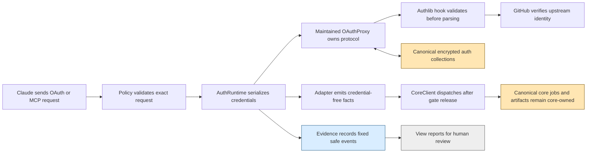
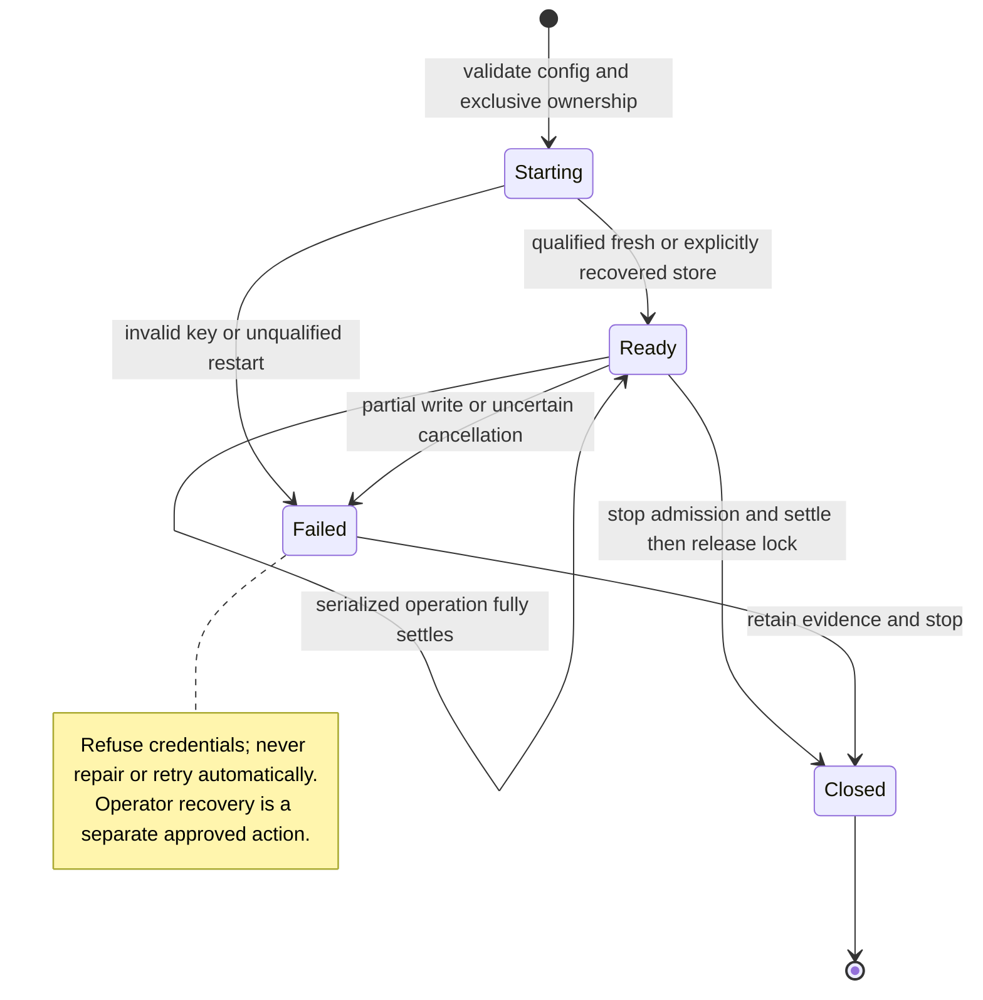

<!-- PURPOSE: Bound the future authentication package without authorizing execution.
     CONTRACT: RT-COWORK-AUTH-009 v1, subordinate to RT-COWORK-MCP-008.
     DEPENDS: Accepted local core; maintained FastMCP/Authlib/MCP; separate D/A.
     CEILING: Draft design only; no implementation, exams, registration or activation. -->
# Cowork future authentication contract

```yaml
contract_id: RT-COWORK-AUTH-009
contract_version: 1
status: draft
owner: Forest
implements: RT-COWORK-MCP-008 section 10 FUTURE AUTH
depends_on: [RT-COWORK-MCP-008]
task_group_id: 53f0ea39-a61e-4307-9c2c-466c1b4b0bd1
dispatchable: false
attempt_ledger: inherited, never reset by this subordinate ID
execution_contract: COWORK-AUTH-009-EXECUTION.md
```

[FIXED] This package MUST preserve AC-008-01/02 and D-008-01/02 identities. It MUST NOT claim core, auth, or deployment acceptance. Its two documents are the entire current writable scope. Normative R rules below are proposed obligations for a future approved build, not permission to build. Definitions are [FIXED] unless explicitly marked [ESCALATE]. Contracts have no line cap under this assignment; prospective source responsibilities MUST each remain below 500 physical lines.

## 1. Authority, status and evidence

Governing inputs read: `/Users/velox/cortados/contracts/CONVENTIONS.md`; `CONVENTIONS.md`, `RUBRIC.md`, `ORCHESTRATION.md`, `PLAYBOOK.md`, and `standards/00-ENGINEERING-STANDARD.md` beneath `/Users/velox/cortados/context-staging/research/ai-coding-std-workflow/` (governing revision `ab1b521047dcabc1b610caa157e5dfbd544f589b`). Project-local parent: [008](COWORK-MCP-008.md) §§2–4 and 10, [execution](COWORK-MCP-008-EXECUTION.md), [decisions](COWORK-MCP-008-DECISIONS.md), [root review](COWORK-MCP-008-ROOT-REVIEW.md). The explicit user-selected ID/location override generic CTX/1NN/single-contract-home naming; they do not waive gates.

Evidence root **V** = `/Users/velox/.cortados-builds/cowork-mcp-verification`. Library root **F** = `/Users/velox/.cortados-builds/cowork-mcp-research/fastmcp/fastmcp_slim/fastmcp`. Installed research root **S** = `V/auth-research-venv/lib/python3.14/site-packages`. These are read-only evidence aliases, not runtime paths or grants.

| Evidence | Meaning retained |
|---|---|
| `V/core-v3-D/FULL-D-REVIEW.md`; e055c51 | Core v3 D=21, A not run. No production failure count inferred. |
| `V/core-v4-D/readiness.json`; 65e2dbb | Core v4 D=3; V4-01 composition and V4-02 examples. |
| `V/core-v4-D-closure/readiness.json`; 1637088 | Independent core D=0; parent SHA256 `89314886b6aaf26c7070d7b82efafcc2699d6e6b92e610d94d648c3e793a2f5c`; A=PENDING_INDEPENDENT_EXAMS; production changes=0. |
| Current assignment | Core QA is authoring exams. No core production exists. Auth build requires accepted core, not merely core D0. |
| `V/008-v2-technical-review.md` | D-008-01: claims hook runs after parsing/writes and misses transparent refresh. D-008-02: one process does not serialize redemption. Neither defect is erased by 009. |
| `V/provider-preflight.md` | GitHub OAuth App `offline_access` is an available candidate; expiring user-token GitHub App is an alternative. No live account/app decision. |
| `V/auth-flow-qualification/{REPORT.md,qualification.py,concurrency.py}` | 81 measured maintained-method cases: 78 malformed rejects before observed parsing/writes, 3 valid controls. Setup included 162 mock calls; concurrency script 4 including setup. Forced duplicate code and refresh exchanges each succeeded twice. |
| Root-confirmed investigation job `4540efb6-75b9-409b-9e85-3c45f21fa08e` | Root independently reran with socket.connect forbidden: zero connects. This is supplied root evidence, not a run by this author. |

Assignment history remains group `53f0ea39-a61e-4307-9c2c-466c1b4b0bd1`: author jobs `a21a86cf-d936-4be9-af76-ddec5048e479`, `5c236b3c-ffc4-4526-ad03-dbf5da0ac957`, `0cf07890-97dd-401c-86ac-cd8bf976a01d`, `162d277f-c2dd-48e8-b1ed-f663af7caa22`. Root-review feedback records draft acceptance only. This authoring is not a valid production attempt. Missing fixtures/environment are blocked, not failed builds. A second valid failure of the same design still triggers design_error; changing package/model never resets it.

No cortados-workers tool was exposed in this author session. No delegation, network, installs, model calls, credential reads, probes, acceptance tests or commits were performed. Existing concurrent `acceptance/cowork_mcp/` work is outside scope.

## 2. Maintained owners and pins

Observed searches: `rg --files integrations/mcp`, `rg -n 'CoreRuntime|CoreClient|create_test_app|load_core_config' docs/mcp-worker/COWORK-MCP-008.md`, and AST extraction of the pinned library files. Current checkout contains ordinary broker/server/job-store/native owners; remote core modules are prospective. Do not treat a contract signature as an implemented import.

| Responsibility | Disposition / sole owner |
|---|---|
| OAuth consent, state, PKCE, code issuance, JWT issuance, refresh transitions | ADOPT FastMCP GitHubProvider → OAuthProxy → MCP handlers / Authlib. No local OAuth engine. |
| Strict resource, temporal, owner/client and safe-error policy | BUILD NEW thin adapters; maintained defaults demonstrably omit these constraints. |
| Credential storage | ADOPT explicit maintained FileTreeStore + Fernet wrapper + provider PydanticAdapters. No second token database. |
| Auth serialization and startup refusal | BUILD NEW outer lifetime owner; maintained per-upstream lock excludes explicit code/refresh races. |
| Tool transport and byte transfer | EXTEND only accepted remote_http composition; one SDK manager and original transfer owner. |
| Core lifecycle, jobs, capacity/quota and native subscription billing | ADOPT 008 and existing broker. Auth never owns a queue, retries, quota or model billing. |
| stdio and training | ADOPT unchanged. No remote dependency import on ordinary startup. |

FastMCP reference HEAD: `83c9764e0bc2d9d32910b82264c09370da24ab7a`. The qualification report confirms installed github/proxy hashes equal reference. Exact examined hashes:

| Path relative to F, except S entries | SHA256 |
|---|---|
| server/auth/providers/github.py | `13a89114465210ba0fcce39b4ff3e7acb09a699a8a5de0e97223c419f53141ba` |
| server/auth/oauth_proxy/proxy.py | `58f13a58bd31373c13ee166f94bf3726dadd6bb86a6c8da89de3b09a627d26f0` |
| server/auth/oauth_proxy/models.py | `b2f45bc919484355f89ad10bf06d84cf45ebf5ed9af51b932ea0800c665242f8` |
| server/auth/oauth_proxy/consent.py | `2810a5bb3df3f1548b04601621d7b9363b88f711991696974244db91ffc823f3` |
| server/auth/jwt_issuer.py | `9d3bceb3ffb9aa86bf080f7e0a972aeddc7a87e75b483be6af4bf4dc94f7bd9e` |
| server/auth/auth.py | `94405db4b54afb041e41c7ba70ac31781f67f1f769c017d9213238edd0cd8b86` |
| S/mcp/server/auth/handlers/token.py | `cade6452f07cce106038da586493904c5ca82590610b450a3d4137190324a2db` |
| S/authlib/integrations/httpx_client/oauth2_client.py | `24c0c3dd6b05c8daeb9d781ce6ceef6c64107ae25a881076fefb82a5995ae463` |

Resolved research versions: fastmcp-slim=3.4.9, Authlib=1.9.1, mcp=1.30.0, httpx=0.28.1, py-key-value-aio=0.4.6, starlette=1.8.0, cryptography=50.0.2, pydantic=2.14.1, uvicorn=0.54.0. Complete transitive freeze: `V/auth-research-freeze.txt`. This is a research environment, not an approved production lock. A separately reviewed remote extra/lock MUST preserve ordinary installed environments.

### Exact called interfaces

The following are observed signatures, not reconstructed SDK APIs. Types retain their owning imports. `self` is omitted.

| Symbol and source | Signature / use |
|---|---|
| github.py:206 GitHubProvider | Keyword-only `client_id:str, client_secret:str, base_url:AnyHttpUrl|str, resource_base_url:AnyHttpUrl|str|None=None, issuer_url:AnyHttpUrl|str|None=None, redirect_path:str|None=None, required_scopes:list[str]|None=None, timeout_seconds:int=10, cache_ttl_seconds:int|None=None, max_cache_size:int|None=None, allowed_client_redirect_uris:list[str]|None=None, client_storage:AsyncKeyValue|None=None, jwt_signing_key:str|bytes|None=None, require_authorization_consent:bool|Literal['remember','external']=True, consent_csp_policy:str|None=None, forward_resource:bool=True, fallback_refresh_token_expiry_seconds:int|None=None, fastmcp_access_token_expiry_seconds:int|None=None, token_expiry_threshold_seconds:int=0, http_client:httpx.AsyncClient|None=None, enable_cimd:bool=True`. |
| proxy.py:719 | `_create_upstream_oauth_client()->authlib.integrations.httpx_client.AsyncOAuth2Client`; MUST call super then register both compliance hooks before returning. No constructor extra_authorize_params on GitHubProvider. |
| consent.py:277 | `_build_upstream_authorize_url(txn_id:str, transaction:dict[str,Any])->str`; MUST copy transaction, replace copied scopes with identity scopes plus offline_access, then call super. |
| proxy.py:838 | `async register_client(client_info:mcp.shared.auth.OAuthClientInformationFull)->None`; persists public ProxyDCRClient, not confidential client credentials. |
| proxy.py:1027,1075 | `async load_authorization_code(client:OAuthClientInformationFull,authorization_code:str)->AuthorizationCode|None`; `async exchange_authorization_code(client:OAuthClientInformationFull,authorization_code:AuthorizationCode)->OAuthToken`. |
| proxy.py:1384,1420 | `async load_refresh_token(client:OAuthClientInformationFull,refresh_token:str)->RefreshToken|None`; `async exchange_refresh_token(client:OAuthClientInformationFull,refresh_token:RefreshToken,scopes:list[str])->OAuthToken`. |
| proxy.py:1797,2008,2146 | `async load_access_token(token:str)->AccessToken|None`; `get_routes(mcp_path:str|None=None)->list[Route]`; `async _handle_idp_callback(request:Request)->HTMLResponse|RedirectResponse`. |
| jwt_issuer.py:218 | `verify_token(token:str,expected_token_use:str='access')->dict[str,Any]`; reuse signature checks, add stricter claim checks. Never call issue_* from adapter. |
| Authlib oauth2_client.py:177–180,195–198 | `register_compliance_hook('access_token_response',hook)` and `register_compliance_hook('refresh_token_response',hook)` run synchronous `hook(httpx.Response)->httpx.Response` before `parse_response_token`. |
| MCP TokenHandler:93–232 | `async handle(request:Request)` authenticates client before code lookup :133 / exchange :189 and refresh lookup :199 / exchange :232. Gate MUST wrap endpoint entry, not exchange methods. |
| auth.py:329 | `get_middleware()->list` uses AuthenticationMiddleware/backend=BearerAuthBackend(verifier), then AuthContextMiddleware. Adapter replaces verifier only. |
| MCP 1.30 transport | `StreamableHTTPSessionManager(app=lowlevel_server,json_response=True,stateless=True)`; lifespan enters `manager.run()`; POST routes to `manager.handle_request(scope,receive,send)`. Adopt accepted 008 interface. |

## 3. Typed adapter boundary and compact examples

All local records are closed, required-field records. JSON duplicate keys, unknown keys, nonfinite values, surrogate text and bool-as-int MUST refuse. N/P/ID/Hash/Principal/CoreLimits/Owner are exactly 008 §2; identity remains strings. Epoch times below are UTC seconds, not core millisecond fields. Monotonic time measures waits only.

| Record | Exact fields / constraints |
|---|---|
| AuthConfig | `schema:'cortados.cowork-auth.v1', origin:HTTPSOrigin, issuer:Nonblank, resource:Nonblank, installation_id:ID, github_subject:decimal-string ^[1-9][0-9]*$, downstream_client_id:Nonblank, redirect_uri:'https://claude.ai/api/mcp/auth_callback', enabled:bool, identity_scopes:tuple[] or tuple['read:user'], auth_root:absolute-path, upstream_client_id:Nonblank, upstream_secret_ref:Nonblank, signing_key_ref:Nonblank, storage_key_ref:Nonblank, control_bytes:P, gate_wait_ms:P, operation_ms:P, response_bytes:P`. Secret references are opaque operator-resolver names, never values or caller paths. |
| VerifiedClaims | `iss:str=issuer, aud:str=resource, token_use:'access', exp:P, iat:N, client_id:str=downstream_client_id, jti:Nonblank`; optional `nbf:N`. Require exp>now, iat<=now, nbf<=now, iat<exp. Other maintained JWT claims may exist but are not copied. |
| AuthorizationFacts | `principal:Principal, resource:str, expires_at:P`; principal issuer=canonical issuer, subject=verified live GitHub decimal ID, installation_id=config ID, client_id=verified downstream ID, enabled=true. No credential. |
| AuthEvent | `schema:'cortados.cowork-auth-event.v1', event_id:ID, at_ms:N, event:enum[starting,ready,refused,failed,closed], reason:enum[none,invalid_request,invalid_token,owner_disabled,upstream_unavailable,storage_unavailable,operation_interrupted,gate_exhausted]`. No payload/URI/path/credential/exception. |
| AuthFailure | `error:enum[invalid_request,invalid_client,invalid_grant,temporarily_unavailable], error_description:'Authentication request refused'`. Resource 401 uses fixed `invalid_token` challenge instead of this OAuth token endpoint body. |
| AuthRuntime (not serialized) | Single process-owned provider, gate, exclusive root-lock fd, state in enum[starting,ready,failed,closed]. No token serializer or cross-process credential channel. |

Constructor invariants: issuer MUST equal `str(provider.base_url)` after Pydantic normalization, including root slash; resource MUST equal exact origin + `/mcp`. Origin has no userinfo/path/query/fragment. No default live origin, subject, limits, retention, app or client. Local fixtures supply every parameter; synthetic numbers are not deployment policy.

Prospective APIs (new local APIs, not claims that files exist):

| Owner | Signature and effects |
|---|---|
| remote_auth_config | `load_auth_config(raw:bytes)->AuthConfig`; pure validation, no credentials/files opened. |
| remote_auth_provider | `class StrictGitHubProvider(GitHubProvider)` overrides only the two constructor/authorize hooks in §2; `validate_token_response(response:httpx.Response)->httpx.Response`; no gate acquisition. |
| remote_auth_claims | `validate_claims(raw:dict[str,object],config:AuthConfig,now_s:int)->VerifiedClaims`; `project_facts(claims:VerifiedClaims,live:AccessToken,config:AuthConfig)->AuthorizationFacts`; pure, no upstream calls. |
| remote_auth_runtime | `AuthRuntime(*,config:AuthConfig,secrets:ResolvedAuthSecrets)`; async enter/exit; `async verify_token(token:str)->AccessToken|None`; `wrap_oauth(endpoint:ASGIApp)->ASGIApp`; owns single gate and storage lifetime. ResolvedAuthSecrets is a private in-memory closed record `{upstream_secret:str,signing_key:bytes,storage_key:bytes}`, never JSON/repr/logged. |
| remote_auth_errors | `safe_oauth_app(app:ASGIApp,*,config:AuthConfig)->ASGIApp`; bounded response filter and fixed local event emission; no protocol minting. |
| remote_service | `create_remote_app(*,core_client:CoreClient,principal:Principal,frontend:FrontendConfig,auth:AuthRuntime)->ASGIApp`; calls the accepted single HTTP composition seam; does not construct another tool server. |

Example notation: `ref(E)` expands the named complete example; `replace(E,field,value)` changes one field; `omit(E,field)` removes one. These are documentation operators, never runtime JSON. QA expands them in its own fixture; nested constituents MUST NOT be recopied into multiple documents.

| Example | Valid value / invalid variant |
|---|---|
| E1 upstream success (recorded probe shape) | `{"access_token":"SYNTHETIC-ACCESS","refresh_token":"SYNTHETIC-REFRESH","token_type":"bearer","expires_in":3600,"refresh_token_expires_in":7200}`; invalid `replace(E1,expires_in,true)` or `omit(E1,refresh_token)`. |
| E2 normalized response | E1 with refresh_token_expires_in removed and refresh_expires_in=7200; invalid both aliases unequal. |
| E3 claims at now=1000 | `{"iss":"https://cowork.invalid/","aud":"https://cowork.invalid/mcp","token_use":"access","exp":4600,"iat":1000,"client_id":"synthetic-claude","jti":"synthetic-jti"}`; invalid omit exp, aud array, aud ending slash, nbf=1001 or exp=true. |
| E4 Principal | `{"issuer":"https://cowork.invalid/","subject":"42","installation_id":"11111111-1111-4111-8111-111111111111","client_id":"synthetic-claude","enabled":true}`; invalid subject=42 or an HTTP-supplied owner. |
| E5 AuthorizationFacts | `{principal:ref(E4),resource:'https://cowork.invalid/mcp',expires_at:4600}`; invalid extra upstream_token field. |
| E6 local event | `{"schema":"cortados.cowork-auth-event.v1","event_id":"22222222-2222-4222-8222-222222222222","at_ms":1000000,"event":"refused","reason":"invalid_token"}`; invalid extra exception field. |
| E7 OAuth error | `{"error":"invalid_grant","error_description":"Authentication request refused"}`; invalid provider-supplied description. |
| E8 upstream error input | `{"error":"invalid_grant","error_description":"SYNTHETIC-SECRET-SENTINEL"}`; invalid error array. Both produce no successful token state; sentinel never reaches logs or response. |
| E9 AuthConfig | All fields in §3: schema literal; origin/issuer/resource from E3; installation/client from E4; github_subject='42'; exact hosted redirect; enabled=true; identity_scopes=[]; auth_root='/synthetic/private/auth'; upstream_client_id='synthetic-upstream'; refs='synthetic-secret','synthetic-sign','synthetic-storage'; control_bytes=65536; gate_wait_ms=1000; operation_ms=5000; response_bytes=65536. Invalid omitted github_subject, origin with path, shared task/auth root, or signing/storage reference equality. Values are exam-only. |

## 4. Credential lifetime and storage

R1 [FIXED, AC-008-02] The response hook MUST validate every successful response before Authlib parses it, because late validation already allowed persistence and entirely missed transparent refresh (D-008-01). Success requires object JSON, nonblank access_token and refresh_token strings, token_type string case-insensitively equal to bearer, strict integer expires_in and refresh lifetime in 1..9007199254740991. This integer bound is the inherited interoperable P range, not an invented TTL. Either expiry alias is allowed; both must be strict equal integers. Normalize to refresh_expires_in. Optional scope must be a string. Optional expires_at must be removed before parsing so provider-controlled absolute time cannot override validated expires_in. Unknown success fields are discarded; no id_token is retained. Body/status/size/JSON failure raises only a fixed local error. HTTP non-2xx or an error member takes the fixed failure branch, never successful parsing or durable mutation. No fallback lifetime or fabricated refresh is permitted.

R2 [FIXED, AC-008-02] `_create_upstream_oauth_client` MUST install the hook for both response events on super's client, because callback, explicit refresh and `_try_transparent_refresh` all use that seam. `_extract_upstream_claims` MUST NOT enforce lifetimes. Downstream code redemption performs no upstream fetch; it trusts callback state, so corrupted stored ClientCode must refuse through storage/schema validation rather than synthesize a response.

R3 [FIXED, AC-008-02] AuthRuntime MUST acquire one process-wide async gate before any credential load for callback, authorization/consent, token exchange, or resource verification. It MUST hold the gate through every maintained read/exchange/write/delete and failure settlement. Wrappers must surround returned OAuth ASGI endpoints, before SDK client authentication; resource verification acquires at `AuthRuntime.verify_token` before JWT/store lookup. Inner provider hooks MUST NOT reacquire. Discovery reads no credentials. No public register/revoke endpoint is mounted in this profile. Future registration/restore commands require the exclusive process lock while the service is stopped. This prevents D-008-02's load-before-lock race without rewriting transitions.

R4 [FIXED, AC-008-01/02] No core/task/DB lock may be held while waiting for auth. Resource verification MUST release auth gate before CoreClient dispatch or any transfer bytes. The gate MUST NOT enclose a job lifetime. A bounded gate wait refuses with fixed temporarily_unavailable; a waiter never starts an exchange after its request deadline. Gate wait and operation durations are mandatory measured parameters. No worker/auth automatic retries follow refusal. This prevents a slow GitHub call from becoming a job queue owner.

R5 [FIXED, AC-008-02] A cancelled/timed-out operation after credential access, uncertain upstream effect, storage error or partial mutation MUST transition AuthRuntime to failed before gate release. New protected requests MUST refuse until explicit operator recovery. In-flight operation settlement MUST precede releasing the exclusive root lock. A process crash or unproven settlement MUST never be described as a completed rollback or refresh-family revocation. The safe default at restart is refusal to serve existing auth state pending recovery qualification, not silent state clearing. Root choice O3 determines the later recovery ritual; no builder may choose it privately.

Exact maintained storage construction is `FileTreeStore(data_directory=auth_root,key_sanitization_strategy=FileTreeV1KeySanitizationStrategy(auth_root),collection_sanitization_strategy=FileTreeV1CollectionSanitizationStrategy(auth_root))`, wrapped by `FernetEncryptionWrapper(key_value=store,fernet=Fernet(storage_key),raise_on_decryption_error=True)`. Imports are the maintained key_value classes in proxy.py:35–43. Pass this explicit wrapper as client_storage. Stable independent signing/encryption secrets are resolved outside tools. No implicit default store: its decryption-as-miss setting is disallowed.

| Store aspect | Contract |
|---|---|
| Class | Provider auth records are Canonical; loss requires reauthentication, not projection rebuild. Immutable synthetic captures are Evidence. Human reports are Views, never runtime input. No new token projection. |
| Write | OAuthProxy alone owns six PydanticAdapter collections; adapter supplies serialization/lifetime only. FileTree writes are multi-record, not a transaction; no fsync/power-loss claim. |
| Query | Maintained keyed get/put/delete under gate. Numeric latency/RSS/query budgets remain unmeasured; execution §5 defines measurement before A/B. |
| Mutability | Provider rotates/upserts/deletes credentials with its TTLs. Operator disable is a service policy latch; no local token-family mutation. No automatic purge/repair on corruption. |
| Identity | Maintained random txn/code/upstream/JTI keys; refresh metadata keyed by maintained SHA256(token). Owner identity uses existing canonical([issuer,subject,installation_id]); no new owner algorithm. |
| Rebuild | n/a—canonical. Backup only with service stopped and exclusive lock, entire auth directory + separately secured matching keys + config/dependency identity. Restore remains disabled until canary/integrity/old-token refusal requirements pass; stale backup replay is O3. |
| Failure | Missing/decrypt-invalid/type-invalid referenced row refuses. Partial writes or uncertain network effect fail the lifetime. Restart cannot presume clean multiwrite state. No automatic retry, rollback, deletion or restore. |

Exact provider records (models.py, inherited defaults retained only inside dependency): OAuthTransaction stores txn_id/client_id/client_redirect_uri/client_state/code_challenge/code_challenge_method/scopes/created_at plus resource/proxy_code_verifier/csrf_token/csrf_expires_at/consent_token nullable fields. ClientCode stores code/client_id/redirect_uri/code_challenge/code_challenge_method/scopes/idp_tokens/expires_at/created_at. UpstreamTokenSet stores upstream_token_id/access_token/refresh_token/refresh_token_expires_at/expires_at/token_type/scope/client_id/created_at/raw_token_data. JTIMapping stores jti/upstream_token_id/created_at. RefreshTokenMetadata stores client_id/scopes/expires_at/created_at. ProxyDCRClient extends OAuthClientInformationFull with allowed_redirect_uri_patterns/client_name/cimd_document/cimd_fetched_at and excluded allow_unregistered_redirect_uris.

Collection names respectively: `mcp-oauth-transactions`, `mcp-authorization-codes`, `mcp-upstream-tokens`, `mcp-jti-mappings`, `mcp-refresh-tokens`, `mcp-oauth-proxy-clients`. These are private secret-bearing library records, not public MCP output or newly owned schemas. Full types are pinned to models.py hash. QA captures actual serialized examples through maintained methods using E1/E3/E4 and pairs each with a missing required key/corrupt ciphertext negative; no handwritten replacement serializer.

Maintained lifetimes are adopted, not locally minted: transaction TTL=900 seconds (proxy.py:994), consent CSRF lifetime/transaction renewal=900 seconds (consent.py:365,406–412,522), authorization-code lifetime=300 seconds (models.py DEFAULT_AUTH_CODE_EXPIRY_SECONDS). Upstream access and refresh expiration derive only from R1's actual durations and the maintained clock. With fastmcp_access_token_expiry_seconds=None, downstream access mirrors the validated upstream duration; JTI TTL follows the corresponding token, upstream-store TTL is max(access,refresh,downstream-access,1), and refresh metadata follows refresh duration (proxy.py:1211,1251–1274,1573–1654). Client registration persists without a locally imposed expiration. Expiry is not proof of secure file erasure. No refresh-family reuse revocation, sliding session life, automatic cleanup schedule or new lifetime default is promised. Q MUST exercise equality boundaries against the pinned provider rather than silently changing its comparisons.

R6 [FIXED, AC-008-02] Auth root MUST be an existing operator-owned private 0700 directory outside task/blob/staging roots, with no symlink ancestors and 0600 regular secret/state files. AuthRuntime MUST acquire an exclusive nonblocking no-follow lifetime lock before constructing storage/provider; a second process refuses before reading credentials. Startup validation failure has no listener or core dispatch. Storage/key rotation MUST stop admission; no old-session continuity is promised. Filesystem durability qualification and backup policy are explicit gates, not invented FileTree guarantees.





```mermaid
sequenceDiagram
  participant C as Claude request
  participant A as AuthRuntime gate
  participant P as Maintained provider
  participant S as Encrypted canonical store
  participant B as Existing CoreClient and broker
  C->>A: bearer or token exchange
  A->>A: acquire before credential lookup
  A->>P: maintained endpoint or load_access_token
  P->>S: reads then multiple writes and deletes
  Note over P,S: Serialized, not transactionally atomic
  P-->>A: result or failure
  A->>A: sanitize and settle; release gate
  A->>B: verified MCP call only
  B-->>C: existing core result
  Note over A,B: No auth lock across broker work; no token over IPC
```

## 5. Identity, ingress and safe errors

R7 [FIXED, AC-008-01] AuthRuntime MUST first verify the proxy JWT signature with maintained JWTIssuer, then enforce VerifiedClaims, then call maintained load_access_token under the same gate. It MUST compare live `AccessToken.claims['sub']` to the configured decimal GitHub subject. GitHub verifier's returned client_id is the GitHub ID, not downstream client identity (github.py:150–166); the adapter MUST use JWT client_id for the latter. Missing/live foreign subject denies, even with a valid signature. Raw GitHub/PAT/ID/refresh tokens are never alternate resource authenticators.

R8 [FIXED, AC-008-01] The SDK-facing AccessToken MUST be newly projected with token equal to the incoming proxy bearer, client_id from verified claims, scopes=[], expires_at=proxy exp, resource=exact resource, subject=live subject and claims containing only canonical iss/sub/installation_id. It MUST NOT copy the upstream token or user JSON. AuthorizationFacts alone cross the trusted composition boundary; core receives its existing Principal, not any bearer. Owner rollover retains issuer/subject/installation; client change requires stopped-service reconfiguration/rebind, never a caller-selected owner.

R9 [FIXED, AC-008-01/02] Construction MUST use required_scopes=[] (or separately reviewed read:user), cache_ttl_seconds=None, consent=True, forward_resource=False, enable_cimd=False, exact callback allowlist and explicit encrypted store. get_routes('/mcp') MUST run once before JWT verification. Registration enabled MUST be set false before routes are made; `/register` MUST be absent. The synthetic upstream-ID client MUST be denied by the distinct downstream client allowlist. offline_access is an upstream authorize hint only, not an API scope requirement or a repository grant. `/user/repos` is a maintained verification call, not a request for repo permission. A live failure with minimal permissions is an activation blocker, not permission to broaden scopes.

Exact remaining constructor operands: base_url=origin, resource_base_url=origin, issuer_url=origin, redirect_path='/auth/callback', client_id=upstream_client_id, client_secret=resolved upstream secret, jwt_signing_key=resolved signing bytes, client_storage=explicit encrypted wrapper, allowed_client_redirect_uris=[config.redirect_uri], require_authorization_consent=True, fastmcp_access_token_expiry_seconds=None, token_expiry_threshold_seconds=0. `provider.client_registration_options.enabled=False` precedes get_routes. No fallback expiry is deliberately selected; R1 makes missing duration unreachable as success. The optional shared verifier http_client remains None in this profile, preserving maintained per-verification client lifetime; any pooling change requires measurement and explicit ownership. Provider timeout_seconds=10 is source behavior to measure under O6, not a promise of end-to-end deadline compliance.

R10 [FIXED, AC-008-02] Ingress MUST reject duplicate authorize/token fields before maintained parsing. Authorize requires exactly one resource equal byte-for-byte to config.resource, response_type=code, the configured client_id and redirect_uri, code_challenge_method=S256 and 43-character base64url SHA256 challenge. Token code grant requires exact client/resource/redirect and verifier; refresh grant requires exact client/resource and refresh_token. Maintained handlers MUST still verify client binding, code, redirect, verifier and scopes. No URL normalization may broaden policy; `/mcp/`, changed port/query/fragment and array audiences deny. The adapter MUST bound form/body bytes using configured control_bytes before parsing. Root must reconcile metadata advertising confidential methods with this public-PKCE profile (O4).

R11 [FIXED, AC-008-01] All `/mcp` methods MUST authenticate before method dispatch, including initialization/listing. After auth, accepted core POST-only behavior remains; other methods return the core 405. No second `/mcp` route or FastMCP tool server is allowed. Discovery/OAuth protocol routes remain public within their exact method table. Transfers use existing core ticket capability, not an added OAuth bearer requirement; the ticket's Authorization header cannot be interpreted as a proxy JWT. Public origin/Host/Origin policy and trusted ingress configuration MUST refuse unknown origins; forwarded identity headers confer no authority.

R12 [FIXED, AC-008-01/02] Dependency logs from fastmcp.server.auth, mcp.server.auth, authlib, httpx and httpcore MUST be dropped before handlers, including exception/traceback text; ASGI/ingress access logs MUST omit query/body/Authorization/Cookie. Only AuthEvent is emitted locally once per transition/refusal. Fixed-safe response filtering MUST cover callback HTML errors, token JSON errors, OAuth error redirects and uncaught failures before bytes are sent. Redirect error replacement may preserve state only after maintained validated redirect binding; no untrusted Location is echoed. Success protocol fields remain unchanged. Error HTML becomes fixed text; token errors use E7; resource denial uses SDK 401 with build_resource_metadata_url(resource) and no token detail. Response buffering is limited by response_bytes; overflow refuses without leaking partial bytes. Sentinel captures across logs, stderr, headers, body and exception paths are required because debug-off does not remove error-level leaks at proxy.py:1100,1479,2328–2331.

R13 [FIXED, AC-008-01/02] Owner disable MUST refuse new authenticated admission and invoke accepted CoreRuntime.disable_owner(owner_id) to revoke tickets/close streams. Accepted jobs retain their original lifetime and operator cancellation path. Expiry, auth failure, frontend loss and reconnect MUST NOT cancel, duplicate or retry a job. GitHub authenticates connector owner only; native execution continues through existing subscription and fresh quota admission without API-key fallback.

## 6. Accepted-core seam proposal, not a parent rewrite

[ESCALATE O2] 008 currently fixes `CoreConfig.mode='local_test'`, synthetic principal/origin, constructor-only raw validation, and `create_test_app` with no credential lookup. A live AuthConfig cannot be passed as though it were valid CoreConfig. The dependent integration cannot build until root approves the following exact amendment or returns a replacement:

* EXTEND remote_config with `load_service_core_config(raw:bytes,base:BaseConfig,*,principal:Principal)->CoreConfig` and a distinct mode literal `oauth_service`; reuse the existing limits/roots/retention/snapshot validator. Preserve `load_core_config` strict local_test behavior. Production principal is from validated operator binding plus live R7 checks, never raw HTTP fields.
* EXTEND CoreRuntime with keyword-only `trusted_service_principal:Principal|None=None`; ordinary omitted branch remains byte-equivalent. Non-None selects the new validator before lock/DB construction. Broker process receives only this closed trusted Principal/config snapshot through trusted launcher construction, not a caller-supplied mode or OAuth secret.
* EXTEND remote_http with one internal `compose_http_app(*,core_client,principal,config,mcp_guard,extra_routes)` owner. Existing create_test_app supplies no-op synthetic guard and empty routes. create_remote_app supplies R7–R12 guard and maintained OAuth routes. The same lowlevel server/manager, 12 descriptors and transfer handlers are constructed once. No catch-all public mount may bypass guard.
* The launcher MUST bind CoreClient via the existing inherited socketpair construction after CoreRuntime recovery and before ASGI admission. App shutdown closes its frontend endpoint; it cannot terminate accepted jobs. A separately approved lifecycle supervisor owns stopping the broker. Existing broker/core locks remain independent of auth gate.

This is prospective sequential ownership only. No existing core file or current QA fixture is writable under this draft. Retention different from 008's explicit_delete/preserve schema needs an explicit parent amendment; mandatory values alone do not make a new retention semantic valid.

## 7. Stable acceptance identity and root decisions

Historical source `git show d4c99db:docs/mcp-worker/COWORK-MCP-008-EXECUTION.md` rows 008-01/02 is retained verbatim below under their stable AC aliases. Current parent v4 names AC-008-01/02 but has no replacement canonical full rows. These are historical wording, not a claim the old gate split is still sufficient:

| Stable ID | Historical local/prebuild text | Historical activation text |
|---|---|---|
| AC-008-01 | Real loopback ASGI discovery/401 challenge, all MCP methods auth, exact port/path/resource; PAT/ID/refresh/wrong issuer/audience/expiry denied | Actual hosted discovery/callback |
| AC-008-02 | Maintained-provider local fixtures: S256 only, exact redirect, duplicate/resource rejection, no positive cache, bad-secret logs, encrypted restart/unknown-key fail closed | Real GitHub App identity/refresh/rotation; two parallel refreshes and crash windows; client deadlines |

R14 [FIXED, AC-008-01/02] Independent QA MUST retain those identities and defect evidence. Root MUST explicitly ratify the supplemental local race/crash/hook requirements R1–R6 before A; moving them out of activation is the D-008-02 correction, not a new AC or erased failure. Actual provider may be OAuth App or GitHub App after Forest's choice. The historical “Real GitHub App” wording is not a mandate to register one now.

Every normative R maps to the same stable AC in its label. Execution defines protected exams, resource measurements and deployment gates. No authored example or probe is independent acceptance. Mermaid rendering and complete document schema checks remain QA gates; no renderer was installed or invoked here.

| Open decision / exact conflict | Concrete alternatives and consequence | Owner / blocks |
|---|---|---|
| O1 deployed identity/application/file policy | Forest may approve proposed login 4list233 / string subject '237812476' and OAuth App offline_access, or choose a different subject/expiring GitHub App. Decimal file limits and payload/history/tombstone/backup retention remain unanswered. No repo permissions. | Forest via root; activation only; synthetic parameterized design remains possible. |
| O2 core synthetic restriction versus production composition | Ratify the exact service-mode/runtime/http seam in §6 after core acceptance, or keep core synthetic and author a separately reviewed trusted launcher interface. Never relabel live values as local_test or build a second handler. | Root technical amendment + independent QA; integration build. |
| O3 FileTree multiwrite versus restart continuity | (a) Reject every restart of a used namespace until operator quarantines it and re-registers/re-authenticates into a new isolated namespace; no continuity, no automatic deletion. (b) Add a separately reviewed durable dirty/clean lifetime marker with demonstrated filesystem flush semantics and refuse dirty restore; more design/exams. Neither may promise atomic upstream rollback or safe stale-backup replay. Current guaranteed behavior is startup refusal, not an implicit choice of (a). | Root/Forest recovery semantics; auth D/A and recovery implementation. |
| O4 public PKCE client versus advertised metadata | Maintained metadata with CIMD off advertises client_secret_post/basic although register_client stores none. Qualify Claude accepting that metadata, or approve a thin metadata correction advertising none with independent protocol tests. Confidential/DCR profile requires another amendment; never hand Claude the upstream secret. | Root + QA, Forest for client-policy change; metadata implementation/activation. |
| O5 old AC wording versus new scope | Ratify verbatim historical rows plus R14 supplement, or publish a versioned canonical AC amendment preserving IDs/history. No private renaming or silent gate relocation. | Root; auth A. |
| O6 source accepts permissive shapes and has 30s HTTP timeout | Approve strict response projection R1 and measured operation/gate budgets; or require additional provider-format qualification before dispatch. Existing 30s upstream timeout plus verification/gate may exceed Claude's 30s deadline; do not claim 10s/30s client constraints satisfied. | Root + QA; auth A/B budgets, live deadline qualification. |
| O7 conventions versus assignment location/ID and dependency scope | Record explicit assignment naming/location override and dependency approval in existing index later; no edit here. Approve remote-only lock/extra after ordinary parity, or keep deployment blocked. | Root; integration/packaging. |

[FIXED] These contradictions return to root unchanged. No row grants permission to choose an alternative privately, create an app, resolve secrets, register a client, expose a listener or select a live default.
