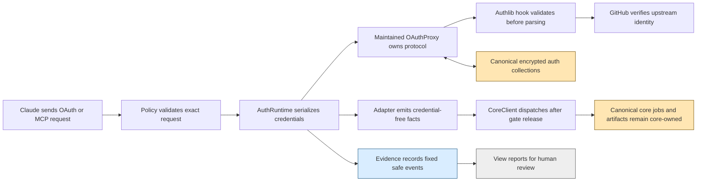
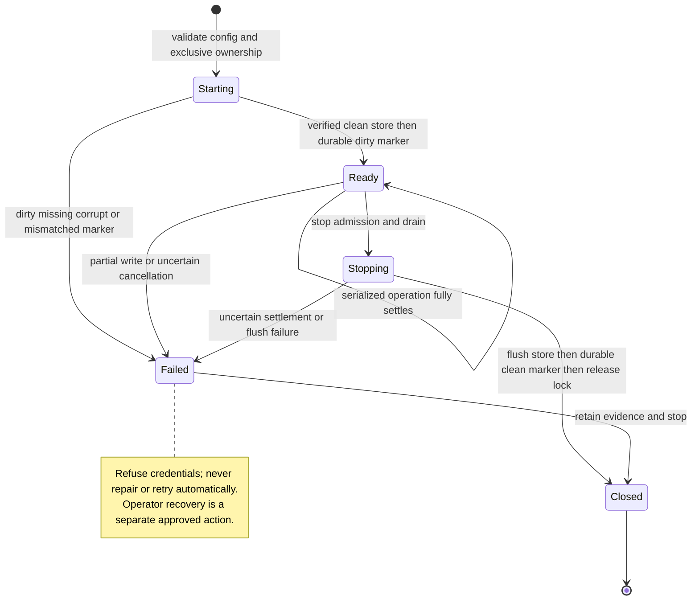

<!-- PURPOSE: Bound the future authentication package without authorizing execution.
     CONTRACT: RT-COWORK-AUTH-009 v2, subordinate to RT-COWORK-MCP-008.
     DEPENDS: Accepted local core; maintained FastMCP/Authlib/MCP; separate D/A.
     CEILING: Draft design only; no implementation, exams, registration or activation. -->
# Cowork future authentication contract

```yaml
contract_id: RT-COWORK-AUTH-009
contract_version: 2
status: draft
owner: Forest
implements: RT-COWORK-MCP-008 section 10 FUTURE AUTH
depends_on: [RT-COWORK-MCP-008]
task_group_id: 53f0ea39-a61e-4307-9c2c-466c1b4b0bd1
dispatchable: false
attempt_ledger: inherited, never reset by this subordinate ID
execution_contract: COWORK-AUTH-009-EXECUTION.md
```

[FIXED] This package MUST preserve AC-008-01/02 and D-008-01/02 identities. It MUST NOT claim core, auth, or deployment acceptance. Its two documents are the entire current writable scope. Normative R rules below are proposed obligations for a future approved build, not permission to build. Definitions are [FIXED] unless explicitly marked [ESCALATE]. Contracts have no line cap under this assignment; prospective source responsibilities MUST each remain below 500 physical lines.

## 1. Authority, status and evidence

Governing inputs read: `/Users/velox/cortados/contracts/CONVENTIONS.md`; `CONVENTIONS.md`, `RUBRIC.md`, `ORCHESTRATION.md`, `PLAYBOOK.md`, and `standards/00-ENGINEERING-STANDARD.md` beneath `/Users/velox/cortados/context-staging/research/ai-coding-std-workflow/` (governing revision `ab1b521047dcabc1b610caa157e5dfbd544f589b`). Project-local parent: [008](COWORK-MCP-008.md) §§2–4 and 10, [execution](COWORK-MCP-008-EXECUTION.md), [decisions](COWORK-MCP-008-DECISIONS.md), [root review](COWORK-MCP-008-ROOT-REVIEW.md). The explicit user-selected ID/location override generic CTX/1NN/single-contract-home naming; they do not waive gates.

Evidence root **V** = `/Users/velox/.cortados-builds/cowork-mcp-verification`. Library root **F** = `/Users/velox/.cortados-builds/cowork-mcp-research/fastmcp/fastmcp_slim/fastmcp`. Installed research root **S** = `V/auth-research-venv/lib/python3.14/site-packages`. These are read-only evidence aliases, not runtime paths or grants. Revision reads use root technical directions at standalone commit 495973c. No original repo edits or workers are authorized.

| Evidence | Meaning retained |
|---|---|
| `V/core-v3-D/FULL-D-REVIEW.md`; e055c51 | Core v3 D=21, A not run. No production failure count inferred. |
| `V/core-v4-D/readiness.json`; 65e2dbb | Core v4 D=3; V4-01 composition and V4-02 examples. |
| `V/core-v4-D-closure/readiness.json`; 1637088 | Independent core D=0; parent SHA256 `89314886b6aaf26c7070d7b82efafcc2699d6e6b92e610d94d648c3e793a2f5c`; A=PENDING_INDEPENDENT_EXAMS; production changes=0. |
| Current assignment | Core QA is authoring exams. No core production exists. Auth build requires accepted core, not merely core D0. |
| `V/008-v2-technical-review.md` | D-008-01: claims hook runs after parsing/writes and misses transparent refresh. D-008-02: one process does not serialize redemption. Neither defect is erased by 009. |
| `V/provider-preflight.md` | GitHub OAuth App `offline_access` is an available candidate; expiring user-token GitHub App is an alternative. No live account/app decision. |
| `V/auth-flow-qualification/{REPORT.md,qualification.py,concurrency.py}` | 81 measured maintained-method cases: 78 malformed rejects before observed parsing/writes, 3 valid controls. Setup included 162 mock calls; concurrency script 4 including setup. Forced duplicate code and refresh exchanges each succeeded twice. |
| Root-confirmed investigation job `4540efb6-75b9-409b-9e85-3c45f21fa08e` | Root independently reran with socket.connect forbidden: zero connects. This is supplied root evidence, not a run by this author. |

Assignment history remains group `53f0ea39-a61e-4307-9c2c-466c1b4b0bd1`: author jobs `a21a86cf-d936-4be9-af76-ddec5048e479`, `5c236b3c-ffc4-4526-ad03-dbf5da0ac957`, `0cf07890-97dd-401c-86ac-cd8bf976a01d`, `162d277f-c2dd-48e8-b1ed-f663af7caa22`. Root-review feedback records draft acceptance only. This authoring is not a valid production attempt. Missing fixtures/environment are blocked, not failed builds. A second valid failure of the same design still triggers design_error; changing package/model never resets it.

This revision is directed by root commit 495973c. The explicit current prohibition on workers overrides the general delegation workflow; no worker was launched. Only the two isolated copied drafts are writable; all original-repository references are read-only. No delegation, network, installs, model calls, credential reads, probes, acceptance tests or commits were performed. Existing concurrent `acceptance/cowork_mcp/` work is outside scope.

## 2. Maintained owners and pins

Observed searches: `rg --files integrations/mcp`, `rg -n 'CoreRuntime|CoreClient|create_test_app|load_core_config' docs/mcp-worker/COWORK-MCP-008.md`, and AST extraction of the pinned library files. Current checkout contains ordinary broker/server/job-store/native owners; remote core modules are prospective. Do not treat a contract signature as an implemented import.

| Responsibility | Disposition / sole owner |
|---|---|
| OAuth consent, state, PKCE, code issuance, JWT issuance, refresh transitions | ADOPT FastMCP GitHubProvider → OAuthProxy → MCP handlers / Authlib. No local OAuth engine. |
| Strict resource, temporal, owner/client and safe-error policy | BUILD NEW thin adapters; maintained defaults demonstrably omit these constraints. |
| Credential storage | ADOPT explicit maintained FileTreeStore + Fernet wrapper + provider PydanticAdapters. No second token database. |
| Auth serialization and startup refusal | BUILD NEW outer lifetime owner; maintained per-upstream lock excludes explicit code/refresh races. |
| Tool transport and byte transfer | EXTEND only accepted remote_http composition; one SDK manager and original transfer owner. |
| Core lifecycle, jobs, capacity/quota and native subscription billing | ADOPT 008 and existing broker. Auth never owns a queue, retries, quota or model billing. |
| stdio and training | ADOPT unchanged. No remote dependency import on ordinary startup. |

FastMCP reference HEAD: `83c9764e0bc2d9d32910b82264c09370da24ab7a`. The qualification report confirms installed github/proxy hashes equal reference. Exact examined hashes:

| Path relative to F, except S entries | SHA256 |
|---|---|
| server/auth/providers/github.py | `13a89114465210ba0fcce39b4ff3e7acb09a699a8a5de0e97223c419f53141ba` |
| server/auth/oauth_proxy/proxy.py | `58f13a58bd31373c13ee166f94bf3726dadd6bb86a6c8da89de3b09a627d26f0` |
| server/auth/oauth_proxy/models.py | `b2f45bc919484355f89ad10bf06d84cf45ebf5ed9af51b932ea0800c665242f8` |
| server/auth/oauth_proxy/consent.py | `2810a5bb3df3f1548b04601621d7b9363b88f711991696974244db91ffc823f3` |
| server/auth/jwt_issuer.py | `9d3bceb3ffb9aa86bf080f7e0a972aeddc7a87e75b483be6af4bf4dc94f7bd9e` |
| server/auth/auth.py | `94405db4b54afb041e41c7ba70ac31781f67f1f769c017d9213238edd0cd8b86` |
| S/mcp/server/auth/handlers/token.py | `cade6452f07cce106038da586493904c5ca82590610b450a3d4137190324a2db` |
| S/authlib/integrations/httpx_client/oauth2_client.py | `24c0c3dd6b05c8daeb9d781ce6ceef6c64107ae25a881076fefb82a5995ae463` |

Resolved research versions: fastmcp-slim=3.4.9, Authlib=1.9.1, mcp=1.30.0, httpx=0.28.1, py-key-value-aio=0.4.6, starlette=1.8.0, cryptography=50.0.2, pydantic=2.14.1, uvicorn=0.54.0. Complete transitive freeze: `V/auth-research-freeze.txt`. This is a research environment, not an approved production lock. A separately reviewed remote extra/lock MUST preserve ordinary installed environments.

### Exact called interfaces

The following are observed signatures, not reconstructed SDK APIs. Types retain their owning imports. `self` is omitted.

| Symbol and source | Signature / use |
|---|---|
| github.py:206 GitHubProvider | Keyword-only `client_id:str, client_secret:str, base_url:AnyHttpUrl|str, resource_base_url:AnyHttpUrl|str|None=None, issuer_url:AnyHttpUrl|str|None=None, redirect_path:str|None=None, required_scopes:list[str]|None=None, timeout_seconds:int=10, cache_ttl_seconds:int|None=None, max_cache_size:int|None=None, allowed_client_redirect_uris:list[str]|None=None, client_storage:AsyncKeyValue|None=None, jwt_signing_key:str|bytes|None=None, require_authorization_consent:bool|Literal['remember','external']=True, consent_csp_policy:str|None=None, forward_resource:bool=True, fallback_refresh_token_expiry_seconds:int|None=None, fastmcp_access_token_expiry_seconds:int|None=None, token_expiry_threshold_seconds:int=0, http_client:httpx.AsyncClient|None=None, enable_cimd:bool=True`. |
| proxy.py:719 | `_create_upstream_oauth_client()->authlib.integrations.httpx_client.AsyncOAuth2Client`; MUST call super then register both compliance hooks before returning. No constructor extra_authorize_params on GitHubProvider. |
| consent.py:277 | `_build_upstream_authorize_url(txn_id:str, transaction:dict[str,Any])->str`; MUST copy transaction, replace copied scopes with identity scopes plus offline_access, then call super. |
| proxy.py:838 | `async register_client(client_info:mcp.shared.auth.OAuthClientInformationFull)->None`; persists public ProxyDCRClient, not confidential client credentials. |
| proxy.py:1027,1075 | `async load_authorization_code(client:OAuthClientInformationFull,authorization_code:str)->AuthorizationCode|None`; `async exchange_authorization_code(client:OAuthClientInformationFull,authorization_code:AuthorizationCode)->OAuthToken`. |
| proxy.py:1384,1420 | `async load_refresh_token(client:OAuthClientInformationFull,refresh_token:str)->RefreshToken|None`; `async exchange_refresh_token(client:OAuthClientInformationFull,refresh_token:RefreshToken,scopes:list[str])->OAuthToken`. |
| proxy.py:1797,2008,2146 | `async load_access_token(token:str)->AccessToken|None`; `get_routes(mcp_path:str|None=None)->list[Route]`; `async _handle_idp_callback(request:Request)->HTMLResponse|RedirectResponse`. |
| jwt_issuer.py:218 | `verify_token(token:str,expected_token_use:str='access')->dict[str,Any]`; reuse signature checks, add stricter claim checks. Never call issue_* from adapter. |
| Authlib oauth2_client.py:177–180,195–198 | `register_compliance_hook('access_token_response',hook)` and `register_compliance_hook('refresh_token_response',hook)` run synchronous `hook(httpx.Response)->httpx.Response` before `parse_response_token`. |
| MCP TokenHandler:93–232 | `async handle(request:Request)` authenticates client before code lookup :133 / exchange :189 and refresh lookup :199 / exchange :232. Gate MUST wrap endpoint entry, not exchange methods. |
| auth.py:329 | `get_middleware()->list` uses AuthenticationMiddleware/backend=BearerAuthBackend(verifier), then AuthContextMiddleware. Adapter replaces verifier only. |
| MCP 1.30 transport | `StreamableHTTPSessionManager(app=lowlevel_server,json_response=True,stateless=True)`; lifespan enters `manager.run()`; POST routes to `manager.handle_request(scope,receive,send)`. Adopt accepted 008 interface. |

## 3. Typed adapter boundary and compact examples

All local records are closed, required-field records. JSON duplicate keys, unknown keys, nonfinite values, surrogate text and bool-as-int MUST refuse. N/P/ID/Hash/Principal/CoreLimits/Owner are exactly 008 §2; identity remains strings. Epoch times below are UTC seconds, not core millisecond fields. Monotonic time measures waits only.

| Record | Exact fields / constraints |
|---|---|
| AuthConfig | `schema:'cortados.cowork-auth.v1', origin:HTTPSOrigin, issuer:Nonblank, resource:Nonblank, installation_id:ID, github_subject:decimal-string ^[1-9][0-9]*$, downstream_client_id:Nonblank, redirect_uri:'https://claude.ai/api/mcp/auth_callback', enabled:bool, identity_scopes:tuple[] or tuple['read:user'], auth_root:absolute-path, upstream_client_id:Nonblank, upstream_secret_ref:Nonblank, signing_key_ref:Nonblank, storage_key_ref:Nonblank, control_bytes:P, gate_wait_ms:P, operation_ms:P, response_bytes:P`. Secret references are opaque operator-resolver names, never values or caller paths. |
| VerifiedClaims | `iss:str=issuer, aud:str=resource, token_use:'access', exp:P, iat:N, client_id:str=downstream_client_id, jti:Nonblank`; optional `nbf:N`. Require exp>now, iat<=now, nbf<=now, iat<exp. Other maintained JWT claims may exist but are not copied. |
| AuthorizationFacts | `principal:Principal, resource:str, expires_at:P`; principal issuer=canonical issuer, subject=verified live GitHub decimal ID, installation_id=config ID, client_id=verified downstream ID, enabled=true. No credential. |
| AuthEvent | `schema:'cortados.cowork-auth-event.v1', event_id:ID, at_ms:N, event:enum[starting,ready,refused,failed,closed], reason:enum[none,invalid_request,invalid_token,owner_disabled,upstream_unavailable,storage_unavailable,operation_interrupted,gate_exhausted]`. No payload/URI/path/credential/exception. |
| AuthFailure | `error:enum[invalid_request,invalid_client,invalid_grant,temporarily_unavailable], error_description:'Authentication request refused'`. Resource 401 uses fixed `invalid_token` challenge instead of this OAuth token endpoint body. |
| AuthRuntime (not serialized) | Single process-owned provider, gate, exclusive root-lock fd, state in enum[starting,ready,stopping,failed,closed]. No token serializer or cross-process credential channel. |

Constructor invariants: issuer MUST equal `str(provider.base_url)` after Pydantic normalization, including root slash; resource MUST equal exact origin + `/mcp`. Origin has no userinfo/path/query/fragment. No default live origin, subject, limits, retention, app or client. Local fixtures supply every parameter; synthetic numbers are not deployment policy.

Prospective APIs (new local APIs, not claims that files exist):

| Owner | Signature and effects |
|---|---|
| remote_auth_config | `load_auth_config(raw:bytes)->AuthConfig`; pure validation, no credentials/files opened. |
| remote_auth_provider | `class StrictGitHubProvider(GitHubProvider)` overrides only the two client-factory/authorize hooks in §2; `validate_token_response(response:httpx.Response,*,response_bytes:int,now_s:int)->httpx.Response`; no gate acquisition. |
| remote_auth_claims | `validate_claims(raw:dict[str,object],config:AuthConfig,now_s:int)->VerifiedClaims`; `project_facts(claims:VerifiedClaims,live:AccessToken,config:AuthConfig)->AuthorizationFacts`; pure, no upstream calls. |
| remote_auth_runtime | `AuthRuntime(*,config:AuthConfig,secrets:ResolvedAuthSecrets,dependency_sha256:str)`; async enter/exit; `async verify_token(token:str)->AccessToken|None`; `wrap_oauth(endpoint:ASGIApp)->ASGIApp`; owns single gate and storage lifetime. ResolvedAuthSecrets is a private in-memory closed record `{upstream_secret:str,signing_key:bytes,storage_key:bytes}`, never JSON/repr/logged. |
| remote_auth_errors | `safe_oauth_app(app:ASGIApp,*,config:AuthConfig)->ASGIApp`; bounded response filter and fixed local event emission; no protocol minting. |
| remote_service | `create_remote_app(*,core_client:CoreClient,principal:Principal,frontend:FrontendConfig,auth:AuthRuntime)->ASGIApp`; calls the accepted single HTTP composition seam; does not construct another tool server. |

Example notation: `ref(E)` expands the named complete example; `replace(E,field,value)` changes one field; `omit(E,field)` removes one. These are documentation operators, never runtime JSON. QA expands them in its own fixture; nested constituents MUST NOT be recopied into multiple documents.

| Example | Valid value / invalid variant |
|---|---|
| E1 upstream success (recorded probe shape) | `{"access_token":"SYNTHETIC-ACCESS","refresh_token":"SYNTHETIC-REFRESH","token_type":"bearer","expires_in":3600,"refresh_token_expires_in":7200}`; invalid `replace(E1,expires_in,true)` or `omit(E1,refresh_token)`. |
| E2 normalized response | E1 with refresh_token_expires_in removed and refresh_expires_in=7200; invalid both aliases unequal. |
| E3 claims at now=1000 | `{"iss":"https://cowork.invalid/","aud":"https://cowork.invalid/mcp","token_use":"access","exp":4600,"iat":1000,"client_id":"synthetic-claude","jti":"synthetic-jti"}`; invalid omit exp, aud array, aud ending slash, nbf=1001 or exp=true. |
| E4 Principal | `{"issuer":"https://cowork.invalid/","subject":"42","installation_id":"11111111-1111-4111-8111-111111111111","client_id":"synthetic-claude","enabled":true}`; invalid subject=42 or an HTTP-supplied owner. |
| E5 AuthorizationFacts | `{principal:ref(E4),resource:'https://cowork.invalid/mcp',expires_at:4600}`; invalid extra upstream_token field. |
| E6 local event | `{"schema":"cortados.cowork-auth-event.v1","event_id":"22222222-2222-4222-8222-222222222222","at_ms":1000000,"event":"refused","reason":"invalid_token"}`; invalid extra exception field. |
| E7 OAuth error | `{"error":"invalid_grant","error_description":"Authentication request refused"}`; invalid provider-supplied description. |
| E8 upstream error input | `{"error":"invalid_grant","error_description":"SYNTHETIC-SECRET-SENTINEL"}`; invalid error array. Both produce no successful token state; sentinel never reaches logs or response. |
| E9 AuthConfig | All fields in §3: schema literal; origin/issuer/resource from E3; installation/client from E4; github_subject='42'; exact hosted redirect; enabled=true; identity_scopes=[]; auth_root='/synthetic/private/auth'; upstream_client_id='synthetic-upstream'; refs='synthetic-secret','synthetic-sign','synthetic-storage'; control_bytes=65536; gate_wait_ms=1000; operation_ms=5000; response_bytes=65536. Invalid omitted github_subject, origin with path, shared task/auth root, or signing/storage reference equality. Values are exam-only. |

## 4. Credential lifetime and storage

R1 [FIXED, AC-008-02] The response hook MUST validate every successful response before Authlib parses it, because late validation already allowed persistence and entirely missed transparent refresh (D-008-01). Success requires object JSON, nonblank access_token and refresh_token strings, token_type string case-insensitively equal to bearer, strict integer expires_in and refresh lifetime in 1..9007199254740991. This integer bound is the inherited interoperable P range, not an invented TTL. Either expiry alias is allowed; both must be strict equal integers. Normalize to refresh_expires_in. Optional scope must be a string. Optional expires_at must be removed before parsing so provider-controlled absolute time cannot override validated expires_in. Unknown success fields are discarded; no id_token is retained. Body/status/size/JSON failure raises only a fixed local error. HTTP non-2xx or an error member takes the fixed failure branch, never successful parsing or durable mutation. No fallback lifetime or fabricated refresh is permitted.

R2 [FIXED, AC-008-02] `_create_upstream_oauth_client` MUST install the hook for both response events on super's client, because callback, explicit refresh and `_try_transparent_refresh` all use that seam. `_extract_upstream_claims` MUST NOT enforce lifetimes. Downstream code redemption performs no upstream fetch; it trusts callback state, so corrupted stored ClientCode must refuse through storage/schema validation rather than synthesize a response.

R3 [FIXED, AC-008-02] AuthRuntime MUST acquire one process-wide async gate before any credential load for callback, authorization/consent, token exchange, or resource verification. It MUST hold the gate through every maintained read/exchange/write/delete and failure settlement. Wrappers must surround returned OAuth ASGI endpoints, before SDK client authentication; resource verification acquires at `AuthRuntime.verify_token` before JWT/store lookup. Inner provider hooks MUST NOT reacquire. Discovery reads no credentials. No public register/revoke endpoint is mounted in this profile. Future registration/restore commands require the exclusive process lock while the service is stopped. This prevents D-008-02's load-before-lock race without rewriting transitions.

R4 [FIXED, AC-008-01/02] No core/task/DB lock may be held while waiting for auth. Resource verification MUST release auth gate before CoreClient dispatch or any transfer bytes. The gate MUST NOT enclose a job lifetime. A bounded gate wait refuses with fixed temporarily_unavailable; a waiter never starts an exchange after its request deadline. Gate wait and operation durations are mandatory measured parameters. No worker/auth automatic retries follow refusal. This prevents a slow GitHub call from becoming a job queue owner.

R5 [FIXED, AC-008-02] A cancelled/timed-out operation after credential access, uncertain upstream effect, storage error or partial mutation MUST transition AuthRuntime to failed before gate release. New protected requests MUST refuse until explicit operator recovery. In-flight operation settlement MUST precede releasing the exclusive root lock. A process crash or unproven settlement MUST never be described as a completed rollback or refresh-family revocation. Root at 495973c selected the durable lifetime-marker protocol in section 8: ordinary verified clean restart is supported; dirty or uncertain state is refused and preserved. No reset/re-registration/recovery ritual is authorized here.

Exact maintained storage construction is `FileTreeStore(data_directory=auth_root+'/credentials',key_sanitization_strategy=FileTreeV1KeySanitizationStrategy(auth_root+'/credentials'),collection_sanitization_strategy=FileTreeV1CollectionSanitizationStrategy(auth_root+'/credentials'),auto_create=False)`, wrapped by `FernetEncryptionWrapper(key_value=store,fernet=Fernet(storage_key),raise_on_decryption_error=True)`. Imports are the maintained key_value classes in proxy.py:35–43. Pass this explicit wrapper as client_storage. Stable independent signing/encryption secrets are resolved outside tools. Startup uses maintained async get_client(client_id:str)->OAuthClientInformationFull|None (proxy.py:782) after durable dirty; missing/foreign client refuses. Runtime retains the underlying FileTreeStore and calls its async close()->None only after all provider work settles; there is no invented provider.close API. Per-call Authlib clients retain maintained context-managed aclose ownership. No implicit default store: its decryption-as-miss setting is disallowed.

| Store aspect | Contract |
|---|---|
| Class | Provider auth records are Canonical; loss requires reauthentication, not projection rebuild. Immutable synthetic captures are Evidence. Human reports are Views, never runtime input. No new token projection. |
| Write | OAuthProxy alone owns six PydanticAdapter collections; adapter supplies serialization/lifetime only. FileTree writes are multi-record, not a transaction. Its writer fsyncs each temporary file before rename; directory and multi-record durability require section 8 qualification. |
| Query | Maintained keyed get/put/delete under gate. Numeric latency/RSS/query budgets remain unmeasured; execution §5 defines measurement before A/B. |
| Mutability | Provider rotates/upserts/deletes credentials with its TTLs. Operator disable is a service policy latch; no local token-family mutation. No automatic purge/repair on corruption. |
| Identity | Maintained random txn/code/upstream/JTI keys; refresh metadata keyed by maintained SHA256(token). Owner identity uses existing canonical([issuer,subject,installation_id]); no new owner algorithm. |
| Rebuild | n/a—canonical. Backup only with service stopped and exclusive lock, entire auth directory + separately secured matching keys + config/dependency identity. Restore remains disabled until canary/integrity/old-token refusal requirements pass; stale-backup restore is excluded by section8, not an ordinary restart. |
| Failure | Missing/decrypt-invalid/type-invalid referenced row refuses. Partial writes or uncertain network effect fail the lifetime. Restart cannot presume clean multiwrite state. No automatic retry, rollback, deletion or restore. |

Exact provider records (models.py, inherited defaults retained only inside dependency): OAuthTransaction stores txn_id/client_id/client_redirect_uri/client_state/code_challenge/code_challenge_method/scopes/created_at plus resource/proxy_code_verifier/csrf_token/csrf_expires_at/consent_token nullable fields. ClientCode stores code/client_id/redirect_uri/code_challenge/code_challenge_method/scopes/idp_tokens/expires_at/created_at. UpstreamTokenSet stores upstream_token_id/access_token/refresh_token/refresh_token_expires_at/expires_at/token_type/scope/client_id/created_at/raw_token_data. JTIMapping stores jti/upstream_token_id/created_at. RefreshTokenMetadata stores client_id/scopes/expires_at/created_at. ProxyDCRClient extends OAuthClientInformationFull with allowed_redirect_uri_patterns/client_name/cimd_document/cimd_fetched_at and excluded allow_unregistered_redirect_uris.

Collection names respectively: `mcp-oauth-transactions`, `mcp-authorization-codes`, `mcp-upstream-tokens`, `mcp-jti-mappings`, `mcp-refresh-tokens`, `mcp-oauth-proxy-clients`. These are private secret-bearing library records, not public MCP output or newly owned schemas. Full types are pinned to models.py hash. QA captures actual serialized examples through maintained methods using E1/E3/E4 and pairs each with a missing required key/corrupt ciphertext negative; no handwritten replacement serializer.

Maintained lifetimes are adopted, not locally minted: transaction TTL=900 seconds (proxy.py:994), consent CSRF lifetime/transaction renewal=900 seconds (consent.py:365,406–412,522), authorization-code lifetime=300 seconds (models.py DEFAULT_AUTH_CODE_EXPIRY_SECONDS). Upstream access and refresh expiration derive only from R1's actual durations and the maintained clock. With fastmcp_access_token_expiry_seconds=None, downstream access mirrors the validated upstream duration; JTI TTL follows the corresponding token, upstream-store TTL is max(access,refresh,downstream-access,1), and refresh metadata follows refresh duration (proxy.py:1211,1251–1274,1573–1654). Client registration persists without a locally imposed expiration. Expiry is not proof of secure file erasure. No refresh-family reuse revocation, sliding session life, automatic cleanup schedule or new lifetime default is promised. Q MUST exercise equality boundaries against the pinned provider rather than silently changing its comparisons.

R6 [FIXED, AC-008-02] Auth root MUST be an existing operator-owned private 0700 directory outside task/blob/staging roots, with no symlink ancestors and 0600 regular secret/state files. AuthRuntime MUST acquire an exclusive nonblocking no-follow lifetime lock before constructing storage/provider; a second process refuses before reading credentials. Startup validation failure has no listener or core dispatch. Storage/key rotation MUST stop admission; no old-session continuity is promised. Filesystem durability qualification and backup policy are explicit gates, not invented FileTree guarantees.





```mermaid
sequenceDiagram
  participant C as Claude request
  participant A as AuthRuntime gate
  participant P as Maintained provider
  participant S as Encrypted canonical store
  participant B as Existing CoreClient and broker
  C->>A: bearer or token exchange
  A->>A: acquire before credential lookup
  A->>P: maintained endpoint or load_access_token
  P->>S: reads then multiple writes and deletes
  Note over P,S: Serialized, not transactionally atomic
  P-->>A: result or failure
  A->>A: sanitize and settle; release gate
  A->>B: verified MCP call only
  B-->>C: existing core result
  Note over A,B: No auth lock across broker work; no token over IPC
```

## 5. Identity, ingress and safe errors

R7 [FIXED, AC-008-01] AuthRuntime MUST first verify the proxy JWT signature with maintained JWTIssuer, then enforce VerifiedClaims, then call maintained load_access_token under the same gate. It MUST compare live `AccessToken.claims['sub']` to the configured decimal GitHub subject. GitHub verifier's returned client_id is the GitHub ID, not downstream client identity (github.py:150–166); the adapter MUST use JWT client_id for the latter. Missing/live foreign subject denies, even with a valid signature. Raw GitHub/PAT/ID/refresh tokens are never alternate resource authenticators.

R8 [FIXED, AC-008-01] The SDK-facing AccessToken MUST be newly projected with token equal to the incoming proxy bearer, client_id from verified claims, scopes=[], expires_at=proxy exp, resource=exact resource, subject=live subject and claims containing only canonical iss/sub/installation_id. It MUST NOT copy the upstream token or user JSON. AuthorizationFacts alone cross the trusted composition boundary; core receives its existing Principal, not any bearer. Owner rollover retains issuer/subject/installation; client change requires stopped-service reconfiguration/rebind, never a caller-selected owner.

R9 [FIXED, AC-008-01/02] Construction MUST use required_scopes=[] (or separately reviewed read:user), cache_ttl_seconds=None, consent=True, forward_resource=False, enable_cimd=False, exact callback allowlist and explicit encrypted store. get_routes('/mcp') MUST run once before JWT verification. Registration enabled MUST be set false before routes are made; `/register` MUST be absent. The synthetic upstream-ID client MUST be denied by the distinct downstream client allowlist. offline_access is an upstream authorize hint only, not an API scope requirement or a repository grant. `/user/repos` is a maintained verification call, not a request for repo permission. A live failure with minimal permissions is an activation blocker, not permission to broaden scopes.

Exact remaining constructor operands: base_url=origin, resource_base_url=origin, issuer_url=origin, redirect_path='/auth/callback', client_id=upstream_client_id, client_secret=resolved upstream secret, jwt_signing_key=resolved signing bytes, client_storage=explicit encrypted wrapper, allowed_client_redirect_uris=[config.redirect_uri], require_authorization_consent=True, fastmcp_access_token_expiry_seconds=None, token_expiry_threshold_seconds=0. `provider.client_registration_options.enabled=False` precedes get_routes. No fallback expiry is deliberately selected; R1 makes missing duration unreachable as success. The optional shared verifier http_client remains None in this profile, preserving maintained per-verification client lifetime; any pooling change requires measurement and explicit ownership. Provider timeout_seconds=10 is source behavior to measure under O6, not a promise of end-to-end deadline compliance.

R10 [FIXED, AC-008-02] Ingress MUST reject duplicate authorize/token fields before maintained parsing. Authorize requires exactly one resource equal byte-for-byte to config.resource, response_type=code, the configured client_id and redirect_uri, code_challenge_method=S256 and 43-character base64url SHA256 challenge. Token code grant requires exact client/resource/redirect and verifier; refresh grant requires exact client/resource and refresh_token. Maintained handlers MUST still verify client binding, code, redirect, verifier and scopes. No URL normalization may broaden policy; `/mcp/`, changed port/query/fragment and array audiences deny. The adapter MUST bound form/body bytes using configured control_bytes before parsing. Root at 495973c approved the section 9 correction to advertise none and S256 only.

R11 [FIXED, AC-008-01] All `/mcp` methods MUST authenticate before method dispatch, including initialization/listing. After auth, accepted core POST-only behavior remains; other methods return the core 405. No second `/mcp` route or FastMCP tool server is allowed. Discovery/OAuth protocol routes remain public within their exact method table. Transfers use existing core ticket capability, not an added OAuth bearer requirement; the ticket's Authorization header cannot be interpreted as a proxy JWT. Public origin/Host/Origin policy and trusted ingress configuration MUST refuse unknown origins; forwarded identity headers confer no authority.

R12 [FIXED, AC-008-01/02] Dependency logs from fastmcp.server.auth, mcp.server.auth, authlib, httpx and httpcore MUST be dropped before handlers, including exception/traceback text; ASGI/ingress access logs MUST omit query/body/Authorization/Cookie. Only AuthEvent is emitted locally once per transition/refusal. Fixed-safe response filtering MUST cover callback HTML errors, token JSON errors, OAuth error redirects and uncaught failures before bytes are sent. Redirect error replacement may preserve state only after maintained validated redirect binding; no untrusted Location is echoed. Success protocol fields remain unchanged. Error HTML becomes fixed text; token errors use E7; resource denial uses SDK 401 with build_resource_metadata_url(resource) and no token detail. Response buffering is limited by response_bytes; overflow refuses without leaking partial bytes. Sentinel captures across logs, stderr, headers, body and exception paths are required because debug-off does not remove error-level leaks at proxy.py:1100,1479,2328–2331.

R13 [FIXED, AC-008-01/02] Owner disable MUST refuse new authenticated admission and invoke accepted CoreRuntime.disable_owner(owner_id) to revoke tickets/close streams. Accepted jobs retain their original lifetime and operator cancellation path. Expiry, auth failure, frontend loss and reconnect MUST NOT cancel, duplicate or retry a job. GitHub authenticates connector owner only; native execution continues through existing subscription and fresh quota admission without API-key fallback.

## 6. Accepted-core integration amendment (O2 resolved at 495973c)

[FIXED] Root approved the distinct oauth_service validator/trusted constructor and one guarded HTTP composition. These are future signatures, not implemented imports. Root must amend accepted 008 with these exact semantics before B2; this isolated copy cannot change the core contract.

| Sole owner | Exact prospective signature / behavior |
|---|---|
| remote_config | load_service_core_config(raw:bytes,base:BaseConfig,*,principal:Principal)->CoreConfig |
| remote_runtime | CoreRuntime(*,base_raw:bytes,core_raw:bytes,manifest_raw:bytes,trusted_service_principal:Principal\|None=None); existing async enter/exit, attach and disable_owner signatures remain unchanged |
| remote_http | compose_http_app(*,core_client:CoreClient,principal:Principal,config:FrontendConfig,mcp_guard:Callable[[ASGIApp],ASGIApp],extra_routes:tuple[Route,...])->ASGIApp |

The service loader accepts exactly the existing core raw schema, except mode must equal oauth_service; principal must equal the trusted argument in all fields and installation_id must equal principal.installation_id. It replaces only synthetic principal/origin restrictions. Common validation remains single-owned: limits, retention, root separation, base.state_dir equality, manifest/native policy and snapshot digest are unchanged. No translation into local_test bytes is allowed. load_core_config continues to accept only local_test with its synthetic restrictions. CoreRuntime's constructor remains effect-free: async enter selects the original loader when trusted_service_principal is None, otherwise the service loader; mismatched mode refuses before lock/DB. Errors retain the parent policy_unavailable mapping.

The trusted launcher constructs Principal from validated AuthConfig (issuer, github_subject, installation_id, downstream_client_id, enabled), compares it against raw core principal and requires core.transfer_origin = auth.origin before either runtime has effects. R7 verifies the same identity live on every authenticated request. HTTP fields never construct the trusted principal. FrontendConfig, PolicySnapshot and config_digest remain core-owned and mode remains excluded from the snapshot as in 008; mode is not an alternate permission.

compose_http_app is the sole lowlevel server, manager, descriptor and transfer composition owner. It adopts one already-bound CoreClient exactly once. create_test_app delegates with identity guard and empty routes, preserving every local_test byte/route behavior. create_remote_app delegates with section 9 routes and the MCP guard. Guard wraps the complete /mcp method dispatcher, including 405; it never wraps /transfers. Extra route paths must be unique and cannot collide with /mcp or /transfers namespaces. OAuth query validation belongs to its route before the core's no-query rejection; core paths retain that rejection. No catch-all bypass or second server is allowed.

Launcher preserves inherited socketpair process construction: broker enters CoreRuntime, attaches server endpoint; frontend constructs CoreClient and awaits bind; then app construction. AuthRuntime enters before app admission; app lifespan enters the one manager.run(), then admits requests. Shutdown stops admission, drains auth, exits manager, closes frontend CoreClient and finally exits AuthRuntime. Failed start unwinds acquired owners in reverse order, never marks auth clean after an uncertain operation. Frontend loss does not invoke broker shutdown or cancel accepted jobs. The broker supervisor separately owns CoreRuntime shutdown; its unresolved external wiring is section 12, not permission for a new IPC/control engine.

CoreRuntime.disable_owner(owner_id) remains the only ticket/stream disable owner. Auth marks disabled before the trusted supervisor awaits that call; no new public tool, transfer route or CoreClient opcode is added. A missing supervisor seam must return to root.

## 7. Stable acceptance identity and root decisions

Historical source `git show d4c99db:docs/mcp-worker/COWORK-MCP-008-EXECUTION.md` rows 008-01/02 is retained verbatim below under their stable AC aliases. Current parent v4 names AC-008-01/02 but has no replacement canonical full rows. These are historical wording, not a claim the old gate split is still sufficient:

| Stable ID | Historical local/prebuild text | Historical activation text |
|---|---|---|
| AC-008-01 | Real loopback ASGI discovery/401 challenge, all MCP methods auth, exact port/path/resource; PAT/ID/refresh/wrong issuer/audience/expiry denied | Actual hosted discovery/callback |
| AC-008-02 | Maintained-provider local fixtures: S256 only, exact redirect, duplicate/resource rejection, no positive cache, bad-secret logs, encrypted restart/unknown-key fail closed | Real GitHub App identity/refresh/rotation; two parallel refreshes and crash windows; client deadlines |

R14 [FIXED, AC-008-01/02] Independent QA MUST retain those identities and defect evidence. Root at 495973c ratified the supplemental LOCAL race/crash/hook requirements R1–R6; moving them out of activation is the D-008-02 correction, not a new AC or erased failure. Actual provider may be OAuth App or GitHub App after Forest's choice. The historical “Real GitHub App” wording is not a mandate to register one now.

Every normative R maps to the same stable AC in its label. Execution defines protected exams, resource measurements and deployment gates. No authored example or probe is independent acceptance. Mermaid rendering and complete document schema checks remain QA gates; no renderer was installed or invoked here.

| Stable decision | Resolution / remaining gate |
|---|---|
| O1 | Unanswered Forest choice: deployed subject/provider/app/client and file/retention policy. Synthetic examples are not defaults. |
| O2 | Approved section 6 seam; root must amend accepted core and transfer shared-file ownership before B2. |
| O3 | Approved durable lifetime marker; section 8 fixes protocol. Independent kill-point/filesystem qualification and separately authorized recovery remain gates. |
| O4 | Approved none/S256 metadata projection in section 9; live Claude compatibility remains unqualified. |
| O5 | Historical rows retained verbatim and R14 supplemental local tests ratified. |
| O6 | Strict projection approved; section 10 fixes semantics. Measured numeric budgets remain QA/root-owned and block A. |
| O7 | Optional isolated remote extra/resolved lock approved for future preparation; lock review, ordinary parity and existing-index update remain gates. No install authorized here. |

No row grants production dispatch, provider registration, credential resolution, listeners or live defaults. Technical contradictions in section 12 return to root.

## 8. Durable lifetime protocol (O3)

[FIXED] remote_auth_runtime owns one lifetime lock, one encrypted marker and durability barriers, not token transitions. All following paths are beneath the operator-provisioned auth_root: auth.lock (0600 stable regular inode, never replace/unlink), lifetime.fernet (0600), lifetime.pending (0600 temporary replacement), and credentials/ (0700). FileTreeStore data_directory and both sanitization strategies use auth_root/credentials, with auto_create=False for that existing root. Its collection children remain library-owned; because auto_create=False also prevents missing collection directories, offline provisioning must prepare all six maintained collections before sealing, not just the client collection. This is a future storage-layout amendment to retained 008 section 10, not migration of any live namespace.

Only AuthRuntime writes the marker. Provider alone writes/deletes token collections. No cull/cleanup scheduler, repair, token index, journal of token transitions or extra token database is introduced. Marker is Canonical control state; a manifest digest is an integrity projection, never sufficient authority to rebuild credentials.

Closed AuthMarker fields, all required:
schema literal cortados.cowork-auth-lifetime.v1; state enum[clean,dirty]; generation:N; run_id:ID; config_sha256:Hash; signing_key_sha256:Hash; upstream_secret_sha256:Hash; dependency_sha256:Hash; store_sha256:Hash|null.
clean requires non-null store_sha256; dirty requires null. Config digest is SHA256 of UTF-8 task_evidence.canonical of all AuthConfig serialized fields (including root, references, enabled and budgets). Signing digest uses actual resolved signing bytes; upstream digest uses actual UTF-8 secret bytes. These digests are INSIDE Fernet ciphertext, never logs. Storage-key identity is proven by successful Fernet decryption; changing any actual key/config/dependency identity refuses. dependency_sha256 is SHA256 of reviewed lock file bytes supplied by trusted launcher, not an incidental pip freeze. Generation increments once on startup; overflow refuses without mutation; run_id is fresh UUID4 per lifetime. It is diagnostic ordering, not an external anti-rollback counter.

Store manifest algorithm: under exclusive ownership, traverse credentials without following links; reject nonregular files, symlinks and hardlinked regular files. Entries are arrays [relative_POSIX_path,kind,bytes,sha256], kind file or directory; directory entries use bytes=0 and sha256=null. Include all descendants, sorted by UTF-8 path bytes, exclude no metadata/temp files; the root itself is excluded. SHA256 of canonical entries is store_sha256. Detect path/inode/size/mtime change between read and post-read stat and refuse. Paths/hashes are private and never events. A leftover library temporary file is an unexplained artifact and refuses clean sealing rather than being silently removed. The manifest is computed, not persisted as another credential store.

Atomic marker replacement: create lifetime.pending with O_CREAT|O_EXCL|O_NOFOLLOW, mode0600; encrypt canonical AuthMarker using maintained Fernet(storage_key); write complete ciphertext, flush userspace, fsync file; os.replace pending onto lifetime.fernet on same filesystem; fsync auth_root directory. No admission/provider construction until the dirty replacement's directory barrier succeeds. A pending file on startup causes refusal even if another marker is clean. Never delete it automatically. Required platform stable-storage barrier beyond fsync (e.g. macOS full flush where needed) must be frozen by Q against the actual filesystem before A. Unsupported barriers refuse startup; no portability or power-loss guarantee is inferred from process-kill tests.

Startup order:

1. Pure config/core/lock identity preflight; no listener. Open/validate existing private root and acquire nonblocking exclusive no-follow auth.lock before marker, secret-store or provider access. Failures release only owned handles and preserve bytes.
2. Validate the already supplied in-memory secrets; their resolution belongs to the trusted external provisioning boundary before enter, never path discovery inside AuthRuntime. Verify marker ciphertext/schema/bindings and absence of pending artifacts. Require clean and matching manifest before constructing FileTreeStore/provider. Dirty/corrupt/unknown-key/missing marker on populated credentials refuses without a write.
3. Atomically persist dirty marker (generation+1, new run_id, null store hash) and complete barriers. Only then construct maintained store/provider, register hook closures, set registration disabled, call get_routes once and verify the pre-provisioned downstream public-client record under the gate. Constructor/startup failure after this point leaves dirty. Fresh empty roots have no implicit initialization: offline provisioning must create the initial clean generation0 marker after registration under the same protocol; that separate action is not authorized here.
4. Mark AuthRuntime ready after auth validation so create_remote_app can consume it. Service admission remains closed until core bind and ASGI manager lifespan readiness also hold. Marker remains dirty throughout the entire admitted lifetime, including idle periods; it is never cleaned between requests.

Clean close order:

1. Stop all OAuth/MCP admission, refuse queued waiters, wait for the active gate owner and all maintained child operations/clients to settle. R5 uncertainty permanently latches failed for this lifetime; it cannot be cleared by later success.
2. With exclusive gate and root lock and no possible writer remaining, validate referenced records through maintained schemas while still dirty, close maintained resources, then flush/fsync every surviving credential file, then each credentials directory deepest-first, then credentials root and auth_root. Directory barriers account for deletions as well as renames. Compute the manifest after those barriers; any error leaves dirty.
3. Persist clean marker with same generation/run_id and current manifest using the exact atomic-replace/barrier sequence. Only a ready-to-stopping, certainly settled lifetime may do this. Release gate then root lock. No code may touch credentials after clean sealing.
4. On any failure, preserve dirty/pending artifacts and report fixed storage_unavailable/operation_interrupted. If clean rename succeeded but its directory barrier is uncertain, attempt durable dirty replacement while still locked; if that cannot be established, report unqualified shutdown and prohibit restart pending operator review. A marker alone cannot prove a failed storage barrier succeeded; this is an explicit qualification limitation in section 12.

Process kill before dirty persistence has no credential effect; a previously clean marker can be reused only if the entire startup verification passes. Kill after durable dirty and before durable clean refuses restart, even if no mutation happened. Kill after durable clean and before lock release permits ordinary clean restart once OS releases the lock. No upstream rollback, crash atomicity, refresh-family revocation or guaranteed credential continuity after crash is claimed. Explicit recovery preserves the failed namespace/evidence and requires separate root/operator approval; no automatic deletion, new namespace, stale backup restore or key rotation.

Clean restart means the current namespace following qualified orderly shutdown. A complete stale backup containing a matching clean marker can replay itself: local hashes cannot distinguish it. Restore is therefore outside supported operations until an independently designed anti-rollback/recovery policy is accepted; do not quietly introduce an external identity/store to solve it.

## 9. HTTP integration and public-client discovery (O4)

remote_service owns route adaptation and metadata projection; remote_auth_runtime owns endpoint gates; remote_auth_errors owns bounded error filtering; remote_http owns dispatch/lifespan. Maintained endpoints still own state, consent, PKCE, tokens and errors before filtering.

| Exact path | Admitted methods / handling |
|---|---|
| /.well-known/oauth-authorization-server | GET, HEAD, OPTIONS; corrected maintained metadata, no credentials |
| /.well-known/oauth-protected-resource/mcp | GET, HEAD, OPTIONS; maintained exact resource metadata |
| /authorize | GET, HEAD, POST; ingress field validation then outer gate then maintained handler |
| /token | POST, OPTIONS; OPTIONS does not enter credential gate; POST validates then gates before client authentication |
| /auth/callback | GET, HEAD; maintained callback under gate; HEAD executes GET semantics but sends no body, as Starlette Route GET implies HEAD |
| /consent | GET, HEAD, POST; gate before any maintained cookie/transaction lookup |
| /mcp | all methods authenticate; then core POST/405 behavior |
| /transfers/<canonical UUID4> | original core GET/PUT capability behavior; no JWT middleware |

Only these paths mount. Unknown paths return core fixed404; disallowed methods fixed405 with allowlist Allow; no redirects for slash variants. GET routes' implicit HEAD is explicit here, not accidentally a credential bypass. Discovery HEAD suppresses body; OPTIONS uses maintained CORS preflight only, with no credential lookup; provider routes not listed do not mount. Outer exact Host/Origin enforcement precedes route dispatch; forwarded identity headers never establish authority. Exact operator ingress allowlist wiring remains section 12.

Metadata construction uses mcp.server.auth.routes.build_metadata(base_url, service_documentation_url, client_registration_options, revocation_options), then changes only token_endpoint_auth_methods_supported to ["none"], code_challenge_methods_supported to ["S256"], client_id_metadata_document_supported to False, and leaves registration_endpoint/revocation_endpoint absent (None excluded in serialization). issuer, authorization_endpoint, token_endpoint and grant/response types retain maintained construction. MetadataHandler and cors_middleware serve that value. Protected-resource metadata remains maintained and resource equals origin+"/mcp"; its authorization_servers uses canonical issuer. R9 requires both registration and revocation options disabled before get_routes. The adapter asserts actual returned paths/methods against this table; source drift refuses construction. No custom token issuance, discovery engine or dynamic client fetch.

Pre-provisioned client must have configured downstream client_id, client_secret=None, token_endpoint_auth_method="none", exactly one hosted redirect, grant_types=["authorization_code","refresh_token"], response_types=["code"], scope="" or None with no requested API scopes, and allow_unregistered_redirect_uris=False. No HTTP Basic, client_secret, client_assertion or alternate client ID accepted. Maintained register_client is used only in separately authorized offline provisioning; startup does not register or overwrite it. Live Claude inability to use the pre-provisioned public profile returns O4, never enables DCR.

Form/query decoder preserves key multiplicity before parsing; duplicate keys in any source or merged query/body refuse. UTF-8/form decoding errors refuse. Required fields are R10. Authorize additionally permits optional state and scope (empty only); token authorization_code permits grant_type, client_id, resource, code, redirect_uri, code_verifier; refresh permits grant_type, client_id, resource, refresh_token, optional empty scope. Unknown fields refuse. Code verifier is 43..128 ASCII characters from ALPHA/DIGIT/-._~; challenge is 43 base64url characters and decodes to exactly32 bytes. Callback/consent retain maintained state/CSRF/cookie schemas; adapter bounds bytes and rejects duplicate inputs but does not reimplement those schemas. Authorization query is permitted only on protocol routes; transfer/MCP query policy remains core-owned.

## 10. Strict projection and bounded operation settlement (O6)

validate_token_response is synchronous and pure except reading the provided response. The registered hook is a closure binding response_bytes and sampling UTC now_s once per response (time.time, truncated to integer seconds; no new local-date helper). It rejects non-2xx status, over-limit response content bytes, invalid UTF-8, duplicate keys at any JSON object level, nonfinite values, surrogate strings, nonobject root, any error member, or R1 invalid fields before Authlib parsing. An unconsumed response is refused; this hook never starts I/O. Success returns a NEW httpx.Response with the same 2xx status, JSON content containing only access_token, refresh_token, token_type="Bearer", expires_in, refresh_expires_in and scope if supplied. It sets application/json and computed content length; it does not retain upstream headers/cookies/error text. No expires_at, id_token, alias or unknown key survives. Scope, when present, is string (empty allowed). Neither input mapping nor original response is mutated. Failure raises AuthPolicyError("invalid_request") with fixed message only; dependency boundaries translate it to section3 AuthFailure. Lifetime addition must remain finite and within the dependent time representation: values whose now+duration exceeds P refuse, not wrap.

R1's zero parse/token-write requirement applies to the malformed response path before exchange mutations; it does not promise zero prior transaction reads, setup writes or an upstream request that already happened. Once upstream exchange has begun, malformed success or transport ambiguity latches R5 failed even when local writes are zero. Ordinary invalid_grant before mutation can return refusal without failing runtime. If the adapter cannot prove no unsettled effect, it fails the lifetime. Provider-swallowed exceptions must not bypass this latch: the runtime-owned hook closure catches the pure validator's fixed exception and sets a request-local failure signal on rejection; no second gate is acquired.

response_bytes bounds outgoing OAuth buffering and hook inspection only; it does NOT by itself cap HTTPX network-read allocation because the compliance hook runs after response receipt. This source-backed limitation requires the bounded HTTP transport seam in section12 before A; do not claim hook rejection is a memory bound. Buffering excludes /mcp and transfers, whose existing core streaming/body budgets remain authoritative. Successful OAuth credentials appear only in the intended maintained protocol response, never diagnostics; sentinel tests distinguish intended synthetic success fields from error leakage.

Gate policy: exactly one active credential operation. gate_wait_ms measures monotonic time from attempted acquisition; operation_ms measures from acquisition through maintained settlement and safe-output completion. A timed-out waiter is removed and can never acquire later. No automatic retries. Admission needs a measured finite simultaneous waiter bound before A; no unbounded asyncio waiter list can satisfy R4. An operation timeout/disconnect after credential access latches failed, cancels cooperatively, then shields settlement before releasing the root lock. If settlement cannot be proven, the process remains failed with dirty marker and no admission until supervisor termination; it never reports a clean close. Cancellation deadlines bound client responses, not certainty of upstream rollback. Q measures retained memory during this state.

All request budgets are mandatory measured synthetic parameters, not deployment defaults. Too-small control/response limits reject legitimate consent/token responses; too-large limits retain secrets and permit allocation growth. Too-short gate/operation timeouts reject valid flow; too-long values exceed client deadlines. Q records both outcomes and raw samples using EXECUTION section5; required numeric request/gate/waiter/latency/RSS/disk/query ceilings remain pending A. 10s/30s requirements are not established by dependency default timeouts.


## 11. Closed constructors, imports and examples

Local records use the 008 mechanical convention Name(**fields), validate once, deep-copy nested mappings/sequences, expose immutable named attributes and retain no caller aliases. No record accepts positional arguments. AuthConfig/ResolvedAuthSecrets/AuthMarker live in remote_auth_config; VerifiedClaims/AuthorizationFacts in remote_auth_claims; AuthEvent/AuthFailure/AuthPolicyError in remote_auth_errors. Runtime is an effect-free object constructor, not a serializable record. Unknown/missing keys reject; optional VerifiedClaims.nbf is the only absent-field exception. Raw JWTs are inputs to projection and may contain other maintained claims; VerifiedClaims output is closed. Library-owned records below keep their actual Pydantic defaults and are not converted into local closed schemas.

AuthPolicyError(code:str) accepts only invalid_request, invalid_token, owner_disabled, upstream_unavailable, storage_unavailable, operation_interrupted, gate_exhausted. Its message is always "Authentication request refused", no cause/traceback in public output. Pure validation raises this fixed error; runtime boundaries map it to AuthFailure or fixed 401. Gate admission exhaustion is HTTP503 temporarily_unavailable; invalid client is HTTP401 invalid_client; invalid grant/request is HTTP400; resource invalidity is HTTP401 with fixed challenge. Unexpected exceptions map to503 temporarily_unavailable and fail the lifetime if effects may have occurred. Constructors never resolve references or perform I/O.

Additional exact callable registry (all prospective; no implicit imports):

- remote_auth_runtime.AuthRuntime(*,config:AuthConfig,secrets:ResolvedAuthSecrets,dependency_sha256:str); async __aenter__()->AuthRuntime; async __aexit__(exc_type:type[BaseException]|None,exc:BaseException|None,tb:TracebackType|None)->None; async verify_token(token:str)->AccessToken|None; wrap_oauth(endpoint:ASGIApp)->ASGIApp. Constructor validates in-memory types only. enter owns section8 effects; exit owns drain/clean or failed preservation. wrap_oauth returns an ASGI callable and acquires only at request entry, not wrapper creation.
- remote_auth_runtime.wrap_mcp(endpoint:ASGIApp)->ASGIApp is an AuthRuntime method. It composes AuthenticationMiddleware(backend=BearerAuthBackend(self)) then AuthContextMiddleware, requires authenticated context, and checks projected Principal equality with construction principal before calling endpoint. AuthenticationMiddleware is outermost. It does not acquire another gate after verify_token. Invalid tokens return None to maintained backend; fixed outage failure is handled by the guard. No secret enters scope beyond the maintained authentication object needed for this request.
- remote_service.create_remote_app(*,core_client:CoreClient,principal:Principal,frontend:FrontendConfig,auth:AuthRuntime)->ASGIApp requires entered/ready auth and bound client; validates equality then calls the one composition owner. It does not enter auth a second time. remote_service.project_metadata(metadata:OAuthMetadata)->OAuthMetadata is a pure copy/update as section9, never a protocol issuer.
- remote_auth_errors.safe_oauth_app(app:ASGIApp,*,config:AuthConfig)->ASGIApp buffers only OAuth/discovery responses; emit_auth_event(event:AuthEvent)->None emits canonical fixed event once. safe_oauth_app wraps the gated endpoint so no exception bytes precede filtering.
- Existing section3 validate_claims/project_facts/load_auth_config signatures remain exact. Pure project_facts rejects missing claims, wrong live sub or disabled config; it never contacts GitHub. StrictGitHubProvider inherits the maintained keyword-only constructor with the additional mandatory local keyword response_bytes:int and runtime-owned on_response_failure:Callable[[],None]; these are consumed locally, never passed to super. Its two override signatures stay exactly section2; closures bind local operands.

| Types / operations | Canonical import owner |
|---|---|
| ASGIApp; Scope/Receive/Send for returned callables | starlette.types; callable signature async (scope:Scope,receive:Receive,send:Send)->None |
| Callable; TracebackType | collections.abc; types |
| Route; Request; HTMLResponse/RedirectResponse | starlette.routing; starlette.requests; starlette.responses |
| AuthenticationMiddleware | starlette.middleware.authentication |
| BearerAuthBackend; AuthContextMiddleware | mcp.server.auth.middleware.bearer_auth; mcp.server.auth.middleware.auth_context |
| SDK AccessToken/AuthorizationCode/RefreshToken | mcp.server.auth.provider; projected AccessToken uses this base, not a new token schema |
| OAuthClientInformationFull/OAuthToken/OAuthMetadata | mcp.shared.auth |
| build_metadata/cors_middleware/build_resource_metadata_url | mcp.server.auth.routes |
| MetadataHandler | mcp.server.auth.handlers.metadata |
| ClientRegistrationOptions/RevocationOptions | mcp.server.auth.settings |
| GitHubProvider | fastmcp.server.auth.providers.github |
| AsyncOAuth2Client | authlib.integrations.httpx_client |
| HTTP response/client | httpx.Response; httpx.AsyncClient |
| FileTreeStore and FileTreeV1*SanitizationStrategy | key_value.aio.stores.filetree |
| FernetEncryptionWrapper; Fernet | key_value.aio.wrappers.encryption; cryptography.fernet |
| PydanticAdapter; AsyncKeyValue | key_value.aio.adapters.pydantic; key_value.aio.protocols |
| AnyHttpUrl | pydantic |
| Principal/CoreConfig/FrontendConfig/CoreLimits/RemoteError | future integrations.mcp.remote_schemas, as 008 |
| BaseConfig | validated dict returned by integrations.mcp.config.load_config(None,raw=base_raw); BaseConfig is a semantic alias, not an importable Config class |
| CoreClient/CoreRuntime | future integrations.mcp.remote_ipc / remote_runtime |
| canonical | cortados_router.task_evidence.canonical, never a duplicate JSON canonicalizer |
| StreamableHTTPSessionManager; Server | mcp.server.streamable_http_manager; mcp.server.lowlevel |
| CallToolResult/TextContent | mcp.types; sole transport owner is remote_http |

Examples below are synthetic schema/constructor examples, not credentials, live evidence or independently accepted fixtures. ref/replace/omit are the exact section3 document operators. Required fields never rely on an ellipsis. For library-owned records, these are complete constructor inputs including explicit nullable/default fields; Pydantic's internal excluded fields are identified. Invalid examples are semantic adapter refusals where the library is intentionally permissive; QA must not claim library validation alone enforces policy.

E9 complete AuthConfig (replaces the shorthand row's expansion):

E9 (full value).

```json
{
  "schema": "cortados.cowork-auth.v1",
  "origin": "https://cowork.invalid",
  "issuer": "https://cowork.invalid/",
  "resource": "https://cowork.invalid/mcp",
  "installation_id": "11111111-1111-4111-8111-111111111111",
  "github_subject": "42",
  "downstream_client_id": "synthetic-claude",
  "redirect_uri": "https://claude.ai/api/mcp/auth_callback",
  "enabled": true,
  "identity_scopes": [],
  "auth_root": "/synthetic/private/auth",
  "upstream_client_id": "synthetic-upstream",
  "upstream_secret_ref": "synthetic-secret",
  "signing_key_ref": "synthetic-sign",
  "storage_key_ref": "synthetic-storage",
  "control_bytes": 65536,
  "gate_wait_ms": 1000,
  "operation_ms": 5000,
  "response_bytes": 65536
}
```

Invalid: omit(E9,github_subject); replace(E9,enabled,1); add unknown field. Cross-root disjointness is launcher validation, since this record alone does not contain core roots.

E5 (full expansion; same E5 identity).

```json
{
  "principal": {
    "issuer": "https://cowork.invalid/",
    "subject": "42",
    "installation_id": "11111111-1111-4111-8111-111111111111",
    "client_id": "synthetic-claude",
    "enabled": true
  },
  "resource": "https://cowork.invalid/mcp",
  "expires_at": 4600
}
```

Invalid: add upstream_token; expires_at=true; principal.client_id different from E9.

E10 ResolvedAuthSecrets in-memory constructor: ResolvedAuthSecrets(upstream_secret='SYNTHETIC-SECRET', signing_key=b's'*32, storage_key=base64.urlsafe_b64encode(b'e'*32)). All fields required; signing_key exactly32 bytes; storage_key is44-byte canonical Fernet URL-safe base64 encoding of32 bytes; upstream_secret nonblank UTF-8. Distinct key material and references required. Invalid: signing_key=b's', storage_key=b'not-fernet', extra field or empty upstream_secret. No JSON serializer; repr/str redact every field. The base64 import is stdlib base64. These bytes are public synthetic examples only.

E11 AuthMarker plaintext before Fernet. This is a valid structural empty-store seal with exact E9/E10 digests and lock bytes UTF-8 'synthetic-lock-v1' followed by LF; it is NOT a provisioned ready service (client is absent).

```json
{
  "schema": "cortados.cowork-auth-lifetime.v1",
  "state": "clean",
  "generation": 0,
  "run_id": "33333333-3333-4333-8333-333333333333",
  "config_sha256": "28e4280daaae157502fad5cc0aea6254345a044a68f32e07deea0446240fa2b9",
  "signing_key_sha256": "8fd6a6a78f5857d7ba1cfe9033bffeec86da2ba6a4bd60a6f833209d9d3e390d",
  "upstream_secret_sha256": "51325b6df2b8f087f99b463606e6794596f8589d3301539abee173985d1d4d77",
  "dependency_sha256": "294fdee877b7699ed86363d72fb742593c91641d568e1668b306bfc00f3c9652",
  "store_sha256": "4f53cda18c2baa0c0354bb5f9a3ecbe5ed12ab4d8e11ba873c2f11161202b945"
}
```

Invalid: state=dirty with non-null store_sha256; omitted dependency_sha256; generation=true; decrypt under different key. A valid dirty variant is replace(replace(replace(E11,state,'dirty'),generation,1),store_sha256,null); use a new UUID4 run_id in a real startup.

E12 AuthRuntime constructor: AuthRuntime(config=AuthConfig(**ref(E9)),secrets=ref(E10),dependency_sha256=ref(E11).dependency_sha256). Valid construction has state starting and no open fd/provider/gate operation; it is not ready. Invalid: raw mapping in secrets, unknown argument, reused/entered runtime or invalid dependency hash. Entering E11's empty fixture refuses missing registered client and preserves dirty; only independently provisioned fixtures reach ready. This is a lifecycle example, not serialized state.

E13 maintained OAuthTransaction constructor input at now=1000.

```json
{
  "txn_id": "synthetic-txn",
  "client_id": "synthetic-claude",
  "client_redirect_uri": "https://claude.ai/api/mcp/auth_callback",
  "client_state": "synthetic-state",
  "code_challenge": "AAAAAAAAAAAAAAAAAAAAAAAAAAAAAAAAAAAAAAAAAAA",
  "code_challenge_method": "S256",
  "scopes": [],
  "created_at": 1000.0,
  "resource": "https://cowork.invalid/mcp",
  "proxy_code_verifier": null,
  "csrf_token": "synthetic-csrf",
  "csrf_expires_at": 1900.0,
  "consent_token": null
}
```

Invalid: omit txn_id; adapter rejects code_challenge_method='plain'.

E14 maintained ClientCode constructor input.

```json
{
  "code": "synthetic-code",
  "client_id": "synthetic-claude",
  "redirect_uri": "https://claude.ai/api/mcp/auth_callback",
  "code_challenge": "AAAAAAAAAAAAAAAAAAAAAAAAAAAAAAAAAAAAAAAAAAA",
  "code_challenge_method": "S256",
  "scopes": [],
  "idp_tokens": {
    "access_token": "SYNTHETIC-ACCESS",
    "refresh_token": "SYNTHETIC-REFRESH",
    "token_type": "Bearer",
    "expires_in": 3600,
    "refresh_expires_in": 7200
  },
  "expires_at": 1300.0,
  "created_at": 1000.0
}
```

Invalid: omit idp_tokens; adapter rejects idp_tokens.expires_in=true before trusting restored code.

E15 maintained UpstreamTokenSet constructor input.

```json
{
  "upstream_token_id": "synthetic-upstream-id",
  "access_token": "SYNTHETIC-ACCESS",
  "refresh_token": "SYNTHETIC-REFRESH",
  "refresh_token_expires_at": 8200.0,
  "expires_at": 4600.0,
  "token_type": "Bearer",
  "scope": "",
  "client_id": "synthetic-claude",
  "created_at": 1000.0,
  "raw_token_data": {
    "access_token": "SYNTHETIC-ACCESS",
    "refresh_token": "SYNTHETIC-REFRESH",
    "token_type": "Bearer",
    "expires_in": 3600,
    "refresh_expires_in": 7200
  }
}
```

Invalid: omit access_token; adapter rejects refresh_token=null or wrong client binding, even though the maintained model permits null.

E16 maintained JTIMapping constructor input.

```json
{
  "jti": "synthetic-jti",
  "upstream_token_id": "synthetic-upstream-id",
  "created_at": 1000.0
}
```

Invalid: omit jti; referenced upstream row missing refuses authentication.

E17 maintained RefreshTokenMetadata constructor input; key is maintained SHA256 of the synthetic refresh JWT.

```json
{
  "client_id": "synthetic-claude",
  "scopes": [],
  "expires_at": 8200,
  "created_at": 1000.0
}
```

Invalid: omit client_id; adapter rejects expires_at=null. Created_at remains maintained float epoch, not local P.

E18 maintained ProxyDCRClient constructor input. allow_unregistered_redirect_uris is intentionally excluded by maintained serialization, not a missing persisted field.

```json
{
  "redirect_uris": [
    "https://claude.ai/api/mcp/auth_callback"
  ],
  "token_endpoint_auth_method": "none",
  "grant_types": [
    "authorization_code",
    "refresh_token"
  ],
  "response_types": [
    "code"
  ],
  "scope": "",
  "client_name": null,
  "client_uri": null,
  "logo_uri": null,
  "contacts": null,
  "tos_uri": null,
  "policy_uri": null,
  "jwks_uri": null,
  "jwks": null,
  "software_id": null,
  "software_version": null,
  "client_id": "synthetic-claude",
  "client_secret": null,
  "client_id_issued_at": null,
  "client_secret_expires_at": null,
  "issuer": null,
  "allowed_redirect_uri_patterns": [
    "https://claude.ai/api/mcp/auth_callback"
  ],
  "cimd_document": null,
  "cimd_fetched_at": null,
  "allow_unregistered_redirect_uris": false
}
```

Invalid: client_secret='SYNTHETIC-SECRET', foreign client_id, wildcard redirect or cimd_document non-null refuse this profile. Removing required redirect_uris is a model error.

E19 OAuthClientInformationFull offline provisioning input is E18 with exactly allowed_redirect_uri_patterns, cimd_document, cimd_fetched_at and allow_unregistered_redirect_uris removed. All remaining fields are explicit. Invalid: client_id=null, redirect_uris omitted or any secret/client authentication method other than none. This specifies data only, not an authorized provisioning callable.

E20 projected SDK AccessToken input after E3/E4 verification.

```json
{
  "token": "SYNTHETIC-PROXY-BEARER",
  "client_id": "synthetic-claude",
  "scopes": [],
  "expires_at": 4600,
  "resource": "https://cowork.invalid/mcp",
  "subject": "42",
  "claims": {
    "iss": "https://cowork.invalid/",
    "sub": "42",
    "installation_id": "11111111-1111-4111-8111-111111111111"
  }
}
```

Invalid: token='SYNTHETIC-ACCESS' or client_id='42' is forbidden projection. This constructor example is not itself a valid signed bearer.

E21 normalized success is ref(E2) with token_type='Bearer'; invalid output includes expires_at, id_token or refresh_token_expires_in. E22 AuthFailure is ref(E7), invalid error='provider_exception'. E23 AuthEvent is ref(E6), invalid reason='secret text'; event starting/ready/closed requires reason=none, failed/refused requires a non-none listed reason. E24 VerifiedClaims is ref(E3), optional nbf=1000 is valid, nbf=1001 invalid at now1000. E4 remains the exact Principal example owned by 008; no new principal schema.

The six library examples specify shapes, not freshly captured maintained outputs. QA must compare actual serialization (including Authlib-added expires_at inside raw_token_data, which is derived after strict projection) and TTL envelopes from pinned methods before A. Do not invent a replacement serializer or assume model coercions provide the stricter adapter policy. Pydantic model validation cannot itself prove ciphertext integrity, reference existence, client binding or an ordered clean close.


### Additional dependency record examples

These complete constructor inputs finish the callable-record inventory; maintained issuance remains the only producer of real OAuth tokens. Invalid variants are adapter refusals unless specified as model errors. No test is claimed.

E25 SDK AuthorizationCode.

```json
{"code":"synthetic-code","scopes":[],"expires_at":1300.0,"client_id":"synthetic-claude","code_challenge":"AAAAAAAAAAAAAAAAAAAAAAAAAAAAAAAAAAAAAAAAAAA","redirect_uri":"https://claude.ai/api/mcp/auth_callback","redirect_uri_provided_explicitly":true,"resource":"https://cowork.invalid/mcp","subject":null}
```

Invalid: omit code (model error); wrong resource/client or expired code refuses maintained exchange. Null subject is a maintained intermediate and never replaces live identity verification.

E26 SDK RefreshToken.

```json
{"token":"SYNTHETIC-REFRESH-JWT","client_id":"synthetic-claude","scopes":[],"expires_at":8200,"resource":"https://cowork.invalid/mcp","subject":null}
```

Invalid: omit token (model error); expired/foreign refresh refuses. Placeholder is not a signed token.

E27 maintained OAuthToken.

```json
{"access_token":"SYNTHETIC-ACCESS-JWT","token_type":"Bearer","expires_in":3600,"scope":"","refresh_token":"SYNTHETIC-REFRESH-JWT"}
```

Invalid: missing access_token (model error); missing refresh or finite access duration violates this profile even if library model accepts it.

E28 corrected OAuthMetadata; None fields are omitted on the wire by maintained handler.

```json
{"issuer":"https://cowork.invalid/","authorization_endpoint":"https://cowork.invalid/authorize","token_endpoint":"https://cowork.invalid/token","registration_endpoint":null,"scopes_supported":[],"response_types_supported":["code"],"response_modes_supported":null,"grant_types_supported":["authorization_code","refresh_token"],"token_endpoint_auth_methods_supported":["none"],"token_endpoint_auth_signing_alg_values_supported":null,"service_documentation":null,"ui_locales_supported":null,"op_policy_uri":null,"op_tos_uri":null,"revocation_endpoint":null,"revocation_endpoint_auth_methods_supported":null,"revocation_endpoint_auth_signing_alg_values_supported":null,"introspection_endpoint":null,"introspection_endpoint_auth_methods_supported":null,"introspection_endpoint_auth_signing_alg_values_supported":null,"code_challenge_methods_supported":["S256"],"client_id_metadata_document_supported":false}
```

Invalid: client_secret_basic method, plain PKCE, non-null registration_endpoint or CIMD=true violates O4.

E29 ProtectedResourceMetadata.

```json
{"resource":"https://cowork.invalid/mcp","authorization_servers":["https://cowork.invalid/"],"jwks_uri":null,"scopes_supported":[],"bearer_methods_supported":["header"],"resource_signing_alg_values_supported":null,"resource_name":null,"resource_documentation":null,"resource_policy_uri":null,"resource_tos_uri":null,"tls_client_certificate_bound_access_tokens":null,"authorization_details_types_supported":null,"dpop_signing_alg_values_supported":null,"dpop_bound_access_tokens_required":null}
```

Invalid: resource ending /mcp/ or foreign authorization server violates exact binding.

E30 manifest entries (tuple representation; not token records).

```json
[["empty","directory",0,null],["empty/sample","file",0,"e3b0c44298fc1c149afbf4c8996fb92427ae41e4649b934ca495991b7852b855"]]
```

Invalid: duplicate/unsorted relative path, ../ escape, absolute path, directory hash non-null or observed symlink. This is a structural traversal example, not E11's empty-root digest.

## 12. Technical contradictions and bounded handback

The selected O2–O7 directions are no longer alternatives. These concrete integration gaps remain, without selecting a product/identity/retention change:

| Gap / competing evidence | Required root/QA response / blocked scope |
|---|---|
| O2: accepted 008 is currently local_test-only, and its CoreClient has no disable/supervisor opcode. R13 needs trusted cross-process disable and the CLI needs broker lifecycle ownership. | Root must amend 008 with section6 and freeze the external trusted supervisor wiring before B2. Do not invent a public command, IPC opcode or duplicate broker supervisor in the builder. |
| O3: clean marker can bind current bytes/keys/config but cannot distinguish a complete stale restored backup. A failure after clean rename but before its final directory barrier may leave an apparently clean file while runtime reports uncertainty. | Restore stays unsupported. Q must qualify filesystem barrier semantics and the fail-stop/operator handling before A; no claim that marker alone proves a failed barrier or detects stale restore. No automatic reauthentication/reset ritual. |
| O3: runtime requires pre-provisioned client/initial seal, while B1/B2 explicitly exclude a provisioning CLI and no operator credential source is approved. | Synthetic exams may provision isolated fixtures through maintained methods. Root must separately specify/authorize operator provisioning and secret resolution before activation; startup never creates or repairs it. |
| O6: HTTPX completes upstream read before compliance-hook size validation; R4 additionally requires finite waiters but AuthConfig has no measured waiter cap yet. | Q measures required bounds, then root amends the request/transport and waiter admission seam before A. Candidate cannot claim memory bounded by response_bytes alone. No new buffer/transport defaults or arbitrary concurrency limit chosen here. |
| R9 / O1: identity_scopes permits a separately reviewed read:user variant, but downstream scope="" must remain compatible with maintained register_client default-scope substitution. | Empty identity scopes is the complete synthetic example. Q must source-qualify any read:user variant and root amend the exact downstream record if needed before using it; no repository scopes or silent normalization. |
| Source-schema strictness: maintained Pydantic records permit coercion/nullable refresh fields; R1/R7's stricter promises cannot be obtained by model validation alone. | Q must verify storage trust-boundary validation against actual maintained serialized records before A. Do not write a replacement serializer/token store or assert handwritten examples are captured evidence. |

These are technical blockers/qualification limits, not unresolved O2–O7 votes and not authority for recovery or broader access. O1 remains exclusively Forest's live choice. Original historical AC-008-01/02, D-008-01/02, V4-01/02 and D21→D3→D0 history remain intact. Current auth D/A are NOT RUN; core A remains pending independent exams as supplied. No production or activation conclusion follows.

## 13. Revision source ledger and read-only verification

Read mechanism: pwd; rg --files / rg -n for path/symbol discovery; sed -n/cat for source excerpts; git show 495973c:docs/mcp-worker/COWORK-MCP-008-ROOT-REVIEW.md for authority; Python stdlib SHA256 over bytes for this ledger. No source imported/executed, dependency installed, test/probe run or credential file read. One read-only git status in this isolated directory reported that it is not a Git repository; comparison therefore uses original document bytes at the pinned commit, not a claim of a clean Git worktree. Shell here-document setup was denied before execution; subsequent edits used in-memory Python -c with writes confined to the two drafts.

| Evidence source | SHA256 read in this revision |
|---|---|
| /Users/velox/cortados/contracts/CONVENTIONS.md | 0e09b19a664befb03073d9160765340debea72bec6ed6b64344afcb50260afe6 |
| /Users/velox/cortados/context-staging/research/ai-coding-std-workflow/CONVENTIONS.md | 2d8a2c18fbce516b4749d77a5e5771e31751ee7c17160cc0c9afcdbffa2b2132 |
| /Users/velox/cortados/context-staging/research/ai-coding-std-workflow/RUBRIC.md | cccae8d0e13997e4a639d846a0f771ef15ed1017bcf0b4def24963298a9cf404 |
| /Users/velox/cortados/context-staging/research/ai-coding-std-workflow/ORCHESTRATION.md | 077ba776ba250d4af88455f59b7bdfb42f34e734f4389090eec9f6f1466a5673 |
| /Users/velox/cortados/context-staging/research/ai-coding-std-workflow/PLAYBOOK.md | 0dbbb7436bdbc72ed190be199d62a59c07d71a4baa9ed64021aedc2dc6781664 |
| /Users/velox/cortados/context-staging/research/ai-coding-std-workflow/standards/00-ENGINEERING-STANDARD.md | d55295920cd6492759611e9177c52e4f08e151da88355b8f78ff1cf4e6d79b94 |
| /Users/velox/.cortados-builds/cowork-mcp-research/fastmcp/fastmcp_slim/fastmcp/server/auth/providers/github.py | 13a89114465210ba0fcce39b4ff3e7acb09a699a8a5de0e97223c419f53141ba |
| /Users/velox/.cortados-builds/cowork-mcp-research/fastmcp/fastmcp_slim/fastmcp/server/auth/oauth_proxy/proxy.py | 58f13a58bd31373c13ee166f94bf3726dadd6bb86a6c8da89de3b09a627d26f0 |
| /Users/velox/.cortados-builds/cowork-mcp-research/fastmcp/fastmcp_slim/fastmcp/server/auth/oauth_proxy/models.py | b2f45bc919484355f89ad10bf06d84cf45ebf5ed9af51b932ea0800c665242f8 |
| /Users/velox/.cortados-builds/cowork-mcp-research/fastmcp/fastmcp_slim/fastmcp/server/auth/oauth_proxy/consent.py | 2810a5bb3df3f1548b04601621d7b9363b88f711991696974244db91ffc823f3 |
| /Users/velox/.cortados-builds/cowork-mcp-research/fastmcp/fastmcp_slim/fastmcp/server/auth/auth.py | 94405db4b54afb041e41c7ba70ac31781f67f1f769c017d9213238edd0cd8b86 |
| /Users/velox/.cortados-builds/cowork-mcp-research/fastmcp/fastmcp_slim/fastmcp/server/auth/jwt_issuer.py | 9d3bceb3ffb9aa86bf080f7e0a972aeddc7a87e75b483be6af4bf4dc94f7bd9e |
| /Users/velox/.cortados-builds/cowork-mcp-verification/auth-research-venv/lib/python3.14/site-packages/authlib/integrations/httpx_client/oauth2_client.py | 24c0c3dd6b05c8daeb9d781ce6ceef6c64107ae25a881076fefb82a5995ae463 |
| /Users/velox/.cortados-builds/cowork-mcp-verification/auth-research-venv/lib/python3.14/site-packages/mcp/server/auth/handlers/token.py | cade6452f07cce106038da586493904c5ca82590610b450a3d4137190324a2db |
| /Users/velox/.cortados-builds/cowork-mcp-verification/auth-research-venv/lib/python3.14/site-packages/mcp/server/auth/provider.py | 73916a156a98f2bd851b450b31dee2084026871efb7b69e8d149c771269fc2da |
| /Users/velox/.cortados-builds/cowork-mcp-verification/auth-research-venv/lib/python3.14/site-packages/mcp/server/auth/routes.py | 5a5c5cde95acdbf33c540ae0115e901205282162890fa98941e13f42272bbdd2 |
| /Users/velox/.cortados-builds/cowork-mcp-verification/auth-research-venv/lib/python3.14/site-packages/mcp/server/auth/middleware/bearer_auth.py | bc83a65fcbc83269310e108611e105ee93c53eecea9085f858233dfbfccbb95f |
| /Users/velox/.cortados-builds/cowork-mcp-verification/auth-research-venv/lib/python3.14/site-packages/mcp/shared/auth.py | c7237afdd49a6e47a79e0059c6a47a97bf38ff98a0504907a357a9ed4720c396 |
| /Users/velox/.cortados-builds/cowork-mcp-verification/auth-research-venv/lib/python3.14/site-packages/key_value/aio/stores/filetree/store.py | c278eb600d78fe01c1770b2352db910b1737f42b82104278b8bf2013a1bbcdab |
| /Users/velox/.cortados-builds/cortados-router-repo/docs/mcp-worker/COWORK-MCP-008.md | 5b9527ac2e71f8ef6bd345031a9dbfe68f0b743d6b004bf7e8db853b923cfc1a |
| /Users/velox/.cortados-builds/cortados-router-repo/docs/mcp-worker/COWORK-MCP-008-EXECUTION.md | 92760ded3f365f7e92074d7b2dd248660ea4b6a6435549acb57978a41f663096 |
| /Users/velox/.cortados-builds/cortados-router-repo/integrations/mcp/config.py | a70778abefc0c1b2563c21b0f5ead6f85885ef0094ed55f5364b8e59730bb778 |
| /Users/velox/.cortados-builds/cortados-router-repo/cortados_router/task_evidence.py | f25082f9d4065a57cf244e5705709ebbf16b5afcb7a510feb6744d7eab8be788 |
| /Users/velox/.cortados-builds/cortados-router-repo/pyproject.toml | f7516262d17c7ddb3f19ba0b1e6e4ac3c99067244c95795a07e16a9b28e3fa7d |
| /Users/velox/.cortados-builds/cowork-mcp-verification/auth-flow-qualification/REPORT.md | 375fd5424df242b8a3e78a003ed675029c4cac6e6eaf020a74890b700befe9fe |
| 495973c:docs/mcp-worker/COWORK-MCP-008-ROOT-REVIEW.md | 88495028f797c33566d0e9a6c4f45dd1c4f1b6700dc31bfcd043879f126dbc8a |
| 495973c:docs/mcp-worker/COWORK-AUTH-009.md | 6e13773a7075d1c0cf75b8cb39ba6f859e14320bcd04dc908b80b68c86f26ecf |
| 495973c:docs/mcp-worker/COWORK-AUTH-009-EXECUTION.md | 254b4238570989288f68ca89222b04bb390ffe77bad841e6ddf83f4dcb0185bb |

Governing standard checkout HEAD was independently read as ab1b521047dcabc1b610caa157e5dfbd544f589b, matching the required pin.

Source anchor implications: proxy.py:719 client factory feeds all three token paths; Authlib:177–180/195–198 hooks precede parsing; proxy.py:838 register_client forces none; auth.py:740–800 composes SDK token/protected metadata routes; routes.py:169/176 defaults confidential methods but S256; filetree/store.py:127–173 fsyncs temp file and renames without parent directory barrier. The latter is why section8 adds qualified lifetime barriers and does not claim provider transactions. Detailed source signatures in sections2/11 and immutable hashes, rather than line numbers alone, define the review target.

Additional final source reads: authlib/oauth2/client.py SHA256 87ff9d5d5b06a1b54b82849f1e27fc4649966bb943dd69fdea8e92cf8dc6a4dc; key_value/aio/stores/base.py SHA256 8f6352bbad37d643a166e00bf06046c1fc7118038e1e80c474f1d1ed22a0736c; key_value/aio/wrappers/base.py SHA256 fc042d46d3394540468f0c04c9387b777e3e6edabe71582614081d98b1c5c890.
