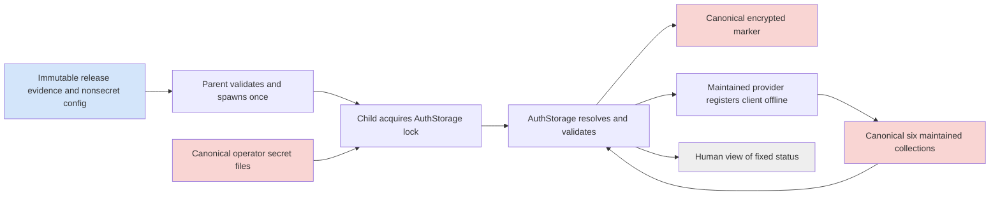
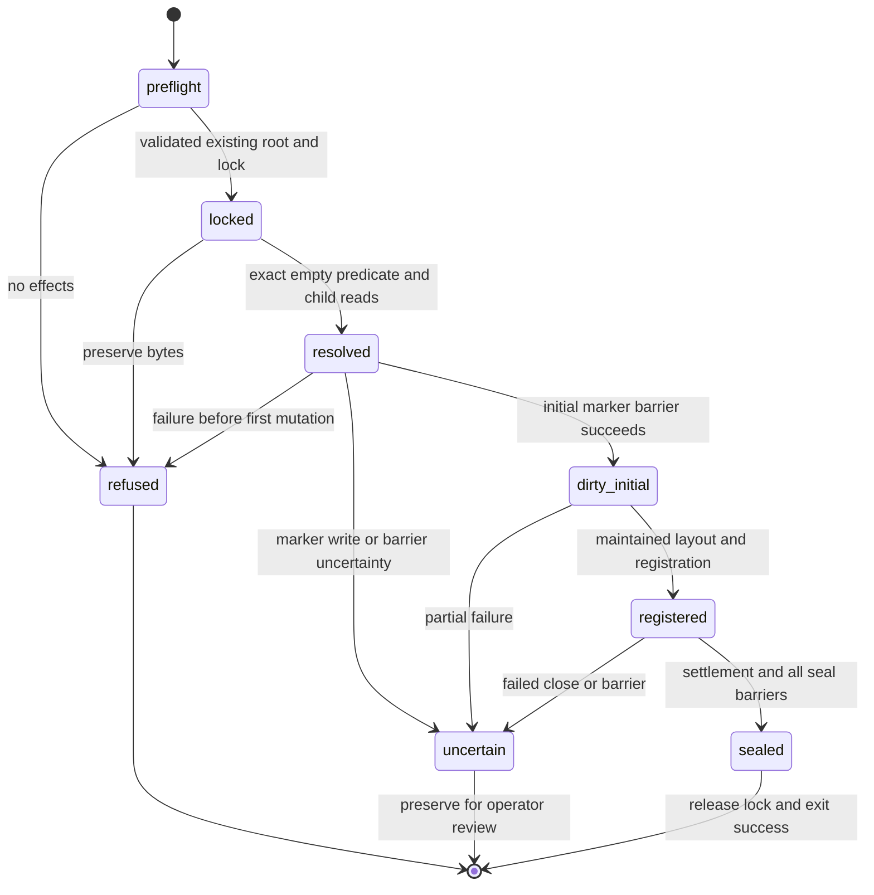
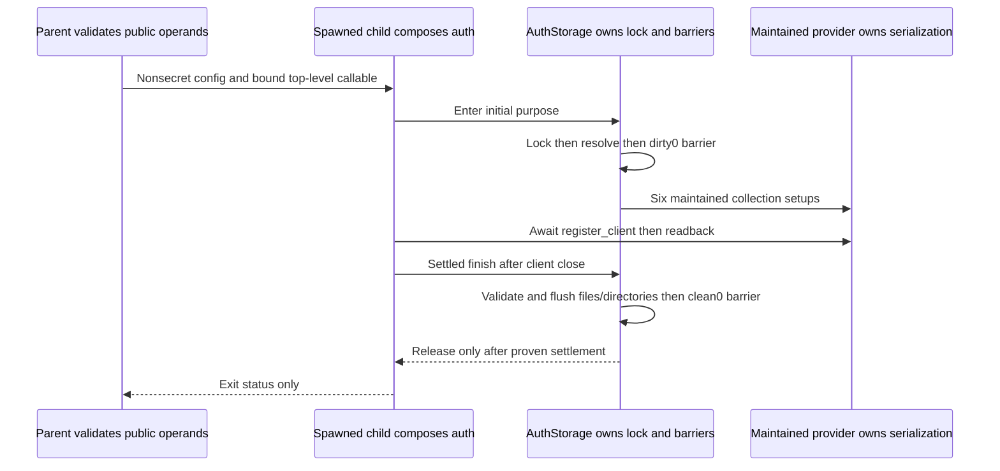

<!-- PURPOSE: Propose the remaining offline operator boundary for Cowork.
     CONTRACT: RT-COWORK-OPERATIONS-010 v2; proposal only.
     DEPENDS: Frozen008v5 and current009v5; independent review and explicit activation.
     CEILING: No source, secret, service, permission or frozen-contract changes. -->
# Cowork operator setup — bounded proposal

```yaml
contract_id: RT-COWORK-OPERATIONS-010
contract_version: 2
status: draft
owner: Forest
orchestrator: root
task_group_id: 53f0ea39-a61e-4307-9c2c-466c1b4b0bd1
depends_on: [RT-COWORK-MCP-008, RT-COWORK-AUTH-009]
dispatchable: false
execution_proposal: COWORK-OPERATIONS-010-EXECUTION-DRAFT.md
attempt_ledger: inherited; no reset or new source attempt
```

This isolated revision covers only secret resolution, first offline provisioning, and parameterized service preparation. Core008 v5 candidate3 is frozen under independent B and the current full host runner; the supplied current status identifies two source causes still to correct, with no core acceptance. Both prior valid failed implementations and all QA history remain. Auth009 v5 has independent D=0/33 at the exact O0 pins, but no A or source acceptance. Operator010/110 D/A/B all remain pending. Nothing here dispatches a builder or authorizes activation. The direct contract-author role and two-document scope govern; no nested worker is used.

The conventions at `/Users/velox/cortados/contracts/CONVENTIONS.md` and their local standard, RUBRIC, ORCHESTRATION and PLAYBOOK govern future gates. These files are review inputs in the isolated author cwd, not a second canonical contract home. Root decides incorporation and index ownership after review. No self D/A score is assigned.

## 0. Canonical definition registry

Definitions O0–O9 are the sole registry for this extension. They are [FIXED] proposed profiles, conditional on acceptance. R010-* is the sole obligation registry. Inherited types, records, serializers, marker format, six collection names, control frames and auth/core state machines retain 009 D0 and frozen008 definitions; they are referenced rather than redefined. Examples are synthetic operands, never live defaults.

### O0. Evidence names and dependency identity

`R` = `/Users/velox/.cortados-builds/cortados-router-repo`; `V` = `/Users/velox/.cortados-builds/cowork-mcp-verification`; `F` = `/Users/velox/.cortados-builds/cowork-mcp-research/fastmcp/fastmcp_slim/fastmcp`; `S` = `V/auth-research-venv/lib/python3.14/site-packages`.

Reviewed bytes (SHA256, not an assertion of source acceptance):

| Reference | SHA256 |
|---|---|
| R/docs/mcp-worker/COWORK-AUTH-009.md (v5) | e9b2c0d1c22954da894643b8638ab9e43aa22f2b7e9fef03df2f10087f022174 |
| R/docs/mcp-worker/COWORK-AUTH-009-EXECUTION.md (v5) | 83052dcde6977750ee633d5a6fb7c179e30f466c75181981ed442eaec94d142b |
| F/server/auth/oauth_proxy/proxy.py | 58f13a58bd31373c13ee166f94bf3726dadd6bb86a6c8da89de3b09a627d26f0 |
| F/server/auth/oauth_proxy/models.py | b2f45bc919484355f89ad10bf06d84cf45ebf5ed9af51b932ea0800c665242f8 |
| F/server/auth/providers/github.py | 13a89114465210ba0fcce39b4ff3e7acb09a699a8a5de0e97223c419f53141ba |
| S/key_value/aio/stores/base.py | 8f6352bbad37d643a166e00bf06046c1fc7118038e1e80c474f1d1ed22a0736c |
| S/key_value/aio/stores/filetree/store.py | c278eb600d78fe01c1770b2352db910b1737f42b82104278b8bf2013a1bbcdab |
| V/auth-dependency-lock/server-requirements.txt | 6099038ad1842f32dd9e4b54946dd3494cb97027851d71c8a066abc6f784cb88 |
| R/integrations/mcp/config.py | a70778abefc0c1b2563c21b0f5ead6f85885ef0094ed55f5364b8e59730bb778 |
| R/pyproject.toml | f7516262d17c7ddb3f19ba0b1e6e4ac3c99067244c95795a07e16a9b28e3fa7d |

Historical dependency drift (preserved): the prior author initially reviewed v4 parent `5bdd0a9a6d9f0ca9b8383c3e7d9d8adaf2048802e7f63f012e6ce11dcd32da0a` and execution `e7139a46f855aff9e1ee47afd02601e1524bd227178673cf963b95ef54a1bdfa`; its final unchanged-hash check failed when root amended v5. That was not a passing check or a source attempt. This revision now pins the actual v5 bytes above. V/auth-v5-D/FULL-D-REVIEW.md and readiness.json record independent D=0 across33 rows for exactly those bytes; A is NOT_RUN_PENDING_RUNNER_SCOPE_AND_EXAMS. V3 D11/33, v4 D4/33, D-008-01/02 and the original v3 diagram3 render failure remain history. V5 distinguishes inherited P from numeric MAX_INTEGER, names httpcore._async.http11.AsyncHTTP11Connection, enumerates HTTP/1.0 and HTTP/1.1 byte values, and defines normalized header accounting separately from allocation floors. O2/O9 preserve those definitions; they propose only the operator deltas enumerated there.

Core history remains authoritative in R/docs/mcp-worker/COWORK-MCP-008-DECISIONS.md and COWORK-MCP-008-ROOT-REVIEW.md: D21→D3→D0, both setup-only blocks, original785/784/1 baseline and separate007 relocated4/4, first valid failure job87c9ffee-4119-4301-bafc-4668d8dbf8ca (B3 at B1/B6/B7;857 methods,856 pass/1 failure;26/28 lanes), and second valid failure jobd37a73fb-aa46-491f-9a5d-98fa60c682e8 (B3 at B1/B5/B7;874 methods,873 pass/1 failure;27/28 lanes). Preserve C1–C10, original transfer-matrix timeout, measurement-client idle error, completed measurement continuations, later observational capacity pass and IPC diagnostic/fixture failures separately. The v5 D1 reference correction and renewed independent D0/A0 precede revised attempt3 (111 core/896 accumulated methods expected in28 lanes); neither those gates nor frozen candidate3 imply B acceptance. No history is reset or regraded here. The current two-cause report comes from the supplied parent context, not a fresh candidate run by this author.

Current read-only evidence pins supplement the maintained-source table:

| Reference | SHA256 |
|---|---|
| R/docs/mcp-worker/COWORK-MCP-008.md | 0fe7b4f3d139436eb9b0b0bdcbc8e0d4e442e8340d560b8abdd0f20cf2332a63 |
| R/docs/mcp-worker/COWORK-MCP-008-EXECUTION.md | e104c7548883318cb6fd80ac58814e1c9d5a217b8d2e6d1ffac56d732bdd1b40 |
| R/docs/mcp-worker/COWORK-MCP-008-DECISIONS.md | e93ffd915392e082fc426932e0252729376f3d77b029b2e5a067390e549eeb4d |
| R/docs/mcp-worker/COWORK-MCP-008-ROOT-REVIEW.md (inspected at62fcd07) | 12e95d86bb4a5fee6da654af70854a634fa99c3c0e25a7811684f011205b8dce |
| V/auth-v5-D/readiness.json | fd8299597e1ec049d13d35583679c8c462ab2f6cc8fc57d2ca65420e86242ae0 |
| V/auth-v5-D/MANIFEST.json | 6a0e4a4f764df8e8d5d85c2955cb1236ed116c2a73ddadfc5d08038d3204b2ff |
| V/auth-v5-D/FULL-D-REVIEW.md | ae2930565069b66014825df7172853e98eb56718afe4328c9cc71dcfe641f394 |
| V/core-revision-2/USER-LIVE-POLICY-APPROVAL.json | d6b813fe0e9a151f5ab3ac2dc55f86916aa4e0fd0e66e199b6d7e41e0b25d477 |
| V/core-revision-2/OFFICIAL-OAUTH-EXPIRY-CHECK.md | 31a9f6468fd674b0cb70cff26c6146486b97506facc0d63fb35a68326b8ec1a3 |
| /Users/velox/.cortados-builds/cowork-retention-proposal/ACTIVATION-CHOICES.md | 8cdffb7d4275be88d20bf41590beeb1b567152378608281ed07da0dd1598990d |
| /Users/velox/.cortados-builds/cowork-retention-proposal/RETENTION-PROPOSAL.md | e99e002d890b4446b3d1be0dc058725a49ca3b86fa3b51671f0166abcbd54ba1 |
| /Users/velox/cortados/contracts/CONVENTIONS.md | 0e09b19a664befb03073d9160765340debea72bec6ed6b64344afcb50260afe6 |
| /Users/velox/cortados/docs/DECISIONS.md | f43050869a6319b0390a70b8047ceaa0b51ab63f49bad5394d34bc5a50b7c02c |
| /Users/velox/cortados/context-staging/research/ai-coding-std-workflow/CONVENTIONS.md | 2d8a2c18fbce516b4749d77a5e5771e31751ee7c17160cc0c9afcdbffa2b2132 |
| /Users/velox/cortados/context-staging/research/ai-coding-std-workflow/RUBRIC.md | cccae8d0e13997e4a639d846a0f771ef15ed1017bcf0b4def24963298a9cf404 |
| /Users/velox/cortados/context-staging/research/ai-coding-std-workflow/ORCHESTRATION.md | 077ba776ba250d4af88455f59b7bdfb42f34e734f4389090eec9f6f1466a5673 |
| /Users/velox/cortados/context-staging/research/ai-coding-std-workflow/PLAYBOOK.md | 0dbbb7436bdbc72ed190be199d62a59c07d71a4baa9ed64021aedc2dc6781664 |
| /Users/velox/cortados/context-staging/research/ai-coding-std-workflow/standards/00-ENGINEERING-STANDARD.md | d55295920cd6492759611e9177c52e4f08e151da88355b8f78ff1cf4e6d79b94 |

Authority: the present direct user instruction and V/core-revision-2/USER-LIVE-POLICY-APPROVAL.json settle the deployment policies below. Older pending text in008/009/DECISIONS is historical; root records/reconciles those approvals through the canonical owner before integration, without reopening them or editing those sources in this assignment. This does not waive independent gates.

The corrected dependency lock qualifies imports on CPython3.14.6/macOS arm64 only. `fastmcp-slim[server]==3.4.9`, `Authlib==1.9.1`, and unchanged `mcp==1.30.0` remain the proposed optional remote graph. The plain slim package failed provider import. Release wheel/interpreter/install-tree hashes remain future evidence. Current candidate3 is frozen for independent review, not an accepted dependency.

### O1. Configuration and private layout

Conditional private-file profile: O1–O8 specify a reviewable technical proposal, not approved custody. O010-04 requires Forest's later concrete final setup review (account, exact paths, backup and crash policy); no secret access or provisioning is authorized now.

New closed immutable local record `OperatorConfig` belongs to `integrations.mcp.remote_auth_config`. Constructor convention and strict JSON rejection are 009 D0.1/D0.3. Every field is required; no environment expansion, discovery or default path.

| Field | Type and predicate |
|---|---|
| schema | literal `cortados.cowork-operations.v1` |
| release_root, interpreter, working_directory | absolute canonical path strings; working_directory equals release_root; interpreter is its qualified venv executable spelling |
| base_config, core_config, auth_config, native_manifest, dependency_lock | absolute paths to immutable regular nonsecret release configuration/evidence files |
| dependency_sha256 | lower-case 64-hex SHA256 of dependency_lock bytes, equal reviewed release digest |
| secret_root | existing operator-owned 0700 absolute directory; disjoint from release, auth, core/task/blob/staging roots |
| secret_files | closed mapping with exactly the three opaque refs from AuthConfig as keys; distinct values are single basenames matching `[A-Za-z0-9][A-Za-z0-9._-]{0,63}`, excluding `.` and `..` |
| upstream_secret_bytes | strict integer 1..9007199254740991; operator-selected byte bound, not an implicit provider limit |
| host | literal `127.0.0.1` |
| port | strict integer 1..65535; distinct from existing private destination8432 and optional S1 port |
| service_mode | enum `foreground`, `launchd-manual` |
| service_label | nonblank ASCII `[A-Za-z0-9][A-Za-z0-9.-]{0,127}`; separate from every existing service |

Nonsecret reference mappings are trusted operator configuration, never MCP input. Distinct references, filenames and decoded signing/storage key bytes are required; no derivation from the upstream secret. Independence also requires operator provenance: software can reject equality but cannot prove entropy or independent generation. Signing file is exactly32 raw bytes; storage file exactly44 canonical Fernet key bytes; upstream file is nonblank UTF-8 bounded by upstream_secret_bytes with no NUL or CR/LF. No trimming or implicit newline stripping. No secret file reads occur in check or the parent launcher.

Recommended layout, wholly parameterized: a new private release root containing a non-editable wheel installation in `venv/`, read-only `config/` and reviewed `requirements.lock`; separate existing `secret_root`; separate existing `auth_root`; separate core roots. Release directories have no group/other access and no write permission after qualification; config/lock files are0400, directories0500, executable files0500 and other package files0400. The venv executable's possible symlink is an explicit qualified exception: pin its final interpreter target/hash and full link chain, do not silently resolve away venv identity. No mutable `current` symlink, editable install, source-cwd import, `PYTHONPATH`, or package mutation during a lifetime. The service uses the pinned absolute interpreter with `-I -B -m integrations.mcp.remote_service`; an actual installed-package subprocess is an exam prerequisite. Read-only filesystem modes are an operational immutability rule, not protection against a malicious same-UID owner or root.

Secret/state paths reject symlink ancestors, nonowner entries, group/other permissions, unexpected ACL grants, hardlinks and special files. File reads use descriptor-relative O_NOFOLLOW opens, regular-file/nlink/uid/mode checks, bounded reads and pre/post fstat identity checks. ACL inspection on the target filesystem is a qualification gate; mode bits alone are insufficient. No secrets are included in release manifests, task artifacts or diagnostics. Secret file hashes are not emitted; 009 marker-internal bindings remain encrypted.

### O2. Proposed callable registry

These are proposed changes to future owners, not observed imports. Python types come from pathlib, typing, collections.abc, httpx and 009 canonical imports; `Callable`, `Awaitable` and `Literal` retain those meanings. All constructors are effect-free. No new utility module is proposed.

| Owner | Exact proposed callable/config shape |
|---|---|
| remote_auth_config | `load_operator_config(raw:bytes,*,auth_config:AuthConfig)->OperatorConfig` — pure schema/cross-reference validation |
| remote_service | `validate_operator_setup(*,operator:OperatorConfig,base_raw:bytes,core_raw:bytes,manifest_raw:bytes,auth_config:AuthConfig)->None` — nonsecret release/filesystem/config/dependency/native-manifest validation only; no runtime enter, state mutation, secret read, network or listener |
| remote_service | `resolve_private_secrets(*,operator:OperatorConfig,auth_config:AuthConfig)->ResolvedAuthSecrets` — trusted module-level function; only invoked in spawned auth/provision child after AuthStorage lock acquisition; fixed-safe exceptions |
| remote_auth_storage | `AuthStorage(*,config:AuthConfig,resolve_secrets:Callable[[],ResolvedAuthSecrets],dependency_sha256:str,on_failure:Callable[[],None],purpose:Literal['restart','initial']='restart')` replaces D0.13's secrets operand; all existing methods remain. Add read-only `resolved_secrets:ResolvedAuthSecrets`, accessible only by entered owner while lock held; no serialization. `client_storage` remains inaccessible before the dirty barrier. |
| remote_auth_runtime | `AuthRuntime(*,config:AuthConfig,resolve_secrets:Callable[[],ResolvedAuthSecrets],dependency_sha256:str,on_failure:Callable[[],None])` replaces D0.10's secrets operand; runtime always constructs AuthStorage with purpose='restart'; provider receives storage.resolved_secrets only after enter. |
| remote_auth_provider | `make_provider(*,config:AuthConfig,secrets:ResolvedAuthSecrets,client_storage:AsyncKeyValue,identity_client:httpx.AsyncClient,on_failure:Callable[[],None])->StrictGitHubProvider` — single extraction of 009 D0.16 constructor wiring; no routes/enter/network/registration; no second issuer |
| remote_auth_runtime | `async provision_initial(*,config:AuthConfig,dependency_sha256:str,resolve_secrets:Callable[[],ResolvedAuthSecrets])->None` — offline composition using AuthStorage purpose='initial', make_provider and maintained register_client; no AuthRuntime enter, core, listener or token flow |
| remote_supervisor | `run_initial_provision(*,auth_config:AuthConfig,dependency_sha256:str,resolve_secrets:Callable[[],ResolvedAuthSecrets])->None` — top-level synchronous multiprocessing spawn target calling asyncio.run(provision_initial(...)); no CoreRuntime or RemoteSupervisor instance |

RemoteSupervisor and run_frontend signatures/control frames stay exactly 009 D0.14. The parent passes `functools.partial(remote_service.resolve_private_secrets, operator=operator, auth_config=auth)` as their zero-argument callable. Only immutable nonsecret records are pickled. This is an importable top-level function bound with public operands, not a lambda, closure, dynamically imported plugin or pre-resolved secret record. Entry code is guarded by `if __name__ == '__main__'`; child import has no effects. Runtime passes the callable through to storage without invoking it. The provisioning parent likewise spawns exactly once and observes process exit; no pipe carries resolved material. Exit0 means completed initial seal; exit1 is fixed refusal/failure. Parent death or missing successful child completion is uncertainty, not permission to retry.

`finish(settled=True,failed=False)` in initial purpose has a stronger predicate: one verified configured public-client row and no token rows in the other five collections; all six maintained metadata files/directories exact; registration completed once; no failed latch, pending artifact or open writer. The storage owner verifies the raw/decoded persisted shape using 009 trust guards, not a caller-provided success boolean alone. Its first successful seal is generation0 with the initial run_id. No new marker schema or external journal.

### O3. Maintained APIs and dispositions

Owner searches: `rg -n 'secret|keyring|keychain|launchd|LaunchAgent|KeepAlive|register_client|resolve_secrets' R/integrations R/cortados_router R/bin R/pyproject.toml`; `rg --files R/integrations/mcp`; review009 D0.9–D0.21 and EXECUTION B1/B2. No matching persistent operator resolver/service installer exists in those source paths. Quota-observation nonce keys are transient integrity owners, not OAuth secret storage. An attempted R/scripts search found no directory; no nonexistent script is adopted.

| Concern | Disposition and source-qualified reason |
|---|---|
| Base configuration | Adopt R/integrations/mcp/config.py:109 load_config(None,raw=base_raw); credential-free closed configuration, existing native environment/permissions owners remain unchanged. Its connector environment-token references are not suitable for the no-secret-environment requirement. |
| Authentication store | Extend proposed009 remote_auth_storage; sole lock/marker/barrier/trust owner already specified. Creating an operator marker writer would duplicate its invariant. |
| Serialization/collections | Adopt S/key_value/aio/stores/base.py:175 `async setup_collection(self,*,collection:str)->None`; FileTreeStore inherits it. S/.../filetree/store.py:533 prepares directories and :353 DiskCollectionInfo.create_or_get_info writes maintained metadata. No handwritten metadata/credential JSON. |
| Registration | Adopt F/.../proxy.py:838 `async register_client(self,client_info:OAuthClientInformationFull)->None`; :782 `async get_client(self,client_id:str)->OAuthClientInformationFull|None`. Registration uses `_client_store.put`, not an insert-only transaction, so the empty-state predicate belongs before it. |
| Provider construction | Extend proposed remote_auth_provider by extracting existing009v5 D0.16 wiring into make_provider; both runtime and initial composition reuse it. F/.../proxy.py:485–548 defaults derive keys/store paths and tolerate decrypt misses; explicit independent keys/store prevent those unwanted defaults. |
| Launch/CLI | Extend proposed remote_service/remote_supervisor; one live RemoteSupervisor, no new broker or daemon. R/INSTALLATION.md:121 reports no launchd job installed; ordinary stdio release is separate. |
| Resolver | Build-new bounded function inside proposed remote_service; stdlib filesystem reads reuse existing configuration conventions, not a new credential DB or source module. |
| Packaging | Adopt non-editable release pattern from INSTALLATION and009 optional remote extra/lock; no new dependency or ordinary-package change in010. |


Canonical composition disposition (009v5 D0.11/D0.17 and EXECUTION B2): adopt `remote_config.load_service_core_config`, `remote_runtime.CoreRuntime(trusted_service_principal=...)` and `remote_http.compose_http_app` only after accepted core B and separately reviewed009 B2 integration. They are dependency owners, not additional010 writable paths. `validate_operator_setup` calls `load_config(None,raw=base_raw)`, constructs the trusted Principal from AuthConfig, uses the canonical service loader, and verifies core principal/installation and transfer_origin equality before effects; it never converts oauth_service to local_test. BaseConfig is the validated dict semantic alias, not an importable Config class. Records/imports follow009 D0.1–D0.3; P stays a type and MAX_INTEGER stays the bound. HTTP composition stays in remote_http; supervisor owns one CoreRuntime and one frontend lifetime, while AuthStorage is the sole auth lock/marker/store owner.

Factory disposition: `make_provider` forwards all009v5 D0.16 operands unchanged, including `config=config`, `on_response_failure=on_failure`, `http_client=identity_client`, `required_scopes=[]`, explicit signing key/encrypted client_storage, no fallback expiry, no cache and disabled CIMD. It sets client_registration_options.enabled=False before return. Runtime and initial composition both use remote_auth_transport.make_identity_client; no fresh unguarded client or new transport owner. Initial composition owns a synchronous irreversible failure latch supplied to storage, transport and factory; any latched failure prohibits a clean seal. It installs009 logging suppression before constructing dependencies and restores it only after settlement/close. Registration/get_client use the entered storage guards under the sole exclusive lock, without entering AuthRuntime or acquiring a second request gate; no network operation is performed.

Retention disposition: adopt the existing core task_store/job_store transaction, remote_runtime publication/lifetime, remote_dispatch delete orchestration and task_workspace remover as the separately reviewed extension's candidate owners, as grounded in RETENTION-PROPOSAL.md. No retention field, callback, writer, timer or remover is added to010, AuthStorage, provider TTLs or launchd. Frozen008 retains explicit_delete semantics until that separate extension is accepted.

Resolver options: (a) environment variables violate the boundary and are rejected; (b) a parent-read pipe violates child-only resolution and is rejected; (c) macOS Keychain could avoid plaintext secret files but no reviewed project owner/API, noninteractive access qualification or approved entitlement exists, so return it to root if desired rather than invoking `security` or introducing a dependency; (d) private operator-provisioned separate files allow a bounded stdlib implementation with no subprocess or new credential service and are recommended, subject to Forest's permission/backup decision. The function does not generate, migrate, rotate or search for credentials. Python cannot promise zeroization of immutable strings/bytes, privileged-process memory secrecy, or exclusion of a malicious same-UID reader. Disable core dumps for this process before resolution; inherited crash-report/debug policy remains a deployment qualification.

### O4. Initial-only protocol and state

Initial admissible root: an existing empty0700 auth_root containing only an existing zero-length0600 regular single-link `auth.lock`, provisioned by the operator. No credentials directory, marker or pending file exists. Requiring the stable lock in advance avoids racing first lock creation and makes refusal byte-preserving. Startup also requires the existing lock. No command here creates the root or lock. File locking is nonblocking exclusive on that same inode; descriptor/entry identity is rechecked under lock.

State enum for initial invocation: `preflight`, `locked`, `resolved`, `dirty_initial`, `registered`, `sealed`, `refused`, `uncertain`. This is an invocation lifecycle, not a persisted credential entity. Refused has no initial mutation; uncertain preserves whatever exists and requires operator review.

Ordered algorithm:

1. Nonsecret O1 validation and release/config/key-reference binding; set safe logging before dependency construction; no listener/core/native/provider calls. Spawn the provision child once.
2. AuthStorage validates existing auth_root/auth.lock and acquires the lock; rechecks exact initial-empty predicate. Any extra object, even an empty credentials directory or a matching sealed marker, refuses without read/overwrite of its contents. Existing uncertainty never becomes an idempotent success.
3. AuthStorage invokes the bound resolver while locked. A missing/invalid/unavailable file releases owned descriptors and refuses without a marker or directory write. No fallback value or prompt. Three independent values are validated with009 constraints.
4. AuthStorage writes dirty generation0, new UUID4 run_id, exact config/signing/upstream/dependency bindings and null store_sha256 through009 marker primitive. Complete file fsync, Darwin F_FULLFSYNC and auth_root directory fsync precede any credential construction. Any failure enters uncertain, preserving pending/marker bytes.
5. AuthStorage creates credentials0700 once. Only in initial purpose it constructs maintained FileTreeStore with auto_create=True, explicit data/metadata directory and both FileTreeV1 strategies, under umask077. It awaits `setup_collection(collection=name)` for each of the six009 names in canonical order. That API is internal to AuthStorage, not exposed through provider guards. No dummy token put/delete. Verify exact six metadata/directories and permissions; auto_create=False remains mandatory for every ordinary restart. No background cull is started.
6. Offline composition creates the bounded identity client without making a request, then make_provider with explicit storage/secrets. It disables registration options for route safety; no get_routes, ASGI app or routes are needed. Invoke maintained register_client exactly once with009 E19 public profile: configured distinct downstream ID, configured hosted redirect, none authentication, authorization_code/refresh_token grants, code response, empty scope and all optional metadata null. No upstream secret is a downstream field. Read back with maintained get_client and strict stored preflight; the upstream-ID fallback cannot qualify as a stored row. Validate five other collections contain no rows.
7. Await identity-client close and maintained store settlement; there is no provider.close API. AuthStorage.finish performs009 complete file/directory barriers, manifest computation, then its exact atomic encrypted clean replacement with generation0/same run_id. Only after the final barrier succeeds can lock release and exit0 occur. No credential access follows the seal.

Failure before step4 preserves original namespace bytes. Failure at/after step4 leaves all partial bytes and the failed latch; no rollback/delete/re-registration. An observed failure during the final clean rename/barrier returns failure even if clean-looking bytes remain. A second initial invocation refuses on those bytes. Normal restart is not a recovery path for an observed uncertain close. A surviving supervisor never relaunches it. After total process loss, exact matching clean bytes cannot prove the previous barrier was observed, nor detect a full stale-image restore;009's narrowed restart guarantee and excluded rollback/power-loss claims remain unchanged.

### O5. Ordinary restart and service lifecycle

`check` performs only O1 nonsecret checks, including original base loader, proposed service-core loader, principal/origin/root equality, exact release dependency lock and manifest provenance. It is not an auth-readiness probe. `serve` delegates the accepted009 lifetime to exactly one RemoteSupervisor. Child AuthStorage locks first, resolves secrets, validates clean marker/config/key/lock binding and full manifest/layout before dirty generation+1. Startup never calls setup_collection to repair missing metadata, register_client, writes missing records, changes keys or overwrites a failed image. Existing maintained lazy setup is entered only after exact layout validation, so missing metadata cannot silently be recreated.

HTTP admission still follows core bind, ready, admit. Auth-failure stops admission, revokes through the existing parent CoreRuntime owner and settles or kills/joins the child according to009; accepted jobs are not retried/cancelled merely by frontend loss. SIGTERM/interactive stop invokes the same supervisor shutdown and close proof. Child failure does not mean parent CoreRuntime has been shut down. No external manager imposes a short kill timeout over accepted-job shutdown; operator-reviewed forced termination remains a separate action.

Recommended first launch is foreground. Optional `launchd-manual` is a reviewed plist projection, not a new scheduler: exact ProgramArguments are pinned interpreter, `-I`, `-B`, `-m`, module, `serve`, and nonsecret config path flags; WorkingDirectory is release_root; Umask63 decimal (077 octal); KeepAlive=false; RunAtLoad=false; no StartInterval/StartCalendarInterval/WatchPaths/QueueDirectories/Sockets/LaunchEvents; no EnvironmentVariables carrying secrets; no shell wrapper/reloader. Service label and service-manager choice remain explicit pending choices. The plist is never installed/generated by this draft. No automatic boot/login start or failure respawn is permitted. A manual restart after uncertain failure requires an operator recovery disposition, not merely `kickstart`. External watchdogs are excluded. Any launchd exit/kill policy that cannot preserve009 settlement is a blocking compatibility result, not authority to shorten shutdown.

The private443→127.0.0.1:8432 route, ordinary installed MCP and training retain their owners. Proposed public8443/mcp stays inactive. No service check opens a port or changes Tailscale. A future public-ingress design must qualify server header/body/connection bounds alongside009 auth queue bounds; these are separate allocations, not covered by auth body size alone.

### O6. CLI and result profile

Proposed extension of009 CLI (no commands executed here):

```text
python -I -B -m integrations.mcp.remote_service check --operator-config ABS --auth-config ABS --core-config ABS --base-config ABS --native-manifest ABS
python -I -B -m integrations.mcp.remote_service provision-initial --operator-config ABS --auth-config ABS --core-config ABS --base-config ABS --native-manifest ABS
python -I -B -m integrations.mcp.remote_service serve --operator-config ABS --auth-config ABS --core-config ABS --base-config ABS --native-manifest ABS --host 127.0.0.1 --port PORT
```

Each explicit path/host/port equals OperatorConfig; disagreement refuses rather than choosing precedence. No `--secret`, `--force`, `--reset`, `--repair`, `--overwrite`, arbitrary callable path or recovery flag. `check` and provisioning print only fixed lines `Operator setup validated` and `Initial provisioning completed`, respectively, on success; each returns0. Failure returns1 and fixed `Operator operation refused`, without traceback/cause/path/ref/credential. serve emits only009 AuthEvent and inherited safe core events. Auth errors, raw dependency LogRecords, stdout/stderr and process-control output are covered by sentinel tests. `check` success makes no secret-readiness assertion. There is no JSON report or new runtime store to maintain.

### O7. Store aspects and inherited limits

| Aspect | Extension disposition |
|---|---|
| Class | Auth credentials/marker remain canonical009 state; private secret files are operator canonical inputs; release/config are immutable evidence for a particular installation; human measurements are views. |
| Write | Only AuthStorage writes marker/layout; maintained provider/Pydantic/FileTree write client and metadata. This proposal has no secret writer. |
| Query | Three bounded child-only file reads per lifetime; one maintained registration put and readback get for initial flow; six setup_collection calls. File/stat/decrypt/barrier costs measured separately. No invented latency SLO. |
| Mutability | Initial empty namespace only; runtime follows009. Changing any key/config/dependency requires a separately reviewed maintenance path, not initial flow. |
| Identity | Existing owner/collection/key identities, lock inode and009 generation/run_id retained; no new row IDs or token DB. |
| Rebuild | Canonical inputs are not rebuildable. Backup custody, matching-key escrow, restore and deletion remain unapproved; no automatic backup copy is made. |
| Failure | Refuse/preserve unknown state; no cleanup, migration, retry, repair or universal crash-atomicity guarantee. |

### O8. Illustrative valid and invalid flows

Synthetic valid OperatorConfig shape (all paths are fictional fixture paths):

```json
{"schema":"cortados.cowork-operations.v1","release_root":"/fixture/release-a","interpreter":"/fixture/release-a/venv/bin/python","working_directory":"/fixture/release-a","base_config":"/fixture/release-a/config/base.json","core_config":"/fixture/release-a/config/core.json","auth_config":"/fixture/release-a/config/auth.json","native_manifest":"/fixture/release-a/config/native.json","dependency_lock":"/fixture/release-a/requirements.lock","dependency_sha256":"6099038ad1842f32dd9e4b54946dd3494cb97027851d71c8a066abc6f784cb88","secret_root":"/fixture/private-inputs","secret_files":{"fixture-upstream":"upstream.bin","fixture-signing":"signing.bin","fixture-storage":"storage.bin"},"upstream_secret_bytes":4096,"host":"127.0.0.1","port":18443,"service_mode":"foreground","service_label":"invalid.example.cowork-fixture"}
```

The referenced synthetic AuthConfig uses those three refs, a synthetic decimal GitHub subject, distinct upstream/downstream IDs, and all009 required limits. A fixture constructor supplies full008/009 records; the above is an OperatorConfig example, not a complete deploy configuration. Its4096/18443 values are exam operands only. Invalid variants: port=true; an extra field `upstream_secret`; `secret_files` value `../key`; equal signing/storage filenames; altered dependency digest; relative config path; auth_root inside secret_root. Each refuses before secret read or state effects.

Valid provisioning trace: lock-only root → lock → resolve three fixture values → dirty0 barrier → six maintained collection setups → register once/read once → settle → credential barriers/manifest → clean0 barrier → exit0. An immediate repeated initial command returns1 and preserves all bytes. Normal serve then follows clean0→dirty1→clean1 on proven close; next restart becomes dirty2. Existing registration bytes remain unchanged across those restarts.

Invalid provisioning trace: credentials directory with missing marker → refuse before resolver/registration, preserve tree. Invalid restart: dirty1 or clean1 with wrong signing/storage/upstream value, config or dependency digest → no registration/listener/admission; preserve existing files. Key rotation is not equivalent to a new empty namespace.

Resolver success is an in-memory ResolvedAuthSecrets with009 exact types; its representation is redacted. Synthetic tests create fixture values only under separately authorized exam roots; none are embedded here. Invalid resolution includes32-byte storage key rather than44-byte canonical Fernet encoding, 33-byte signing file, invalid UTF-8 upstream value, aliased inode, file swap during bounded read or unavailable root. Failures expose only the fixed result profile.

### O9. Explicit009v5 amendment packet — not applied

Amend D0.10 and D0.13 with O2's replacement constructor operands and initial-purpose extension; amend D0.14's child sentence so resolution occurs through AuthStorage after lock, rather than before AuthRuntime enter. Update D0.18 to require the pre-existing lock and define initial dirty0/clean0 as O4, with the initial-only auto_create=True exception. Add O2 make_provider extraction to the existing provider owner and O2 initial composition/entry to runtime/supervisor. Add O6 mandatory operator-config CLI operand and provision-initial subcommand to009 EXECUTION scope only after independent review. Preserve normal FileTree auto_create=False and unchanged marker/control schemas. Add O1 config type to the existing config owner; no new module.

Reason for amendment:009 currently requires a lock before secret-store access in D0.18 yet resolves secrets before AuthRuntime enter in D0.14, and its storage constructor receives already-resolved secrets. A real resolver makes that ordering conflict material. Passing an unresolved callable to the same lock owner closes it without a second lock owner. The initial-only mode is absent from009; it cannot be inferred as implementation latitude. Changes to strict <500-source-line budgets or source ownership require root disposition, not splitting into an unapproved utility file.

Proposal scope is exactly the six O2/O3 operator owners;009 remote_auth_transport/errors/claims and D0.11 core owners remain read-only dependencies for010. Mirror accepted changes into009 D0.9/10/13/14/18/21b, affected R6/R13 obligations, examples and EXECUTION B1/B2/CLI through the canonical owner before dispatch; no patch to009 is made here. Initial registration does not change token schemas, scopes, TTLs, control frames or normal restart behavior. Independent009 D0 applies to the unmodified pins, not to this amendment.

Until root adopts and independently re-reviews these exact amendments,010 cannot be built against009. If009 D changes interfaces meanwhile, report the dependency diff and re-review010 under the same group/attempt history.

## 1. Atomic obligation and acceptance registry

Each row is one requirement with its reason and test oracle. All are [FIXED] within this proposal. AC commands and protected fixture ownership are in the execution draft; AC sentences are copied there verbatim.

| ID | Requirement | Reason | AC |
|---|---|---|---|
| R010-01 | Work MUST remain within the two-document author scope. | Root retains source/activation authority while008/009 work proceeds. | AC010-01 |
| R010-02 | Future integration MUST wait for accepted dependency interfaces and exclusive owner transfer. | Concurrent edits could invalidate root's review evidence. | AC010-01 |
| R010-03 | Operator ingress MUST validate O1/O6 before runtime effects. | Forest needs refusal rather than accidental default deployment. | AC010-02 |
| R010-04 | Secret resolution MUST occur only in a spawned child under the AuthStorage lock. | Parent/process transports would expose operator secrets and bypass exclusion. | AC010-03 |
| R010-05 | Resolver I/O MUST enforce O1's bounded private-file predicates. | Symlink/coercion/unbounded reads could disclose unrelated files to the service. | AC010-03 |
| R010-06 | Diagnostics and transports MUST exclude resolved secret material. | Forest cannot retract credentials from logs or task history. | AC010-03 |
| R010-07 | Initial provisioning MUST refuse every root outside O4's lock-only predicate. | Maintained register_client overwrites; existing identity would otherwise be replaced. | AC010-04 |
| R010-08 | AuthStorage MUST remain the sole lock/marker/barrier owner. | A second writer could certify incomplete provider state. | AC010-05 |
| R010-09 | Initial layout creation MUST use the six maintained setup_collection calls. | Missing collections would make later auto_create=False operations fail. | AC010-05 |
| R010-10 | Client provisioning MUST use the single maintained register_client path. | Handwritten credentials could drift from maintained serializer/profile semantics. | AC010-05 |
| R010-11 | Initial sealing MUST enforce O2's persisted predicate and O4 ordering. | Forest needs a qualified generation0 image before ordinary startup. | AC010-06 |
| R010-12 | Failure MUST preserve O4's refused/uncertain state without automatic recovery. | Reattempting registration would erase evidence of partial mutation. | AC010-06 |
| R010-13 | Ordinary startup MUST enforce O5 without repair or registration. | An apparently successful reboot must not silently change identity/storage. | AC010-07 |
| R010-14 | Live lifetime ownership MUST remain with the single009 RemoteSupervisor. | A second broker/retry owner could duplicate jobs or lose close proof. | AC010-08 |
| R010-15 | Service-manager configuration MUST enforce O5's manual-only profile. | Automatic relaunch after auth failure bypasses operator review. | AC010-08 |
| R010-16 | Release preparation MUST preserve the ordinary installation, training and private route. | Forest's existing workflows must not be displaced by this connector. | AC010-09 |
| R010-17 | Qualification MUST measure O7 costs through actual candidate owners. | Mock timings cannot establish candidate ordering or resource behavior. | AC010-10 |
| R010-18 | Activation MUST wait for every pending release choice and real-client gate. | Local synthetic success does not prove Cowork usability or permission approval. | AC010-11 |

| AC | Exact acceptance sentence |
|---|---|
| AC010-01 | The reviewed diff contains only authorized files and preserves dependency hashes, ownership gates and attempt history. |
| AC010-02 | Invalid or mismatched operator configuration refuses before secret reads, state writes, runtime entry or network activity. |
| AC010-03 | Spawn traces show one child-only resolution after lock acquisition and zero secret sentinels in parent memory captures, argv, environment, IPC, diagnostics or task files. |
| AC010-04 | Every noninitial, corrupt or uncertain root is refused with unchanged bytes and zero registration calls. |
| AC010-05 | Owner traces show one storage lock/marker owner, six maintained collection setups, one maintained registration and no replacement serializer or store. |
| AC010-06 | Fault traces prove the initial seal barriers and preserve every partial state without retry or a false successful-close report. |
| AC010-07 | Qualified restart retains exact identity/config/dependency binding and performs zero registration or repair. |
| AC010-08 | One supervisor controls admission and close, while every auth/close failure suppresses automatic relaunch. |
| AC010-09 | Installed-package validation preserves ordinary MCP, training and the existing private route without activating the candidate endpoint. |
| AC010-10 | Actual candidate measurements report secret-read, storage, registration, barrier and launch overhead separately with raw counters and uncertainty. |
| AC010-11 | Root's release record distinguishes every answered choice and actual provider/Claude/file/native gate from synthetic local evidence. |

## 2. Lifecycle views







## 3. Settled policy and remaining decisions

| Classification | Current disposition |
|---|---|
| Already approved — identity | Existing GitHub account **4list233**, dedicated **CortadOS Studio Workers OAuth App**, **no repository permissions**, allow only the approved account; Claude/Codex subscription credentials stay on Studio. Explicit identity_scopes=[] and provider required_scopes=[]; no broad default user scope. |
| Already approved — payload limits | Exactly **100000000 bytes/file**, **1000000000 bytes/task**, **10000000000 bytes/installation**, decimal integers, not binary MiB/GiB. These bind later live core configuration; remaining numerical budgets require qualification. |
| Already approved — retention direction | Automatically delete completed-task files after **7 days**. This requires a separate retention extension; it is not implemented or granted by008/009/010. |
| Awaiting user choice — completion semantics | Root's completion-trigger question remains pending. ACTIVATION-CHOICES C1–C3 are proposal data, not answers: automatic settlement versus explicit completion, treatment of failed/cancelled/interrupted attempts and payload versus content-bearing history boundary remain unapproved where unresolved. No new question or default is selected here; root reconciles the pending answer into the separate extension. Historical enrollment likewise is not silently authorized. |
| Required qualification — OAuth | Actual app existence/configuration, consent/no-repo permissions, finite token fields on fresh authorization and explicit/transparent refresh, issuer and numeric subject remain unverified. Candidate subject237812476 must be reverified; username is not immutable authority. |
| Required qualification — delivery | Actual Cowork none/S256 public-client flow and hosted callback, raw binary upload/download/hash materialization and all native-tool confinement remain gates. No API-key, confidential-client or DCR fallback. |

Expiry feasibility: the pinned OFFICIAL-OAUTH-EXPIRY-CHECK.md records documented OAuth App expiring-token setting (eight-hour access; refresh expires after six months without use), alternative offline_access opt-in and unaffected old long-lived tokens. These are feasibility facts, never locally minted TTLs or actual flow evidence. Current009v5 retains its copied-transaction offline_access hook. No hook/permission change is authorized by this reconciliation. If root selects the documented app-setting route instead, the precise additional proposal is to remove only that scope injection from StrictGitHubProvider.authorize (009 D0.8/E27 and affected obligations/examples), retain downstream empty scopes and every guarded response/refresh/storage predicate, require fresh authorization with verified finite access/refresh fields and amend/re-review009 before use. No GitHub App migration is implied. The maintained /user/repos probe and fallback projected user scope (github.py:118–145) confer no repository permission; actual consent and response behavior require qualification.

Seven-day task retention cannot be implemented with auth credential TTLs, token culling, an operator script, launchd schedule, task-file timestamps, disconnect or a successful clean auth seal. Completion/expiry, migration, races and cleanup belong to the separate existing-owner extension; no new store, queue, scheduler or dependency is authorized. Technical API naming, composition and source-scope details within approved behavior belong to root; they do not reopen settled policy.

Remaining gates (already-approved policy is not an unanswered choice):

| ID | Pending decision/gate | Blocks |
|---|---|---|
| O010-01 [ESCALATE] | Accept/review O9 against009v5 D0; accepted008 B,009 A/source/B and operator D/A/B plus exclusive source ownership remain pending. No amendment is applied here. | Dispatch/integration |
| O010-02 [QUALIFICATION] | Account4list233/dedicated OAuth App/no repo permissions are approved. Actual app configuration, reverified numeric subject and downstream public-client compatibility remain qualification gates. | Live configuration/provisioning |
| O010-03 [APPROVED / SEPARATE EXTENSION] | Decimal100000000/1000000000/10000000000 limits and automatic7-day completed-task cleanup are approved. Completion semantics remain pending; separate retention design/exams/acceptance required, with frozen explicit_delete unchanged. | Live core configuration |
| O010-04 [ESCALATE] | Private-file resolver approval, separately provisioned independent keys/root/lock, upstream_secret_bytes, ACL/coredump/backup custody and service account. Keychain alternative needs a new qualified proposal. | Secret access/provisioning |
| O010-05 [ESCALATE] | Exact immutable release/interpreter/roots, optional launchd-manual versus foreground, label, loopback port and measured server/ingress budgets. | Launch |
| O010-06 [ESCALATE] | Qualified target filesystem barriers, failure ordering, clean restart and separate operator-reviewed recovery/rotation/restore/reset/deletion policy. Initial flow does not grant those operations. | Provisioning/release; recovery remains excluded |
| O010-07 [ESCALATE] | Actual provider finite access/refresh lifetimes without fabricated TTL and actual Claude none/S256/pre-provisioned-public-client compatibility. No DCR fallback. | Public activation |
| O010-08 [ESCALATE] | Actual Cowork binary upload/download/hash materialization and native all-tool confinement, including file/read/edit/document runtimes. Synthetic shell proof is insufficient. | Completion claim |
| O010-09 [ESCALATE] | Explicit final activation approval after root presents reviewed local results and exact networking/service changes preserving private443. | Any live app, listener, route or service changes |

Air Claude Cowork custom connector URL+OAuth remains the selected experience. Studio native Codex subscription remains the worker backend; S1 is optional. No SSH/companion substitution, API-key fallback, or automatic file/connector/history inheritance follows from this proposal.


## Root incorporation note — document proposal only

The authoring-time core status above is historical. Candidate3 host896methods/10failureevents/1error/0skips and independent11-row B have completed: four failed rows, two product causes. Root recorded rejection and narrow exam-owner correction authority at0ae0cf4; source remains unaccepted. No010 D/A/B or009 amendment is accepted. The ROOT-REVIEW hash in O0 identifies the inspected62fcd07 bytes, verified with git show; root subsequently appended the final rejection/exam grant. All other27 cited source/evidence hashes still match. This annotation changes provenance/current status only, not the proposed API, AC or deployment behavior.
