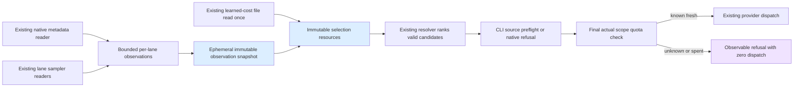
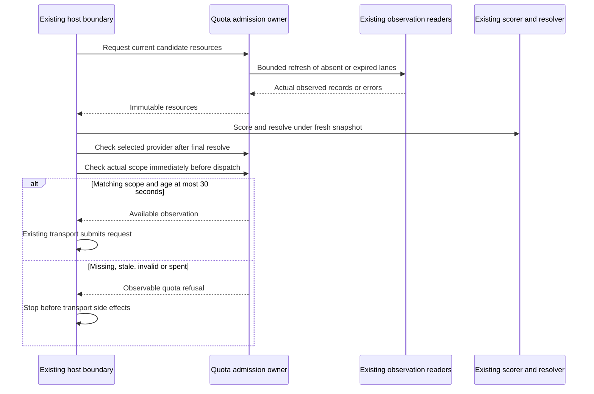

<!-- PURPOSE: Specify fresh quota admission at both MCP and legacy fleet dispatch boundaries.
     CONTRACT: RT-FRESH-QUOTA-005; known quota within 30 seconds, immutable selection observations.
     DEPENDS: Existing native metadata, scarcity, resource and host dispatch owners.
     CEILING: No new quota formula, learned-cost writer, model budget or promotion policy. -->
---
contract_id: RT-FRESH-QUOTA-005
contract_version: 1
owner: Forest
exam_owner: /root/quota_evaluation_qa
status: frozen
implements: [RT-MCP-001]
depends_on: [RT-QUOTA-EVALUATION-004, RT-MCP-LEARNING-003]
blocks: []
attempt_ledger: ["D/A-1: independent review closed; B candidate pending"]
---

# Fresh quota admission for MCP and the legacy fleet

This contract is frozen for the two disjoint builder lanes after independent D/A review.
Protected fixtures and the exact integration-source manifest are pinned in `acceptance/fresh_quota/`. Forest explicitly selected
strict fresh quota admission for **both** MCP and the legacy fleet on October 17, with a 30-second
maximum observation age. This contract implements that instruction without changing scarcity arithmetic.
Author: `/root/mcp_learning_contract`; QA: `/root/quota_evaluation_qa`.

**[FIXED] Configured-source binding.** A fresh reading authorizes only the configured CLI source
whose nonsecret authentication-store selection matches the actual dispatch. This is source provenance,
not a permanent account-identity guarantee. Hermes-native OAuth/credential pools have no established
match to the CLI source in the inspected evidence and MUST refuse as unknown. No new token reader,
account lookup, credential refresh or copied secret is permitted. The exact binding is §3.1.

| Obligation | Latitude and acceptance |
|---|---|
| Source age/geometry, immutable resource checks | **[FIXED]** MUST follow §3; AC-FQ01–FQ03/FQ07. |
| Route and actual dispatch gates | **[FIXED]** MUST follow §4; AC-FQ04–FQ06. |
| Existing source/status correction | **[FIXED]** MUST follow §5; AC-FQ02/FQ08. |
| Scope, preserved exams and activation | **[FIXED]** MUST follow §2/6; AC-FQ09/FQ10. |
| Child-pipe read mechanism | **[BOUNDED]** MAY use selectors or bounded reader threads; both MUST meet the same overall deadline, output budget and reaping behavior. |

All “retain”, “preserve”, “refuse”, “only” and “no” obligations below carry the corresponding fixed
MUST/MUST NOT requirement. A missing API/fixture is a readiness gap, not permission to choose new
observable behavior in the builder.

## 1. Evidence and owner map

The prior repair remains independent: package 004 fixes one estimate being read twice and recovers
the saved checkpoint. **[FIXED]** No 005 live activation may occur until that evaluation completes,
because changing core/scarcity sources while grading would invalidate its recorded input hashes.

| Responsibility | Inspected owner/source | Disposition |
|---|---|---|
| Native Codex protocol/version/account/inventory | `integrations/mcp/native_metadata.py:128` (`NativeMetadata`) | Extend with an observation interface; retain one RPC implementation. |
| Native quota units and schema | `cortados_router/scarcity_codex_native.py:14` (`project`) | Extend status projection; strict admission remains default. |
| Scarcity formulas, pool matching, summaries | `cortados_router/scarcity.py:68,437,454,631` | Adopt; fix captured Codex status parser/source only, no formula change. |
| Immutable resolver resources | `cortados_router/selection_resources.py:14` | Extend to multiple lane/pool observations and one frozen optional cost map. |
| Fleet selection and scored-answer cache | `cortados_router/execution_routing.py::select` | Extend quota checks; cached answers never cache quota/admission. |
| Fleet final main-model dispatch | Shared plugin `plugins/cortados-router/__init__.py:160` (`_execution_admission`) | Gate before its existing router-mode early return; preserve identity/fit checks. |
| Auxiliary final client dispatch | Active host `agent/auxiliary_model_routing.py:270` (`_dispatch`) | Gate sync/async/stream dispatch, including router mode off. |
| Actual auxiliary client construction | Active host `agent/auxiliary_client.py:5606` (`_get_cached_client`) | Small call-site binding of actual client/provider identity; no inferred identity from model alone. |
| Nightly teacher model call | Shared `train/label.py:89` (`call_teacher`) | Add final guard using its actual constructed environment/argv; preserve existing scarcity stop, learning inputs and label writer. |
| External CLI starts and continuations | Shared `plugins/cortados-pty/model_routing.py`, `runner.py:683` (`send`) | Gate reuse and router-off paths at actual submission. |
| Learned tokens-per-percent | Existing `scarcity.unit_costs`, `unitcost.learn` | Read once into snapshot if available; writer unchanged; absent estimate is not absent quota. |

The active host is `/Users/velox/.cortados/hermes/hermes-agent`. Router-owned deployment copies are
`patches/required-routing/agent_model_routing.py` and `patches/auxiliary-routing/auxiliary_model_routing.py`;
ownership is recorded in shared `docs/handoffs/harness.md:331`. No Hermes host business rule is copied
into a new policy owner. Reproduce boundary discovery with:

```sh
rg -n 'route_agent_model|def _execution_admission|register_middleware' /Users/velox/cortados/plugins/cortados-router/__init__.py
rg -n 'def (_dispatch|required_send|required_asend|prepare_required_request)' /Users/velox/.cortados/hermes/hermes-agent/agent/auxiliary_model_routing.py
rg -n 'def _get_cached_client|return cached_client|return client' /Users/velox/.cortados/hermes/hermes-agent/agent/auxiliary_client.py
rg -n 'configured|reuse_admission|validate_rendered|os.write' /Users/velox/cortados/plugins/cortados-pty/model_routing.py /Users/velox/cortados/plugins/cortados-pty/runner.py
```

Real captures in `/Users/velox/.cortados-builds/quota-evaluation-verification`:

- `native-quota-sanitized.json`: Codex primary window is **weekly**, 10080 minutes, used 36 percent,
  reset epoch `1792653737`, secondary null. Primary does not imply five hours; a missing five-hour
  window must not be invented or treated as a schema failure.
- `codex-status-quota-sanitized.json`: actual weekly text has `64% left (resets 3:22 AM on 22 Oct)`.
  Current parser consumes a preceding session UUID as a model/pool and ignores the AM/date suffix,
  yielding October 18. Native evidence establishes October 22 at 03:22 America/Toronto.
  The two readings can differ slightly in used percent because they were observed at different times.

## 2. Proposed package boundaries

**[FIXED]** One new installed owner, `cortados_router/quota_admission.py`, validates fresh observations,
maps trusted candidate provider/model identities to existing lane/pool owners, constructs resources and
returns observable admission results. One new installed owner,
`cortados_router/quota_observations.py`, collects bounded observations from existing sources. These
responsibilities MUST NOT be implemented again in plugin, PTY or host adapters. Target each new file
below 500 physical lines; split requires review rather than line packing.

Frozen standalone builder paths:

| Path | Permitted change |
|---|---|
| `cortados_router/quota_admission.py` | New strict validation/admission owner. |
| `cortados_router/quota_observations.py` | New bounded observation adapter/child entrypoint. |
| `cortados_router/selection_resources.py` | Generalize immutable resource snapshot while retaining `from_quota`. |
| `cortados_router/execution_routing.py` | Fresh resources before scoring/selection; return observation metadata. |
| `cortados_router/scarcity_codex_native.py` | Status projection without weakening strict default. |
| `integrations/mcp/native_metadata.py` | Shared observation seam and hard 30-second age ceiling. |
| `cortados_router/scarcity.py` | Native Codex source and narrow captured-parser correction; call-site-sized changes in oversized file. |
| `cortados_router/route_task.py` | Final returned advice freshness after last resolve. |
| `cortados_router/worker_admission.py` | Extend existing snapshot validation with explicit status-only spent projection; strict remains default. |
| `cortados_router/core.py` | Extend existing estimate readers with optional supplied snapshots; do not duplicate pool mappings. |
| `tests/test_fresh_quota.py` | Builder regressions only; protected exams remain QA-owned. |
| `docs/mcp-worker/INDEX.md` | Map new responsibilities and contract. |

Staged integration copies mirror these exact relative paths beneath the operator-created
`/Users/velox/.cortados-builds/fresh-quota-activation` (source roots recorded separately in manifest):

- Shared `plugins/cortados-router/{core.py,execution_routing.py,__init__.py,scarcity.py}`:
  add existing resources seam to live core, thin installed-owner calls and status source adaptation.
- Shared new `plugins/cortados-router/quota_policy.py`: exact-release loading adapter only, no quota logic.
- Shared `train/{dataset.py,label.py,build_sft.py,evaluate.py,nightly.sh}`: migrate only the existing learning-release path literals; `label.py` additionally gets the final teacher quota guard defined below.
- Shared `plugins/cortados-pty/{model_routing.py,runner.py}`: final quota checks at starts/continuations.
- Shared `patches/auxiliary-routing/auxiliary_model_routing.py`: deployment copy of host dispatch adapter.
- Active host `agent/{auxiliary_model_routing.py,auxiliary_client.py}` and `hermes_cli/plugins.py`:
  actual-client binding, final dispatch hook and hook registration. Oversized files get call-site edits only.

No change to `agent_model_routing.admitted` is currently required: main dispatch is gated by plugin
middleware and auxiliary dispatch by its existing `_dispatch`. This avoids double admission and leaves
receipt identity rules owned by the host. A frozen-source inventory must establish every used client-
construction return reaches the binding; unbound client identity MUST refuse, never guess a provider.
The new immutable release root is
`/Users/velox/.local/share/cortados-workers/releases/fresh-quota-v1-20261017`, using its noneditable
wheel and `venv/lib/python3.14/site-packages`. The new thin `quota_policy.py` adapter imports only the
quota owners from this exact path and verifies their resolved module origin. Host Python 3.12 must pass
installed-owner import tests; the observation subprocess uses the new release's `venv/bin/python`.
The config stays `/Users/velox/.config/cortados-workers/config.json`; credentials, native binary,
permissions and account remain unchanged. The five training deployment literals migrate together to this new immutable release after the
learning-equivalence checks below. Never mutate the old `mcp-learning-v1-20261017` release. This is
an installation migration with unchanged learning behavior, not a replacement learning implementation.
Stage tests may relocate this release only through a fixture-constructed adapter constant; production
code MUST NOT accept arbitrary environment-path overrides. Root records exact candidate wheel SHA/source
commit and applies the reviewed literal path. The source manifest lives in
`/Users/velox/.cortados-builds/fresh-quota-verification/baseline.json`, with immutable before files in
`live-before`. The new bridge is additive and must be recorded as absent-before.

The source manifest additionally freezes all five training files before changes. The prior instruction
to keep their old import literals is superseded by this reviewed migration: old and new
`cortados_router`/`integrations` packages cannot safely coexist by changing `sys.path` in a process that
already imported old learning modules. Keeping one release per process avoids mixed-origin imports
without adding another subprocess dispatch-check protocol.

The shared bridge has exact literal constants `RELEASE_SITE_PACKAGES`, `RELEASE_PYTHON`, `CONFIG_PATH`
with the paths above. Its public calls are `check(provider, model, *, auth_scope) -> QuotaCheck` and
`resources(candidates) -> SelectionResources` and
`source_preflight(provider, model) -> SourcePreflight`. The latter is only called after the trusted
transport identification below; it forwards to the installed same-named owner. It also exposes thin
`auth_scope(provider, *, environment, executable, argv=()) -> AuthScope`, forwarding the loaded
normalized config to the installed canonicalizer. Each loads the normalized config through existing
`integrations.mcp.config.load_config(CONFIG_PATH)` and forwards to installed `quota_admission.check`
or `current_resources`; it forwards `auth_scope` unchanged and owns no quota decisions. It verifies imported quota owner/config owner file
origins beneath the exact site directory before invoking them. A failed origin/config import becomes
observable unknown admission, never fallback to the checkout. Independent stage fixtures may replace
only these literal constants in a private adapter copy and use an installed fixture module at that
exact origin; production has no environment override. PTY's existing adapter uses those same constants
and installed-owner forwarding directly, so isolated CLI delivery does not depend on a router-plugin
folder. Literal deployment configuration is the only repeated content; business rules remain installed.

Read-only staged dependencies are frozen in
`/Users/velox/.cortados-builds/fresh-quota-verification/dependency-fixture.json`; this does not expand
builder-writable paths. The full inventory command is:

```sh
/Users/velox/.cortados-builds/mcp-worker-qa-env/bin/python /Users/velox/.cortados-builds/fresh-quota-verification/run-full-suite.py
```

### Builder ownership lanes

**[FIXED]** The installed-owner builder owns only the standalone table above. The integration builder
owns only the exact staged integration copies above, including staged live-core resource seams.
Neither builder edits the other's paths or any protected acceptance file. Both consume this identical
frozen contract and independently pinned exams. The integration builder targets these fixed installed
interfaces and fixture relocation seams; it must not vendor or modify owner implementations. Root
integrates only after both candidates are complete and independent QA has exercised their combined
installed/staged form. Contract/exam changes remain author/QA-owned and require a new pin before build.

## 3. Observation and admission interfaces

**[FIXED]** Observation collection MUST NOT call `scarcity.sample()` on the dispatch path: it can wait
on an unbounded shared lock, take over a minute, update history and invoke the learner. Collection uses
existing per-lane samplers directly in isolated bounded children, and existing `NativeMetadata` for
Codex. The source adapter MUST reuse the actual configured read-only invocation; it may not fabricate
strict flags that the metadata process did not use. No model turn, credential refresh, policy edit, learner invocation or new persistent quota store.
The existing operator `startup_timeout_s` (currently 20 seconds), `termination_grace_s` and
`max_output_bytes` bound collection/cleanup/output. These are reused configured limits, not new values.
The subprocess group must be reaped on deadline/output failure; late results cannot authorize the call.

Collection cache/in-flight identity MUST include normalized source configuration and effective auth
scope, not lane alone; observations from different homes/accounts/config generations cannot be shared.
The exact authentication-scope representation and source restrictions are §3.1.
Only one collection per lane and configuration/scope per host process may be in flight; concurrent callers share that outcome
or reach their own bounded wait deadline. Collect requested lanes concurrently. Successful observations
may be held in memory for at most 30 seconds; failed refresh invalidates the prior admission record.
Collection child command is the exact installed release Python with
`-B -m cortados_router.quota_observations --observe-lane <lane>`; stdin contains the normalized config
as one UTF-8 JSON object. Stdout is exactly one newline-terminated JSON object with closed keys:
`{source: nonblank string, auth_scope: AuthScope, record: existing scarcity record|null, error: null|{code:
"quota_unknown"|"quota_spent", reason: nonblank string}}`. Successful source observation has nonnull
record and null error; a typed source failure has null record and nonnull error. A complete spent
record may have null error and `refusing:true`; admission still refuses it. Timestamps are absent from
child output: only the parent assigns its probe-start timestamps. Both typed outcomes exit zero;
invalid CLI input exits nonzero, as do unexpected crashes. Nonzero exit, extra stdout values/keys,
invalid JSON or inconsistent record/error fields yield parent `quota_unknown`. Stderr is diagnostic data. No secrets or
account identifiers are included in public output/logs. The installed owner pins its own release Python
path; independent tests may patch that dependency to an isolated child fixture, never through a runtime
environment bypass. Spawn a separate process group; enforce configured combined stdout/stderr bytes
while reading, not after unbounded `communicate` allocation. An invalid child JSON/result is unknown.
The child invokes existing native/CLI source readers directly; a child must not call `collect` recursively.

Timestamp each lane at probe **start**, conservatively bounding time since the earliest possible
observation. Do not timestamp a cached old record at batch completion. Long probes may be unavailable
under this policy; report the actual timeout and do not manufacture freshness.

**[FIXED]** Extend the existing `window_view` result with additive raw fields `window_s` and
`reset_epoch`. The former is the supplied positive finite duration in seconds, including existing
fractional-duration sources; the latter is the supplied finite epoch or explicit null. Its existing
human projections/formula remain unchanged. A guessed display date does not replace null raw evidence.

Immutable `QuotaObservation` schema, all keys required:

```text
{lane: string, source: string, auth_scope: AuthScope, observed_at: finite epoch seconds,
 observed_monotonic: finite monotonic seconds, record: existing scarcity record|null,
 error: null|{code: "quota_unknown"|"quota_spent", reason: string}}
```

`record` retains the existing windows/pools/scarcity fields. Each subscription window requires nonblank
`window` and `pool`, finite numeric `used_pct` in 0..100, positive finite `window_s`, and finite
`reset_epoch`; boolean values are not numbers for validation. Null raw reset is retained for truthful
status but is not admissible. Unknown optional legacy display fields do not replace these raw facts.
Duplicate lane observations are an integrity failure for that lane and yield unknown, never last-wins.
Non-quota native errors (account, policy, protocol, inventory) become `quota_unknown` source failures;
the diagnostic reason names the component without copying raw private terminal/account output. No private account identity or credentials
enter this public shape. The child reports source results; the parent supplies trustworthy start times.
Missing subscription windows, invalid used percentages (finite 0..100), invalid/future observation time,
nonpositive/nonfinite `window_s`, null/nonfinite `reset_epoch`, reset at/before check time or later than
probe-start plus `window_s`,
missing required model pool, refresh error or age greater than 30 seconds is `quota_unknown`. Existing
spent thresholds (including used >=99 percent and native limit flags) remain `quota_spent`. A newly
fetched envelope around stale lane windows is not a successful observation.

**[FIXED]** The numeric scarcity/pool algorithms remain `window_view`, `finish`, `pool_for`, `_roll`.
The admission owner validates completeness before invoking them and MUST NOT invent a reset date.
Unknown learned tokens-per-percent or remaining-token estimates alone MUST NOT refuse a fresh known
percentage observation. Existing price fallback applies. Learned costs, when present, are read once
per resource snapshot, rather than independently during candidate ranking.

Exact injectable collection interface (config is the existing normalized worker config):

```text
quota_observations.collect(lanes: tuple[str, ...], *, config: dict) -> tuple[QuotaObservation, ...]
quota_admission.current_resources(candidates: list[dict], *, config: dict) -> SelectionResources
quota_admission.source_preflight(provider: str, model: str, *, config: dict) -> SourcePreflight
SourcePreflight = {quota_stage: "source_preflight", auth_scope: AuthScope, quota: QuotaCheck}
quota_admission.resources(candidates: list[dict], observations: tuple[dict, ...],
                          cost_estimates: dict|None = None, *, now: float,
                          monotonic: float, max_age_s: float) -> SelectionResources
quota_admission.auth_scope(provider: str, *, environment: dict, executable: str|None,
                           config: dict, argv: tuple[str, ...] = ()) -> AuthScope
quota_admission.check(provider: str, model: str, *, auth_scope: dict, config: dict,
                      observations: tuple[dict, ...]|None = None) -> QuotaCheck
QuotaCheck = {status: "available"|"unknown"|"spent", kind: "subscription"|"local_resource"|"unknown",
             lane: string|null, pool: string|null, observed_at: number|null, age_s: number|null,
             source: string|null, reason: string}
```

`lanes` is deduplicated and returned in lexical lane order; an empty tuple returns an empty tuple without I/O; supported names are exactly `claude`,
`codex`, `antigravity`, `cursor`, `local`. Invalid lane/config arguments raise `ValueError` before probe
startup; source failures return typed error observations. Config injection is not a production bypass:
the production bridge supplies the normalized pinned config. Lower configured metadata ages remain
valid; effective age limit is `min(config["limits"]["metadata_max_age_s"], 30)`.

Standalone `cortados_router.execution_routing.select` adds keyword-only `quota_config=None` after
its existing arguments. A nonnull value is the already normalized config supplied by a trusted caller;
otherwise it calls the existing `integrations.mcp.config.load_config` with
`/Users/velox/.config/cortados-workers/config.json`. It forwards that same config to the installed
quota owners for the full decision. This is dependency injection, never an MCP argument or environment
bypass. The staged shared selector uses its exact-release bridge; its QA config injection remains the
fixture-relocated bridge `CONFIG_PATH`, preserving the production origin check. The pre-core resource
candidate projection MUST retain the existing `codex-cli` aliases of `openai-codex` rows before exact
`allowed_routes` filtering; the existing alias policy is unchanged.

`current_resources` is the orchestration owner: derive requested lanes from candidates, collect them,
read existing `scarcity.unit_costs()` once, capture one clock pair, and call pure `resources`. It must
not implement another eligibility or cost formula. Production selection uses it even on a scorer cache
hit; a later selection after slow scoring obtains a current snapshot again.

`candidates` contains existing resolver dictionaries requiring nonblank `lane`, `provider`, `model`;
optional `family` and `pool` retain their current meanings. Pure `resources` candidates also require
`auth_scope`; other resolver fields are unchanged. `current_resources` attaches the observed configured
source scope to prospective CLI candidates for planning only; final dispatch always independently
derives the actual scope. It MUST NOT attach a CLI scope to Hermes-native OAuth candidates.
`cost_estimates` is the existing `scarcity.unit_costs()` pool-key mapping (values carry
`tokens_per_pct`/`remaining_tokens` when available), frozen at construction. Null/empty means unknown.
Existing core `_pool_tokens_per_pct` and `_tokens_left_for` gain keyword-only `lanes=None, costs=None`:
when supplied they MUST use those supplied mappings, including empty dictionaries, without disk reads;
when omitted they retain existing behavior. `SelectionResources` adopts these mapping helpers rather
than copying the hardcoded learner-key map. `resources` is pure: no probes, file reads or clock refresh. The caller captures `time.time()` and
`time.monotonic()` once, passes them as `now`/`monotonic`, and passes effective `max_age_s` in (0,30].
The resource owner uses only this supplied instant to classify every lane consistently. Negative ages,
missing timestamps or age above the passed maximum produce unavailable health. Both wall-clock and
monotonic deltas MUST be finite, nonnegative and at most the maximum; report their maximum as `age_s`.
Invalid/missing times yield null `age_s`, not a guessed zero. Clock rollback/forward jumps refuse until
refreshed rather than extending a cached record's lifetime; it does not assume an
observation is admissible merely because it exists. Production `check` likewise captures one pair of
clocks per validation. Independent exams may patch these clock/collection owners; no test-mode bypass.

Trusted provider mapping is closed: `codex-cli` → `codex`, `claude-cli` → `claude`,
`agy-cli` → `antigravity`, `cursor-cli` → `cursor`; `custom`/`ollama` have local source status only when declared by the existing routing table;
execution still requires actual local transport proof, which this package does not establish (§3.1). Other providers are unknown; a model name
alone is never sufficient. `openai-codex` is always unproven under this package, including a caller
that supplies a CLI scope for it; no native-OAuth credential reader is added. Pool selection MUST call existing `scarcity.pool_for` against observed pool
keys, preserving existing candidate explicit pool and general-window applicability. Required pool applicability is exact: Codex needs general `all`; Cursor needs the existing
`pool_for` result (`cursor-models` or `other-models`); Antigravity needs `gemini` or `claude-gpt` per that
owner; Claude needs general `all` and any observed matching specific pool returned by that owner.
An explicit candidate pool must exist. The `info` pool is never sufficient for admission. If a required
pool is absent, refuse as unknown; do not substitute an unrelated pool. This does not invent unseen
Claude pool names; observed general windows plus matching reported pools retain their existing meaning. Codex's captured bucket
is general `all`, and a session UUID cannot create a pool. Local records require fresh finite resource
scarcity and a successful source observation but no subscription windows; status `kind=local_resource`
expresses that distinction with no invented percent.

`check` refreshes an absent/expired observation synchronously through the bounded owner, then validates
the exact chosen lane/pool. Unknown provider identity is `unknown`, not an inferred subscription from
a familiar model name. Observations are copied/serialized when constructing resources so later mutation
or background refresh cannot alter selection. Missing subscription lanes are explicitly unavailable,
not the current `candidate_health` default of healthy/unknown. Local computation is not a subscription
quota pool; it retains its existing local resource-health check and must not claim a percentage balance.
For local resource refusal use status `unknown` on missing/invalid observation and `spent` only when
the existing local health owner reports unavailable; `kind` remains `local_resource`.

### 3.1 Exact configured-source scope

**[FIXED]** `AuthScope` is a closed object, with all keys required:

```text
{kind: "cli_store"|"local_resource"|"unproven", lane: string|null, scope_id: string|null}
```

For known scopes, `scope_id` is lowercase SHA-256 of UTF-8 canonical JSON (`sort_keys=True`,
`separators=(",",":")`, `ensure_ascii=False`) of this private, nonsecret descriptor:
`{lane, executable, home, config_home, store, store_mode, uid}`. Paths are absolute resolved paths;
`uid` is the current numeric process UID. `home` is effective `HOME` (required absolute),
`config_home` is effective `XDG_CONFIG_HOME` or `home/.config`. `executable` is the resolved actual
argv executable; unresolved/nonabsolute executables are unproven. `store` is effective `CODEX_HOME`
or `home/.codex` for Codex, effective `CLAUDE_CONFIG_DIR` or `home/.claude` for Claude, and
`config_home` for Cursor/Antigravity. `store_mode` is `file` for Cursor and `default` for other CLIs.
Cursor requires actual `AGENT_CLI_CREDENTIAL_STORE=file`; another or absent value is unproven.
Codex's store and executable must equal normalized worker config `codex_home` and `codex_bin`.
The descriptor's paths are configuration, never contents of credential files. Only its hash enters
observations; do not expose paths, account IDs or environment values in receipts or logs.

The canonicalizer inspects an already constructed effective environment; it never opens credential
files, reads tokens, changes the environment or resolves a new account. Nonblank alternate-auth or
provider override selectors make that source unproven:

| Lane | Disallowed nonblank selectors |
|---|---|
| Codex | `OPENAI_API_KEY`, `OPENAI_KEY`, `OPENAI_BASE_URL`, `CODEX_API_KEY`, `CODEX_AUTH_TOKEN` |
| Claude | `ANTHROPIC_API_KEY`, `ANTHROPIC_AUTH_TOKEN`, `ANTHROPIC_BASE_URL`, `CLAUDE_CODE_OAUTH_TOKEN`, `CLAUDE_CODE_USE_BEDROCK`, `CLAUDE_CODE_USE_VERTEX`, `CLAUDE_CODE_USE_FOUNDRY` |
| Cursor | `CURSOR_API_KEY`, `CURSOR_AUTH_TOKEN` |
| Antigravity | `GOOGLE_API_KEY`, `GEMINI_API_KEY`, `GOOGLE_APPLICATION_CREDENTIALS` |

Additionally, a nonblank lane-prefixed selector (`OPENAI_`/`CODEX_`, `ANTHROPIC_`/`CLAUDE_`,
`CURSOR_`/`AGENT_CLI_`, or `GOOGLE_`/`GEMINI_`/`ANTIGRAVITY_`, respectively) ending `_TOKEN`,
`_KEY`, `_BASE_URL` or `_AUTH` is unsupported and unproven. Do not copy or hash values of these
selectors. A source using unsupported selectors cannot mint a usable CLI-store scope either.
Empty values are absent. Canonicalization errors return `{kind:"unproven",lane:<mapped lane or null>,
scope_id:null}` rather than guessing. Malformed supplied scopes likewise refuse as unknown.

Codex public `auth_scope` is a final-dispatch canonicalizer: it requires actual `exec` argv with
`--strict-config` and `--ignore-user-config`, supplied from the existing native argument owner.
It MUST reject `app-server` argv as unproven even if strict-looking flags are supplied. Non-strict
legacy Codex exec argv is likewise unproven; this package does not silently disable user/project
configuration to make its quota check pass.

The observation adapter reuses the admission owner's private descriptor canonicalization only after
successful `NativeMetadata` policy preflight and validated account observation. Its actual source
invocation remains `[codex_bin,"app-server","--listen","stdio://",...]` with the existing captured
disabled-feature flags and closed read-only RPC list. The private descriptor/hash implementation is
shared with public `auth_scope`; the observation adapter MUST NOT duplicate hashing, fabricate strict
exec argv, or turn its observation exception into public dispatch proof. This produces matching
configured-store descriptors while retaining distinct invocation validation at the two trusted
boundaries. Unknown/custom auth configuration outside these profiles refuses `quota_unknown`.

Local status observations retain their resource record with an unproven authentication scope. No
trusted actual local client/base-URL binding was established in this package. Consequently production
`auth_scope` for `custom`/`ollama` returns unproven and they are excluded from executable routes;
status collection remains available. A declared table entry or local-looking model name alone cannot
authorize a remote custom client. `AuthScope.kind=local_resource` is reserved for a proven local
binding and MUST NOT be manufactured by this package; `QuotaCheck.kind=local_resource` may still
truthfully identify the unavailable local source. This conservative limitation adds no local
transport owner.

The observation child derives scope from the exact environment/executable it passes to the existing
source owner: Codex `native_environment(config)` and configured binary; other CLI sources their
existing `_cli_env()` with existing Cursor file-store override. The sampler and scope calculation MUST
share one captured environment, not separately reread mutable defaults. Narrow optional keyword
`environment=None` on existing per-lane CLI samplers is permitted for this dependency injection;
omission preserves diagnostic behavior. Source mismatch, unproven scope or failed refresh cannot reuse
an old scope record. Hash collisions aside, equality is exact equality of the closed scope object.

`check` compares the trusted dispatch scope to the chosen observation scope before admitting. Its
public QuotaCheck shape remains unchanged; human reasons identify unproven/mismatched source without
printing its descriptor. A mismatched scope MAY NOT cause the source reader to switch to arbitrary
caller-supplied homes: only configured sources are observed. Collection cache identity includes the
scope hash and normalized source config, invalidated when either changes.

`resources` exposes immutable `allowed_routes: tuple[tuple[str,str], ...]` in candidate order,
deduplicated by exact `(provider,model)`, containing only scope-proven and available candidates.
Selection MUST intersect its candidate list with these exact routes **before** `core.resolve`.
Lane-only `health()` cannot distinguish a native OAuth candidate from a same-lane CLI candidate;
therefore health alone is not sufficient. `current_resources` and legacy route advice describe configured-source availability, not a promise
that an as-yet-unconstructed worker can dispatch. Legacy selection receipts add exactly
`quota_stage:"source_preflight"`; the existing route fields remain unchanged. No source preflight may
be logged or returned as final dispatch admission. `source_preflight` collects the configured lane,
extracts its canonical scope, and calls the existing `check` owner with that scope; it does not
implement another age/pool rule. Unknown source produces an unproven scope and the usual unknown check.
It supports only the four CLI providers; native OAuth/API and arbitrary custom clients refuse.
No available route yields the existing observable refusal,
never default selection. Pure resource construction never attaches a missing scope automatically.

## 4. Boundaries and refusals

**[FIXED]** Before scoring/routing, obtain current candidate observations. Scored-answer cache hits still
perform this check. After scoring, refresh observations that expired while S1 ran, then resolve using
one immutable resource snapshot. The post-selection final check MUST run after the last resolve;
MCP advice may not return an old “available” claim after a slow last resolve. Do not loop indefinitely:
a failed final check returns observable refusal; the caller can submit a new request.

Immediately before each provider dispatch, check the exact provider/model again. Route receipts remain
identities/context-fit evidence, not reusable quota permission. This applies to explicit models, cached
routes, delegated tasks, cron calls, auxiliary sync/async calls, delayed streams, PTY starts and
continuations, and both enabled/disabled router mode. These checks cover host API calls and outer native CLI starts/explicit continuations. They do not
claim visibility into each opaque internal inference of an already running native worker. No
next-call/client-create/PTY-write occurs after
unknown/spent refusal. Existing hooks/error channels carry the structured quota status and human reason;
the hook is named `admit_model_quota`. Its arguments are trusted `provider`, `model`, `entrypoint` strings and `auth_scope: AuthScope`; unknown/blank identity returns `status=unknown`, never a model-name-based provider guess. The CortadOS plugin callback returns exactly
`{router:"cortados-router", quota_stage:"source_preflight"|"dispatch", quota:QuotaCheck}`. The stage
must match the requested stage; a source preflight never grants final dispatch permission.
A CortadOS callback refusal, exception, malformed result or duplicate result MUST stop dispatch with
`quota_unknown` or `quota_spent`, a human reason and zero provider side effects. Generic Hermes with
no such registered callback retains its preexisting behavior; this is not a CortadOS mode-off bypass.
A loaded CortadOS plugin MUST register the callback independently of model-router mode.
The main middleware returns existing `LocalExecutionFailure` with `reason` set to the quota code;
auxiliary dispatch raises its existing `AuxiliaryRoutingError` carrying that code and human reason;
PTY operations raise their existing ValueError/RuntimeError channel with the same prefix. No new host
exception hierarchy or silent fallback.

MCP retains existing errors `quota_unknown`/`quota_spent`, native model inventory/captured model gates,
permissions, and pre-START revalidation. The new status observation seam MUST NOT make strict
`NativeMetadata.snapshot()` accept invalid/spent quota. The exact new method is
`NativeMetadata.observe() -> dict`: one uncached complete raw `_collect` observation after existing
preflight; no model turn. `snapshot()` retains its existing admitted-cache behavior and effective age
ceiling `min(configured_age,30)`. `worker_admission.validate_snapshot(snapshot, *, admission=True)`
retains account validation and calls `scarcity_codex_native.project(value, *, now=None, admission=True)`.
Only status observation explicitly passes `admission=False`. With complete valid windows that mode
returns the same projection with `refusing=True` for a native spent flag; default True still raises
`quota_spent`. Invalid windows remain unknown; explicit spent flags without complete windows produce
spent status with no invented window details. No rejected admission is cached as successful.

Fleet selection may exclude unavailable candidates and choose a fresh valid candidate that satisfies
existing task/route constraints. It cannot select an unobserved fallback. A chosen route that becomes
unavailable at final dispatch is refused; the host's existing retry must reroute, never call the same
provider under a stale receipt. An unknown subscription is not replaced with paid API access.

### Trusted host and PTY adapter interfaces

**[FIXED]** The host's existing `_hermes_aux_effective_provider` attribute and
`_effective_provider_for_client` own resolved-client identity. Extend concrete return paths in
`resolve_provider_client`/`_route_client` to retain this identity for explicit clients as they already do
for auto clients, including converted async clients. Preserve already resolved effective identity;
never overwrite it with `auto`/`main` or derive provider from a model string. Cache/fallback returns MUST
retain the actual client's identity. No new global client registry or credential copy. Concrete CLI transports carry `_hermes_aux_quota_stage="source_preflight"` only under the
source/class checks below. A client with actual canonical environment/argv proof may instead carry
`_hermes_aux_auth_scope`; absence means unproven, not a configured-source default. Wrappers retain
only evidence already proven by their original concrete client. Unbound clients and native OAuth
clients remain unproven. Do not bind configured source scope to an arbitrary SDK object from its name.
The existing callable `_route_client(req: _ResolveRequest, client_obj, final_model_str) -> (client, model)`
is the binding seam: it preserves the actual result of async conversion, then retains a concrete
`req.provider` only if no more-specific effective identity exists. Existing `_resolve_auto_branch`
continues to attach its actual resolved provider. Existing `_to_async_client(sync_client, model,
is_vision=False) -> (client, model)` MUST propagate a concrete effective identity from its source to
its returned wrapper; it must not replace a wrapper's more-specific existing identity. Binding failure
leaves identity unknown and therefore refuses when the strict hook is present. Concrete return arms
that bypass `_route_client` must be enumerated in QA evidence and receive the same identity handoff at
their existing call site. No new independent provider-normalization helper is permitted.

Change auxiliary `_dispatch` to `_dispatch(client, kwargs)` and check the actual bound provider and
`kwargs["model"]` through `admit_model_quota` before its router-mode early return. Use existing
`hermes_cli.plugins.has_hook("admit_model_quota")` and
`invoke_hook("admit_model_quota", provider=provider, model=model, auth_scope=auth_scope,
entrypoint="auxiliary-dispatch", quota_stage=quota_stage)` to distinguish generic Hermes (no callback) from a loaded strict callback that returned no
valid result. The latter refuses. Existing required receipt/context/attempt checks remain in place.
`required_send` and `required_asend` call that owner before actual create. A deferred stream/generator
is wrapped so the same exact-provider check occurs before its first `next`/`anext` advances the lazy
transport. Every physical retry/fallback dispatch checks its own actual client identity. Do not retry
an unknown/spent quota refusal through an unobserved provider. Subsequent chunks of an already dispatched
request are not new provider calls and do not trigger repetitive quota reads.

A duplicate/missing result after a positive `has_hook` check is refusal. Capture whether the hook was
present before invoking it, so an exception swallowed by generic hook machinery cannot become a generic-
Hermes exemption. The plugin handler is `_admit_model_quota(provider, model, entrypoint, *, auth_scope, quota_stage="dispatch", **_)`, returning
the exact callback shape specified above. There is one callback; dispatch delegates to `quota_admission.check`, while a proven source-preflight
call delegates to `quota_admission.source_preflight`. Unknown stages refuse; the hook is an internal
trusted host interface, never exposed as a caller-controlled tool argument.

The main plugin middleware performs its installed-owner check before its `model_router`-disabled
return, then preserves existing receipt/fit enforcement when enabled. Its signature retains existing
arguments and adds explicit `base_url="", api_mode=""` (already supplied by the existing host call).
For a registered CLI profile satisfying the source proof below it requests source preflight; all
other cases have unproven actual scope and refuse before `next_call`. This does not infer actual
account identity from middleware provider/model strings. The PTY model-routing adapter
loads the same installed owner directly; it MUST NOT require the router-plugin directory to exist in
isolated delivery fixtures. No quota policy is copied into PTY code. Runner submission paths call it
for starts and continuations, including `reuse_admission` and router-off cases. Raw `Job.spawn` process
construction remains a lower-level cleanup primitive, not an admission API; FD-cleanup tests continue
to test it independently. User prompt bytes MUST pass final check before the runner writes them.

PTY routing advice may precede construction, but final admission MUST occur after `_child_env(runtime,
extra)` and `build_argv` have produced the exact runtime/environment/executable. Derive scope through
`quota_admission.auth_scope`; store the admitted nonsecret scope on the Job for later `send` calls.
Continuation checks retain this original scope, never recompute it from newly changed defaults. If a
reroute changes runtime, reconstruct effective environment/argv and scope before starting. Any changed
explicit home, executable, credential mode or alternate-token selector must either match the configured
observation exactly or refuse. No credential contents are retained on the Job. Main middleware source preflight only permits execution to reach the proven CLI Runner; an
unbound SDK/native OAuth call refuses. The Runner never substitutes the planner's prospective CLI
scope for actual transport provenance.

**[FIXED] Trusted CLI transport proof.** The read-only deployment dependency
`/Users/velox/cortados/plugins/model-providers/cortados-cli/__init__.py` owns `_CliProfile` and
`CliBrainClient`. Its source is frozen in the dependency manifest; no edits are authorized here.
For shared plugin checks the expected path is derived as
`Path(__file__).resolve().parents[1] / "model-providers/cortados-cli/__init__.py"` from the router
plugin module, preserving staged sibling geometry. Both host auxiliary modules use the literal
`PROVIDER_PLUGIN_SOURCE = "/Users/velox/cortados/plugins/model-providers/cortados-cli/__init__.py"`.
QA may substitute only this named literal in a private host fixture copy to the immutable copied
dependency; production has no environment override. This repeats deployment configuration only.
The latter's `_create` calls the existing Runner `run_brain`, and its existing async-wrap exemption
returns that same client. Auxiliary binding requires `type(client).__name__ == "CliBrainClient"`,
`inspect.getfile(type(client))` resolving to that exact dependency, and `client.runtime` equal to the
closed provider/runtime mapping (`claude-cli:claude`, `codex-cli:codex`, `agy-cli:agy`,
`cursor-cli:cursor`). It additionally requires the actual bound `client.chat.completions.create`
to be that client's class `_create` method, not a replaced SDK function. Only then may `_route_client`
mark `_hermes_aux_quota_stage="source_preflight"`. `_dispatch` revalidates this source/class/method
binding before trusting the mark, so merely copying attributes to an arbitrary SDK object fails.
This source-proof belongs to the existing auxiliary identity owner; no global registry is added.

Main middleware cannot yet see a constructed client. It therefore requires the existing registered
provider profile to be the `_CliProfile` subclass defined in that exact frozen dependency (check the
base class's source), matching `_runtime`, `auth_type="external_process"`,
`api_mode="chat_completions"`, and host-supplied `base_url="acp://cortados-<runtime>"` plus
`api_mode="chat_completions"`. That registered profile's `create_client` must be its original
`_CliProfile.create_client`, which constructs the proven client. If any fact is absent or changed,
refuse; never treat a matching provider label alone as proof. This main check is source preflight,
not a final account-bound receipt. Actual Runner admission remains mandatory regardless of mode.

Auxiliary source-preflight hook calls pass canonical unproven `auth_scope` and
`quota_stage="source_preflight"` only after the checks above. Actual dispatch calls pass their
canonical scope and `quota_stage="dispatch"`. Main middleware uses the same source-preflight owner
only after registered-profile checks; no new host request/receipt class is introduced. Protected QA
uses a relocated frozen provider-plugin dependency, with only its literal expected source root
relocated in a fixture copy; production cannot override trusted source paths through environment.
The final Runner receipt is Job metadata `quota_stage:"dispatch"`, `quota_auth_scope:AuthScope`,
`quota:QuotaCheck`; every continuation replaces the check result after revalidation of retained scope.
Failed checks are surfaced before any transport side effect, never stored as successful admission.

**[FIXED] Nightly teacher boundary.** The integration builder stages the actual current
`train/label.py`; its `call_teacher(model,batch)` is a real model dispatch and MUST use the same
owner in both legacy and MCP-learning modes. Construct its existing `_env()` exactly once. Resolve
`argv[0]` through that environment's PATH (not a second environment read), use the resulting absolute
executable in the actual argv, and call the thin bridge's `auth_scope("claude-cli", environment=env,
executable=resolved, argv=tuple(argv))`, then `check("claude-cli",model,auth_scope=scope)` immediately
before its existing `subprocess.run`. Missing executable, unproven scope, unknown or spent quota
raises `RuntimeError` with the quota code and nonsecret reason; zero teacher processes and zero label
writes occur for that attempt. Existing `work()` contains the exception and its quota-stop behavior;
do not invent successful labels, change retries or silently ignore refusal.

Load the thin bridge by its exact shared/staged file `REPO / "plugins/cortados-router/quota_policy.py"`
using the existing unique-file-module loading convention. Installed module origins must still match
the new immutable release. `label.py` owns no copied quota validation, pool mapping or refresh rule.
The old `_scarce`/`SCARCITY_STOP` teacher pacing behavior remains; it is not final authorization and
cannot bypass the new check. Teacher model names, system prompt, labels, sampling, data, sequence
budget, evaluation thresholds and schedule remain unchanged. Independent QA tests known-source
success and zero teacher processes on unknown/spent/mismatched scope with both learning flags.

**[FIXED] Learning-release equivalence and activation.** Before migration, compare old installed and
new installed wheel bytes for `cortados_router/{learning_data.py,learning_source.py,task_evidence.py}`,
`integrations/mcp/{schemas.py,native_profile.py}` and their package `__init__.py` files. They MUST be
identical. The learning-specific `core.clean_request` implementation MUST remain source/AST identical;
whole `core.py`/`scarcity.py` equality is not required because their reviewed 004/005 changes are the
purpose of this release. Every other changed shared dependency must be an explicitly authorized
004/005 change, not an unreviewed learning edit. Run the accumulated learning, tokenizer-boundary,
activation and nightly pipeline exams against the new installed origin, with both learning flags.
All four Python adapters keep their existing flag/origin checks, changing only the literal expected
site-packages path; `nightly.sh` changes only its matching exported site-packages literal.

Activate these five files only after 004 evaluation/report publication completes and no training
invocation is active. Verify each before hash, atomically replace each reviewed Python file, then
atomically replace nightly last; validate the complete new literal set before another scheduled or
manual invocation. Partial installation or intervening edits stop activation and are repaired from
the frozen set; never run a mixed release. No launchd schedule changes, restart of an active trainer,
relabeling, data migration or checkpoint edits are authorized by this installation step.

Original acceptance assertions remain protected. Independent QA may supply trusted config and
observation fixtures at the owner seam for existing isolated tests, or make a narrowly reviewed
fixture amendment that preserves original identity/fit/failure assertions and historical proof. No
production behavior may detect tests, default strict admission off or accept unknown quota to obtain green.

## 5. Status and captured parser correction

**[FIXED]** Existing `scarcity.py --force [--json]`, `subscription_usage` and `/router usage` remain the
inspection owners. Codex readings use the native owner's captured typed windows. A weekly primary and
null secondary render as one weekly window, with 36 percent used/64 percent headroom and reset
`1792653737` in the captured example. For normal scarcity status and learning-key compatibility, the validated 10080-minute window is named
`week`, and a validated 300-minute window is named `5-hour`; retain native primary/secondary provenance
separately. An otherwise valid duration uses its actual duration label, never a fabricated week/five-hour
classification. The existing `unitcost.WINDOW_POOL` mapping remains unchanged. The source and observation
age remain visible. Used percentage
is not a dollar balance or exact token balance.

The retained TUI parser must recognize only captured `5h`/`Weekly` labels and explicit recognized model
prefixes; a UUID before `Weekly` is not a model. Parse the captured `3:22 AM on 22 Oct` in the observed
timezone into October 22, not tomorrow. Unsupported/partial date text stays unknown; do not guess missing
date/window information. Native source failure MUST remain unavailable rather than silently falling back
to TUI. Existing `_codex()` remains a diagnostic compatibility reader, with its retry regressions and
corrected parser; normal `SAMPLERS["codex"]` delegates to the native source adapter. That diagnostic
reader is never an admission authority. This retains meaningful historical tests without having two
active Codex quota sources. Protect both the real native shape and the actual text fragment.

## 6. Independent acceptance plan and deployment

QA-owned protected path: `acceptance/fresh_quota/`. Every case needs committed fixture bytes,
exact module/test selectors, before/candidate source hashes and an executable stage binding before A=0.

| AC | Required independent ground truth |
|---|---|
| AC-FQ01 | Exact age boundary 30 accepted, >30 unknown; future time and fresh envelope/stale lane refuse; per-lane timestamps retained. |
| AC-FQ02 | Native weekly primary/null secondary accepted; captured reset epoch preserved; malformed/missing/spent flags correctly refuse. |
| AC-FQ03 | Exact configured scope and provider-route filtering; same-lane native OAuth excluded; one frozen candidate/pool/cost snapshot; mutation after construction cannot change ranking; unknown cost still allows known percentage. |
| AC-FQ04 | S1 delay/cache hit/slow final resolve cannot return stale admission; initial and final observation identity/calls observed. |
| AC-FQ05 | Main dispatch and auxiliary sync/async/deferred stream mode-on and mode-off: unknown/spent means zero actual client calls. |
| AC-FQ06 | Nightly teacher final guard under both learning flags; PTY actual effective home/binary/store/alternate-token mismatch; retained continuation scope; spawn/reuse/continuation mode-on and mode-off: refusal means zero spawn/prompt bytes, with truthful status. |
| AC-FQ07 | Probe timeout, oversized output, concurrent callers, failed refresh and stale successful late result: bounded process lifetime, no learner/history writes, no fabricated fresh timestamps. |
| AC-FQ08 | Existing status fields/source preserved; native captured weekly example and UUID-plus-AM/date parser regression. |
| AC-FQ09 | All maintained suites and unchanged original exams accounted for; representative baseline/candidate call counts and latency samples. |
| AC-FQ10 | Learning-source equivalence and five-path release migration; staged exact sources verified; operator activates after 004 evaluation ends, checks hashes, installs pinned release and reloads actual fleet/MCP. |

The executable protected selectors are `acceptance.fresh_quota.test_admission`, `test_auth_scope`,
`test_native`, `test_collection`, `test_codex_status`, `test_route_temporal`, `test_main_pty`,
`test_client_binding`, `test_auxiliary_dispatch`, `test_selection` and `test_teacher` under that same package. QA freezes method-level
mapping and ground-truth fixtures in its README/manifest; no builder modifies them. The complete new
exam command from the standalone root is:

```sh
/Users/velox/.cortados-builds/mcp-worker-qa-env/bin/python -B -m unittest discover -s acceptance/fresh_quota -t . -v
```

AC-FQ09 additionally requires the full-inventory command in §2, including the installed-release test
lane and the preserved shared/host suites. QA records baseline and candidate source hashes and raw
latency/probe counts for an uncached successful source, fresh-cache selection, expired-source refresh,
unknown failure, concurrent same-source callers, and zero-dispatch refusal. Each workload preserves
its source fixture and timing samples. No timing improvement compensates for incorrect admission;
there is no new arbitrary latency pass threshold. Bounds are the configured deadline/output/grace
limits and the fixed freshness rule. A missing performance record remains an acceptance gap.

Activation MUST preserve current training/model pointer and schedule. Operator checks every live before
hash, applies only verified staged files through delegated builders, and records release wheel/source
hashes. The active gateway requires its existing supported reload:
`/Users/velox/cortados/bin/gateway-restart.sh`; do not hand-start a second gateway or invent launchd
commands. Verify resumed gateway health and configured faces, then prove actual admission refusal and
successful known-quota dispatch without spending a model turn solely for a status check. Preserve prior
files/config for rollback; an unrelated intervening edit stops activation rather than being overwritten.





Independent D/A review: **D=0, A=0**, `/root/quota_evaluation_qa`, October 17, 2026.
The protected package records 116 executable cases, method selectors, sanitized capture provenance,
exact before manifests, source-binding inventory, render artifacts and intentional prebuild failures.
Preserved shared PTY delivery and FD cleanup baseline: 27 passed, zero failures/errors/skips.
Builder implementation and B validation remain pending. Root owns the unchanged required-routing
fixture lane, migrated learning activation lane, six-workload performance evidence and installed
learning-byte equivalence before B completion. None is claimed passing by this design freeze.
The full accumulated candidate package must pass with no empty/missing/skipped lane; unrelated
whole-CortadOS suites outside this scoped inventory are separately unverified.
