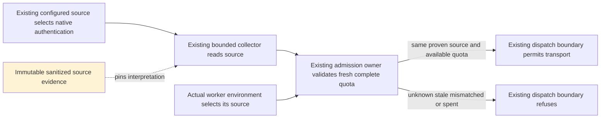
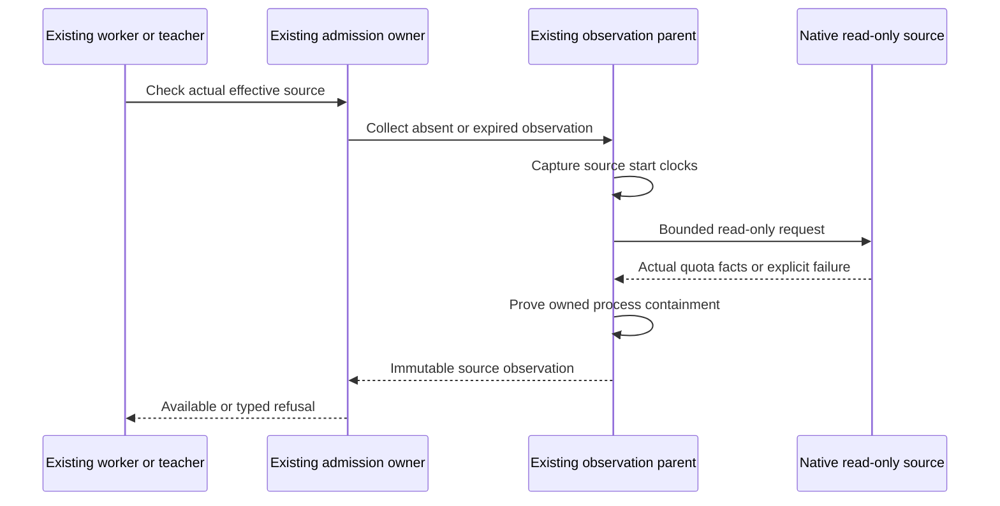

<!-- PURPOSE: Repair the real Claude, Cursor and Antigravity quota-source boundary.
     CONTRACT: RT-QUOTA-SOURCES-006; preserve RT-FRESH-QUOTA-005 admission guarantees.
     DEPENDS: Existing observation, source-identity, scarcity and process owners.
     CEILING: No new quota policy, account selection, API billing, model call or remote gateway. -->
---
contract_id: RT-QUOTA-SOURCES-006
contract_version: 1
owner: Forest
author: /root/quota_repair_contract
exam_owner: /root/quota_evaluation_qa
status: frozen-common-cursor
implements: [RT-FRESH-QUOTA-005]
depends_on: [RT-QUOTA-EVALUATION-004, RT-MCP-LEARNING-003]
blocks: []
attempt_ledger: ["D1: independent common/Cursor review0 defects", "A1: independent77-method freeze0 defects; prebuild red retained; B pending"]
---

# Repair real subscription quota sources

The common/Cursor slice is frozen after independent D=0 then A=0.
The scoped builder may implement against the committed protected exams. B, integrated verification
and before-hash guarded activation remain required. Claude and Antigravity enablement remain deferred source-evidence work within the
requested repair. Missing evidence for them does not authorize weakening their refusal.

Forest requested repair of strict verification for Claude, Cursor and Antigravity so existing fleet
and nightly work can execute. The instruction retains known, fresh, source-bound admission. This
package may strengthen the technical source proof from 005 without inventing account selection or
per-call billing authorization. It does not change CortadOS's global decisions log.

## 1. Observed failure and evidence

Baseline standalone source is `a5a2733fea3c700369d2c628a6bd9e27b72561c5` on `plan/subagent-mcp`.
The prior scoped suite passed 605 tests. That result did not establish all real quota sources usable.
The installed 005 live capture in
`~/.cortados-builds/fresh-quota-verification/live-bounded-quota.json` admitted Codex and refused:

| Lane | Recorded result | Established cause or remaining evidence gap |
|---|---|---|
| Claude | `Quota source metadata is unavailable` | The effective environment contains `CLAUDE_CODE_OAUTH_TOKEN`; `_source_scope` refuses it before the sampler runs. |
| Antigravity | `Quota source metadata is unavailable` | The effective environment contains `GEMINI_API_KEY`, `GEMINI_API_KEYS`, and `GOOGLE_MAPS_API_KEY`; 005's selector rules cannot prove the chosen source. |
| Cursor | `Quota observation process containment could not be proven` | `probe_reaper.descendants` starts setuid-root `/bin/ps`; the parent detects the owned child but cannot read its identity (`EPERM`). The native owner truthfully retains failed containment. |

Diagnostic evidence is private at `~/.cortados-builds/quota-verification-repair/`:
`source-environment.json`, `selector-origins.json`, `cli-auth-help.json`, `agy-help.json`,
`cursor-native-trace.json`, `cursor-owned-cleanup.json`, `cursor-source-excerpts.json`, and
`setuid-ps-containment.json`.
These files contain nonsecret diagnostics, not authority to relax admission.

The Claude `auth status --json` capture reports `loggedIn: true`, `authMethod: "oauth_token"`,
`apiProvider: "firstParty"`, `subscriptionType: null`. A null subscription type is not proof of a
subscription allowance. Cursor's captured installed source formats `billingCycleEnd` with only UTC
month/day for the TUI. `scarcity.py:396` reconstructs local 23:59 and uses 30.4 days. That reconstruction
is not the original billing-cycle geometry. Antigravity's `Quota available` display has no reset in
the existing parser (`scarcity.py:271`). A percentage without raw reset evidence remains unknown.

The captured Claude 2.1.302 binary (`5262ce9de86243fed0d21edc39b271555d56780d0112e2b194439fe1c6662d37`)
contains the read-only `GET https://api.anthropic.com/api/oauth/usage` source. Its OAuth header owner
uses the selected bearer plus `anthropic-beta: oauth-2025-04-20`. Its native credential selector uses
`CLAUDE_CODE_OAUTH_TOKEN` directly when present, with no refresh token for that source; a null reported
subscription type comes from absent `CLAUDE_CODE_SUBSCRIPTION_TYPE`, not a successful server quota
inspection. Source excerpts are pinned privately in `claude-source-excerpts.json`. A bounded request
with that exact existing source returned HTTP 429 (`claude-native-usage.json`), not quota facts. No
successful payload, quota geometry or subscription authorization is claimed from this request.

A second single normal read at `2026-10-17T20:06:46Z` returned `429`, native error type
`rate_limit_error`, and `Retry-After: 3240` (`claude-native-usage-second.json`). No additional request
is eligible before `2026-10-17T21:00:46Z`. Native source proves `/usage` can answer from a 60-second
snapshot and seed its display from persisted utilization up to one hour old after an unavailable
request (`claude-usage-cache-excerpts.json`). The fast TUI captures prove display shape/timing only;
their containment observations also failed. A newly painted cached display MUST NOT be restamped.
Cursor's `cursor-native-rpc-response.json` retains real native protobuf JSON including the exact
billing-cycle start/end in epoch milliseconds. Its diagnostic loader is not a dispatch profile until
native workspace/config merge and authentication precedence are proven identical to the actual CLI.
The operator reversed two incidental Cursor diagnostic trust markers only after exact before-state
and timestamp checks (`cursor-incidental-trust-reversal.json`); this corrective action is distinct
from the future probe requirement to perform zero trust/settings writes.

**[FIXED; AC-QS01/QS03]** QA MUST preserve each consumed real source shape and its executable/version
provenance before readiness, following D-0092. QA MUST redact only secrets and identifiers. QA MUST NOT
invent missing reset or duration fields while creating a fixture. The reason is the 005 near-miss:
synthetic green admission did not demonstrate that real sources could authorize actual dispatch.

## 2. What already exists and must remain canonical

Owner discovery commands run against the baseline:

```sh
rg -n '^def (_claude|_cursor|_antigravity|tui_capture|_cli_env|parse|window_view)' cortados_router/scarcity.py
rg -n '^def |^class ' cortados_router/quota_admission.py cortados_router/quota_observations.py integrations/mcp/native_process.py
```

| Responsibility | Existing owner | Disposition |
|---|---|---|
| Source descriptor and actual scope canonicalization | `quota_admission._source_scope`, `auth_scope` | Preserve pure 005 APIs; extend this owner through prepare_actual/check_actual and delegated native SourceCapture. |
| Freshness, required pool and spent admission | `quota_admission._age`, `_evaluate`, `check` | Adopt unchanged policy. |
| Effective observation environment and bounded child lifecycle | `quota_observations._environment`, `observe_lane`, `_probe`, `_exchange`, `_reap` | Extend the existing lifecycle; no second collector/cache. |
| Read-only CLI usage invocation and projection | `scarcity._claude`, `_cursor`, `_antigravity`, their parsers | Extend or delegate these entrypoints; no second active source for the same lane. |
| Creation-identity process ownership and group signals | `integrations.mcp.native_process.ProcessTracker` | Adopt unchanged; setuid-helper refusal is valid, not an owner defect. |
| CLI PTY cleanup | `probe_reaper.track`, `reap`, `scarcity.tui_capture` | Extend by adopting native identity ownership; remove privileged inventory helpers from admission probes. Preserve separate diagnostic stale-folder cleanup. |
| Window, pool, overflow and cost arithmetic | `scarcity.window_view`, `finish`, `pool_for`, `_roll` | Adopt unchanged. |
| Fleet/PTy/auxiliary/nightly gates | Frozen 005 adapters | Adopt; any new source proof must reach these same actual dispatch gates. |

**[FIXED; AC-QS02/QS05]** Every invariant MUST remain in its existing owner. An adapter MUST delegate
to that owner. `scarcity.py` is oversized; it MUST receive only call-site edits unless the contract
first names and reviews a coherent extraction. The builder MUST NOT add a second parser or cleanup
implementation under a different name to avoid this restriction.

## 3. Unchanged runtime guarantees

**[FIXED; AC-QS04]** The 005 maximum age MUST remain `min(metadata_max_age_s, 30)` seconds.
Both wall-clock and monotonic ages MUST remain finite, nonnegative and within that maximum. The parent
MUST retain the probe-start timestamps. Collection completion MUST NOT restamp the source. These rules
prevent a slow or stale read from authorizing work after its evidence expires.

**[FIXED; AC-QS03/QS04]** Subscription authorization MUST still require known percentage, positive
finite duration, finite future reset, required pool, matching actual source and no applicable spent
flag. Missing information MUST yield `quota_unknown`. Spent information MUST yield `quota_spent`.
An untouched or inactive quota window MUST NOT receive `now + duration` as a fabricated reset.
Source-provided relative durations MAY only be converted using a pinned observation boundary whose
conservative geometry is proven by the captured source; the source-specific rule must be frozen first.

**[FIXED; AC-QS02]** The effective source used for observation MUST equal the source selected by actual
dispatch. Removing a selector only from a probe MUST NOT authorize a worker retaining that selector.
Matching home/executable plus `authMethod` alone MUST NOT establish equality of two different OAuth
tokens. A source switch between selection and dispatch MUST invalidate admission. These rules prevent
subscription A's observation from authorizing source B's work.

**[FIXED; AC-QS02]** A native source profile MAY prove that a particular ambient selector is ignored.
That exception MUST name the exact executable/version and selector in captured native evidence.
An exception MUST NOT be generalized to an entire prefix. An actual API key, endpoint override,
unrecognized auth mode or unidentified account MUST remain unproven. A subscription repair MUST NOT
fall back to API billing or select another account.

**[FIXED; AC-QS01/QS02]** Source verification MUST be read-only. It MUST NOT call a model, refresh a
credential, enroll or switch an account, edit authentication settings, invoke a learner or write a
quota/history store. Raw credentials and account identifiers MUST NOT enter fixtures, public scope,
errors, logs or evidence. The private ephemeral equality mechanism in §4.1 needs its source profiles and
independent exams frozen before dispatch; no builder dispatch is granted by this draft.

**[FIXED; AC-QS05]** Source collection MUST reuse configured startup timeout, termination grace,
process polling and combined-output limits. It MUST preserve creation-identity checks and refusal on
inaccessible or unowned processes. A successful root exit MUST NOT count as proof that descendants
exited. Permission failure MUST NOT become exit.
The captured Cursor cause MUST be repaired by removing privileged `ps`/`lsof` inventory from the
admission probe lifecycle, not by teaching `ProcessTracker` to ignore `EPERM`. Source-private cleanup
MUST use the existing native identity owner from child creation onward. The legacy stale-folder sweep
MUST NOT run on the admission path. A post-exit PID absence does not retroactively prove that an
inaccessible child had no descendants.

**[FIXED; AC-QS04/QS06]** Failed refresh MUST invalidate the prior admission record. Cache and in-flight
identity MUST include the proven effective source. Concurrent callers MUST share only that source's
outcome. A source failure MUST surface through the existing typed observation and admission result;
private terminal or credential material MUST NOT be interpolated into the reason.

## 4. Builder and acceptance boundaries

### 4.1 Concrete proposed interface for independent D/A

The following API is pinned as review input; no builder dispatch precedes D/A and exam freeze:

```python
prepare_actual(provider, *, environment, executable, argv, cwd, config) -> ActualSource
check_actual(provider, model, *, actual: ActualSource, config) -> dict  # existing QuotaCheck
```

`quota_admission` owns both functions and the `ActualSource` type. The first captures context, never
permission; the second performs source proof/collection on its first call without a pre-populated
registry. Its result is exactly the existing public QuotaCheck schema. Existing `check` and pure
`auth_scope` preserve 005 compatibility and conservative refusal. A serialized dictionary, forged
public scope, similarly shaped object, context from another provider or retired process cannot
substitute for the owner-created `ActualSource`. Invalid capture input or unrecognized source raises
ValueError with fixed nonsecret text from prepare_actual; thin adapters turn it into the existing typed
unknown refusal. check_actual rejects a foreign/retired/forged context with the existing unknown result.
The new public scope shape remains exactly `{kind, lane, scope_id}`, with kind `native_subscription`
and a random 64-hex scope_id. It carries no execution authority: legacy public check MUST refuse this
kind, while configured selection uses the existing internal evaluator and the actual gate uses
check_actual. cli_store scope behavior remains unchanged for 005.

`ActualSource` is immutable, nonserializable, and has a redacted repr. Its read-only `public_scope`
property returns a fresh copy of the three-field sanitized scope; it never exposes private fields.
The random scope identifier is generated when context is captured and is an identifier, not approval.
A same-private-source cached observation may be copied and associated with this context's scope only
inside the owner after exact private-key equality and freshness checks; source timestamps are unchanged.
No public scope dictionary can request this binding. It contains the exact private
copied environment/argv, resolved executable, effective cwd and profile/source-setting identities.
The caller captures after all its overrides and uses those same values for actual transport. The
native profile enumerates the source-selecting argv projection used for equality; prompt/task text
is excluded. Unknown source-affecting flags/settings refuse. Workspace settings and native precedence
must be modeled, not only HOME. Source files use stat/read/stat with resolved-path/content equality
before/after the quota read and immediately before dispatch. This is boundary evidence, not a claim
of atomic knowledge of a later vendor file read. Ambiguous native auto-switch behavior stays unknown.

The owner uses a process-local random 32-byte HMAC-SHA256 key (standard 256-bit strength) over the
canonical effective-source material for PRIVATE cache/in-flight identity. Include profile/executable
content, resolved home/store/settings/cwd, selected credential bytes, endpoint/source mode and any
locale/timezone inputs consumed by parsing. The key/digest never enters public scopes, logs, receipts,
Job.meta, fixtures or persistent state. Public scope is a random nonce for a proven context, not a
credential digest. Equality entries expire with their observation (at most 30 seconds), are invalidated
on failure and reset after fork/PID change. Different credentials or settings cannot share a flight.
Raw environment references are released when the call/context retires; physical zeroization is not
claimed. Only a live transport owner retains its original private context while that transport lives.

`quota_observations` remains the sole collector/cache/in-flight owner. Its actual-source child protocol
is a closed versioned envelope: `schema: cortados.quota-source.request.v1`, `nonce` (64 lowercase hex
characters from 32 random bytes), `profile` (frozen profile name), `config` (existing normalized config),
`executable` (absolute resolved native executable), `source_argv` (profile's nonsecret source-selecting
argv projection), `cwd` (absolute resolved path).
No credential, prompt or raw environment is serialized into that JSON. The child inherits the exact
captured vendor environment via Popen `env=` and cwd via `cwd=`. Spawn the fixed release Python using
`-I -B -m cortados_router.quota_observations --observe-actual`; isolation prevents PYTHONPATH/PYTHONHOME
or cwd from shadowing the owner without rewriting the environment passed onward to vendor readers.
Reuse existing nonblocking exchange, configured combined-byte limit and startup/cleanup deadlines.

The child's response is closed: `schema: cortados.quota-source.response.v1`, echoed `nonce`, echoed
`profile`, `source` (fixed reader identifier), `record` (existing sanitized scarcity record or null),
`error` (existing typed quota error or null), and `proof` (private object described below or null on
error). The private proof remains in the parent's internal cache entry and is stripped from public
observations, QuotaCheck, Job.meta and logs. No child public auth scope grants authority. Parent rejects
wrong/replayed nonce/profile, unknown fields, unstable source material and failed containment; then it
associates quota with its private context and public random scope. Parent probe-start wall/monotonic
clocks remain authoritative. Child exceptions return fixed typed text; no exception repr or private
terminal/HTTP body appears on stdout/stderr. No child rereads the global environment or scarcity env
file to select a different source.

`current_resources` and `source_preflight` collect configured contexts through this same proof owner.
The configured source comes from the existing `_environment`, current resolved cwd, and profile's
read-only invocation projection. They may expose sanitized proven quota for selection; that is only
advisory. The final actual transport always prepares/checks its own captured context. An unproven
configured source yields existing unknown selection health, never a public-scope shortcut. Existing
Codex profile and 005 pure-scope API remain unchanged. Its private actual context uses profile name
`codex-cli-store-v005`, captures actual argv/env/cwd and delegates the existing auth_scope strict
`exec --strict-config --ignore-user-config` and config-home/executable checks. check_actual delegates
existing Codex check/NativeMetadata collection and requires matching actual captured scope; native
read uses the exact captured environment. Its public_scope remains the existing deterministic
cli_store scope (exception to new-profile random scope), and its private valid_until_epoch is None.
Only this frozen profile may use a null deadline. No new Codex credential discovery/reader or weakened
selector rule is introduced. Existing Codex paths remain enabled through migrated callers.

Teacher creates a context after final argv/env/cwd resolution and checks it immediately before its
subprocess call. PTY start does the same and retains the context only in a private in-memory attribute,
never persisted Job.meta/JSON. The exact Job attribute is `_quota_actual_source`; public metadata
continues to store only existing `quota_auth_scope` from `actual.public_scope` plus public QuotaCheck.
Missing `_quota_actual_source` (including object reload and legacy metadata-only jobs) refuses sends.
Drop its reference on job retirement; no private context enters meta.json, receipt or error. Every continuation obtains fresh quota for the ORIGINAL process source;
a changed global environment does not substitute another account for that running process. Changed
file-backed credential/settings generations refuse continuation unless the profile proves actual
running selection. After reload/context loss, continuation refuses until a new runtime binding exists.
For Cursor actual dispatch, the model passed to check_actual must equal the actual argv `--model`
operand; a missing or mismatched actual model refuses rather than authorize a different quota pool.
The configured read-only projection is permitted only for advisory configured collection; it cannot
stand in for a final dispatch grammar. Both learning-flag paths use the same gate. Missing new API in an installed owner is a deployment
failure, never permission to fall back to old checks.

The exact external-source seams for independent tests are:

```python
quota_sources.capture_source(provider, *, environment, executable, argv, cwd, config) -> SourceCapture
quota_sources.read_source(profile, *, environment, executable, source_argv, cwd, config) -> SourceRead
```

`SourceCapture` is a keyword-constructible frozen private value:
`SourceCapture(*, profile, lane, source_argv, material, files)`, with fields `profile` (string), `lane` (string),
`source_argv` (tuple of strings), `material` (canonical private bytes), and `files` (tuple of private
file-generation descriptors). Each existing-file descriptor is `(resolved_path, device, inode, size,
mtime_ns, ctime_ns, sha256_of_contents)`; an absent candidate is `(resolved_path, None, None, None,
None, None, None)`. Comparisons use stable stat/read/stat generations and re-resolve candidate paths. The object has a
redacted repr and refuses serialization. Material includes the captured environment, source-selecting
argv projection, cwd, executable/native dependencies and captured source-file contents. Parent-only
HMAC gives cache equality; no material or file credential digest enters public output.

`capture_source` is pure filesystem/environment capture: no process, network, native config invocation
or second supervisor. It fingerprints the profile's exact known file authorities, candidate-path
presence and relevant source material. Native semantic config/auth interpretation is performed only
inside read_source, under the existing bounded observation child. Its actual native selected paths and
full merge must match the captured profile's file authorities; unknown discovery refuses.
`prepare_actual` delegates capture_source; final and continuation checks recapture against the same
private transport values. `quota_observations` calls read_source only inside its existing isolated,
bounded child. read_source delegates native owners and pure cursor_record; it has no admission/cache.
Its exact return is keyword-constructible private `SourceRead(*, record, valid_until_epoch)`. Record is
the existing scarcity record. For Cursor, valid_until_epoch is `native_token_exp - 300`, derived only
inside the audited native reader. The private response proof is exactly `{valid_until_epoch}`. The
parent requires a finite nonboolean deadline and `wall_now + startup_timeout_s <= valid_until_epoch`
at every actual admission, in addition to both-clock quota freshness. The existing configured startup
allowance conservatively covers native startup before its first use; too short permits a transition
into native refresh, while excessive allowance refuses still-useful tokens. No new tuned timeout is
introduced. Cached records retain this private deadline and cannot be reused past it. Missing/invalid
proof refuses. No raw token/claim or this derived deadline enters public output.
Independent tests can replace these named module seams or source manifests in isolated test processes;
production configuration has no fixture profile, arbitrary import, custom reader or alternate endpoint
escape hatch. Separate manifest/native-owner exams validate the real profile so seam tests do not
stand in for source correctness. Retire contexts by dropping references at job end/reload and reject
foreign creating PID after fork. No new retire API or physical zeroization claim is required.

### 4.2 Writable scope and source-profile readiness

The initial review slice is common source-proof plumbing plus the Cursor native reader. Claude and
Antigravity remain disabled in the new profile dispatcher until their separately captured source
profiles satisfy this same D/A/exam boundary. This does not complete Forest's three-lane repair; the
remaining profiles remain active work. No initial slice is dispatchable before its readiness gaps close.

The normal Cursor status path MUST use the repaired native source too. The named collector seam is
`quota_observations.status_record(lane, *, config, environment=None) -> dict`, returning an existing
sanitized scarcity record. This extension supports lane `cursor`: with environment=None it uses the
existing configured source; an explicitly supplied environment is captured exactly, never discarded
or reread from the global env file. It obtains a configured/read-only ActualSource through the same
source-proof and bounded collector/cache path used by current_resources/source_preflight. It does
not create a second collector, parser, cache or freshness policy. It exposes only a successfully
validated, fresh record and strips private proof. A failed, unavailable or unproven row raises fixed
`WorkerError("quota_unknown", "Quota source metadata is unavailable")`; it must not restamp or return
a former success. The existing diagnostic wrapper may render that failure, never substitute TUI data.

Standalone `scarcity._cursor(*, environment=None)` delegates to this seam with loaded configuration.
The shared adapter adds `quota_policy.cursor_status()`, verifies the pinned installed collector's
origin using the existing release guard, and calls status_record for Cursor. Shared
`plugins/cortados-router/scarcity.py:_cursor()` delegates only to quota_policy.cursor_status().
Both oversized scarcity modules replace their former Cursor sampler bodies with delegation and
have no net growth. Their legacy parse_cursor_usage may remain diagnostic-only; normal status and
admission MUST NOT use its guessed reset or TUI fallback. The bounded observe-actual child invokes
quota_sources.read_source directly and MUST NOT call scarcity._cursor or status_record: this keeps
the status-to-collector path from recursively entering itself. Codex status behavior is unchanged.

Proposed writable scope after independent freeze:

- `cortados_router/quota_admission.py`: extend the sole source/admission owner with ActualSource and
  the two-step API, preserving existing closed result and policy.
- `cortados_router/quota_observations.py`: extend the existing collector/IPC/cache/lifecycle for the
  private actual context. No second cache, supervisor or freshness arithmetic.
- `cortados_router/quota_sources.py` (new): cohesive native source profiles/read-only projections,
  delegated by existing sampler call sites. It owns external source interpretation, not quota policy.
- `cortados_router/cursor_quota.cjs` (new): version-bound loader of installed Cursor native credential,
  configuration and DashboardClient owners; no copied RPC/credential implementation. Python remains
  the bounded lifecycle owner. This file contains no independent admission/cache/freshness rules.
- `cortados_router/scarcity.py`: call-site delegation only; no net growth in this oversized file.
- `cortados_router/probe_reaper.py`: adopt native creation-identity cleanup; remove privileged
  inventory from admission lifecycle, retaining separate stale diagnostic cleanup.
- `pyproject.toml`: package only the named native reader resource so the immutable wheel contains it.
- `tests/test_quota_sources.py` (new): builder-owned unit/regression tests; independent exams excluded.
- `docs/mcp-worker/FRESH-QUOTA-SOURCES-006.md` and `docs/mcp-worker/INDEX.md`: author/root metadata only.

`integrations/mcp/native_process.py` is excluded: its inaccessible-owned-child refusal is correct.
No production permission or ownership exception is granted.

The fresh activation candidate is `/Users/velox/.cortados-builds/quota-sources-activation/` and is copied
from the frozen 005 inputs, never edited in place at the 005 source. Only these candidate paths gain
API/dependency migration: `plugins/cortados-router/quota_policy.py`,
`plugins/cortados-router/scarcity.py`, `plugins/cortados-pty/model_routing.py`,
`plugins/cortados-pty/runner.py`, and `train/label.py`.
The quota adapter also forwards the named Cursor status seam; shared scarcity receives only the
delegation above. The two adapters forward prepare/check to the exact installed owner; runner/teacher capture,
retain/release and pass private context. No adapter implements source rules or quota arithmetic.

The immutable release target is
`/Users/velox/.local/share/cortados-workers/releases/quota-sources-v1-20261017/`.
Literal dependency-path migration additionally covers candidate `train/dataset.py`,
`train/build_sft.py`, `train/evaluate.py`, `train/nightly.sh`, `agent/auxiliary_client.py`,
`agent/auxiliary_model_routing.py`, and `hermes_cli/plugins.py`. These files have no new behavior beyond
origin parity/literal release replacement. Root must inventory exact before/candidate hashes for every
consumer, include both learning flags and keep nightly installation last. Existing release and 005
activation source remain rollback inputs. No production fallback to an old owner missing the new API.

### 4.3 Cursor profile and parser seam

Cursor production admission migrates exclusively to the native profile below. Unsupported or failed
native proof returns unknown; it MUST NOT fall back to legacy `_cursor` TUI/date reconstruction.
The legacy parser remains diagnostic/005 compatibility only, never an admission source for this
profile. If the existing inspection sampler is migrated, its narrow call site delegates to the existing
bounded observation collector; it never invokes read_source under a second/unbounded supervisor.
The actual observation child directly delegates the new native reader and does not recurse through
that inspection sampler. No duplicate active Cursor admission reader remains.

Profile name: `cursor-2026.10.16-e3cb207-file-v1`. Its installed `index.js` SHA-256 is
`d0e2097119ed8ef3509c6e9e4c629809f2b7345d81de33bf591875b4b6e4722c`.
The resolved launcher is `cursor-agent` in that version directory (SHA-256
`2ccc9a8e167797641448b5e5c936f006ba137a2555f117f38c5eb76a5238a233`), reached by
`/Users/velox/.local/bin/cursor-agent`. It executes its bundled Node v26.8.1 (SHA-256
`ebd2d552c7bebde593dd0390530963ad28de56bccde6ce387cdbe55fb0b6fb8e`) and index.js. File backend
skips the wrapper's system-CA branch. QA must freeze the exact relative file/hash manifest from
`cursor-native-fingerprint-chain.json`, including its loaded native dependencies and usage-reference
chunk. The production profile embeds that reviewed manifest; a private diagnosis path is not a runtime
dependency. Resolve and fingerprint the actual launcher chain; never substitute a system Node.
A changed native version/hash refuses until a new profile is captured; filenames alone do not prove
compatible behavior. The loader delegates native `../cli-credentials/dist/index.js` file-store owner,
`../cursor-config/dist/file-based-config-provider.js`, and `./src/dashboard-client.ts`.
Use native `getCurrentPeriodUsage` against the captured `https://api2.cursor.sh` endpoint with the
current credential only. No login, refresh, settings/trust write, alternate endpoint or API-key fallback.
The diagnostic's deletion of CURSOR_API_KEY is not permitted in production: an active override refuses.

Credential authority is `HOME/.cursor/auth.json`, independently of native settings precedence
`CURSOR_CONFIG_DIR` > `XDG_CONFIG_HOME/cursor` > `HOME/.cursor`; data root is
`CURSOR_DATA_DIR` > `HOME/.cursor`. Bind relevant native active team/config in private source material,
never public identifiers. The exact native workspace/git-root merge must match actual CLI startup;
`skipGitRootDetection` cannot be adopted merely because the diagnostic used it. A nearest-ancestor
`.envrc` can cause native direnv to alter source environment; refuse such a profile unless native
selection proves it inactive (for example the ACTUAL captured environment already has DIRENV_DISABLE=1).
Unknown config, executable args, auth/endpoint overrides or automatic credential selection refuse.
`cursor-native-profile-proof.json` and `cursor-profile-parity.json` establish the captured native
configuration projection: settings at `/Users/velox/.cursor/cli-config.json`, no project config files,
no ancestor `.envrc`, native direnv result `skipped/no-envrc`, file backend and absent API/endpoint
selectors. Full native config merge equals the diagnostic skip-git-root merge for that capture. The
production profile MUST use the full native merge and MUST NOT assume skip-git-root equivalence for
another cwd. The initial enabled profile is conservatively limited to native projections with no
project config files and no active direnv selection; unfamiliar project settings remain unknown.
Private equality covers the settings/auth content that determines native merged active-team/config,
with native interpretation inside the bounded child, and stable generation of the auth/settings files.
The exact native project filename is `.cursor/cli.json`; full native discovery uses GitExecutor
`rev-parse --show-toplevel` (or cwd on no root), then root and each root-to-cwd component, ordered
existence-filtered/deduplicated merge. Pure capture conservatively records absence of `.cursor/cli.json`
at every resolved cwd ancestor plus relevant captured Git/environment inputs. It does not run git.
The bounded child proves its native candidate chain lies in this captured ancestor set; an outside or
unmodeled root refuses. Any discovered project config is outside the initial profile and refuses.
Recheck absence at the final gate so a newly created project config cannot reuse older evidence.
`cursor-project-candidate-discovery.json` and `cursor-synthetic-fixture-provenance.json` pin this rule. Re-evaluate the same native projection for actual cwd on every final gate.
The captured settings digest is provenance, not a permanent allowlist of Forest's configuration.
A new settings generation creates a new private context and requires a new source observation.
`cursor-native-token-branch.json` and `cursor-auth-source-semantics.json` prove the actual file-token
owner invokes `auth-refresh.ts`'s native `nH` expiration predicate: malformed/missing/nonfinite/nonnumeric
exp is refresh-needed; `exp - floor(now_epoch_s) < 300` is refresh-needed; equality at 300 retains the
current token. The 300 seconds are native protocol semantics, not a newly tuned CortadOS timeout.
Refuse refresh-needed both before reading quota and at the final dispatch/continuation boundary.
Require no stored API key, no API override and no prior ephemeral source override. The read-only reader
supplies the exact captured current access token through native credential-manager interface, returns
undefined for getApiKey and throws on setAuthentication; it cannot refresh or persist. Do not invoke
login/refresh merely to prove a token. This is boundary proof, not future-token atomicity.

The initial Cursor argv profile accepts the existing Runner's Cursor grammar only: executable, `-p`,
`--output-format stream-json`, `--trust`, `--model <id>`, optional `--force`, optional
`--resume <id>`, optional `--mode ask`, and at most one final prompt argument. Read-only configured
preflight uses the zero-prompt projection. Model and resume values are operands, never reinterpreted as
flags; malformed/duplicate/unknown flags refuse. Preserve the exact actual argv privately, but no prompt
or resume value enters the public envelope/equality projection. Native source-affecting `--endpoint`,
`--api-key`, `--auth-token`, custom `--header`/`-H`, project/config overrides and subcommands are excluded.
Actual source selection must remain the known file subscription profile. Probe code never sends the
Runner's trust or prompt options to native main; it loads only the audited read-only owners.

Refuse active interpreter-injection inputs `NODE_OPTIONS`, `NODE_PATH`, `BASH_ENV`, `ENV`, or `DYLD_*`
variables before invoking the captured native reader. They cannot be stripped only from a probe while
retained by actual dispatch. Bound executable chain and loader paths instead of resolving a system Node
or requiring arbitrary packages from cwd. Guards refuse native credential/config/trust mutations;
existing-directory mkdir may be satisfied without mutation only after proving that directory exists.
An attempted new directory or any write/rename/delete sets a sticky mutation-attempt flag and fails
the read, even when the native owner catches the guard exception and returns a fallback/default config.
The native loader's repair/backup/regeneration catch path must never turn a refused write into a
successful source proof. Only a native load with zero such attempts can supply quota facts.
The captured version's native dependency list must match the reviewed loaded-file manifest.

The source review manifest is `readiness-source-manifest.json`, SHA-256
`13a30d20c6be101c8ee4825aaafc600c592e046381a3b808821e0f19bc831e3e`.
QA freezes those facts plus the native RPC response and config-parity capture into independent fixtures.
No credential values, account fields or raw claim values are copied; source selection compares them
only inside private memory.

The independently testable pure projection is:

```python
cortados_router.quota_sources.cursor_record(payload, *, observed_at) -> dict
```

It accepts the native protobuf JSON object and returns an existing scarcity record with source
`cursor native getCurrentPeriodUsage` and windows. Malformed/unknown native payload raises
`WorkerError("quota_unknown", "Native quota data is invalid")`; no raw field is interpolated. Native `billingCycleStart` and `billingCycleEnd` are finite integral epoch
milliseconds, including native int64 decimal-string JSON. `observed_at` is finite numeric seconds
excluding booleans. No unproven positive-epoch constraint is added. Booleans, fractional values, nondecimal
strings and nonfinite conversions refuse. Require `start <= observed_at*1000 < end` and `end > start`.
Every projected window has `window_s=(end-start)/1000` and `reset_epoch=end/1000`, without local calendar
reconstruction, rounded month length, rounding of percentages or fabricated reset. The exact duration
comes from this response; fixture example is 31 days, not 30.4 days.

| Native planUsage field | Existing window name | Existing pool |
|---|---|---|
| totalPercentUsed | month (included, both pools) | info |
| autoPercentUsed | month (Cursor models: Grok, Composer, Auto) | cursor-models |
| apiPercentUsed | month (other models: Claude, GPT, Gemini …) | other-models |

All three percentages must be numeric excluding booleans, finite and within [0,100]. Missing fields refuse; zero is known
and is not absence. Existing `scarcity.finish`, pool selection and spent behavior remain canonical;
100% info/Auto does not make the distinct named-model API pool spent. Display messages, spend-limit
billing, extra usage and bonus credits do not override subscription-pool arithmetic. The top-level `enabled` field is diagnostic only: captured native usage-data.ts does not read it,
and its renderer produces identical usage for true/false/missing (`cursor-enabled-schema.json`,
`cursor-enabled-interpretation.json`, `cursor-enabled-renderer-fixture.json`). It is not a PlanUsage
field or entitlement proof. No on-demand purchase/billing permission follows from enabled/message
fields, and their absence does not invalidate otherwise complete native quota facts.

QA owns new protected `acceptance/quota_sources/` (new; its `acceptance/` parent exists). No fixture or
selector under that path is currently committed. The builder MUST NOT write it. The eventual freeze
commit MUST carry the independent `Exam-Owner` trailer. Root approves only additive fixture plumbing
in `acceptance/fresh_quota/stage_support.py` and `acceptance/fresh_quota/test_main_pty.py` methods
`test_unknown_and_spent_prevent_continuation_bytes_even_mode_off` and
`test_available_continuation_checks_identity_and_writes_once`:
prepare/check fake-owner plumbing and owner-created private Job context replacing their metadata-only
setup. Every existing assertion remains unchanged. Fake prepare may delegate fake auth_scope to keep
the old exact call-record assertions; new 006 exams must exercise the actual new owner. A new protected
case separately requires metadata-only/context-lost continuation denial. Root owns migration and release evidence.

## 5. Acceptance criteria to freeze with source evidence

| ID | Required independent ground truth |
|---|---|
| AC-QS01 | Redacted real read-only source captures for each enabled lane/profile; exact native version/hash; values and missing fields retained; zero model calls, credential/settings writes and learner/history writes. |
| AC-QS02 | Observation and actual dispatch use the same proven source; alternate token, home, executable, store, endpoint, account or auth-mode changes refuse; an ignored selector exception is limited to its captured native profile; no API-billing fallback. |
| AC-QS03 | Exact source-provided reset/duration/percentage/pool projection, including zero/untouched and exhausted shapes; absent, truncated, malformed, wrong-unit and out-of-window geometry refuse; existing pool/overflow results remain identical. |
| AC-QS04 | At exactly 30 seconds admission can succeed; above 30 or either clock invalid it refuses; stale lanes cannot be wrapped as fresh; failed refresh cannot reuse prior authorization; slow routing and final actual dispatch revalidate. |
| AC-QS05 | Bounded real child/PTY lifecycle with creation-identity ownership; zero surviving owned executable descendants after completion/failure; PID reuse, unknown identity, foreign group, inaccessible inventory and output/deadline failures refuse without signaling unrelated processes. |
| AC-QS06 | One in-flight read per effective source, fresh-cache reuse, scope switch invalidation, concurrent callers and late result rejection; immutable selection resources remain unchanged after construction. |
| AC-QS07 | Installed/staged main, auxiliary sync/async/deferred stream, PTY start/reuse/continuation and nightly teacher under both learning flags exercise the repaired source through the existing final gate; refusal means zero transport starts or prompt bytes. |
| AC-QS08 | All prior maintained scoped suites and 005 protected exams are accounted for on the integrated candidate; no empty/missing/skipped lane is counted passing; baseline failures remain visible. |
| AC-QS09 | Baseline/candidate raw latency and source-call counts for uncached success, cache hit, expiry, unknown failure, concurrent same-source callers and zero-dispatch refusal; correctness precedes performance. |
| AC-QS10 | Immutable installed release, origin parity, before-hash-guarded migration and rollback evidence; all actual fleet/nightly bridges use the reviewed owner; no training pointer, labels, promotion gate or schedule changes. |

Readiness requires executable method selectors and captured fixtures for these rows. The intended
new-exam command is not currently a passing command:

```sh
/Users/velox/.cortados-builds/mcp-worker-qa-env/bin/python -B -m unittest discover -s acceptance/quota_sources -t . -v
```

The accumulated 005 inventory owner remains
`~/.cortados-builds/fresh-quota-verification/run-full-suite.py`; QA must freeze its 006 extension and
installed-source bindings before implementation. The package result MUST remain distinct from the
unverified unrelated whole-CortadOS suites.

Existing observation cache/in-flight maps are process-local. A repaired source does not prove
independent fleet/teacher processes avoid upstream limits. Claude's observed 429 does not establish
its cause. Honor native Retry-After and keep unavailable fresh quota unknown. A shared-process broker
is excluded from this repair without separate cause evidence and reviewed owner extension.

## 6. Evidence and deployment boundary

**[FIXED; AC-QS08/QS10]** No live install follows from a draft or synthetic green tests. Root MUST
freeze the candidate source and wheel hashes after independent B=0. Root MUST verify current before
hashes before activating only reviewed files. Root MUST retain the prior release and before files
for rollback. An intervening edit MUST stop replacement. No shared-tree Git mutation is authorized here.

**[FIXED; AC-QS10]** Release migration MUST move every process to one immutable installed owner, as in
005. A process MUST NOT mix old and new `cortados_router` module origins. The migration's exact release
path and literal consumers MUST be enumerated before freeze. The existing learning-equivalence and
nightly-last installation checks remain binding. S1 weights, evaluation gates and schedules are excluded.

**[FIXED; AC-QS01/QS10]** The final operational proof MUST use bounded read-only source checks through
the installed owner and actual effective worker/teacher environments. It MUST report which sources
are presently available, unknown or spent. No model turn may be spent merely to test a quota display.
The Air-to-Studio MCP/S1 execution request is outside this package.

The builder handback MUST contain its confined diff, exact source revision/hashes, per-AC evidence,
full suite accounting, raw performance records, chosen bounded details and residual limitations.





## 7. Readiness gaps

| Gap | Required evidence or design | Current state |
|---|---|---|
| R1 | Claude subscription quota source and exact same-source binding, including null subscription-type capture | Diagnosis in progress; no profile enabled. |
| R2 | Antigravity source selection and native reset facts for untouched windows | Diagnosis in progress; no selector exception or reset inference granted. |
| R3 | Cursor native cleanup reuse and exact billing-cycle source | Typed response, config parity, runtime fingerprints and exact auth-expiry branch captured; independent77-method fixture freeze complete. |
| R4 | Exact scope paths, source protocol, sanitized source manifests, runnable protected selectors and release migration | Common/Cursor paths, API, protocol, release migration and QA selectors frozen in this package. |
| R5 | Independent D/A and committed exam freeze | Independent D=0 then A=0; B pending. Both Mermaid diagrams render with the existing router-l1-qa-tools mmdc; private SVGs are in `contract-diagrams/`. |

Independent QA disposition: **D=0 then A=0 for common/Cursor only**. Protected exams and source
facts are frozen with the `Exam-Owner` commit. The prebuild is intentionally red:77 methods,
18 failure records,86 error records (including subtests), zero skips. Candidate B has not run.
Claude/Agy profiles remain disabled and outside this slice's readiness claim.

## 8. Independent normative and execution binding

**[FIXED; AC-QS01–QS10]** The builder MUST implement the exact interface, schema, source-profile,
status and migration requirements in §§3–4. Present-tense interface/profile declarations in those
sections specify MUST behavior; they are not optional examples. The builder MUST use the named
canonical owners. The builder MUST NOT introduce an alternate authentication or billing path.
These bindings preserve source equality when an apparently harmless config/refresh fallback would
otherwise observe one subscription and dispatch another.

**[FIXED; AC-QS01–QS08]** The builder MUST treat every path beneath
`acceptance/quota_sources/` as read-only. Existing protected exams remain read-only. The only QA-owned
005 amendments are `acceptance/fresh_quota/stage_support.py` and the two setup additions in
`acceptance/fresh_quota/test_main_pty.py`; `evidence/fixture-amendment.json` pins before/after hashes
and all20 unchanged assertion ASTs. Both new source files have verified parent `cortados_router/`;
the new unit-test file has verified parent `tests/`. Native process owner, learner implementation,
training data/weights/current pointer, promotion policy, schedules and prior releases are excluded.
The explicit builder paths are exactly §4.2; no wildcard grants additional writable scope.

**[FIXED; AC-QS01–QS07]** The builder MUST satisfy every exact selector in
`acceptance/quota_sources/METHOD-MAP.json`. That file maps all77 methods to the unchanged AC IDs.
`fixtures/cursor-native-rpc-response.json` is the real source ground truth;
`fixtures/cursor-projection-reference.json` pins its unit conversions. `fixtures/PROVENANCE.json`
identifies redactions and separates invented native-store values. Worked valid/invalid protocol cases
are executable in `test_actual_protocol.py` and `fixtures/actual_child.py`: a correctly nonce-bound
response with complete native geometry and future private proof permits admission; a wrong nonce,
extra field, missing/nonfinite proof, expired source, or invalid geometry refuses. `test_native_reader`
exercises real native credential/config owners with only root-approved isolated Dashboard substitution.
The native preload and frozen clock are test-only; production MUST NOT expose an instrumentation flag.

**[FIXED; AC-QS08]** Root MUST run the preserved605 scoped methods plus this package and all builder
regressions through the frozen full runner. It MUST reject empty, skipped, missing or failing lanes.
The exact full command is:

```sh
/Users/velox/.cortados-builds/mcp-worker-qa-env/bin/python /Users/velox/.cortados-builds/quota-verification-repair/run-full-suite.py
```

The runner binds `CORTADOS_FRESH_QUOTA_STAGE` to the006 activation candidate. Historical learning,
newly migrated learning, shared nightly, shared router and preserved PTY delivery/FD suites remain
separate required lanes. Unrelated whole-CortadOS suites are not represented as verified by this scope.

**[FIXED; AC-QS09/QS10]** Root MUST execute the exact performance and parity commands in METHOD-MAP.
Their reviewed scripts/hashes are copied in `acceptance/quota_sources/evidence/`. The six existing
baseline workloads measure Codex protocol overhead. The six new actual-source workloads and native
file capture measure the changed path. The old actual-source API is absent and real old Cursor
containment failed; root MUST NOT invent a successful native latency comparator. Root MUST retain raw
figures, source-call counts and the exact tested identities. Root MUST verify immutable installed
origins, learning byte parity, rollback inputs, before-hash guarded activation and nightly-last order.
A staged candidate and unregistered immutable release may be built for B; no live consumer moves
before B=0 and independent source identity verification.

Brownfield references: `quota_admission.py:46` owns source descriptors; `:72` owns pure dispatch
scope; `:90` owns freshness; `:104` owns pool admission. `quota_observations.py:53` owns configured
environment; `:70` owns child reap; `:116` owns bounded exchange; `:185` owns cache/in-flight sharing.
`scarcity.py:126` owns PTY capture; `:415` owns the former Cursor sampler. `probe_reaper.py:59` owns
the privileged inventory defect; `:101` owns cleanup. Paths are beneath `cortados_router/` at the
frozen baseline. The native process owner remains unchanged. Both rendered diagrams and source
inputs are retained in the independent evidence directory.
