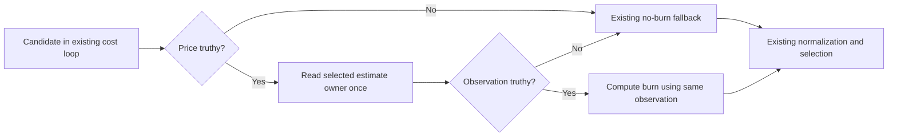
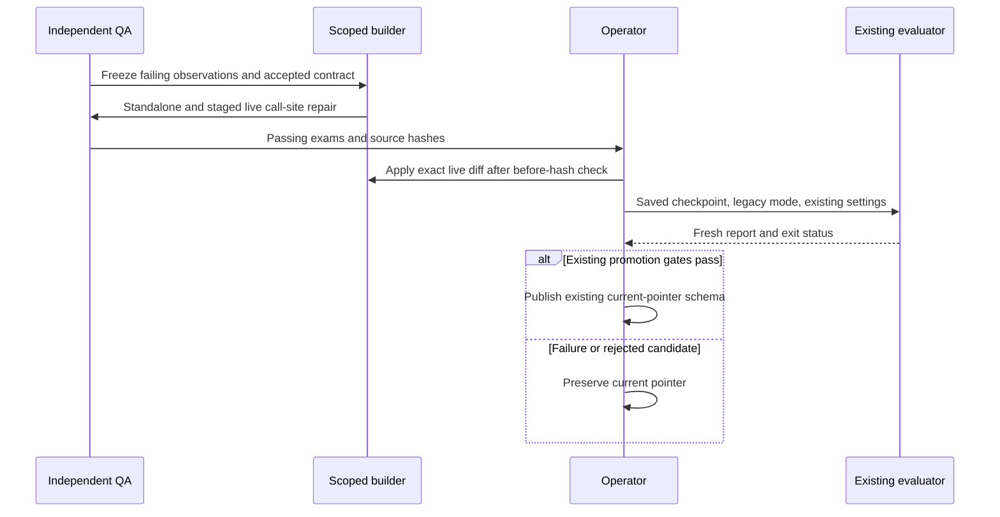

<!-- PURPOSE: Repair inconsistent quota-cost observations and recover the saved nightly evaluation.
     CONTRACT: RT-QUOTA-EVALUATION-004; preserve existing quota, fallback and promotion rules.
     DEPENDS: Existing core/scarcity/evaluate owners and independently frozen source evidence.
     CEILING: No new quota policy, training, data mutation or automatic promotion outside existing gates. -->
---
contract_id: RT-QUOTA-EVALUATION-004
contract_version: 1
owner: Forest
exam_owner: /root/quota_evaluation_qa
status: approved
implements: [RT-MCP-001]
depends_on: [RT-MCP-LEARNING-003]
blocks: []
attempt_ledger: []
---

# RT-QUOTA-EVALUATION-004 — quota-cost consistency and evaluation recovery

Status: approved for scoped implementation after independent D/A review; implementation and recovery are not yet accepted.
Author: `/root/mcp_learning_contract`. Exam owner: `/root/quota_evaluation_qa`.
Authority: Forest's October 17 instruction to fix the evaluation crash, rerun the saved checkpoint,
promote only if the existing gates pass, explain quota selection and provide the existing inspection command.
This records a narrow repair within that instruction; it adds no ruling to `docs/DECISIONS.md`.

The following fixed obligations map to the executable ACs below. **[FIXED]** The builder and operator
MUST implement §3 exactly (AC-Q01–Q05), MUST stay within §2 scope and retain all tests (AC-Q06), MUST
follow the frozen-input recovery sequence (AC-Q07), MUST NOT promote except under §4's existing gates
(AC-Q08), and MUST accurately describe the existing inspection interface and its limits (AC-Q09).
**[BOUNDED: {assignment expression|local variable}]** The builder MAY bind the one local estimate by assignment expression or local variable;
these are the only implementation choices granted here, with no public difference or new helper.
Normative “retain”, “preserve”, “do not” and “only” statements in these sections express these MUST/MUST
NOT obligations. Strict fresh admission for both MCP and fleet is newly authorized as separate package
005; it MUST NOT be silently folded into this repair or delay this recovery.

## 1. Evidence and intended result

Standalone baseline is `a5ea70e162cd556111d9b0a506764145cd1d9808`. The operator's immutable capture is
`/Users/velox/.cortados-builds/quota-evaluation-verification/live-before`; its sibling `baseline.json`
records exact SHA-256 values, paths and lengths. Captured live core hash is
`8454018479497287fe9ee3109493a5ffdc7f2e7fe14888e3ca63660107b26532`.
The completed October 17 01:30 checkpoint's `adapters.safetensors` and `0001500_adapters.safetensors`
both hash to `e0fa96c564a56732d1338b8c61bcbc446293d310c400e98a8ba5fb6e8c18430b`.

`core.resolve` currently calls the estimate reader twice in one candidate's burn expression. A first
positive estimate followed by `None` crashes division; a changed positive second observation silently
changes the denominator. `scarcity.unit_costs` rereads a file and returns no estimate after read/parse
failure, so these are possible observations, not hypothetical numeric inputs. This does not establish
that a particular concurrent writer caused the captured crash. Independent exams reproduce both cases.
`evaluate.band_of` calls `resolve`; replacing lane health with an empty mapping does not remove those
estimate reads. The fix must let this existing evaluator complete its cost calculations consistently.

## 2. Ownership, scope and exclusions

| Responsibility | Inspected owner | Disposition |
|---|---|---|
| Candidate burn, normalization and selection | `cortados_router/core.py:408` (`resolve`, burn at 532); captured live `plugins/cortados-router/core.py:521` (burn) | Extend only the estimate-consuming expression to observe once. |
| Estimate reading and unknown fallback | `cortados_router/core.py:321` (`_pool_tokens_per_pct`), `cortados_router/scarcity.py:610` (`unit_costs`) | Adopt unchanged. |
| Learned quota estimate writer | `cortados_router/unitcost.py:48` (`learn`) | Adopt unchanged; atomic writer repair is a separate package. |
| Used/elapsed/reset scarcity and recommendation | `cortados_router/scarcity.py:68,568,594,631,652` (`window_view`, `lane_scarcity`, `stance`, `summary_lines`, CLI) | Adopt unchanged; no duplicate status command or formula. |
| MCP known-quota admission | `cortados_router/worker_admission.py:41` (`admit`), `selection_resources.py`, broker pre-START admission | Adopt unchanged; immutable native snapshot path remains intact. |
| Held-out classification and promotion decision | Live `train/evaluate.py:48,154,263` (`band_of`, main, gates), `train/common.py:29` (`read_labels`), `train/student.py` | Adopt unchanged in the original run's legacy mode. |
| Deployment and conditional current-pointer publication | Operator, using existing `train/nightly.sh` post-evaluation semantics | Execute after tested repair; no nightly restart or retraining. |

These are inspected source locations at the captured revision, not promises that live and standalone
files are interchangeable. Reproduce owner discovery from the standalone root with:

```sh
rg -n 'def (resolve|_pool_tokens_per_pct|window_view|lane_scarcity|stance|summary_lines|unit_costs|learn|admit)|__main__' cortados_router/core.py cortados_router/scarcity.py cortados_router/unitcost.py cortados_router/worker_admission.py
rg -n 'def (band_of|read_labels)|report\["promote"\]' /Users/velox/cortados/train/evaluate.py /Users/velox/cortados/train/common.py
```

Builder-writable paths are exactly:

1. `/Users/velox/.cortados-builds/cortados-router-repo/cortados_router/core.py` — minimal call-site repair.
2. `/Users/velox/.cortados-builds/quota-evaluation-activation/plugins/cortados-router/core.py`
   — independently copied captured live core, with the equivalent minimal call-site repair.
3. `/Users/velox/.cortados-builds/cortados-router-repo/tests/test_quota_cost_snapshot.py`
   — optional additional builder regression; existing tests are read-only.
4. `/Users/velox/.cortados-builds/cortados-router-repo/docs/mcp-worker/INDEX.md`
   — one entry linking this existing responsibility and contract; no ownership move.

The staging root is new operator-created test material, not the shared production checkout. The builder
must not replace staged live core with standalone core: their integrations differ. Protected exams are
`acceptance/quota_evaluation/{__init__.py,support.py,test_consistency.py}` and their QA-owned evidence.
Only independent QA may amend those paths. Source cores are oversized: permit call-site edits only,
with no unrelated growth, packing, reformatting or helper extraction. A local expression binding is a
bounded implementation choice. No added dependency, persistent cache, schema, retry, timeout or limit.

No pure band owner is introduced: classification extraction would change another responsibility and
is unnecessary to repair this crash. Consequently the existing local checkpoint evaluator still calls
full `resolve` and can read quota; “offline” here means local saved model inference with offline model
loading, not a guarantee of zero quota/background-probe I/O. Do not report that stronger guarantee.
No changes to scarcity freshness, learner writer, labels, splits, requests, checkpoint weights, teacher
calls, training budgets, inference thresholds, promotion tolerances or scheduled nightly startup.

## 3. Exact behavior and examples

`resolve` retains its arguments, return keys, errors and existing ordering. For each candidate reaching
the burn-cost loop:

- If `c.get("price")` is false, do not call the estimate reader; burn remains `None`.
- Otherwise call the selected reader exactly once: injected `resources.tokens_per_pct` when supplied,
  otherwise existing `_pool_tokens_per_pct`. Bind that observation locally for this candidate only.
- If that observation is truthy, compute the existing `price / (estimate / 1e6)` expression using it.
  `1e6` retains the existing per-million-price conversion; no new tuned constant is introduced.
- If it is `None` or zero, retain `burn=None` and existing price/general/local fallback normalization.
  Do not invent token counts, quota evidence, zero scarcity or a success claim.
- Another candidate and another `resolve` invocation obtain their own observations. No cross-candidate,
  request or invocation estimate cache is introduced. Existing spent/unhealthy exclusions still apply.

For the independent fixture's two candidates (Codex price 2, Claude price 4), all other costs equal:

| Reader sequences available per candidate | Expected reads | Expected result |
|---|---|---|
| Codex `[1000, null]`, Claude `[4000, null]` | Codex once, Claude once | Burns 2000 and 1000; weights 100 and 50; Claude chosen; no crash. |
| Codex `[1000, 10000]`, Claude `[4000, 400]` | Once each | Same result; unused second values cannot reverse ranking. |
| Both `[null, 1000]` | Once each | Both burn null; price weights 50 and 100; Codex chosen. |
| Both `[0, 1000]` | Once each | Same existing fallback; no division by zero. |
| Local price null | Zero | Burn null; existing local weight zero. |
| Next invocation Codex `[10000]`, Claude `[400]` | Fresh once each | Codex now chosen; prior observations are not cached. |
| Codex health spent, estimates null | Once each in existing cost loop | Codex excluded; Claude chosen; existing skipped reason retained. |

The contract intentionally changes the double-read behavior, not arbitrary estimate-domain validation.
Reader failure containment remains owned by the existing reader; do not add blanket exception handling
around selection. This patch provides per-candidate observation consistency, not a global quota transaction.



## 4. Recovery and publication protocol

The operator creates the staged live path from `live-before/plugins/cortados-router/core.py`; baseline
and captured files remain immutable. Independent QA runs the same contract against standalone legacy,
standalone injected-resources, and staged actual live core. Only after these pass does the designated
builder apply the exact reviewed live expression change, after comparing the live file to its recorded
before hash. A hash mismatch stops application and requires reinspection; never overwrite intervening edits.
Root reviews/applies an operator-approved artifact through the delegated builder, not production authorship.
Record before/after hashes and exact diff. Do not commit the shared checkout.
This separate post-test activation grants that builder exactly one additional target,
`/Users/velox/cortados/plugins/cortados-router/core.py`, for that reviewed expression change only.
It does not add the shared checkout to ordinary build scope. Current-pointer publication below is
operator state activation, not a permission to edit evaluator or training source.

Before evaluation, record the saved checkpoint, request/label/override files, tables, current adapter
pointer, evaluation sources, training config and existing baseline/bar cache identities. Use the October
17 run's base, fail-up and outward settings and its completed 1500-step adapter. Unset
`CORTADOS_MCP_LEARNING_V1`: this run began without the new learning feature, and enabling it would change
holdout eligibility and invalidate same-run comparison. Do not rerun dataset, labeling, SFT building or
training. Retain immutable frozen copies and compare protected input hashes after evaluation.

Use a recorded operator wrapper at
`/Users/velox/.cortados-builds/quota-evaluation-verification/run-evaluation.py`. It adds the existing
`/Users/velox/cortados/train` directory to `sys.path`, imports `common`, and sets `common.DATA` to
`/Users/velox/.cortados-builds/quota-evaluation-verification/training-data` **before** importing the
actual unchanged live `evaluate` module. This redirects both imported `evaluate.DATA` and
`common.read_labels` to the frozen request/label copies; setting only `evaluate.DATA` is insufficient.
It asserts legacy `_MCP_LEARNING is None` and invokes `evaluate.main` with these exact argv values:

```text
--base mlx-community/Qwen3-4B-Instruct-2507-4bit
--adapter /Users/velox/cortados/train/runs/2026-10-17-0130/adapter
--out /Users/velox/.cortados-builds/quota-evaluation-verification/evaluation
--fail-up 0.75
```

Run it with `/Users/velox/cortados/.venv-mlx/bin/python`, `HF_HUB_OFFLINE=1`,
`CORTADOS_S1_OUTWARD_AT=0.25`, and `CORTADOS_MCP_LEARNING_V1` absent. Record the command and environment
before starting. Omit the evaluator's optional `--baseline`: the promoted October 16 adapter is the
comparison bar and will be freshly graded on the same frozen holdout. This avoids additional old-engine
baseline calls. If the promoted bar cannot be obtained, the existing no-bar decision cannot promote;
do not supply fabricated metrics or alter the gate. No preexisting bar cache is copied into private DATA.
Private evaluation bar caches and `evaluation/report.json` are derived outputs and may be created;
requests, labels and weight bytes remain unchanged. The wrapper is operator evidence, not a new runtime
entrypoint or copied evaluator. No parallel recovery evaluation may mutate these private outputs. A
failed process is a failed recovery, even if a stale report exists; require a report created by this
invocation and exit zero.

Promotion remains exactly the evaluator's existing decision: a nonempty comparison bar; candidate band
accuracy at least bar accuracy minus 0.03 when under-routing improves, otherwise minus `1/max(n,1)`;
under-routing at most bar plus that one-row slack; outward recall at least the bar. Existing promoted-
adapter-on-this-holdout comparison remains unchanged; this invocation leaves optional old-engine
baseline generation disabled as described above. Report actual `bar_source`,
`bar_error` if present, cohort counts and candidate/bar metrics. Do not substitute old metrics or invent
an extra favorable gate. If report `promote` is false or evaluation fails, keep `current.json` unchanged.

Only a fresh successful report with `promote:true` authorizes publishing the existing nightly pointer
schema (`base`, absolute `adapter`, `temperatures`, `promoted`, `report`, `inference`, `holdout`). Preserve
the old pointer as recovery evidence and record the new pointer hash. Recheck current-pointer and model
hashes before publication; refuse if they changed during grading. Publish using atomic replacement and
verify the S1 service reports the intended adapter and remains healthy. Publishing is conditional on the
existing gates, not on the repair tests alone. Scheduling remains intact; no launchd edits or restarts.



## 5. Quota explanation and inspection

Adopt the existing operator command:

```sh
python3 /Users/velox/cortados/plugins/cortados-router/scarcity.py --force
python3 /Users/velox/cortados/plugins/cortados-router/scarcity.py --force --json
```

Optional positional lane names restrict its existing refresh. `--force` actively probes and refreshes
the existing quota/history state; it is not a passive file read. Human output already shows used percent,
elapsed-window percent, headroom percent, reset time/duration, projected consumption, allowance per hour,
available learned token estimates and routing stance. Unavailable readings remain unknown/stale/error;
subscription allowance percentages are not dollar costs or guaranteed token balances.

Scarcity compares consumed allowance with elapsed window and reset timing, retaining existing near-spent
avoidance and underused/expiring preference. Candidate costs combine existing price/burn normalization
with those scarcity adjustments; task capability and admission constraints still apply. The native MCP
path checks a validated quota snapshot at admission and before worker START, with its existing maximum
metadata age of 30 seconds. This is cache-backed checking, not a fresh provider network request on every
call or checks on every internal native model call. Legacy fleet uses its existing cached/asynchronous
scarcity path and can route unknown quota using price fallback. Forest has now authorized strict fresh quota for both paths; that policy and the captured legacy
Codex reset/parser defects belong to follow-up 005 and MUST NOT block this saved-checkpoint recovery.

## 6. Acceptance and evidence

From the standalone checkout, the protected command is:

```sh
PYTHONPATH=/Users/velox/cortados CORTADOS_QUOTA_CORE=/Users/velox/.cortados-builds/quota-evaluation-activation/plugins/cortados-router/core.py /Users/velox/.cortados-builds/mcp-worker-qa-env/bin/python -B -m unittest acceptance.quota_evaluation.test_consistency -v
```

QA pins the exact interpreter, manifest and baseline log. All seven checks run in each of the three
classes `StandaloneLegacy`, `StandaloneResources`, `FrozenLive`: 21 tests, no skipped source lane.

| AC | Command/ground truth | Pass condition |
|---|---|---|
| AC-Q01 | Above command, `test_positive_then_none_uses_first_observation_without_crash` | Once per priced candidate; exact burns/weights and chosen lane from §3; no TypeError. |
| AC-Q02 | `test_positive_then_changed_value_keeps_first_observation` | Second observation cannot influence ranking. |
| AC-Q03 | `test_unknown_estimate_retains_price_fallback_without_quota_evidence`, `test_zero_estimate_retains_existing_no_estimate_fallback` | Exact old fallback and absence of fabricated evidence. |
| AC-Q04 | `test_unpriced_candidate_does_not_read_quota_estimate`, `test_next_calculation_observes_new_quota_estimate` | Zero unpriced calls; later invocation observes new values. |
| AC-Q05 | `test_spent_candidate_remains_excluded_with_unknown_estimate` plus original MCP admission exams | Existing spent exclusion and strict MCP checks retain their meaning. |
| AC-Q06 | QA's full maintained-suite inventory and staged live diff/hash review | Every maintained standalone suite accounted for; original tests unchanged; no unrelated live/source edit. |
| AC-Q07 | Fully expanded saved-checkpoint invocation from §4, process log, fresh report and before/after input hashes | Actual saved checkpoint evaluation exits zero; protected inputs unchanged; metrics/bar and exact legacy mode recorded. GPU integration is separate from builder unit exams. |
| AC-Q08 | Fresh report and current-pointer before/after comparison | Publish only on existing gates; otherwise pointer bytes unchanged. |
| AC-Q09 | §5 exact commands and source-discovery command above | Existing output fields and unknown/error states remain available; no invented status owner. This verifies interface continuity, not correctness of the known legacy Codex parser/reset values (005). |

Efficiency evidence compares original and candidate resolver with deterministic observation readers on
the same synthetic candidates. Record call counts and elapsed samples, not provider network timing.
The required improvement is two-to-one estimate reads for each priced candidate with a positive initial
estimate; outputs for stable observations remain equal. A faster different ranking for unchanged
observations fails. No latency threshold is introduced.

Full suite and integration are distinct gates. Report pass/fail/blocked counts and exact tested source
hashes; successful unit exams cannot be described as successful checkpoint evaluation or promotion.
The aspect grid is closed as follows: interfaces/behavior §3; state/lifecycle §4; errors §3–4; security
and permissions §2/4; resources §2/6; integration §2/4; observability and evidence §5/6. No new store or
migration is created. Rollback is the preserved live core and current-pointer bytes, applied only after
checking for intervening edits; data and checkpoint rollback are unnecessary because they are not written.


The exact full-inventory command for AC-Q06 (new output directory recorded by the runner) is:

```sh
/Users/velox/.local/share/cortados-workers/releases/mcp-learning-v1-20261017/venv/bin/python /Users/velox/.cortados-builds/quota-evaluation-verification/run-full-suite.py
```

Independent QA rendered both inline diagrams with
`/Users/velox/.cortados-builds/router-l1-qa-tools/node_modules/.bin/mmdc`; command, Puppeteer options,
extracted Mermaid and rendered SVG ground truth are in
`acceptance/quota_evaluation/evidence/diagrams.log`, `diagram-1.mmd`, `diagram-1.svg`, `diagram-2.mmd`
and `diagram-2.svg`. They are QA-owned evidence; builders MUST NOT edit them.

The independently owned performance driver supplies raw per-call samples for small (2), typical (12),
large (48) and unknown-estimate (12) candidate fixtures, 100 repetitions each. The count is a measurement
sample size to expose noise, not a runtime cap. For AC-Q06 run:

```sh
PYTHONPATH=/Users/velox/cortados /Users/velox/.cortados-builds/mcp-worker-qa-env/bin/python -B acceptance/quota_evaluation/evidence/measure_resolver.py --core /Users/velox/.cortados-builds/quota-evaluation-activation/plugins/cortados-router/core.py --out /Users/velox/.cortados-builds/quota-evaluation-verification/performance-candidate-live.json
PYTHONPATH=/Users/velox/cortados /Users/velox/.cortados-builds/mcp-worker-qa-env/bin/python -B acceptance/quota_evaluation/evidence/measure_resolver.py --core /Users/velox/.cortados-builds/cortados-router-repo/cortados_router/core.py --out /Users/velox/.cortados-builds/quota-evaluation-verification/performance-candidate-standalone.json
```

Compare each report to QA's matching `performance-baseline-live.json` or
`performance-baseline-standalone.json` in `acceptance/quota_evaluation/evidence`. Stable estimate reads
MUST change from 4/24/96 to 2/12/48; unknown-estimate reads MUST remain 12. Chosen route and alternatives
MUST match the corresponding stable baseline. Retain all raw timing samples; no latency threshold.
