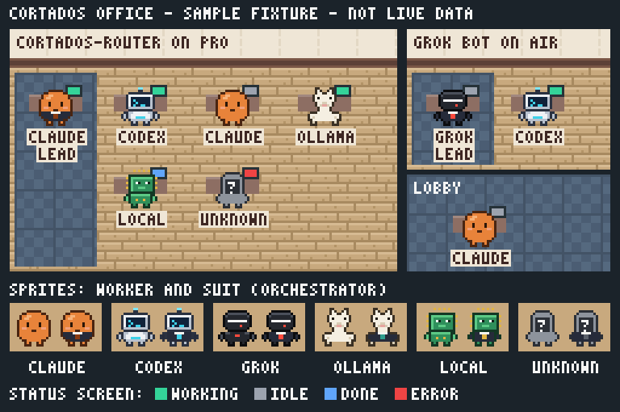

# CortadOS → Claw3D office adapter (steps 2–3, not deployed)

Node 22+ stdlib only. No npm install, Claw3D process, account creation, or Air
configuration is part of this folder's code; [DEPLOY.md](DEPLOY.md) is the (unrun)
runbook for the Air. See [PROTOCOL.md](PROTOCOL.md) for the researched Claw3D
protocol, how it renders people and floors, and the remaining gaps.

| File | What |
|---|---|
| `adapter.mjs` | office view → Claw3D gateway frames; sprite choice per person; polling |
| `bridge.mjs` | the WebSocket gateway Claw3D Studio's proxy connects to (loopback, auth, Origin, read-only) |
| `sprites.mjs` | original pixel art as text grids, PNG encoder, Claw3D 3D avatar profiles |
| `build-assets.mjs` | regenerates `assets/` and `assets/preview.png` from the fixture (`--write` / `--check`) |
| `assets/` | sprites, floor tiles, preview; origin and licence in `assets/NOTICE.md` |
| `claw3d/avatar-profile-hint.patch` | 6-line Claw3D change so the 3D figures wear the family suits |
| `claw3d/studio-login.cjs`, `claw3d/studio-login.patch` | login form for Studio's access cookie (`/cortados-login`) and its 3-line wiring |
| `gateway-check.mjs` | deploy-air.sh's end-to-end health probe: a `connect` through Studio's own proxy must get the bridge's hello |
| `DEPLOY.md`, `deploy-air.sh`, `deploy-lib.sh` | Air runbook, script (install / upgrade / tailnet publish) and its pure checks, written and **not run** |

## Test

```sh
node --test integrations/office-claw3d/                # Node 26 resolves the folder
node --test integrations/office-claw3d/*.test.mjs      # portable form (Node 22/24)
node integrations/office-claw3d/build-assets.mjs --check
```

## Appearance (issue #77)



Each person gets a sprite, as metadata only. The published `provider`/`lane` never change:

- **Worker**: by the provider it ran on (`claude`, `codex`/`openai` → codex robot, `grok`/`xai`
  → dark robot, `local`), else by its lane key (`claude#b`, `codex`, `local-*`). Otherwise
  it gets the grey `unknown` visitor. A worker's model never chooses its sprite.
- **Local lane**: by the node's backend, which office.py publishes per local worker as
  `local_backend` (`ollama` → the llama, `vllm-mlx` → the green chip `local`, any other value →
  `local`). The provider takes it from the node gate's own report. Only when `local_backend` is
  absent or null (an older provider, or a node whose gate never said) does a name-shape
  guess apply: the llama for an Ollama-shaped tag (`name:tag`, e.g. `qwen3:27b`) that does not
  name mlx, else `local`. Each agent's `office.localBackend` holds the published value (known
  values only, else null).
- **Orchestrator**: wears a suit, styled by its **model** (office v1 reports no provider or
  lane for it): `claude-*`/opus/sonnet/haiku/fable → claude, `gpt-*`/`codex*`/`o<N>` → codex,
  `grok*` → grok, an Ollama tag → ollama, qwen/llama/gemma/mistral/mlx… → local,
  anything else → unknown. A routed local main loop's `local_backend` makes the local/llama
  choice exact, as for workers. Its published provider stays `null`.

Each agent in `agents.list` carries `identity.avatarUrl` (the sprite as a 128 px PNG data
URL, which Claw3D's 2D panels show unmodified) and `identity.avatarProfile` (a Claw3D voxel
figure profile: family colour, a hoodie for workers, Claw3D's own jacket and pants as the
suit). Stock Claw3D ignores `avatarProfile`; the patch makes it use it.

## Intended runtime

Run as dedicated macOS user **_cortados-office**, separate from the provider and
Claw3D installation. Give that user only a dedicated **office:read** scoped client
token, never the provider owner token. Provider registration lives in
cortados_router/provider/clients.py; an owner provisions it separately.
Store token outside the repo in a file owned by that user, mode 0600. The adapter
rereads it each poll for rotation; never puts it in output or command arguments.
Do not expose the office token to the browser.

A local diagnostic transport (metadata JSONL stdout, not a WebSocket listener):

```sh
CORTADOS_OFFICE_TOKEN_FILE=/private/path/to/office-token \
CORTADOS_OFFICE_URL=http://127.0.0.1:8432/v1/cortados/office \
CORTADOS_OFFICE_POLL_SECONDS=5 \
node integrations/office-claw3d/adapter.mjs --stdio
```

This command is illustrative, **not run during development**. Poll interval 1–3600
seconds (default 5); ten-second request timeout, sequential polls, SIGINT/SIGTERM
cancellation. Remote providers require HTTPS, redirects are refused. Only GET of
the exact office endpoint is possible. Failures emit fixed diagnostics, retaining
the last successful snapshot, which may be stale. No prompts, commands, file
contents, source response bodies, token paths or exception text are logged.
Metadata stdout still deserves local-only access and should not be publicly logged.

The WebSocket host is `bridge.mjs` (stdlib, no `ws` dependency). It binds only
127.0.0.1/::1 and accepts an upgrade only from a loopback peer, on path `/`, with a
localhost Host and an allowlisted Origin (default `http://localhost:<port>`, which
Studio's proxy sends). The first frame must be `connect` carrying the local **bridge
secret** in `params.auth.token`. That secret is never the office token, and the bridge
refuses to start if they match. Frames are text only, masked, unfragmented and at most
64 KiB, with at most 8 clients, a rate cap and a 10 s connect deadline.

```sh
CORTADOS_OFFICE_TOKEN_FILE=/private/path/office-token \
CORTADOS_OFFICE_BRIDGE_TOKEN_FILE=/private/path/bridge-token \
node integrations/office-claw3d/bridge.mjs     # 127.0.0.1:18789; illustrative, not run here
```

Both token files must be 0600. Optional settings: `CORTADOS_OFFICE_BRIDGE_HOST` (127.0.0.1
or ::1), `_PORT`, `_ORIGINS` (comma list, `*` refused), `CORTADOS_OFFICE_URL`,
`CORTADOS_OFFICE_POLL_SECONDS`.

Methods: `connect`, `agents.list`, `sessions.list` and `status` serve the office roster.
Studio also calls `config.get`, `exec.approvals.get`, `agents.files.get`,
`sessions.preview`, `chat.history`, `models.list`, `skills.status` and `cron.list` while
it connects and hydrates. These get FIXED, empty answers: no transcript, file or config
is served. `config.get` says reload mode `off`, so Studio never tries `config.patch`.
Every other method (`chat.send`, `*.set`, `*.patch`, `agents.create`, `wake`, …) is
refused with `READ_ONLY`, and the hello advertises read methods only.
OfficeGateway(send) stays the transport seam: one gateway per authenticated
connection, and poll updates fan out through `OfficeHub`.

Stable IDs namespace orchestrators separately from workers, and named workers
separately from anonymous fingerprints. Duplicate identities reject the snapshot.
Nested records require a recognized status and typed projection metadata (nullable
strings, not arrays/objects); workers require run_id (nullable only in the lobby).
Malformed snapshots leave the previous roster and lifecycle state untouched.
The exported polling API reports fixed, credential-safe diagnostics to stderr by
default; callers may supply an onError function. Operational limits and their
local-policy rationale are documented beside their constants in adapter.mjs.
Lobby
records lacking run_id use a best-effort metadata fingerprint + ordinal: v1 hides
conversation IDs, so reordering anonymous records may recreate their characters.
Floors with absent orchestrators do not get fabricated people.
